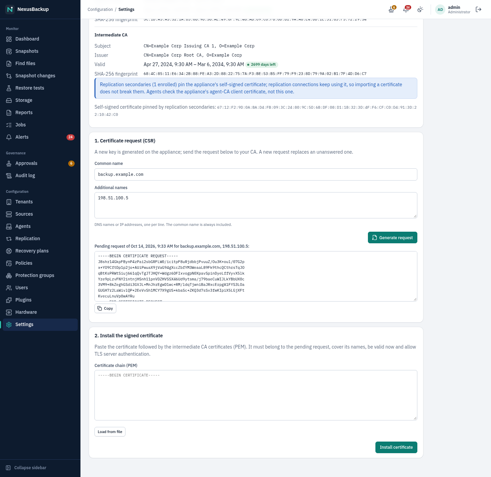
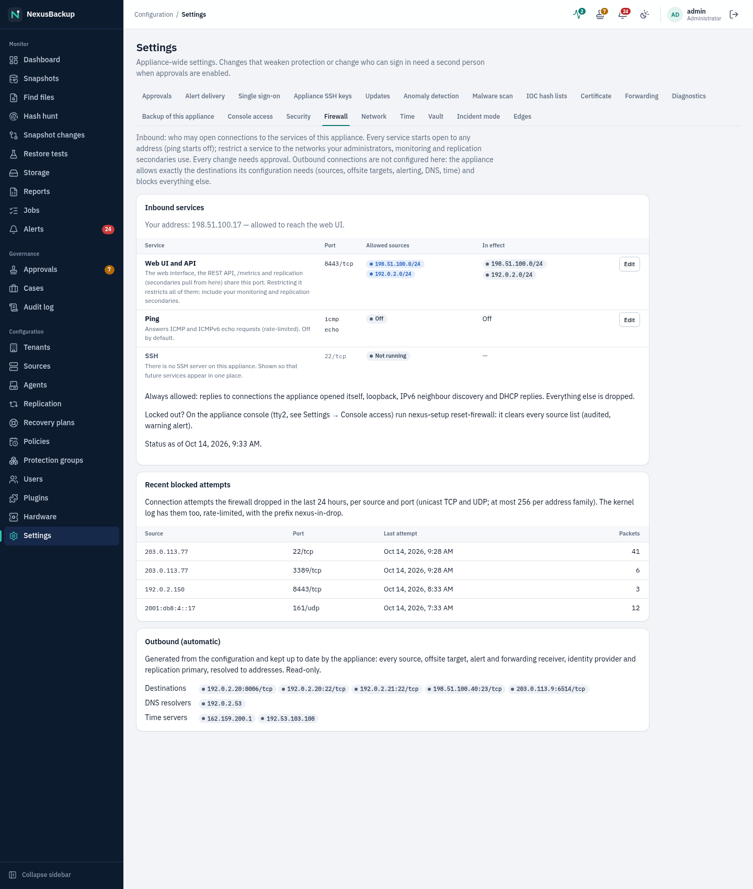
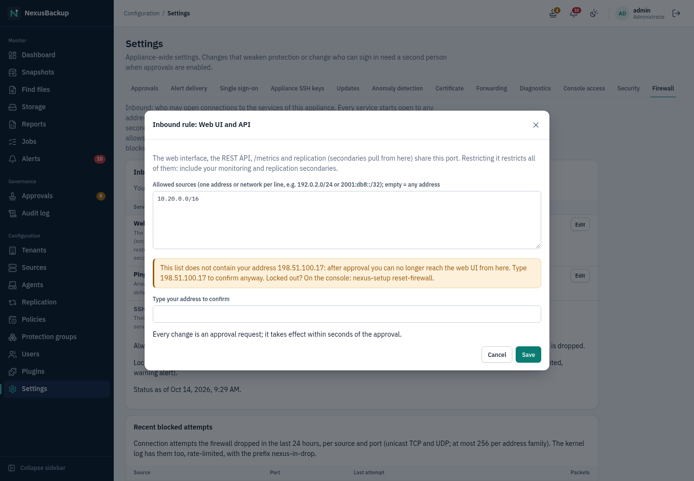
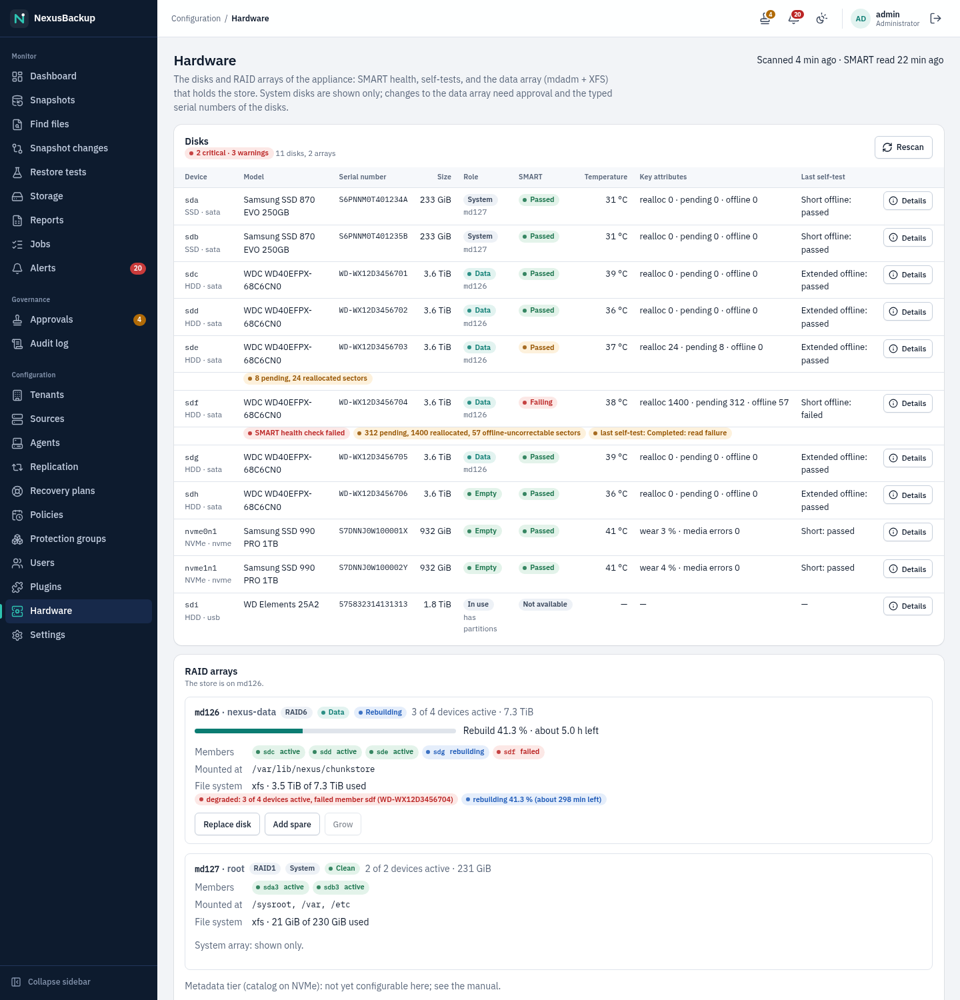

# 02 Installation and first boot

This chapter is for **administrators** who install the appliance and for the **security officer**, who must be
present at the console during first boot.

> **Status:** The appliance image and the first-boot wizard run end to end in the lab (a VM with SELinux
> enforcing). Release 0.0.1-alpha is published (signed image and installer ISO), but there is **no tested
> installation on physical hardware** yet. Of the disk layout of plan §12.2, the **data array** (RAID over the data
> disks, created in the web UI, see [Data disks](#data-disks)) is implemented and tested against fake tools; its run
> in the lab VM (`lab/appliance/disks.sh`) is pending. Mirrored system disks are set up by the installer only as far
> as the installer supports it, the NVMe metadata tier is a follow-up, and full-disk encryption with LUKS2 and TPM is
> **not implemented yet**. Treat this chapter as the procedure for test installations.

## Before you start

### Hardware sizing

The reference sizing (plan §3.2 and §12.3) covers 5 tenants with 1–2 TB of raw data each and full GFS retention:

| Component | Recommendation |
|---|---|
| CPU | 8–16 cores |
| RAM | 32–64 GB. NFS/SMB shares with about 1 million files need roughly 0.6–0.7 GB per such share during a backup (the file list is held in memory) |
| System disks | 2 small SSDs, mirrored (bootc image, A/B deployments) |
| Metadata | 2 NVMe drives (≥ 1 TB), mirrored |
| Data | for example 6 × 12 TB in RAID6: about 40 TB usable for 10 TB of raw source data after two years of GFS retention |
| Network | separate NICs for management, backup and offsite traffic (at least two) |
| Firmware | TPM 2.0 and Secure Boot capable (needed later for disk encryption) |

Plan for 30–40 % headroom. The appliance raises a warning alert when the store is more than 75 % full.

### What you need

- The installer ISO from the [GitHub release](https://github.com/undone37/NexusBackup/releases), written to a USB
  stick or mounted as virtual media (see below).
- A free IPv4 address on the management network (or DHCP), a host name, and DNS servers.
- Two people for first boot, if you want approvals (four-eyes principle) from the start: the **administrator** and
  a **security officer**, each with their own authenticator app (TOTP) on a phone or hardware token.
- Paper and pen, or an offline password safe, for the **recovery key**.

## Install the image

### From the installer ISO (recommended)

Each release has an installer ISO, `nexusbackup-<version>-x86_64.iso` (about 1.9 GB), with a `.sha256` file next to
it. It contains the signed appliance image, so installation needs no network.

1. Check the download: `sha256sum -c nexusbackup-<version>-x86_64.iso.sha256`.
2. Write it to a USB stick (`dd if=nexusbackup-….iso of=/dev/sdX bs=4M conv=fsync`, or any image writer), or attach
   it as virtual media (iDRAC/iLO, or a VM's CD drive). Boot in UEFI mode (legacy BIOS boot is untested).
3. Boot from it. The installer (Anaconda) asks only for the **installation destination**: pick the system disk.
   **Everything on that disk is erased.** Language, keyboard, time zone (UTC) and the locked root account are preset;
   accounts and the network are set up later by the first-boot wizard.
4. Start the installation (about 1–5 minutes), then reboot and remove the medium. The console shows the setup
   wizard (next section).

The installed appliance follows `ghcr.io/undone37/nexusbackup:stable` for updates. On its first update check it
switches to signature enforcement, so from then on it accepts only images signed with the release key (see
[13 Updates](13-updates.md)).

> **Status:** Tested in a UEFI virtual machine (QEMU, unattended install of the 0.0.1-alpha ISO, first boot into
> the wizard with SELinux enforcing: `lab/appliance/iso-test.sh`). Not yet tested on physical servers.

### From the container image (advanced)

Without the ISO, `bootc install to-disk` writes the image to a disk and makes it bootable:

```sh
podman build -f os/Containerfile -t localhost/nexus-os:dev .      # build (repository root as context)
# on the target machine, as root, booted from a live system that has podman:
podman run --rm --privileged --pid=host -v /dev:/dev -v /var/lib/containers:/var/lib/containers \
  --security-opt label=type:unconfined_t localhost/nexus-os:dev \
  bootc install to-disk --wipe --filesystem xfs \
  --enforce-container-sigpolicy --target-imgref ghcr.io/undone37/nexusbackup:stable /dev/sdX
```

`--target-imgref` names the image the appliance follows for updates. `--enforce-container-sigpolicy` makes the
appliance accept only signed updates from that repository right away.

> **Status:** `lab/appliance/build-disk.sh` runs exactly this `bootc install to-disk` onto a virtual disk in the lab
> (about 2 minutes, a 1.7 GB disk image).

The installed system has:

- a locked root account and **no SSH server**: emergency access is through the local console only, on tty2 with a
  one-time code or the recovery key (see [14 Disaster recovery](14-disaster-recovery.md#emergency-root-shell-on-the-console));
- SELinux enforcing; every service in its own user, systemd sandbox and SELinux domain;
- a firewall that blocks everything except the management port (see [Network and firewall](#network-and-firewall)).

## First boot: the `nexus-setup` wizard

On first boot the console (tty1) shows the setup wizard instead of a login prompt. It runs on every boot until
setup is complete. Progress is saved after each step, so if the machine reboots or you quit the wizard (`q`), it
continues where it stopped. The overview screen lists all steps; `r` redoes the network, an account or the
certificate.

Keys in forms: Tab or Up/Down moves between fields, Left/Right chooses an option, Enter continues, Esc goes back.

### Step 1: management network

1. Choose the network card that will carry the web interface. Only this network can reach the web UI (port 8443).
2. Choose **DHCP** or **static**. For static, enter the address with prefix (for example `192.0.2.10/24`), the
   gateway and the DNS servers (comma-separated).
3. Enter the host name (for example `backup.example.com`).

The wizard creates the NetworkManager profile `nexus-mgmt`. Only IPv4 is supported for now.

### Step 2: administrator account

1. Enter a user name and a password twice (at least 12 characters).
2. Scan the QR code shown on the console with your authenticator app (issuer `NexusBackup`, TOTP SHA-1, 6 digits,
   30 s), or type the secret shown below it.
3. Type the current 6-digit code. The account is created only when the code is correct.

### Step 3: second person (security officer)

The wizard recommends a **second person**: a security officer who approves destructive or weakening changes
(see [10 Approvals and audit](10-approvals-and-audit.md)). Choose one of:

- **now (recommended):** the security officer sits down at the console and sets their own user name, password
  (different from the administrator's name) and authenticator, exactly as in step 2. With two people, approvals
  start **enabled**.
- **later:** approvals start **disabled**. Every action still takes effect and is recorded in the audit log. You can
  add a second person in the web UI (**Users**) and enable approvals afterwards under **Settings → Approvals** (see
  [09 Users and access](09-users-and-access.md)).

### Step 4: key service and recovery key

The appliance now creates its master key (KEK). All tenant keys are wrapped with it.

1. Make sure nobody else can see the screen. Press Enter to create the key.
2. The **recovery key** appears once: 16 numbered groups of 4 hex digits (0–9, A–F). Write down all groups. Do not
   photograph it.
3. Type `YES` when you have written it down.
4. Re-enter the 3 randomly chosen groups the wizard asks for. If they do not match, new groups are chosen; Esc
   shows the key again (until it is confirmed).

After confirmation the key is removed from the screen and from memory. It is **never written to disk or to a
log**. The wizard then also sets the **boot menu password** (the GRUB password that protects the kernel command line,
see [14 Disaster recovery](14-disaster-recovery.md#boot-menu-password)). It is derived from the recovery key, so
there is nothing else to write down. If the wizard was interrupted after the key was created but before you confirmed it, the key cannot be shown
again: type it in full (64 hex digits, dashes optional) or reinstall the appliance (nothing has been encrypted yet).

### Step 5: TLS certificate

The wizard creates a self-signed certificate (ECDSA P-256, valid for 10 years) for the host name and the management
IP addresses, and shows its **SHA-256 fingerprint**. Write it down. You compare it when your browser warns about
the certificate on first sign-in. A secondary appliance for replication also needs it (see
[08 Replication](08-replication.md)). Later you can replace it in the browser with a certificate from your own CA
([Use your own certificate](#use-your-own-certificate)); the self-signed one stays in place for replication.

### Step 6: metrics token

The wizard creates `/etc/nexus/metrics-token`, the bearer token for the `/metrics` endpoint (see
[11 Alerts and monitoring](11-alerts-and-monitoring.md)). An existing token is kept.

### Step 7: finish

The summary shows the web address, the certificate fingerprint and whether approvals start enabled. Press Enter: the
wizard writes `/var/lib/nexus/setup-done` and starts the services (web API, scheduler, key service, replication
daemon). After that a second run of the wizard is refused.

### Changing the network later

Run this on the local console as root:

```sh
nexus-setup --force-reconfigure-network
```

It redoes only the network step, creates a **new self-signed TLS certificate** (the addresses in it change, so the
fingerprint changes too) and restarts the web API. Tell everybody who pinned the old fingerprint, for example the
secondary appliance of a replication. An imported certificate (next section) is not touched: if the new addresses are
not in it, generate a new request and import a new certificate.

## Store the recovery key

The recovery key is the only way to decrypt your backups if the appliance is lost. With the recovery key and the
offsite credentials you can restore on new hardware (see [14 Disaster recovery](14-disaster-recovery.md)).

- Keep at least two copies offline, in different safe places (for example a safe and a bank deposit box).
- Never store it on the appliance, in a ticket system, by e-mail or in the same place as the offsite credentials.
- Anyone with the recovery key **and** access to the offsite copy can read all tenants' data. Treat it like the
  master key of the building.
- The appliance cannot show it again. If you lose it while the appliance still works, your backups stay readable,
  but you lose the disaster-recovery path. There is no function to issue a new recovery key yet.
- Also protect the console of the machine itself: set a firmware (BIOS/UEFI, iDRAC/iLO) password and disable
  booting from other media. The appliance protects its own boot menu with a password, but not the firmware.

## First sign-in

Open `https://<host name or IP>:8443/` in a browser on the management network, for example
`https://backup.example.com:8443/`. The browser warns about the self-signed certificate: compare the fingerprint it
shows with the one you wrote down in step 5, then accept it.

Sign in with your user name, password and the current code from your authenticator app (under **or with an
appliance account**; the **Sign in with …** button appears only after single sign-on has been set up).


Next steps:

1. Create tenants and offsite targets: [07 Offsite](07-offsite.md).
2. Add sources: [04 Sources](04-sources.md).
3. Create policies and protection groups: [05 Policies and groups](05-policies-and-groups.md).
4. Create accounts for the other people: [09 Users and access](09-users-and-access.md).
5. Under **Settings**: set up alert delivery ([11 Alerts](11-alerts-and-monitoring.md#delivery-notification-rules))
   and, optionally, single sign-on ([09 Users and access](09-users-and-access.md#single-sign-on-oidc)).

## Use your own certificate

Browsers warn about the self-signed certificate. To get rid of the warning, have your CA (an internal company CA or
a public one) issue a certificate for the appliance. An administrator does this under **Settings → Certificate**; a
security officer can look at it.


1. **Generate a request.** Under **1. Certificate request (CSR)** check the common name (the host name people use in
   the browser) and the additional names (one per line: further DNS names and the IP addresses you use). The form is
   pre-filled with the names of the current certificate. **Generate request** creates a new private key **on the
   appliance**. The key never leaves it, not even into the web UI. Copy the request (PEM, `-----BEGIN CERTIFICATE
   REQUEST-----`) and give it to your CA.

   

2. **Install the answer.** Paste the issued certificate followed by the intermediate CA certificates (PEM; the root
   is optional), or load the file, and click **Install certificate**. The appliance checks before using it:
   - the certificate belongs to the key of the pending request;
   - the chain is in order (certificate, then each issuer) and every certificate is signed by the next one;
   - every certificate is valid today;
   - the names cover all names of the request (a wildcard like `*.example.com` covers one level);
   - the certificate allows TLS server authentication and is no CA certificate.

   If a check fails, the message says which one and nothing changes. If the root is not included, the appliance warns
   that clients must trust it already. New connections get the new certificate right away; the web API is not
   restarted.
3. **Revert.** **Back to the previous certificate** switches to the certificate installed before; with no previous
   one, **Back to self-signed** returns to the certificate from the setup wizard. Clicking it again undoes the revert.

What it does not change:

- **Replication** secondaries pin the fingerprint of the self-signed certificate. Replication connections keep
  getting the self-signed certificate, so an import does not break them, and you do not need to tell anybody a new
  fingerprint. The page shows the pinned fingerprint.
- **Agents** do not check this certificate: the appliance proves itself to agents with its agent-CA client
  certificate.

Each step is in the audit log (`tls.csr`, `tls.install`, `tls.revert`). The appliance warns 90, 30 and 7 days
before the certificate expires ([11 Alerts](11-alerts-and-monitoring.md#expiry-warnings)). Renewing works the same
way: generate a new request, install the new certificate.

> **Status:** there is no ACME (Let's Encrypt) client: the appliance has no inbound access from the internet and no
> default outbound access. Certificates are requested and installed by hand.

## Network and firewall

- **Inbound:** only the services in **Settings → Firewall**, each restricted to the source networks you set there
  (see [Inbound firewall](#inbound-firewall)). Out of the box that is TCP 8443 (web UI, REST API, `/metrics` and the
  replication endpoint) from any address; ping is off. Everything else is dropped, recorded (shown in **Settings →
  Firewall → Recent blocked attempts**) and logged rate-limited with the prefix `nexus-in-drop:`.
- **Outbound:** blocked by default and **not configurable**: the scheduler keeps an allow-list of every destination
  you configure (PVE API and node SSH, agents, TrueNAS, NFS/SMB servers, plugin endpoints, offsite targets,
  replication primaries, the alert webhook and SMTP relay, forwarding receivers, the identity provider). A small
  privileged helper (`nexus-nft-sync`) applies it to the firewall within seconds of a change, and every 30 minutes.
  DNS servers and the NTS time servers are allowed automatically. **Settings → Firewall → Outbound (automatic)** shows
  the current list. Blocked connections are logged with the prefix `nexus-out-drop:`.
- Extra static destinations can be listed by root on the console in `/etc/nexus/allowed-hosts`, one
  `host port [proto]` per line.
- The sources never connect to the appliance. The appliance connects to them (pull model).

> **Status:** `systemctl reload nftables` empties the allow-lists until the next sync (at most 30 minutes, or the next
> configuration change); the inbound rules start with the defaults (web UI from any address) until then. Outbound
> rules work with resolved IP addresses, which is fragile for endpoints behind rotating DNS (for example large S3
> providers or CDNs).

<a id="management-allow-list"></a>

### Inbound firewall



**Settings → Firewall** (administrators change, security officers read) lists the services the appliance listens on:

| Service | Port | Default | Note |
|---|---|---|---|
| Web UI and API | 8443/tcp | any address | also `/metrics` and replication: secondaries pull from this port. One TLS port, so the firewall cannot tell these apart: they are restricted together. Cannot be switched off. |
| Ping | ICMP / ICMPv6 echo request | off | rate-limited to 10 per second |
| SSH | 22/tcp | — | not running: there is no SSH server on the appliance. Listed so that future services appear in the same place. |

**Edit** opens the rule of a service: enter networks or addresses, one per line (`192.0.2.0/24`,
`2001:db8:10::/48`, `198.51.100.7`); an empty list means any address. Up to 64 entries; duplicates are merged and
host bits cleared (`192.0.2.77/24` becomes `192.0.2.0/24`). IPv4 and IPv6 are separate: a list with only IPv4
networks blocks all IPv6 clients. Connections that are already open are not cut.



- For the web service, include every place that needs the web UI or the API: administrators' and operators'
  networks, monitoring that scrapes `/metrics`, and the **secondary appliances of a replication**.
- Every change is an approval request (`firewall inbound`) while approvals are enabled; the row shows "approval
  pending" until it is decided. After the approval the scheduler writes the rule into the firewall file and
  `nexus-nft-sync` loads it within seconds. The column **In effect** shows what the firewall holds now (refreshed
  every minute).
- The page shows your own address. A web list that does not contain it is refused unless you type your address to
  confirm that you will lose access from here.
- Always allowed, whatever the rules: replies to connections the appliance opened itself, loopback, IPv6 neighbour
  discovery and DHCP replies.
- **Recent blocked attempts** lists, per source address and port, the connection attempts the firewall dropped in
  the last 24 hours (unicast TCP and UDP, at most 256 per address family) with the time of the last one and a packet
  count.

The Phase 14 management allow-list (**Settings → Security**) is now the web service's rule: an existing list is
taken over unchanged, and `PUT /settings/mgmt-allow` still works (it requests a change of the web rule).

**Locked out?** On the local console, as root:

```sh
nexus-setup reset-firewall
```

clears every service's source list (any address again; ping stays on or off) and loads the firewall at once. It is
audited (`firewall.reset`, actor `console`) and raises the warning alert `firewall_reset`. Then set correct lists in
the web interface. The old name `nexus-setup reset-mgmt-allow` does the same.

> **Status:** The inbound rules are tested in the API, the scheduler, the firewall-set generator and the console reset;
> the nftables rules and the status reader were checked with `nft` 1.1.5 in the appliance image's userland. A run
> on the appliance (lab step `firewall` of `lab/e2e/m5-api.sh`) is pending. The console commands need a root shell
> on the console (see [Known gaps after installation](#known-gaps-after-installation)).

## Data disks

Until you create a data array, the backups (the chunk store, `/var/lib/nexus/chunkstore`) live on the system disk.
On hardware with separate data disks, create the **data array** right after first boot, **before the first backup**:
the appliance builds it only while the store is empty.

**Configuration → Hardware** lists every disk with its model, serial number, size, type, role and SMART health,
and the RAID arrays with their state:



| Role | Meaning |
|---|---|
| **System** | holds the operating system (a mounted file system or swap, or the system mirror): shown only, never changed here |
| **Data** / **Metadata** | member of the data array (`nexus-data`) / the metadata array (`nexus-metadata`) |
| **In use** | has partitions, a file system or RAID signature, or belongs to another array: the appliance does not touch it |
| **Empty** | no partitions and no signatures: can become part of an array, a spare or a replacement |

To create the data array (administrator):

1. Click **Create data array**, choose the RAID level and tick the empty disks. **RAID6** (at least 4 disks; two
   may fail) is the recommendation for the data tier; RAID5 (3+), RAID10 (4+, an even number) and RAID1 (2) are
   offered too. The dialog shows the usable capacity.
2. Type the **serial numbers** of all selected disks into the confirmation field. They are printed on the disks and
   shown in the table; typing them makes sure the right disks are overwritten.
3. Submit. The request needs **approval** by a second person (another administrator or a security officer), like
   every other destructive change ([10 Approvals and audit](10-approvals-and-audit.md)).
4. After approval the appliance checks again that the disks are empty and the store holds no files, then creates
   the array (mdadm, metadata 1.2, internal write-intent bitmap), formats it with XFS, stops the scheduler and the
   replication service, mounts the array as the store with a mount unit that survives OS updates, and starts them
   again. The initial synchronisation runs in the background (the array shows **resyncing** with its progress);
   backups can start at once. **Recent operations** on the page shows the outcome; it is recorded in the audit log
   (`disks.create_array`, `hardware.op`).

**Afterwards:**

- **Add spare** adds an empty disk as a hot spare: it takes over automatically when a member fails.
- **Replace disk** swaps a failed member for an empty disk (see
  [15 Troubleshooting](15-troubleshooting-faq.md#replacing-a-disk)). A working member with SMART warnings can be
  replaced the same way: it is copied to the new disk first and stays in the array until the copy is complete.
- **Grow** adds one disk to a RAID5 or RAID6 array. The reshape takes hours and runs in the background; the file
  system grows when it has finished.
- **Run short / long self-test** in a disk's **Details** starts a SMART self-test (administrators, audited); the disk
  stays in use. The result appears under **Last self-test** after the next scan.

All of these need the typed serial number of the new disk and approval. The appliance never changes system disks,
disks with partitions or signatures, or arrays it did not create.

> **Status:** Implemented in the web UI, the API, the scheduler (alerts) and the root helper `nexus-disks` with its
> SELinux domain; the helper's logic is tested against recorded tool output. The lab run in a VM with extra disks
> (`lab/appliance/disks.sh`) is pending.
>
> **Not supported:** moving an existing store onto a new array (create the array before the first backup), the
> **metadata tier** (catalog on an NVMe mirror; NVMe disks are shown and monitored, but the catalog stays on the
> system disk), shrinking an array or changing its RAID level.

## Known gaps after installation

These are open production items (see `state.md`, "Production gaps"):

- **Console root shell:** several maintenance tasks in this manual (update rollback and maintenance window, network
  change, SSH key files, disaster recovery, the break-glass reset of a locked-out administrator) need a root shell on
  the local console. The root password stays locked; the shell opens on **tty2** with a one-time code that a second
  person approved, or with the recovery key, for at most 8 hours, audited and alerted (see
  [14 Disaster recovery](14-disaster-recovery.md#emergency-root-shell-on-the-console)). Remaining gap: the procedure
  has not been used on real hardware yet (see the status note there).

- **SSH keys for Proxmox VE nodes:** **Settings → Appliance SSH keys** shows and rotates the appliance's keys, but
  its appliance-side part is still being integrated, so the appliance does not create its own key pair yet. The PVE
  source refers to a private key file and a `known_hosts` file under `/etc/nexus/ssh/` on the appliance (for example
  `/etc/nexus/ssh/pve.key`). These files must be placed there by root on the console (owner `nexus-chunkstore`, mode
  0600). For TrueNAS sources the key is entered in the web UI instead (see [04 Sources](04-sources.md)).
- **SFTP keys for the Storage Box** are also files on the appliance; the web UI only takes the path.
- **Appliance configuration backup:** the catalog (users, sources, policies) and the keys `totp.key` and
  `secrets.key` are not backed up automatically (see [14 Disaster recovery](14-disaster-recovery.md)).
- **Disk encryption:** LUKS2 with TPM unlock is deferred. Backup data is always encrypted per chunk, but the master
  key file (`kek.local`) is protected only by file permissions and SELinux, not by a TPM.
- **Certificate renewal** for agents and TrueNAS pins is not automated. The appliance warns before agent,
  replication and web certificates expire ([11 Alerts](11-alerts-and-monitoring.md#expiry-warnings)).
