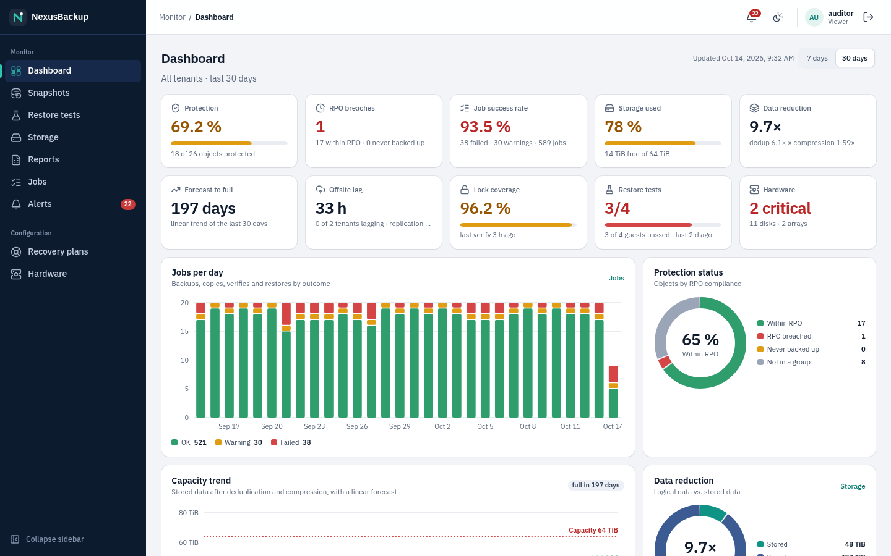
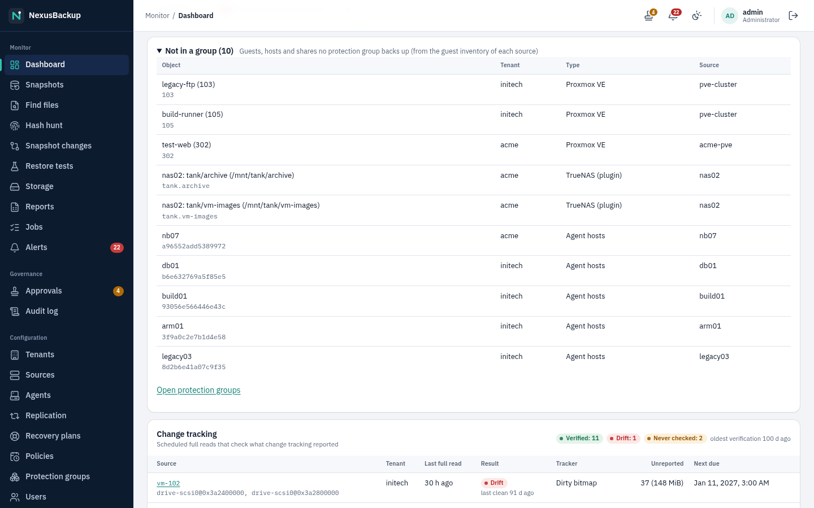
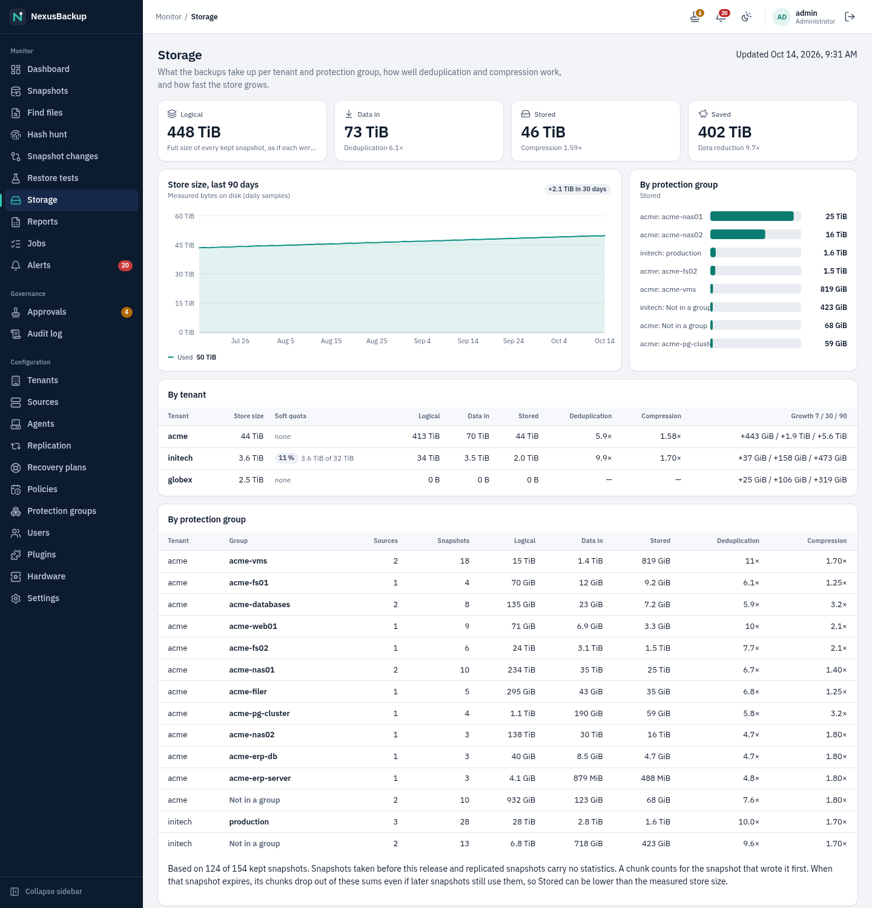
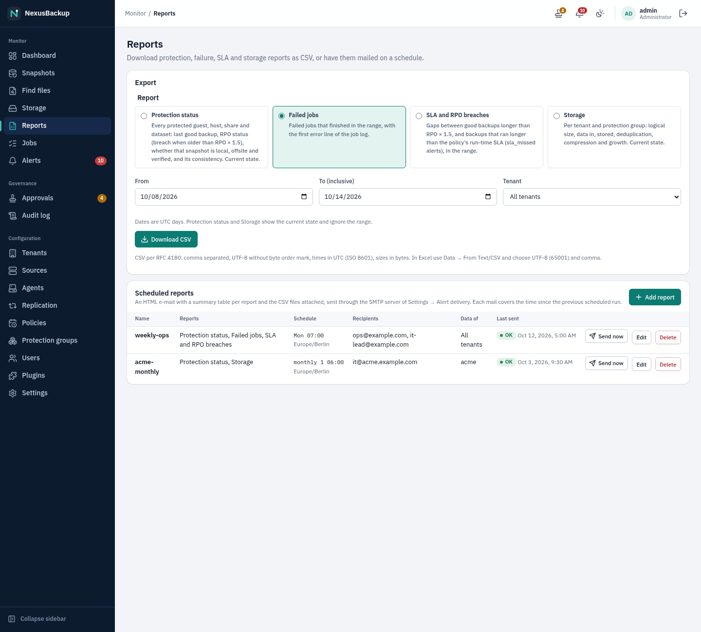
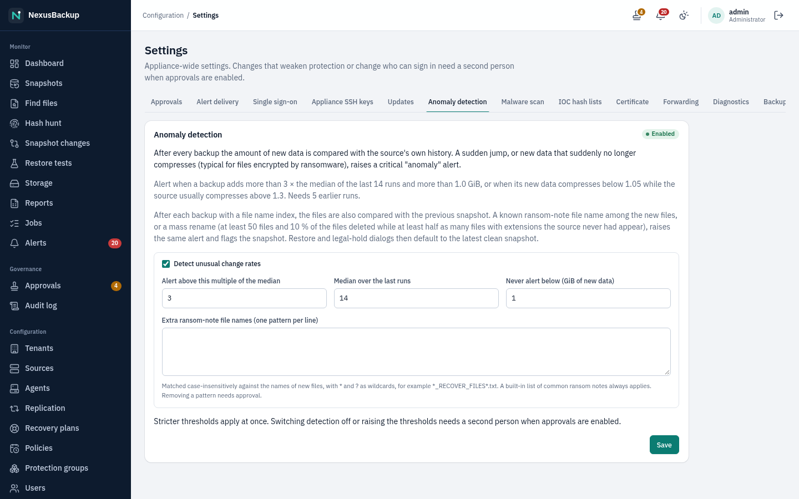
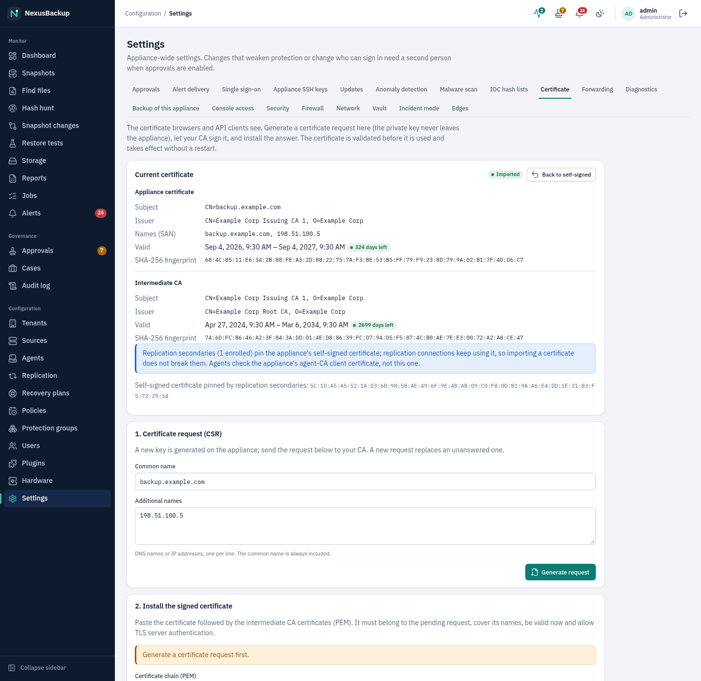
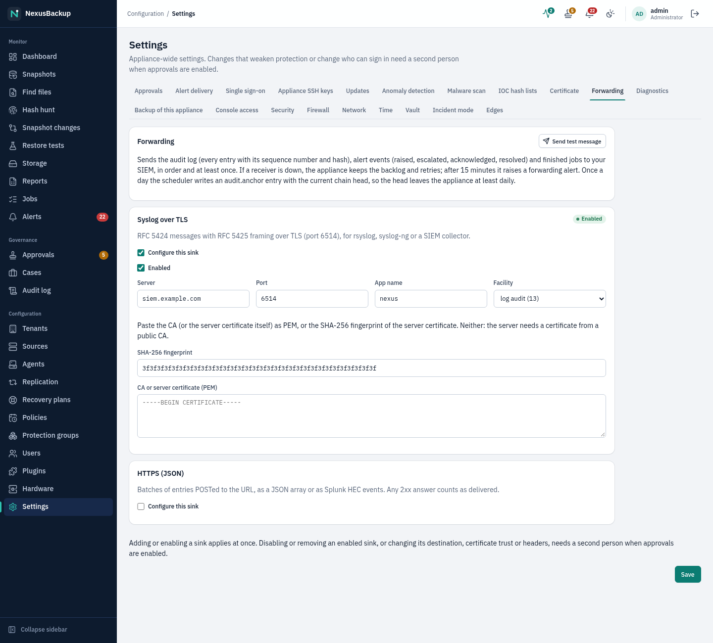
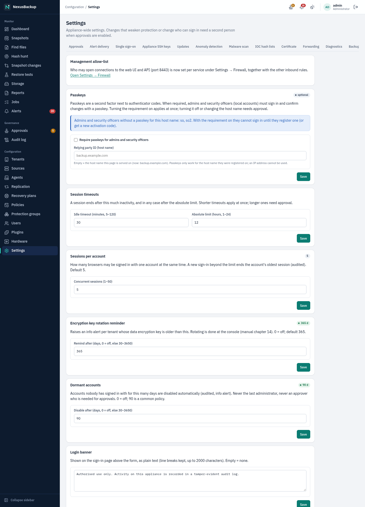

# 03 The web interface

This chapter walks through every page of the web interface. Task-oriented details are in the chapters linked from
each section.

The screenshots show a fictional demo appliance (tenants **acme**, **initech** and **globex**). Your pages show your
own data.

> **Status:** The web interface was redesigned in this release (new layout, dark mode, KPI dashboard, **Settings**
> page, single sign-on). The new pages were tested against the demo backend. The appliance-side parts of the KPI
> dashboard, single sign-on, alert delivery, appliance SSH keys, updates and break-glass recovery are still being
> integrated; until an appliance runs them, those pages show an error or no data there. The **Storage** page and the
> dashboard's deduplication and compression factors need backups taken with this release (earlier ones carry no
> statistics).

## Signing in

Open `https://<appliance>:8443/` in a browser. The certificate is the self-signed one created during setup; compare
its fingerprint with the one the setup wizard showed (see [02 Installation](02-installation.md)).

The sign-in page has two ways in:

- **Sign in with <identity provider>** (for example **Sign in with Keycloak**): shown only when an administrator has
  set up single sign-on. Your browser goes to your organization's identity provider, which checks your password and
  second factor, and then comes back signed in. See
  [09 Users and access](09-users-and-access.md#single-sign-on-oidc).
- **or with an appliance account**: enter your **User name**, **Password** and the 6-digit **Authenticator code**
  from your authenticator app, then click **Sign in**.

For appliance accounts:

- Each code can be used only once. If a sign-in fails right after a successful one, wait for the next code.
- After 5 failed attempts within 15 minutes, the account (and the address you sign in from) is locked for 15
  minutes. Failed sign-ins are recorded in the audit log.
- New accounts are activated with an activation code through **Activate account** below the form; see
  [09 Users and access](09-users-and-access.md#activating-your-account).

A session ends after 30 minutes without activity and after 12 hours at the latest (an administrator can change both
in **Settings → Security**). You then see "Your session has expired. Please sign in again." An account with an end
date cannot sign in from that day on. If single sign-on fails, the sign-in page shows the reason in a red box; see
[15 Troubleshooting](15-troubleshooting-faq.md#single-sign-on).

If the administrators set a **login banner** (for example a legal notice), it appears in a blue box above the form.

## Layout

**Sidebar (left).** The pages in three groups:

| Group | Pages |
|---|---|
| **Monitor** | Dashboard, Snapshots, Find files, Storage, Reports, Jobs, Alerts |
| **Governance** | Approvals, Audit log |
| **Configuration** | Tenants, Sources, Agents, Replication, Policies, Protection groups, Users, Plugins, Hardware, Settings |

**Alerts** and **Approvals** carry a counter: open alerts (red when one of them is critical, amber otherwise) and
pending approval requests. **Collapse sidebar** at the bottom shrinks the sidebar to an icon rail; hover an icon to
see its name. The browser remembers the choice. In a narrow window (below about 900 px, e.g. a phone) the sidebar is
hidden; open it with the **Menu** button at the top left.

**Top bar.** From left to right:

- the breadcrumb: group and page, e.g. **Monitor / Dashboard**;
- the **Approvals** button (stamp icon) with the number of pending requests, for roles that see approvals;
- the **Alerts** button (bell icon) with the number of open alerts, for roles that see alerts;
- the **theme** button (see below);
- your user name and role, and for tenant-scoped accounts your tenant (e.g. "Tenant user · acme"). Click it to
  open **My account** with your sessions and API tokens ([09 Users and access](09-users-and-access.md#your-sessions-my-account),
  [API tokens](09-users-and-access.md#api-tokens));
- **Sign out** (arrow icon).

**Theme (light / dark).** By default the interface follows your operating system's light or dark setting. The theme
button cycles through **Theme: follow the system** → **Theme: light** → **Theme: dark** → back to following the
system; its tooltip tells you the current choice and the next one. The choice is stored in this browser only.

Keyboard users: the first Tab stop is **Skip to content**.

## Navigation and roles

The sidebar shows only what your role may use. The server checks every request again; hiding is a convenience.

| Page | Administrator | Security officer | Operator | Tenant user | Viewer |
|---|---|---|---|---|---|
| Dashboard, Snapshots, Storage, Reports (CSV downloads), Jobs | ✓ | ✓ | ✓ | ✓ (own tenant) | read (its scope) |
| Find files | ✓ | — | ✓ | ✓ (own tenant) | — |
| Reports: scheduled reports | ✓ | read | — | — | — |
| Alerts | ✓ | ✓ | ✓ | — | read (without a tenant) |
| Approvals | ✓ | ✓ (decides) | ✓ (read) | — | — |
| Audit log | ✓ | ✓ | — | — | — |
| Tenants, Sources, Agents, Policies, Protection groups, Users | ✓ | — | — | — | — |
| Replication, Plugins | ✓ | read | read | — | — |
| Hardware | ✓ (changes need approval) | read | read, **Rescan** | — | read (without a tenant) |
| Settings | ✓ (all tabs) | read (all tabs) | read (Approvals, Appliance SSH keys, Updates) | — | — |
| My account | ✓ | ✓ | ✓ | ✓ | ✓ |

Accounts limited to one tenant (any role with a tenant set) see only that tenant's data and do not see the Alerts,
Approvals, Replication and Settings pages. A security officer can see snapshots but cannot start restores. A viewer
sees the same pages as a tenant user (or, without a tenant, all tenants and the alerts) but has no buttons that start
or change anything: no **Back up now**, no restores, no file browsing or downloads, no acknowledging alerts.

## Dashboard

The Dashboard answers two questions at a glance: *is everything protected?* and *is the appliance healthy?* The top
part shows key figures (KPIs) and charts; below them is the per-guest **Protection status** table.

The header shows when the figures were computed (**Updated …**) and what they cover: **All tenants**, or your tenant
for tenant-scoped accounts. **7 days** / **30 days** switches the period of the job figures and charts (remembered
for the browser session). The key figures refresh every minute, the table below every 30 seconds.

### Terms used on the dashboard

- **Object**: one protected unit: a Proxmox VE VM or container, an agent host, a TrueNAS dataset, an NFS/SMB share,
  or a plugin guest or source (e.g. a PostgreSQL database or a Microsoft 365 mailbox).
- **RPO** (recovery point objective): how much data you may lose at most. The dashboard takes it from the object's
  policy schedule: **daily** = 24 h, **hourly** = 1 h, **every N hours** = N h, weekdays = the longest gap between
  two run days, **monthly** = 31 days (see [05](05-policies-and-groups.md#schedules)).
- **Within RPO**: the last good (successful) backup is no older than **1.5 × the RPO**, e.g. 36 h for a daily
  policy, 90 minutes for an hourly one. The half period is slack for a long or delayed backup.
- **RPO breached**: the last good backup is older than 1.5 × the RPO.
- **Paused**: behind the RPO, but every group of the object is paused or its source is in maintenance. Not counted as
  a breach (see [05](05-policies-and-groups.md#pausing-a-group)).
- **Never backed up**: the object is in a protection group but has no successful backup yet.
- **Not in a group**: the appliance knows the object (a guest in the inventory of a source, e.g. a VM on a connected
  Proxmox VE cluster or a database of a PostgreSQL source; an enrolled agent; an NFS/SMB source) but no protection
  group covers it. Nothing backs it up. Guests a group excludes count here too.

Storage figures (here and on the [Storage](#storage) page) use four terms:

- **Logical**: the full size of every kept snapshot, as if each were a complete copy. Ten daily snapshots of a 100 GiB
  VM are 1 TiB logical.
- **Data in**: the new, unique data the backups added to the store, before compression. Data that another snapshot
  (of any source of the tenant) already stored is not counted again.
- **Stored**: what that new data takes up on disk after compression and encryption.
- **Saved**: Logical minus Stored.

**Deduplication** = Logical ÷ Data in, **Compression** = Data in ÷ Stored; their product is the data reduction of the
measured backups.

### Key figures

| Tile | What it shows | Act when |
|---|---|---|
| **Protection** | share of all known objects that are protected, "16 of 19 objects protected" | below 100 % (amber): objects are not in a group; add them or decide consciously not to back them up |
| **RPO breaches** | number of objects whose last good backup is older than 1.5 × RPO; below: how many are within RPO and how many were **never backed up** | red: any breach; amber: objects never backed up. See **Objects needing attention** |
| **Job success rate** | share of jobs in the period that finished OK; below: failed jobs, warnings, total. Click it to see the failed jobs | below 95 % (red), any failure (amber) |
| **Storage used** | how full the local chunk store is; below: free and total space | above 75 % (amber; the `capacity` alert fires), above 90 % (red) |
| **Data reduction** | logical data ÷ the measured store size, e.g. **4.2×** = 4.2 TiB of backed-up data need 1 TiB of disk; below: the **Deduplication** and **Compression** factors from the backup statistics (see the terms above; their product can differ a little from the tile, which uses the measured store size) | a sudden drop: new data that does not deduplicate (e.g. encrypted or compressed files); the `anomaly` alert watches this per source |
| **Forecast to full** | days until the store is full if it keeps growing like in the last 30 days (a straight line through the daily usage, the "linear trend"); **Not growing** when usage is flat or falling, or fewer than 7 days of samples exist; **> 2 years** for very long horizons | below 90 days (amber), below 30 days (red): add storage or review retention |
| **Offsite lag** | how far the offsite copy of the most-behind tenant trails; below: how many tenants with an offsite target are lagging, and the replication lag. "no offsite copies" when no tenant has an offsite target. Click it to open **Replication** | any lagging tenant (amber); see the `offsite_lag` alert |
| **Lock coverage** | share of snapshots under an immutable retention lock; below: the last verification and failed verifications | below 100 % (amber), any failed verification (red) |

The figures are computed on the appliance from its catalog. A tile shows "—" when a value is unknown (for example a
data reduction factor before the first backup).

### Charts

- **Jobs per day**: one stacked bar per day: backups, copies, verifies and restores, split into **OK** (green),
  **Warning** (amber) and **Failed** (red). The legend sums up the period. **Jobs** opens the job list.
- **Protection status**: a ring of all objects by RPO compliance: **Within RPO**, **RPO breached**, **Never backed
  up**, **Not in a group**. The centre shows the share within RPO.
- **Capacity trend**: stored data per day (after deduplication and compression), the linear forecast as a dashed line
  and the store's capacity as a dotted red line. The chip at the top right ("full in 197 days") repeats the forecast.
- **Data reduction**: a ring of **Stored** against **Saved** space, with the **Logical** size and the
  **Deduplication** and **Compression** factors below it. **Storage** opens the [Storage](#storage) page.
- **Failures by source type**: failed jobs in the period per source type (Proxmox VE, SMB shares, TrueNAS, agent
  hosts, plugins by name, …). Shows where problems cluster.
- **Objects needing attention**: up to 10 objects with an RPO breach or that were never backed up, worst first:
  **Object**, **Tenant**, **Type**, **Last good backup**, **RPO** and the **SLA** chip (**Breached** or **Never**).
  "Every object is within its RPO." when there is nothing to do.
- **Not in a group (N)**: shown when something is unprotected. Click it to open the list: **Object** (name and guest
  ID), **Tenant**, **Type** and **Source**. **Open protection groups** leads to the groups, where an
  [auto-protect group](05-policies-and-groups.md#auto-protect-all-guests-or-guests-by-tag) can cover them for good.

Hover over a bar or ring segment to see its value. Screen readers get each chart as a table.

If the key figures cannot be loaded, a banner says so; the table below still works.

### Protection status table, failed jobs, open alerts

**Protection status** lists every protection group with one row per guest (VM, container, host, dataset, share,
database). The columns show the time of the last backup, whether the newest copies are **Local**, **Offsite** and
**Verified**, and the **Consistency** of the newest snapshot (**application**, **crash**, **inconsistent** or
**unknown**, see [06 Restores](06-restores.md#consistency)). **Offsite** shows *n/a* when the group's policy does not copy offsite. **Status** is **Protected**,
**RPO breached**, **Paused** (the group is paused or its source in maintenance) or **No backup**; **RPO breached** means the newest
snapshot is older than 1.5 × the policy period (36 hours for daily, 90 minutes for hourly policies; the same rule as the RPO KPIs). Administrators and operators can start a backup with **Back up now**:
the whole group, selected guests or the guests that failed in the last run (see
[05](05-policies-and-groups.md#back-up-now)).

Below the table are the most recent **Failed jobs** (last 7 days) and **Open alerts**.

When approvals are disabled although two or more people could approve, administrators see a banner recommending to
enable them, with a link **Open approval settings**. **Dismiss** hides it for the current browser session.

## Storage

**Monitor → Storage** shows what the backups take up, per tenant and per protection group (terms: see
[Terms used on the dashboard](#terms-used-on-the-dashboard)). Tenant-scoped accounts see their tenant only.

- The tiles at the top sum up **Logical**, **Data in** (with the deduplication factor), **Stored** (with the
  compression factor) and **Saved** (with the total data reduction).
- **Store size, last 90 days**: the measured size of the store per day; the chip shows the growth over 30 days (hover
  for 7 and 90 days).
- **By protection group** (chart): the groups that store the most.
- **By tenant**: **Store size** (measured once a day), the **Soft quota** (share used, amber from 80 %, red from
  100 %; set on **Tenants**), Logical, Data in, Stored, the two factors and the growth over 7, 30 and 90 days.
- **By protection group** (table): the same per group. Snapshots of sources that are in no group (any more) are
  summed up as **Not in a group**. A source in several groups counts for the first one.

How the figures are obtained: every backup reports how much it read, the snapshot's logical size and the new data it
wrote (plain and stored). The page sums these up for the snapshots that are still kept. Two limits:

- A chunk counts for the snapshot that wrote it first. When that snapshot expires, its chunks drop out of the sums
  even if later snapshots still use them. Stored can therefore be lower than the measured **Store size**, and the
  factors lean high on old data; the store size is always measured.
- Snapshots taken before this release and replicated snapshots carry no statistics. The note below the table says how
  many of the kept snapshots are covered.

**Soft quotas**: administrators set a tenant's quota in GiB on **Tenants** (**Edit**, **Soft storage quota**). The
appliance raises a `quota` warning at 80 % and a critical alert at 100 % of the measured store size (see
[11 Alerts and monitoring](11-alerts-and-monitoring.md#alert-kinds)). A quota never stops a backup; it applies
without approval.

## Reports

**Monitor → Reports** exports four reports as CSV files and, for administrators, mails them on a schedule
(see [11 Alerts and monitoring](11-alerts-and-monitoring.md#scheduled-reports)).

| Report | Content | Time range |
|---|---|---|
| **Protection status** | one row per protected guest, host, share, dataset and plugin guest: its groups, RPO, last good backup and its age, status (`ok`, `breach` = older than RPO × 1.5, `never`, `paused`), whether that snapshot is kept locally, copied offsite and verified (time), and its consistency (`application`, `crash`, `inconsistent`, `unknown`; snapshots from before this version show the
older `consistent` flag as `crash` / `inconsistent`) | current state |
| **Failed jobs** | every job that failed in the range: job number, tenant, kind, what it worked on (group, source, agent, guest), times, attempt and the first error line of its log | from – to |
| **SLA and RPO breaches** | `rpo_breach` rows: the periods in which an object had no good backup for longer than RPO × 1.5 (start, end or empty while it lasts, hours, limit); `sla_missed` rows: backups that ran longer than their policy's run-time SLA | from – to |
| **Storage** | one row per tenant and per protection group: snapshots, logical size, data in, stored, saved (bytes), deduplication, compression, data reduction, measured store size, soft quota and growth over 7 / 30 / 90 days (tenant rows) | current state |

1. Choose the report.
2. For **Failed jobs** and **SLA and RPO breaches**, set **From** and **To** (whole UTC days, **To** included; at most
   400 days). Without dates the last 7 days are used.
3. Accounts that see all tenants can limit the report to one **Tenant**. Tenant-scoped accounts always get their own
   tenant only.
4. **Download CSV**. Every download is recorded in the audit log (`report.export`, with report, range, tenant and
   number of rows).

The CSV format follows RFC 4180: comma separated, a header line, fields with commas, quotes or line breaks in double
quotes, UTF-8 without a byte order mark, times in UTC as ISO 8601 (`2026-10-12T07:00:00Z`), sizes in bytes.
Text that starts with `=`, `+`, `-` or `@` gets a leading `'` so spreadsheets do not run it as a formula.
**Excel**: open it with **Data → From Text/CSV**, choose **65001: Unicode (UTF-8)** and the comma as delimiter
(double-clicking the file may show umlauts wrongly and split by semicolons in some locales). LibreOffice asks for the
character set and delimiter when opening the file.

How the SLA report finds the gaps: it takes the times of the object's snapshots in the catalog plus the snapshots
that successful backup jobs recorded, so snapshots removed by retention do not show up as gaps. A pause is only known
for the current state: an object paused now has no open breach, earlier gaps count regardless.

**Scheduled reports** (below the export; administrators change them, security officers can see them) are described in
[11 Alerts and monitoring](11-alerts-and-monitoring.md#scheduled-reports).

> **Status:** The reports and the scheduled mails are new in this release. They are covered by the catalog, API and
> scheduler tests (including the mail composition against a local SMTP stub) and were tried in the web interface
> against the demo backend. They have not yet been run on an installed appliance in the VM labs.

## Snapshots

One row per snapshot, newest first. Filter by **Tenant** and by **Guest (e.g. vm-100)**, then click **Filter**.

Snapshot names tell you what was backed up:

| Name | Content |
|---|---|
| `vm-<id>` / `ct-<id>` | Proxmox VE VM / container |
| `host-<agent id>` | Linux or Windows host (agent); the agent's name is shown below |
| `nas-<source id>-<pool.dataset>` | TrueNAS dataset (built-in connector) |
| `share-<source id>` | NFS or SMB share; the source name is shown below |
| `plugin-<plugin>-<source id>[-<guest>]` | plugin source, e.g. a PostgreSQL database |

**Size** is the logical size of the snapshot. **Local**, **Offsite** and **Verified** show where copies exist and
whether the local copy passed verification. **Locked until** is the retention lock (— when it has expired).
**Consistency** is the snapshot's consistency level; hover over the badge for its meaning (see
[06 Restores](06-restores.md#consistency)). Snapshots received from another appliance carry a **Replicated from …**
label.

**Restore several** (top right) restores many VMs and containers of one tenant in one step, see
[06 Restores](06-restores.md#restore-several-guests-at-once).

Each row has two controls (not for security officers, who cannot restore):

- **Browse files** opens the file browser. Plugins can give it their own name, e.g. **Download (tar/zip)**.
- **Restore** opens a menu with the restores that fit this snapshot:

| Snapshot | Restore menu |
|---|---|
| `vm-` | **Full restore to a new VM / container**, **Instant recover**, **Restore files to a host…** |
| `ct-` | **Full restore to a new VM / container**, **Restore files to a host…** |
| `host-` | **Restore to path** |
| `plugin-…` | the plugin's restores that apply to this kind of snapshot, e.g. **Restore database dump to a server** only on database snapshots and **Point-in-time restore** only on cluster snapshots of PostgreSQL; **Restore to a host…** for plugins with a download |
| `nas-`, `share-` | **Restore to a host…** |

Administrators also see **Delete** on snapshots whose retention lock has expired, that have a local copy and that were
not replicated from another appliance (see [06 Restores](06-restores.md#deleting-a-snapshot)).

See [06 Restores](06-restores.md).

## Files

**Browse files** opens the file browser for one snapshot. Click directories to open them, use the breadcrumb or
**.. (Up one level)** to go back. Select files and directories with the check boxes, choose **tar** or **zip** and click
**Prepare download**. When the archive is ready, a **Download** button appears. Details:
[06 Restores](06-restores.md#browse-files-and-download-them-tar-or-zip).

Reading a VM's file systems starts an isolated restore micro-VM in the background, so the first listing of a VM
snapshot takes a few seconds.

## Find files

**Find files** (also linked from the Snapshots page) searches file and folder names across all snapshots of a tenant:
a name or pattern (`*`, `?`, `[a-z]`), optionally one guest and a date range. Each result row is one version of a file
(same path, size and modification time) with the snapshots that hold it; pick a snapshot and click **Open** (file
browser at that folder), **Download** or, for host snapshots, **Restore…**. Details:
[06 Restores](06-restores.md#find-a-file).

## Jobs

All jobs, newest first (the 100 most recent). Filter by **State** and **Kind**. The list refreshes every 4 seconds
while jobs are queued or running. Click a job number to see its details.

The job page shows kind, state, tenant, who requested it (`scheduler` for scheduled work), the times and the
parameters. While the job runs, the log refreshes every 2 seconds (**Live — refreshing every 2 s**).

- Administrators and operators can cancel a queued or running job (**Cancel** in the list, **Cancel job** on the
  job page). A queued job is cancelled at once. For a running job the scheduler stops the connector (SIGTERM, then
  SIGKILL after 30 seconds) and, for a Proxmox VE backup or restore, the running PVE task; the job ends
  **cancelled**, and "Cancellation requested by …" is shown meanwhile. A backup cancelled half-way leaves no
  snapshot: a snapshot only exists once its manifest is written as the very last step, and the chunks it had
  already stored are removed by the next garbage collection. Steps that run inside the appliance (retention, GC,
  verify) are not interrupted; the job stops after the current step. Cancelling is recorded in the audit log
  (`job.cancel`).
- Failed backups are retried (see [05](05-policies-and-groups.md#retries)): the job list shows **Attempt n**, and a
  retry's page links to the first job of the chain; a retry waiting for its delay shows **Starts not before**.
- A finished **Download files** job shows a **Download** button to the person who requested it.
- Plugin jobs show a **Result** section (validation result, list of guests, restore summary).
- A backup that could not take a point-in-time consistent view (an agent without snapshot support, a share without
  NAS snapshot, or files that changed while they were read) shows a warning banner:

## Alerts

Alerts the appliance raised, newest first: failed jobs, verification failures, capacity above 75 %, offsite or
replication lag over 48 hours, inconsistent backups, garbage collections waiting for approval, break-glass recovery
and more. A problem that repeats while its alert is open is counted on that alert (**Seen**: "147 times").
**What to do** under each message gives a short hint. **Acknowledge** says someone is on it (recorded with your name
and an optional note); the alert stays open. **Resolve** closes it with an optional note. Most alerts resolve
themselves when the next run succeeds (badge **auto-resolved**). The switch at the top shows **Open**, **Resolved** or
**All** alerts. The bell in the top bar counts the open alerts nobody has acknowledged. Where alerts are sent
(notification rules for e-mail and webhooks) is set under **Settings → Alert delivery**. See
[11 Alerts and monitoring](11-alerts-and-monitoring.md).

**Break-glass banner.** If someone used the console recovery for a locked-out administrator, every administrator
sees a red banner under the top bar: "Break-glass recovery was used: … Check the audit log, then acknowledge." with
**Open audit log** and **Acknowledge**. It stays until an administrator acknowledges it. See
[14 Disaster recovery](14-disaster-recovery.md#break-glass-the-only-administrator-lost-their-authenticator).

## Approvals

All requests waiting for a second person, and (with **Pending only** cleared) the history. The chip at the top right
shows whether approvals are **Enabled** or **Disabled**; **Approval settings** leads to **Settings → Approvals**,
where they are switched on and off. See [10 Approvals and audit](10-approvals-and-audit.md).

## Audit log

Every recorded action, newest first. **Verify chain** recomputes the hash chain over all entries; **Load more** pages
back in time. The filter bar narrows the list by **Actor** (exact), **Action** (prefix, e.g. `user.`), **Target**
(contains) and a **From** / **To** day range; **Export CSV** downloads the matching entries with their hashes
(recorded as `audit.export`). The **Forwarding** box shows each configured syslog / HTTPS sink: destination, state
(up to date, entries behind, failing, disabled), the last delivered entry against the newest, the last delivery and
the last error. See [10 Approvals and audit](10-approvals-and-audit.md#audit-log).

## Configuration pages

| Page | What you do there | Chapter |
|---|---|---|
| **Tenants** | create tenants, set each tenant's offsite target and soft storage quota; deactivate and reactivate a tenant ([09](09-users-and-access.md#deactivating-a-tenant)); **Recovery key**: the optional tenant recovery key ([14](14-disaster-recovery.md#the-tenant-recovery-key-optional)) | [07 Offsite copies](07-offsite.md), [Storage](#storage) |
| **Sources** | connect Proxmox VE, agent hosts, TrueNAS, NFS/SMB shares and plugin sources | [04 Sources](04-sources.md) |
| **Agents** | register Linux/Windows backup agents, issue enrollment tokens, update agents | [04 Sources](04-sources.md) |
| **Replication** | pair this appliance with a second appliance | [08 Replication](08-replication.md) |
| **Policies** | schedules, retention and offsite switch | [05 Policies and protection groups](05-policies-and-groups.md) |
| **Protection groups** | which guests of a source are backed up with which policy | [05 Policies and protection groups](05-policies-and-groups.md) |
| **Users** | accounts, roles, activation codes; single sign-on accounts are marked **Single sign-on** | [09 Users and access](09-users-and-access.md) |
| **Plugins** | install, upgrade and remove plugins; publisher keys | [12 Plugins](12-plugins.md) |
| **Settings** | appliance-wide settings in six tabs (below) | see below |

## Settings

**Configuration → Settings** holds the appliance-wide settings. Only administrators change them; security officers
see every tab read-only ("Read-only: only administrators change these settings.") and can run the self-checks under
**Diagnostics**, operators see **Approvals**, **Appliance SSH keys** and **Updates**; viewers and tenant users see no settings. Changes that weaken protection or change who can sign in need a second person
when approvals are enabled.

| Tab | What it is for | Chapter |
|---|---|---|
| **Approvals** | the **Approval requirement**: enable or disable four-eyes approvals | [10 Approvals and audit](10-approvals-and-audit.md#enabling-and-disabling-approvals) |
| **Alert delivery** | notification rules (severity, kinds, tenants → e-mail recipients, webhook with optional template), **Send test** per rule, the SMTP server, reminders and retention | [11 Alerts and monitoring](11-alerts-and-monitoring.md#delivery-notification-rules) |
| **Single sign-on** | the OpenID Connect identity provider, group mappings, **Test connection** | [09 Users and access](09-users-and-access.md#single-sign-on-oidc) |
| **Appliance SSH keys** | the public keys the appliance signs in to sources with; **Copy**, **Rotate**, **Retire old key** | [04 Sources](04-sources.md#appliance-ssh-keys) |
| **Updates** | running, staged, available and rollback image; **Check now**, **Install now** | [13 Updates](13-updates.md#updates-in-the-web-interface) |
| **Anomaly detection** | thresholds of the change-rate `anomaly` alert | [11 Alerts and monitoring](11-alerts-and-monitoring.md#change-rate-anomalies) |
| **Certificate** | the web certificate (chain, fingerprints, expiry), a certificate request generated on the appliance, importing the signed certificate, reverting | [02 Installation](02-installation.md#use-your-own-certificate) |
| **Forwarding** | the syslog-over-TLS and HTTPS (JSON) sinks that receive the audit log, alert events and finished jobs; **Send test message** | [10 Approvals and audit](10-approvals-and-audit.md#forwarding-to-a-siem) |
| **Diagnostics** | **Run checks** (self-checks with a help link each; the same checks gate updates), **Create bundle** (redacted support bundle for a time range, administrators only, downloadable for 24 h) | [15 Troubleshooting](15-troubleshooting-faq.md#diagnostics-and-support-bundles) |
| **Console access** | requests for an emergency root shell on the appliance console, **Show code** (once), **Revoke** (administrators and security officers only) | [14 Disaster recovery](14-disaster-recovery.md#emergency-root-shell-on-the-console) |
| **Security** | session timeouts, dormant accounts, login banner; sessions of all users (administrators); a link to the firewall | [09 Users and access](09-users-and-access.md#sessions-and-sign-in-protection) |
| **Firewall** | inbound rules per service (who may reach the web UI, ping), recent blocked attempts, the automatic outbound allow-list (read-only) | [02 Installation](02-installation.md#inbound-firewall) |
| **Vault** | vault mode of a replication secondary: its preconditions, the request to switch it on, the two-step switch-off (administrators, security officers and operators read it) | [08 Replication](08-replication.md#vault-mode-secondary-only) |

## Messages and dialogs

- Results of actions appear as short messages at the bottom right. "Pending approval: request #N …" means the action
  was turned into an approval request and has **not** taken effect yet.
- Destructive actions ask for confirmation in a dialog first. Secrets you enter (passwords, API keys, tokens, client
  secrets) are **write-only**: the appliance never shows them again. When you edit a source or a setting, leave a
  secret field empty to keep the stored value ("Stored — leave empty to keep the current value.").
- One-time values (enrollment tokens, activation codes, replication codes) are shown once in a dialog. Copy them
  before you close it.
