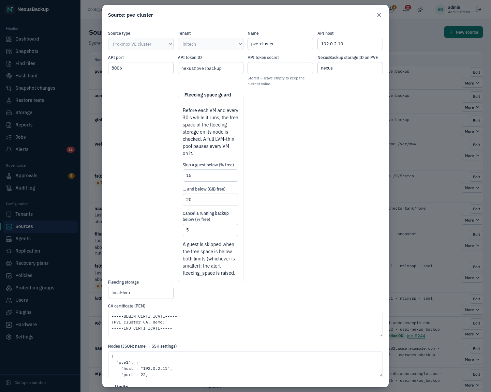
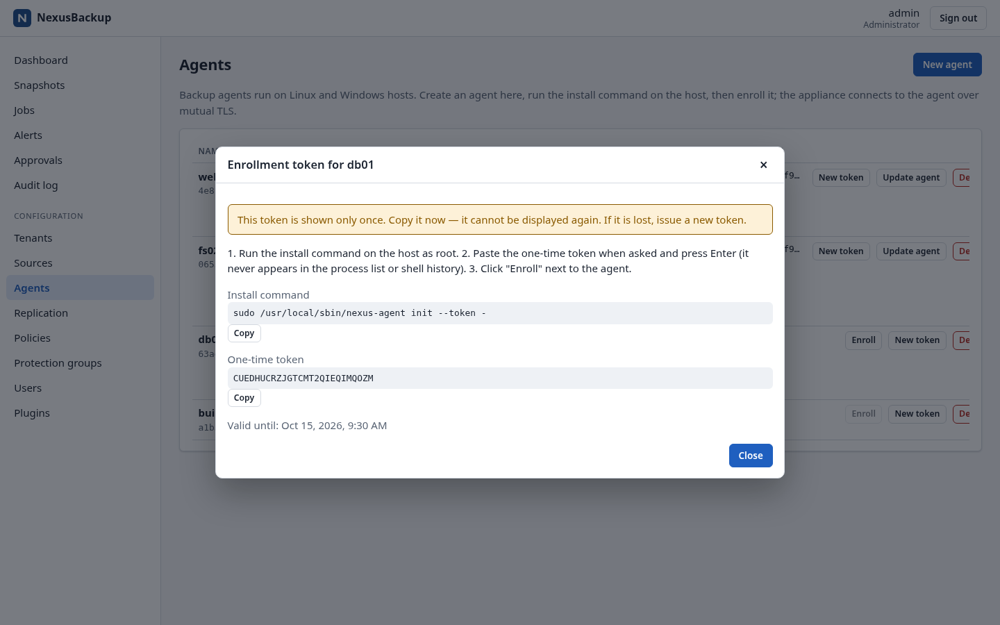
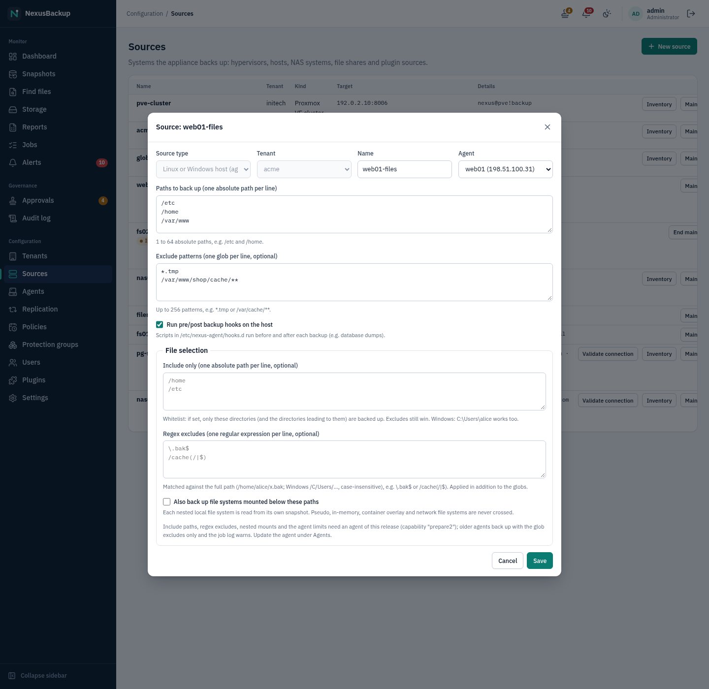
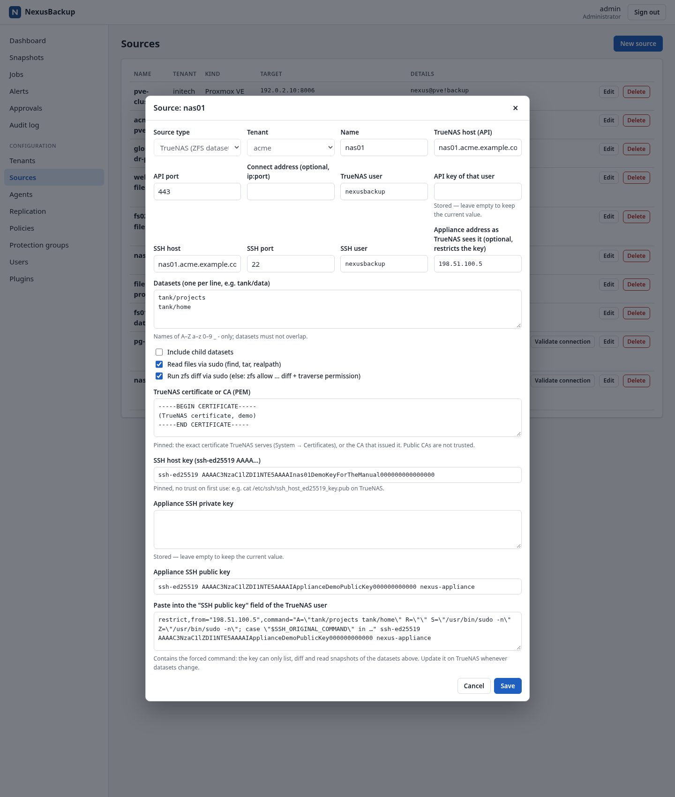
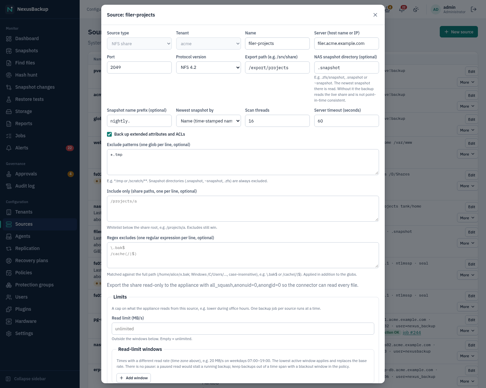
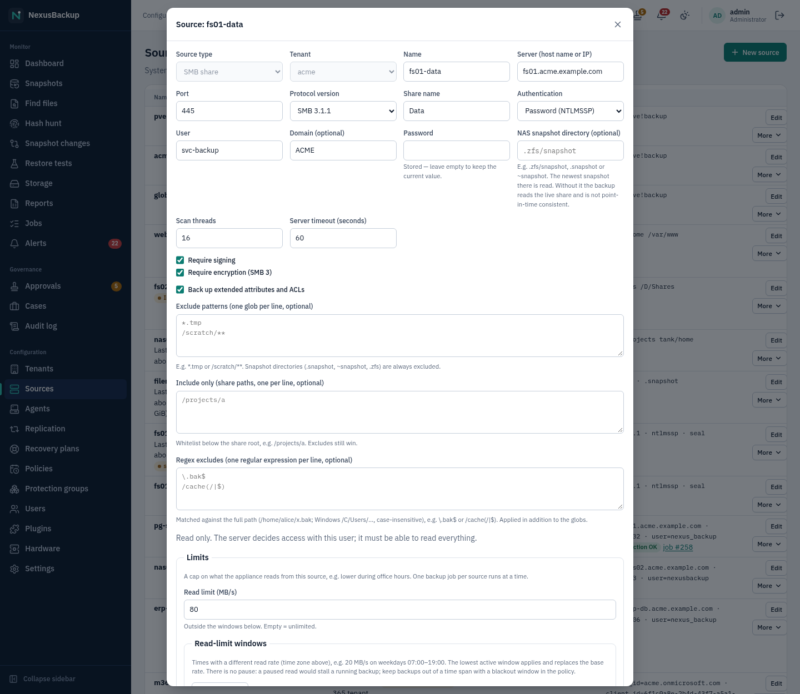
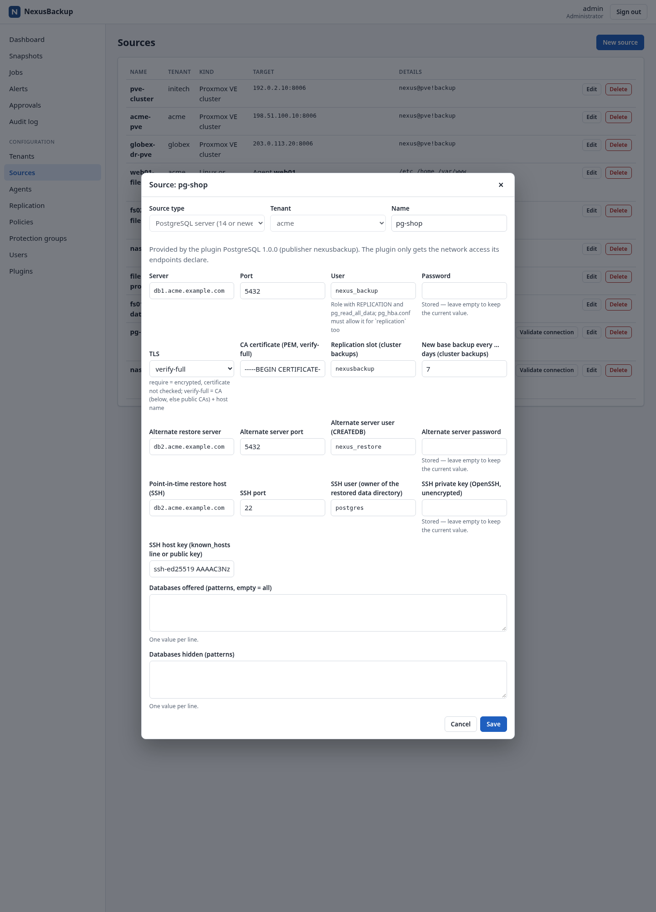

# 04 Sources

A **source** is a system the appliance backs up: a Proxmox VE cluster, a host with a backup agent, a TrueNAS
system, an NFS or SMB share, or a system handled by a plugin (for example PostgreSQL). Each source belongs to
exactly one tenant. A source by itself does not take any backups. A protection group selects what to back up
from it and which policy applies (see [05 Policies and protection groups](05-policies-and-groups.md)).

The appliance **pulls** all data. It opens every connection itself: sources never connect to the appliance and
hold no credentials for it. The appliance's outbound firewall is default-deny. The scheduler adds the endpoints
of every configured source to the allow-list automatically, so you never open appliance ports by hand. You do
have to allow the appliance's address on the source side (host firewall, NAS export, `pg_hba.conf` …).


## Managing sources

Open **Configuration → Sources**. Only administrators see this page.

- **New source** opens the form. First choose the **Source type**, the **Tenant** and a **Name**. You cannot
  change the type and the tenant later.
- **Edit** changes a source. Secret fields (API token secret, passwords, private keys) are **write-only**. The
  appliance never shows them again. When you edit a source, leave a secret field empty to keep the stored value
  ("Stored — leave empty to keep the current value."). Secrets are sealed and bound to the endpoint they belong to
  (host, port and, where present, user). If you change those fields, enter the secret again.
- **Delete** removes a source. It is refused while protection groups still use the source, so delete or move
  those groups first. With approvals enabled, a second person must approve the deletion (see
  [10 Approvals and audit](10-approvals-and-audit.md)).
- For plugin sources, **Validate connection** runs a short validation job. It shows **Connection OK** or the field
  and message the plugin reported, plus a link to the job.

| Source type (UI) | Kind | Appliance connects to | Restores |
|---|---|---|---|
| **Proxmox VE cluster** | `pve` | PVE API (TCP 8006) and SSH (TCP 22) on every node | full VM/CT, instant recovery, file download |
| **Linux or Windows host (agent)** | `linux` | the agent on the host (TCP 7444) | restore to path, tar/zip download |
| **TrueNAS (ZFS datasets)** | `truenas` | TrueNAS API (TCP 443) and SSH (TCP 22) | tar/zip download |
| **NFS share** | `nfs` | NFS (TCP 2049; NFSv3 also mountd, default 20048) | tar/zip download |
| **SMB share** | `smb` | SMB (TCP 445) | tar/zip download |
| plugin kinds (e.g. **PostgreSQL server (14 or newer)**) | `plugin:<kind>` | the endpoints the plugin declares (PostgreSQL: 5432; optional restore server and SSH host) | per plugin |
| **Microsoft 365 tenant (Exchange, OneDrive, SharePoint, Teams)** (plugin) | `plugin:m365` | `graph.microsoft.com`, `login.microsoftonline.com` and your two SharePoint hosts (TCP 443) | download; restore to the original or another user/site/team (new folder) |

Restores are described in [06 Restores](06-restores.md).

## Proxmox VE

Supported: **Proxmox VE 9.x only**. VMs are backed up from QEMU dirty bitmaps (incremental forever). Containers
are streamed as a tar archive from the container's user namespace.

> **Status:** Tested in a nested lab with a single-node PVE 9.2.2 cluster. Multi-node clusters are untested. The
> least-privilege set of API permissions for the appliance has not been defined yet (the lab uses broad roles,
> see below).

### 1. Install the node plugin on every node

The package `nexusbackup-pve` adds the storage type `nexusbackup`, the backup provider, and an SSH helper with a
forced command. It is built from the repository:

```sh
pve-plugin/build-deb.sh 0.1.0          # -> target/deb/nexusbackup-pve_0.1.0_all.deb
```

Install it on **every** node of the cluster:

```sh
apt install ./nexusbackup-pve_0.1.0_all.deb
```

The package creates the unprivileged system user `nexusbackup` (no password) and its runtime directories, then
reloads the PVE daemons. The node never connects to the appliance.

### 2. Allow the appliance's SSH key

The appliance reaches each node as `nexusbackup` over SSH. On every node, put the appliance's public key into
`/var/lib/nexusbackup/.ssh/authorized_keys` (root-owned) with exactly these options:

```text
restrict,command="/usr/lib/nexusbackup/helper" ssh-ed25519 AAAA… nexus-appliance
```

`restrict` allows no forwarding of any kind. Backup data flows over the SSH session's stdio.

> **Status:** Appliance SSH key management is a known production gap. The appliance does not yet generate a key
> pair or show its public key. The private key and a `known_hosts` file must exist as files on the appliance,
> and the source refers to them by path (see the **Nodes** field below). The web UI refuses inline private keys
> in this field.

### 3. Add the NexusBackup storage in PVE

Add the storage once for the cluster. Fleecing is **mandatory** for provider VM backups and needs fast local
thin storage on the node, for example `local-lvm`:

```sh
pvesm add nexusbackup nexus --nexus-fleecing-storage local-lvm --content backup,images
```

The resulting `/etc/pve/storage.cfg` entry:

```text
nexusbackup: nexus
	nexus-fleecing-storage local-lvm
	content backup,images
```

`images` is only needed for instant recovery: the storage then holds the recovery overlays. Optional:
`nexus-job-timeout` (seconds a VM backup waits for the appliance, default 21600). Nodes cannot delete backups:
deleting a NexusBackup volume in PVE fails with "deletion is managed by the NexusBackup appliance".

### 4. Create an API token

Create a PVE user and an API token with privilege separation for the appliance. The lab uses these roles:

```sh
pveum user add nexus@pve
pveum user token add nexus@pve backup --privsep 1
for role in PVEVMAdmin PVEDatastoreAdmin PVEAuditor; do
  pveum acl modify / --tokens 'nexus@pve!backup' --roles "$role"
done
# full restores attach the guest NIC to a bridge: SDN.Use on its zone
pveum acl modify /sdn/zones/localnetwork --tokens 'nexus@pve!backup' --roles PVESDNUser
```

> **Status:** These broad roles are lab settings. A minimal privilege set is still to be defined (listed as a
> production gap).

### 5. Create the source



| Field | Content |
|---|---|
| **API host**, **API port** | a cluster node's API, port 8006 |
| **API token ID** | e.g. `nexus@pve!backup` |
| **API token secret** | the token's secret (write-only) |
| **NexusBackup storage ID on PVE** | the PVE storage ID of the NexusBackup storage from step 3 (e.g. `nexus`). Backups run through this storage. |
| **Fleecing storage** | the fleecing storage, e.g. `local-lvm`. VM backups fail without it. |
| **CA certificate (PEM)** | the cluster CA (`/etc/pve/pve-root-ca.pem`). The appliance pins TLS to it. |
| **Nodes (JSON: name → SSH settings)** | every node with its SSH endpoint and the key and known_hosts files on the appliance |

Example for **Nodes**:

```json
{
  "pve1": { "host": "192.0.2.11", "port": 22, "key": "/etc/nexus/ssh/pve.key", "known_hosts": "/etc/nexus/ssh/known_hosts" },
  "pve2": { "host": "192.0.2.12", "port": 22, "key": "/etc/nexus/ssh/pve.key", "known_hosts": "/etc/nexus/ssh/known_hosts" }
}
```

Then create a protection group with the VM/CT IDs to back up.

Limits: VM templates cannot be backed up (fleecing). Container restores need staging space in the node's
`/var/tmp`, and every container backup reads the full tree. After a VM or host restart the dirty bitmap is lost,
so the next backup re-reads the whole disk (it still transfers only changed chunks).

## Linux and Windows hosts (agents)

The backup agent `nexus-agent` runs on the host and listens on **TCP 7444** (TLS 1.3). It never connects out. The
appliance connects to it. Trust is set up once with a one-time enrollment token, then the two sides use mutual
TLS with certificates from the appliance's own CA. The agent sends plain BLAKE3 chunk hashes, and only chunks the
appliance does not have yet are transferred (LZ4-compressed on the wire when that saves at least 10 %).


### 1. Create the agent

On **Configuration → Agents**, click **New agent** and enter **Tenant**, **Name**, **Host** (address the appliance
connects to) and **Port** (7444). The appliance creates a one-time token, valid for 24 hours, and shows it
**once**, together with the install command:



Copy the token now. If it is lost, click **New token** (an earlier unused token stops working).

### 2. Install the agent on the host

**Linux:** the agent is a static binary for all distributions, shipped as a bundle
(`nexus-agent-<v>-x86_64.tar.gz`). Unpack the bundle and install it with the token on stdin:

```sh
tar xzf nexus-agent-<v>-x86_64.tar.gz && cd nexus-agent-<v>-x86_64
sudo ./install.sh --token -          # paste the token, press Enter
```

`install.sh` installs `/usr/local/sbin/nexus-agent`, the systemd unit, and `/etc/nexus-agent/` (hook directories,
release keys). It then enrolls the agent and starts the service. If the agent is already installed, use the
command shown in the dialog and paste the token when asked:

```sh
sudo /usr/local/sbin/nexus-agent init --token -
```

The token never appears in the process list or the shell history. Allow TCP 7444 from the appliance's address in
the host firewall.

**Windows (Server 2016 or newer):** as Administrator:

```bat
mkdir "C:\Program Files\NexusAgent"
copy nexus-agent.exe "C:\Program Files\NexusAgent\"
rem copy release-keys\*.pub to %ProgramData%\NexusAgent\config\release-keys\ (create the directory)
cd "C:\Program Files\NexusAgent"
nexus-agent.exe init --token -
nexus-agent.exe install
```

Open TCP 7444 in the Windows firewall for the appliance's address only. The service `NexusAgent` runs as
LocalSystem.

> **Status:** The Windows agent is **built and unit-tested only. It has never run on Windows.** There is a manual
> test plan in `docs/agent-windows.md`. Do not rely on it for production data before that test plan has been run.
>
> **Status:** The appliance image does not ship an agent bundle yet (`/usr/share/nexus/agent`). The release
> process must provide it. Until then, build the bundle with `crates/agent-linux/dist/build-bundle.sh` (Linux) or
> `crates/agent-windows/build.sh` (Windows).

### 3. Enroll

Back on the Agents page, click **Enroll**. An enrollment job connects to the agent and proves the token in both
directions. The proof is bound to this TLS session, so it cannot be relayed by a man in the middle. The job then
issues the agent's client certificate and pins the agent's certificate. The status becomes **Enrolled**.
Statuses: **Token pending** (waiting for enrollment), **Token expired** (issue a **New token**), **Enrolled**.

- **Update agent** sends the current signed agent release. The agent verifies the signature, refuses downgrades,
  and restarts.
- **Re-enroll** is offered after **New token** on an enrolled agent.
- **Delete** needs approval when approvals are enabled. It is refused while a source uses the agent.

Five failed enrollment proofs lock the agent. Running `nexus-agent init --token …` again clears the lock.
Certificate renewal and changing an agent's host or port are not supported yet. Delete the agent and create it
again instead.

### 4. Create the source



Choose **Linux or Windows host (agent)**, the **Agent**, and:

- **Paths to back up (one absolute path per line)**: 1 to 64 paths, e.g. `/etc`, `/home`. On Windows use the
  `/C/…` form: `/C/Users`, `/D/Shares` (`C:\Users` is accepted by the agent too).
- **Exclude patterns (one glob per line, optional)**: up to 256, e.g. `*.tmp`, `/var/cache/**`. On Windows they are
  matched case-insensitively, e.g. `C:\Users\*\AppData\Local\Temp`.
- **Run pre/post backup hooks on the host**: scripts in `/etc/nexus-agent/hooks.d` (`pre`, `post`) run before and
  after each backup, for example database dumps. A failing pre hook fails the backup. Hooks are local to the
  host: the appliance cannot send commands. Test them with `nexus-agent hooks test`. Windows has no hooks; VSS
  writers provide application consistency there.

A group of an agent source backs up exactly that agent's host. Snapshots are named `host-<agent id>`.

### Consistency on Linux

For each volume, the agent takes a snapshot before reading:

- LVM thin or thick snapshots
- ZFS snapshots
- btrfs read-only snapshots (nested subvolumes are handled as volumes of their own)

If a volume cannot be snapshotted (for example plain ext4 on a partition), the agent reads it live. The backup is
then marked **not point-in-time consistent**, files that changed while being read are flagged `inconsistent`,
and the alert `backup_inconsistent` is raised. Recommendation: put data on LVM, ZFS or btrfs. On Windows the agent
uses VSS (copy-only) and the USN journal for change detection.

## TrueNAS

Supported: TrueNAS Community Edition (tested: 25.10.7). The appliance creates a ZFS snapshot through the TrueNAS
API, finds changes with `zfs diff`, and reads only changed files from the snapshot over SSH. A restricted SSH user
with a forced command serves the reads. Nothing is installed on TrueNAS besides a key. Restores are **download
only** (tar/zip) in v1.

### 1. Prepare TrueNAS (once, in the TrueNAS UI)

1. Create the group and user `nexusbackup`. The home directory must be on a pool dataset (e.g. `/mnt/tank/home`),
   with shell `bash`, password disabled, and SMB access off. Under "Allowed sudo commands with no password" add
   `/usr/bin/find`, `/usr/bin/tar`, `/usr/bin/realpath`, `/usr/sbin/zfs`.
2. Create a privilege for that group with exactly the roles `SNAPSHOT_WRITE`, `SNAPSHOT_DELETE`, `DATASET_READ`,
   and no web shell.
3. Create an API key for `nexusbackup` (Credentials → API Keys).
4. Turn on the SSH service, with key login only.
5. Download the TrueNAS certificate (System → Certificates, `truenas_default`) and note the SSH host key
   (`/etc/ssh/ssh_host_ed25519_key.pub`).
6. Generate an SSH key pair for the appliance (e.g. `ssh-keygen -t ed25519 -N ''`). Both halves go into the
   source form. The private key is stored sealed and is write-only.

> **Status:** Privilege model: `nexusbackup` runs `find`/`tar`/`realpath`/`zfs` via passwordless sudo, which is
> root-equivalent. The security boundary is the forced command: it accepts only four operations, only on the
> configured datasets and `nexus-*` snapshots, and only canonical paths. This model was accepted as the v1 design.

### 2. Create the source



| Field | Content |
|---|---|
| **TrueNAS host (API)**, **API port** | e.g. `nas01.acme.example.com`, 443 |
| **Connect address (optional, ip:port)** | connect here instead of resolving the host name |
| **TrueNAS user**, **API key of that user** | `nexusbackup` and its API key (write-only) |
| **SSH host**, **SSH port**, **SSH user** | default: the API host, 22, `nexusbackup` |
| **Appliance address as TrueNAS sees it** | optional: restricts the key with `from=` |
| **Datasets (one per line, e.g. tank/data)** | 1 to 64 datasets. Names may only contain A–Z a–z 0–9 `_ -`, and datasets must not overlap. |
| **Include child datasets** | also back up mounted child datasets |
| **Read files via sudo (find, tar, realpath)** | default on (needed to read files the user cannot read) |
| **Run zfs diff via sudo** | default on. Off requires `zfs allow -u nexusbackup diff <dataset>` plus traverse permission on every dataset root. |
| **TrueNAS certificate or CA (PEM)** | **pinned**: the exact certificate TrueNAS serves, or the CA that issued it. Public CAs are never trusted. |
| **SSH host key** | pinned, no trust on first use |
| **Appliance SSH private key** | write-only |
| **Appliance SSH public key** | the public half of that key. Enter it: the `authorized_keys` line below is built from it (the built-in source does not derive it from the private key). |

After **Create**, the dialog stays open and shows **Paste into the "SSH public key" field of the TrueNAS user**:
one `authorized_keys` line with `restrict`, optional `from=` and the forced command. Paste it into the user's
"SSH public key" field on TrueNAS. **Whenever you change the datasets or the sudo options, the line changes. Paste
it again.**

In a group you select datasets with checkboxes (none selected = all datasets of the source). Snapshots are named
`nas-<source id>-<pool.dataset>`. TrueNAS keeps one `nexus-<source>-<time>` snapshot per dataset as the reference
for the next incremental run. Your own snapshots are never touched.

Limits: a changed file is re-read completely. The certificate pin breaks when TrueNAS renews its certificate:
backups fail with a TLS error until you update the source.

### TrueNAS as a plugin (`plugin:truenas`)

The same connector also exists as the plugin **TrueNAS (plugin)** (source kind **TrueNAS datasets (plugin)**). It
uses the same TrueNAS setup and forced command, but runs sandboxed without access to the store or keys (see
[12 Plugins](12-plugins.md)). Differences:

- one ZFS snapshot per dataset instead of one atomic recursive snapshot per root
- TrueNAS keeps two `nexus-*` snapshots per dataset
- renamed files are transferred again
- datasets are guests named like `tank.media`, and a group **must** select them
- the `authorized_keys` line is not shown in the form. **Validate connection** writes it to the job log.

Both kinds can exist side by side, even for the same datasets: each source only touches its own `nexus-<id>-*`
snapshots. To migrate a source to the plugin:

1. Install the plugin.
2. Create a `plugin:truenas` source with the same values.
3. Validate it. Paste the line again if the datasets or flags differ.
4. Create a group with the same policy, then disable the old group.

The first plugin backup is a full read into new `plugin-truenas-…` snapshots. The old `nas-…` snapshots stay
restorable until retention removes them. When you finally delete the built-in source, delete its last
`nexus-<old id>-*` ZFS snapshot on TrueNAS by hand. The built-in kind is not deprecated.

> **Status:** The TrueNAS plugin passed its integration tests (sandbox, fake TrueNAS, local sshd). The lab run
> against a real TrueNAS VM and through the appliance image is still pending.

## NFS and SMB shares

The appliance mounts a share read-only and walks it. Unchanged files are detected from the previous snapshot by
path or inode plus size, mtime and ctime. The mount is done by a small privileged helper and is never visible in
any mount table. Restores are **download only** (tar/zip) in v1.

### Server side: give the appliance read access to everything

These are the supported setups:

- **NFS:** export the share read-only to the appliance's address with `ro,all_squash,anonuid=0,anongid=0`. Every
  request of the appliance is then root on the server: it can read everything and write nothing. Without this,
  only world-readable files are backed up, and unreadable ones make the snapshot not consistent. Only `sec=sys`
  is supported (no NFS Kerberos).

  ```text
  /export/projects  198.51.100.5(ro,all_squash,anonuid=0,anongid=0)
  ```

- **SMB:** use a dedicated backup account that can read everything. On Windows servers, make it a member of
  **Backup Operators** (the appliance opens files with backup intent). On Samba, set
  `admin users = <backup user>` on a read-only share definition, or grant read ACLs on everything. Only password
  authentication (NTLMSSP) is offered. **Kerberos is not supported in v1.**

### Create the source





Common fields: **Server (host name or IP)**, **Port** (NFS 2049, SMB 445), **Protocol version** (NFS 4.2/4.1/4.0/3,
SMB 3/3.1.1/3.02/3.0/2.1), **Scan threads** (default 16), **Server timeout (seconds)**,
**Back up extended attributes and ACLs**, **Exclude patterns**. Snapshot directories (`.snapshot`, `~snapshot`,
`.zfs`) are always excluded.

- NFS: **Export path (e.g. /srv/share)**. For NFSv3 also the **mountd port (NFSv3)**: the appliance does not use
  the portmapper, so the server must run mountd on a fixed port (default 20048).
- SMB: **Share name**, **User**, **Domain (optional)**, **Password** (write-only), **Require signing** (default on),
  **Require encryption (SMB 3)**. SMB 2.1 has no encryption.

**Point-in-time consistency:** set **NAS snapshot directory (optional)**, e.g. `.zfs/snapshot`, `.snapshot` or
`~snapshot`. The appliance then reads the newest snapshot below it instead of the live share. Use
**Snapshot name prefix** to filter snapshot names, and **Newest snapshot by** to choose between **Name** (time-stamped
names) and **Modification time** (NetApp-style `hourly.0`). Without a NAS snapshot, the live share is read and the
backup is not point-in-time consistent. The job then shows a warning, and the alert `backup_inconsistent` is
raised once per source for the missing snapshot. Files that actually changed while being read raise the alert
every time.

A share's group has no guest selection: it backs up the whole share. Snapshots are named `share-<source id>`.

Limits: all entries are held in memory until the commit (about 0.5–0.7 KB per entry: plan RAM for shares with
millions of files). Over SMB to Samba, a same-size rewrite with a restored mtime is not detected.

## Plugin sources (PostgreSQL, Microsoft 365)

Kinds provided by installed and **enabled** plugins appear in the **Source type** list under **Plugins**. The form
is generated from the plugin's configuration schema, and fields declared as secret are write-only. A note under
the form names the plugin, its version and its publisher. The plugin only gets network access to the endpoints
its source config declares. Installing plugins: [12 Plugins](12-plugins.md).



### PostgreSQL (14 or newer; tested 14, 17, 18)

Prepare the server. The role needs `REPLICATION` and `pg_read_all_data`:

```sql
CREATE ROLE nexus LOGIN REPLICATION PASSWORD '…';
GRANT pg_read_all_data TO nexus;     -- logical dumps
ALTER ROLE nexus CREATEDB;           -- only for dump restores to the source server
```

`pg_hba.conf` must allow the role for its databases **and** for `replication` from the appliance's address. Also
set `wal_level` to at least `replica` and keep one `max_wal_senders` and one `max_replication_slots` free.

Form fields (from the plugin manifest):

- **Server**, **Port** (5432), **User**, **Password**
- **TLS**: `require` (encrypted, certificate not checked, the default), `verify-full` (CA below or public CAs, plus
  the host name), `disable`. **CA certificate (PEM, verify-full)**.
- **Databases offered (patterns, empty = all)**, **Databases hidden (patterns)**
- **Replication slot (cluster backups)** (default `nexusbackup`), **New base backup every … days** (default 7)
- optional **Alternate restore server**, **Alternate server port**, **Alternate server user (CREATEDB)**,
  **Alternate server password**: a second server for dump restores
- optional **Point-in-time restore host (SSH)**, **SSH port**, **SSH user (owner of the restored data directory)**
  (default `postgres`), **SSH private key (OpenSSH, unencrypted)**, **SSH host key (known_hosts line or public
  key)**: where point-in-time restores create a new data directory

Click **Validate connection** to check connectivity and permissions.

What the group selects decides the backup type:

- **Databases selected:** one consistent logical dump per database (stream `<db>.sql`). These are restored to a
  server.
- **No database selected:** the whole cluster, as a base backup (`data/`) plus all WAL since then (`wal/`). This
  is restorable to a point in time.

> **Caution:** the replication slot keeps WAL on the server between backups. If backups stop, WAL accumulates.
> When you remove the source, drop the slot (`SELECT pg_drop_replication_slot('nexusbackup')`), or set
> `max_slot_wal_keep_size`.
>
> **Status:** Logical dumps do not cover owners/grants, comments, RLS policies, aggregates, operators, range types,
> rules, foreign tables, table inheritance, large objects, publications, event triggers, statistics objects or
> roles. Each backup warns about the ones present; use a cluster backup where they matter. Point-in-time restore
> of clusters with extra tablespaces is not supported (use the download). The plugin passed integration tests
> against real PostgreSQL servers. A run on the appliance image (signed bundle, UI) is still pending.

### Microsoft 365 (Exchange, OneDrive, SharePoint, Teams)

The **Microsoft 365** plugin (`m365`) backs up a Microsoft 365 tenant through Microsoft Graph: Exchange mailboxes
(mail, calendars, contacts), OneDrive, SharePoint document libraries, and Teams (team files and, optionally,
channel messages). It signs in as an **app registration** in your Entra ID with a **certificate**. There is no
password and no client secret. Details and limits: `docs/m365.md` in the repository.

Prepare Entra ID once (a Global or Application Administrator does this):

1. Entra admin center → **App registrations** → **New registration**: "Accounts in this organizational directory
   only", no redirect URI. Note the **Application (client) ID** and the **Directory (tenant) ID**.
2. Create a certificate on any computer with OpenSSL:

   ```sh
   openssl req -x509 -newkey rsa:3072 -sha256 -nodes -days 730 \
     -subj "/CN=NexusBackup M365" -keyout nexus-m365.key -out nexus-m365.crt
   ```

   In the app registration, open **Certificates & secrets → Certificates → Upload certificate** and upload
   `nexus-m365.crt`. Do not create a client secret.
3. **API permissions → Add a permission → Microsoft Graph → Application permissions**, then **Grant admin
   consent**:

   | Workload | Needed for backups | Also needed for restores |
   |---|---|---|
   | always | `User.Read.All` | |
   | Exchange mailboxes | `Mail.Read`, `Calendars.Read`, `Contacts.Read` | `Mail.ReadWrite`, `Calendars.ReadWrite`, `Contacts.ReadWrite` |
   | OneDrive, SharePoint, Teams files | `Sites.Read.All`, `Files.Read.All` | `Sites.ReadWrite.All`, `Files.ReadWrite.All` |
   | Teams | `Team.ReadBasic.All`, `Channel.ReadBasic.All` | |
   | Teams channel messages | `ChannelMessage.Read.All` | `Teamwork.Migrate.All`, `Channel.Create` |

4. Only if you want **Teams channel messages**: Microsoft treats the export of channel messages as a *protected
   API*. Request access for your app through the form linked from https://aka.ms/teamsgraph/requestaccess.
   Approval can take several days. Until then, leave **Teams: channel messages** off. Team files are backed up
   without it.

Create the source with **Source type** **Microsoft 365 tenant (Exchange, OneDrive, SharePoint, Teams)**. Form
fields (from the plugin manifest):

- **Tenant ID (GUID) or primary domain**, **Application (client) ID of the app registration**
- **Certificate (PEM, uploaded to the app registration)** and **Private key of the certificate (PEM, RSA,
  unencrypted)**: paste the contents of `nexus-m365.crt` and `nexus-m365.key`. Both are write-only and sealed.
  Delete the key file afterwards.
- The workloads: **Exchange mailboxes (mail, calendars, contacts)**, **OneDrive**, **SharePoint sites (document
  libraries)**, **Teams: team files**, **Teams: channel messages (protected Microsoft API, needs Microsoft's
  approval)** (off by default), and **Teams export payment model**: `B` (backup use, billed by Microsoft through an
  Azure subscription linked to the app), `A` (security/compliance licences) or `evaluation` (a small free monthly
  quota, for tests).
- **SharePoint host** (`contoso.sharepoint.com`) and **OneDrive host** (`contoso-my.sharepoint.com`): needed for
  OneDrive, SharePoint and Teams files. If you enter wrong values, validation tells you the right ones.
- Leave **Graph host**, **Sign-in host**, **HTTPS port** and **Additional CA certificate** empty. They exist for
  national clouds and test setups.

Click **Validate connection**. The plugin signs in, logs the certificate's SHA-1 thumbprint (compare it with the
one in the app registration) and makes one test call per enabled workload. A missing permission is reported
next to the workload with the permission names. A sign-in failure shows Microsoft's error code (for example
`AADSTS700027` when the certificate is not uploaded to the app).

In the protection group, click **Load …** and tick the **users** (mailbox + OneDrive), **sites** and **teams** to
back up. Each becomes its own snapshot (`plugin-m365-<source>-u.…`, `-s.…`, `-t.…`). A group without any ticked
object is refused: the plugin never backs up a whole tenant as one snapshot. Backups after the first one are
incremental: the plugin asks Microsoft only for what changed (mail folders and drives) or compares the lists
(calendars, contacts, Teams messages), and unchanged items are not downloaded again.

> **Caution:** the app's application permissions are tenant-wide. To limit which mailboxes it can read, use
> Exchange Online *RBAC for Applications*. When the certificate approaches its expiry date, upload a new one,
> enter both new fields in the source, then remove the old certificate from the app.
>
> **Status:** The plugin passed its integration tests against a local Microsoft Graph simulation. A run against a
> real Microsoft 365 tenant is still pending. Not covered in this version: modified occurrences of recurring
> meetings, event attachments, contact photos, archive mailboxes, public folders, file versions and sharing
> permissions, SharePoint lists and subsites, private/shared channel sites (back them up as sites), and 1:1 or
> group chats.

