# 04 Sources

A **source** is a system the appliance backs up: a Proxmox VE cluster, a host with a backup agent, a TrueNAS
system, an NFS or SMB share, or a system handled by a plugin (for example PostgreSQL). Each source belongs to
exactly one tenant. A source by itself does not take any backups. A protection group selects what to back up
from it and which policy applies (see [05 Policies and protection groups](05-policies-and-groups.md)).

The appliance **pulls** all data. It opens every connection itself: sources never connect to the appliance and
hold no credentials for it. The appliance's outbound firewall is default-deny. The scheduler adds the endpoints
of every configured source to the allow-list automatically, so you never open appliance ports by hand. You do
have to allow the appliance's address on the source side (host firewall, NAS export, `pg_hba.conf` …).


## Managing sources

Open **Configuration → Sources**. Only administrators see this page.

- **New source** opens the form. First choose the **Source type**, the **Tenant** and a **Name**. You cannot
  change the type and the tenant later.
- **Edit** changes a source. Secret fields (API token secret, passwords, private keys) are **write-only**. The
  appliance never shows them again. When you edit a source, leave a secret field empty to keep the stored value
  ("Stored — leave empty to keep the current value."). Secrets are sealed and bound to the endpoint they belong to
  (host, port and, where present, user). If you change those fields, enter the secret again.
- **Delete** removes a source. It is refused while protection groups still use the source, so delete or move
  those groups first. With approvals enabled, a second person must approve the deletion (see
  [10 Approvals and audit](10-approvals-and-audit.md)).
- For plugin sources, **Validate connection** runs a short validation job. It shows **Connection OK** or the field
  and message the plugin reported, plus a link to the job.
- **Inventory** (Proxmox VE, TrueNAS and plugin sources that list guests) shows the source's guest inventory, see
  below.

### Guest inventory

The appliance lists the guests of every Proxmox VE, TrueNAS and guest-listing plugin source once an hour (job
**Refresh guest inventory**) and keeps the result as the source's **inventory**:

| Source | Guests | Tags |
|---|---|---|
| Proxmox VE | every VM and container the API token can see (`/cluster/resources`), without templates | `type:qemu`/`type:lxc`, `node:<node>`, `pool:<pool>`, `tag:<PVE tag>` |
| TrueNAS | the datasets configured in the source | `pool:<ZFS pool>` |
| Plugin sources (PostgreSQL, Microsoft 365, …) | what the plugin lists (databases; users, sites, teams, groups) | what the plugin reports, e.g. Microsoft 365 `type:user`, `license:none`, `site:team` |

**Inventory** opens the list: **Guest** (ID), **Name**, **Type**, **Tags** and **Protected by** (the groups covering
the guest, or **not in a group**). Guests the source no longer lists stay in the list, greyed out, as **gone since …**;
groups no longer select them. **Refresh inventory** (administrators and operators) lists the guests now, e.g. right
after you created VMs.

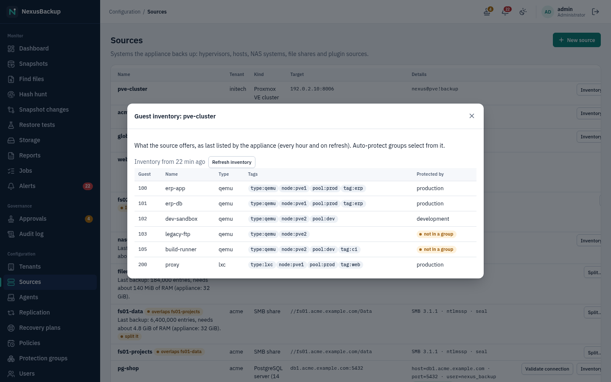

The inventory feeds the [auto-protect groups](05-policies-and-groups.md#auto-protect-all-guests-or-guests-by-tag)
(**All guests**, **By tag or pool**) and the Dashboard's **Not in a group** count. The Proxmox VE token sees only guests
it has `VM.Audit` on (the lab roles below grant it on `/`). If a refresh fails, the last inventory stays in effect and
an `inventory_refresh` warning is raised.

### Maintenance

**Maintenance** puts a source into maintenance mode for 1–30 days or until **End maintenance**, for example while a
Proxmox VE cluster or a NAS is upgraded. Meanwhile no scheduled backups of the source's groups start (running ones
are not stopped; cancel them on **Jobs** if needed), and the Dashboard shows their guests as **Paused** instead of
overdue. Manual backups stay possible. The source shows an **In maintenance** badge, and the groups page shows it on
each of its groups. A slot missed during maintenance runs once when it ends. Maintenance of more than 7 days (or until
ended) raises a `paused` warning. It needs no approval and is audited (`source.maintenance`,
`source.maintenance_end`). Operators may set it through the API as well (`POST /api/v1/sources/{id}/maintenance`
with `{"until": <unix time>}` or `{}`, `POST /api/v1/sources/{id}/maintenance/end`).

## Appliance SSH keys

The appliance signs in to some sources over SSH with its own keys: Proxmox VE nodes, TrueNAS systems and offsite
SFTP targets. **Configuration → Settings → Appliance SSH keys** lists these keys. Administrators, security officers
and operators can see them; only administrators rotate them.


Each key shows its name (e.g. `pve`), what it is **Used for**, its **Fingerprint**, when it was **Created** and the
**Public key** with a **Copy** button. Only the public halves are shown; the private keys never leave the appliance.
Copy the public key from here when you set up a source (for example into `authorized_keys` on a Proxmox VE node, see
below), and compare the fingerprint when you check a source.

To replace a key (for example once a year, or when you suspect it leaked):

1. Click **Rotate** and confirm. With approvals enabled, this is an approval request (`ssh key rotate`) that another
   administrator or security officer must approve. The appliance creates a new key. The old one stays valid and is
   shown below the new one as **Old key, still valid until retired**; **Rotate** is unavailable until it is retired.
2. Install the new public key (**Current key**, **Copy**) on every source that uses this key, next to the old one.
3. Run a backup of each of these sources (**Back up now** on the Dashboard) to check that the new key works.
4. Click **Retire old key** and confirm. Sources that only trust the old key stop working. Then remove the old public
   key from the sources.

The built-in TrueNAS source still uses the key pair you enter in its form (see [TrueNAS](#truenas)).

> **Status:** The **Appliance SSH keys** tab was tested against the demo backend; generating, rotating and retiring
> keys on the appliance is still being integrated. Until then the tab may stay empty, and the key files are placed on
> the appliance by hand as described below.

| Source type (UI) | Kind | Appliance connects to | Restores |
|---|---|---|---|
| **Proxmox VE cluster** | `pve` | PVE API (TCP 8006) and SSH (TCP 22) on every node | full VM/CT, instant recovery, file download, files to a host with an agent |
| **Linux or Windows host (agent)** | `linux` | the agent on the host (TCP 7444) | restore to path (this or another host), tar/zip download; the agent is also the target for files from every other source |
| **TrueNAS (ZFS datasets)** | `truenas` | TrueNAS API (TCP 443) and SSH (TCP 22) | tar/zip download, files to a host with an agent |
| **NFS share** | `nfs` | NFS (TCP 2049; NFSv3 also mountd, default 20048) | tar/zip download, files to a host with an agent |
| **SMB share** | `smb` | SMB (TCP 445) | tar/zip download, files to a host with an agent |
| plugin kinds (e.g. **PostgreSQL server (14 or newer)**) | `plugin:<kind>` | the endpoints the plugin declares (PostgreSQL: 5432; optional restore server and SSH host) | per plugin |
| **Microsoft 365 tenant (Exchange, OneDrive, SharePoint, Teams)** (plugin) | `plugin:m365` | `graph.microsoft.com`, `login.microsoftonline.com` and your two SharePoint hosts (TCP 443) | download; restore to the original or another user/site/team (new folder) |

Restores are described in [06 Restores](06-restores.md).

## Proxmox VE

Supported: **Proxmox VE 9.x only**. VMs are backed up from QEMU dirty bitmaps (incremental forever). Containers
are streamed as a tar archive from the container's user namespace.

> **Status:** Tested in a nested lab with a single-node PVE 9.2.2 cluster. Multi-node clusters are untested. The
> least-privilege set of API permissions for the appliance has not been defined yet (the lab uses broad roles,
> see below).

### 1. Install the node plugin on every node

The package `nexusbackup-pve` adds the storage type `nexusbackup`, the backup provider, and an SSH helper with a
forced command. It is built from the repository:

```sh
pve-plugin/build-deb.sh 0.1.0          # -> target/deb/nexusbackup-pve_0.1.0_all.deb
```

Install it on **every** node of the cluster:

```sh
apt install ./nexusbackup-pve_0.1.0_all.deb
```

The package creates the unprivileged system user `nexusbackup` (no password) and its runtime directories, then
reloads the PVE daemons. The node never connects to the appliance.

### 2. Allow the appliance's SSH key

The appliance reaches each node as `nexusbackup` over SSH. Copy the public key `pve` from **Settings → Appliance SSH
keys** (see [Appliance SSH keys](#appliance-ssh-keys)). On every node, put it into
`/var/lib/nexusbackup/.ssh/authorized_keys` (root-owned) with exactly these options:

```text
restrict,command="/usr/lib/nexusbackup/helper" ssh-ed25519 AAAA… nexus-appliance
```

`restrict` allows no forwarding of any kind. Backup data flows over the SSH session's stdio.

> **Status:** Showing and rotating the appliance's keys in **Settings → Appliance SSH keys** is new and still being
> integrated on the appliance side. The source still refers to the private key and a `known_hosts` file by path
> (see the **Nodes** field below); until the appliance generates the key, both must exist as files on the appliance.
> The web UI refuses inline private keys in this field.

### 3. Add the NexusBackup storage in PVE

Add the storage once for the cluster. Fleecing is **mandatory** for provider VM backups and needs fast local
thin storage on the node, for example `local-lvm`:

```sh
pvesm add nexusbackup nexus --nexus-fleecing-storage local-lvm --content backup,images
```

The resulting `/etc/pve/storage.cfg` entry:

```text
nexusbackup: nexus
	nexus-fleecing-storage local-lvm
	content backup,images
```

`images` is only needed for instant recovery: the storage then holds the recovery overlays. Optional:
`nexus-job-timeout` (seconds a VM backup waits for the appliance, default 21600). Nodes cannot delete backups:
deleting a NexusBackup volume in PVE fails with "deletion is managed by the NexusBackup appliance".

### 4. Create an API token

Create a PVE user and an API token with privilege separation for the appliance. The lab uses these roles:

```sh
pveum user add nexus@pve
pveum user token add nexus@pve backup --privsep 1
for role in PVEVMAdmin PVEDatastoreAdmin PVEAuditor; do
  pveum acl modify / --tokens 'nexus@pve!backup' --roles "$role"
done
# full restores attach the guest NIC to a bridge: SDN.Use on its zone
pveum acl modify /sdn/zones/localnetwork --tokens 'nexus@pve!backup' --roles PVESDNUser
```

> **Status:** These broad roles are lab settings. A minimal privilege set is still to be defined (listed as a
> production gap).

### 5. Create the source


| Field | Content |
|---|---|
| **API host**, **API port** | a cluster node's API, port 8006 |
| **API token ID** | e.g. `nexus@pve!backup` |
| **API token secret** | the token's secret (write-only) |
| **NexusBackup storage ID on PVE** | the PVE storage ID of the NexusBackup storage from step 3 (e.g. `nexus`). Backups run through this storage. |
| **Fleecing storage** | the fleecing storage, e.g. `local-lvm`. VM backups fail without it. |
| **Fleecing space guard** | **Skip a guest below (% free)** (default 15) **… and below (GiB free)** (default 20), **Cancel a running backup below (% free)** (default 5). See below. |
| **CA certificate (PEM)** | the cluster CA (`/etc/pve/pve-root-ca.pem`). The appliance pins TLS to it. |
| **Nodes (JSON: name → SSH settings)** | every node with its SSH endpoint and the key and known_hosts files on the appliance |

Example for **Nodes**:

```json
{
  "pve1": { "host": "192.0.2.11", "port": 22, "key": "/etc/nexus/ssh/pve.key", "known_hosts": "/etc/nexus/ssh/known_hosts" },
  "pve2": { "host": "192.0.2.12", "port": 22, "key": "/etc/nexus/ssh/pve.key", "known_hosts": "/etc/nexus/ssh/known_hosts" }
}
```

Then create a protection group with the VM/CT IDs to back up, or one that protects all guests or the guests of a pool
or tag ([auto-protect](05-policies-and-groups.md#auto-protect-all-guests-or-guests-by-tag)).

**Fleecing space guard.** While a VM is backed up, every block the guest overwrites is first copied to the
fleecing storage of its node. If that storage (usually the LVM-thin pool `local-lvm`) runs full, Proxmox pauses
**every** VM on it. So before each VM, and every 30 seconds while it runs, the appliance reads the storage's free
space (for LVM-thin also its metadata):

- below **both** skip limits (15 % and 20 GiB by default: whichever is smaller counts) the guest is skipped. The job
  log says `fleecing storage local-lvm on node pve2 has … free, below the guard …: guest skipped`; the group's retry
  policy runs it again later;
- below the cancel limit (5 %) a running backup is cancelled at once;
- both raise the critical alert `fleecing_space` for that node and storage (category hardware,
  [11 Alerts and monitoring](11-alerts-and-monitoring.md)); it resolves when a later backup finds enough room.

The API token needs to read the storage (the PVEAuditor role covers it, also the LVM-thin metadata); if it cannot,
the job log says `not guarded` and the backup runs without the guard. Containers use no fleecing and are not checked.

Limits: VM templates cannot be backed up (fleecing). Container restores need staging space in the node's
`/var/tmp`, and every container backup reads the full tree. After a VM or host restart the dirty bitmap is lost,
so the next backup re-reads the whole disk (it still transfers only changed chunks).

### Limits: guests at once, busy storages, read rate

Backups should not slow down a production cluster during the day. The **Limits** section of a Proxmox VE source
(TrueNAS and NFS/SMB sources have the read limit only) bounds what the appliance does to it:

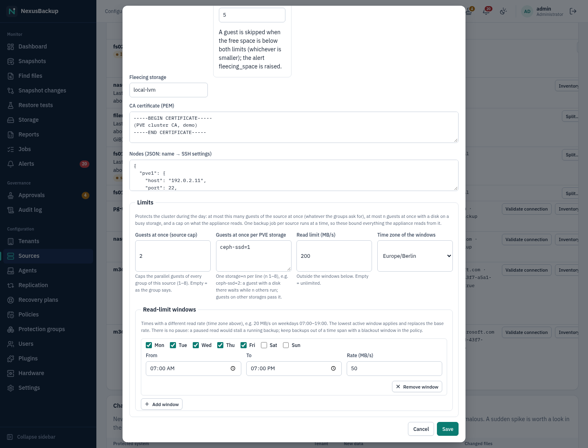

| Field | Effect |
|---|---|
| **Guests at once (source cap)** | at most this many guests of the source are backed up at the same time (1–8), whatever a group's **Parallel guests** asks for. Empty: as the group says. |
| **Guests at once per PVE storage** | one `storage=n` per line, e.g. `ceph-ssd=2`: a guest with a disk on that storage waits while n others with a disk there run; guests on other storages pass it. Useful for a busy Ceph pool or a slow NFS storage. |
| **Read limit (MB/s)** | what the appliance reads from the source per second (all guests of a run together). Empty: unlimited. |
| **Read-limit windows** | times with another rate in the chosen time zone, e.g. 50 MB/s on weekdays 07:00–19:00. The lowest active window applies and replaces the base rate. There is no pause window: a paused read would stall a running backup (and fill the fleecing storage). Keep backups out of office hours with a blackout window in the policy instead ([05 Policies and protection groups](05-policies-and-groups.md)). |

Backups of one source never overlap (a second group's run waits for the first), so these limits bound everything
the appliance reads from that source. The job log notes `parallel guests capped at 2 by the source`. The read limit
paces VM disk reads (NBD), the container tar stream, TrueNAS walks and file contents, and the file contents of
NFS/SMB shares.

> **Status:** Unit- and integration-tested (scheduler, connectors against fakes). The lab check on a real PVE
> cluster (two storages, `iotop` on the node while capped) is pending.

### VM identity and reused VMIDs

Every VM snapshot records the VM's identity from its configuration: the `vmgenid` and the SMBIOS UUID. When a VM is
deleted and another one is created with the same VMID (or a VM is replaced by a restore), the identity changes. The
appliance then:

- marks the snapshot with **New VM identity** on **Snapshots** (the tooltip shows the old and new values);
- raises the warning `vmid_reused` ([11 Alerts and monitoring](11-alerts-and-monitoring.md#alert-kinds));
- starts a new chain: the new VM has no dirty bitmap from the old one, so its first backup reads all disks.

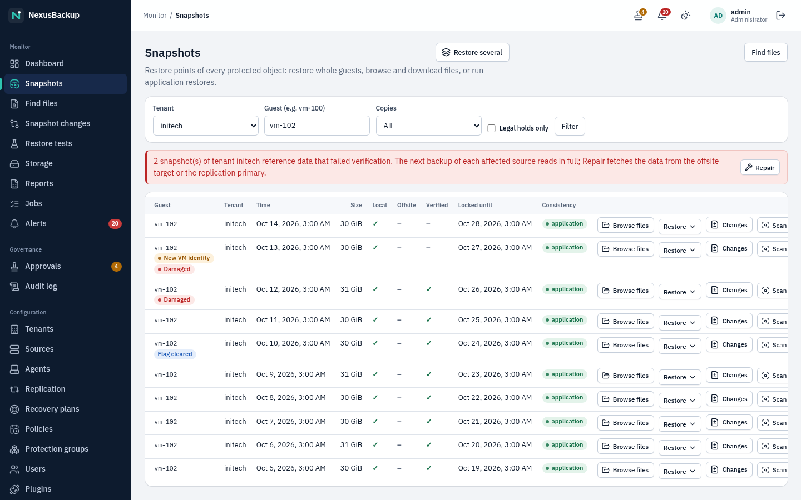

The older snapshots of that VMID belong to the previous VM. They stay restorable and age out with the group's
retention. Put them on legal hold if they must be kept longer, and check that the group still protects the VM
you mean.

## Linux and Windows hosts (agents)

The backup agent `nexus-agent` runs on the host and listens on **TCP 7444** (TLS 1.3). It never connects out. The
appliance connects to it. Trust is set up once with a one-time enrollment token, then the two sides use mutual
TLS with certificates from the appliance's own CA. The agent sends plain BLAKE3 chunk hashes, and only chunks the
appliance does not have yet are transferred (LZ4-compressed on the wire when that saves at least 10 %).


### 1. Create the agent

On **Configuration → Agents**, click **New agent** and enter **Tenant**, **Name**, **Host** (address the appliance
connects to) and **Port** (7444). The appliance creates a one-time token, valid for 24 hours, and shows it
**once**, together with the install command:


Copy the token now. If it is lost, click **New token** (an earlier unused token stops working).

### 2. Install the agent on the host

Step-by-step guides for the host administrator, including firewall rules, `agent.conf` and troubleshooting:
[16 Linux agent](16-linux-agent.md) and [17 Windows agent](17-windows-agent.md).

Download the package for the host from the release page (see the README, "Downloads") and check it against
`SHA256SUMS`. The release manager signs every package with the release key (`<file>.sig`, cosign). Install it, then
enroll the agent with the token. The token is read from stdin, so it never appears in the process list or the shell
history.

**Debian, Ubuntu** (`nexus-agent_<v>-1_amd64.deb` or `_arm64.deb`):

```sh
sudo apt install ./nexus-agent_<v>-1_amd64.deb
sudo nexus-agent init --token -          # paste the token, press Enter
sudo systemctl enable --now nexus-agent
```

**RHEL, AlmaLinux, Rocky, Fedora** (`nexus-agent-<v>-1.x86_64.rpm` or `.aarch64.rpm`):

```sh
sudo dnf install ./nexus-agent-<v>-1.x86_64.rpm
sudo nexus-agent init --token -
sudo systemctl enable --now nexus-agent
```

The package installs `/usr/bin/nexus-agent`, the systemd unit, `/etc/nexus-agent/` (mode 0700, hook directories,
release keys) and the database hook examples in `/usr/share/doc/nexus-agent/examples/`. It does not start the
service before enrollment and prints these commands after the installation. Allow TCP 7444 from the appliance's
address in the host firewall. Removing the package (`apt remove`, `dnf remove`) keeps `/etc/nexus-agent`, so a
reinstall keeps its enrollment. `apt purge` deletes the enrollment too.

**Other Linux distributions:** use the bundle `nexus-agent-<v>-x86_64.tar.gz` (built with
`crates/agent-linux/dist/build-bundle.sh`). It installs to `/usr/local/sbin`:

```sh
tar xzf nexus-agent-<v>-x86_64.tar.gz && cd nexus-agent-<v>-x86_64
sudo ./install.sh --token -          # paste the token, press Enter; enrolls and starts the service
```

To enroll a bundle installation again, use the full path `sudo /usr/local/sbin/nexus-agent init --token -`.
EL and Fedora keep `/usr/local/sbin` out of sudo's path, so the shorter command shown in the dialog fails there.

**Windows (Server 2016 or newer)** (`nexus-agent-<v>-x64.msi`): double-click the MSI or install it silently, then
enroll in an elevated PowerShell:

```bat
msiexec /i nexus-agent-<v>-x64.msi /qn
cd "C:\Program Files\NexusBackup Agent"
.\nexus-agent.exe init --token -
sc.exe start NexusAgent
```

The MSI installs `nexus-agent.exe` to `C:\Program Files\NexusBackup Agent`, registers the service `NexusAgent`
(LocalSystem, automatic start, restart on failure), and puts the release keys in `%ProgramData%\NexusAgent`, which
only SYSTEM and Administrators can read. It appears in **Apps & features** as "NexusBackup Agent". Before enrollment
the service starts and stops again by itself.

**Silent installation with GPO or Intune.** Deploy the MSI as it is: `msiexec /i nexus-agent-<v>-x64.msi /qn` (GPO:
computer software installation; Intune: line-of-business app, install context device). Uninstall:
`msiexec /x nexus-agent-<v>-x64.msi /qn`. This keeps the enrollment in `%ProgramData%\NexusAgent`. Add `PURGE=1` to
delete it as well. A newer MSI replaces an older one in place and keeps the enrollment. The MSI deliberately has no
token property. Tokens are per host and used once, and MSI properties end up in installer logs and in GPO/Intune
configuration. Enroll each host afterwards, for example with a remote PowerShell or an Intune script that pipes the
host's token into `nexus-agent.exe init --token -`. Open TCP 7444 in the Windows firewall for the appliance's
address only. The MSI does not add a firewall rule.

**Updates.** Package installations are updated with the package manager (new `.deb`/`.rpm`/`.msi`). The appliance's
**Update agent** action is refused by them ("installed from a deb package …"), so the agent never replaces a file
the package manager owns. To allow it anyway, set `self_update = on` in `agent.conf`. Bundle installations and manual
Windows installations update themselves through **Update agent**.

> **Status:** The Windows agent and its MSI are **built and checked on Linux only. They have never run on Windows.**
> The MSI tables are validated with msitools, but no real installation has been tested. There is a manual test plan in
> `docs/agent-windows.md`. Do not rely on them for production data before that test plan has been run.
>
> **Status:** The `.deb` and `.rpm` packages are installed and removed in Debian 13, AlmaLinux 10 and Fedora
> containers at every release. The aarch64 packages are built and the binary is started under emulation. They have
> not run on real arm64 hardware yet.
>
> **Status:** The appliance image does not ship an agent bundle for **Update agent** yet (`/usr/share/nexus/agent`).
> The release process must provide it.

### 3. Enroll

Back on the Agents page, click **Enroll**. An enrollment job connects to the agent and proves the token in both
directions. The proof is bound to this TLS session, so it cannot be relayed by a man in the middle. The job then
issues the agent's client certificate and pins the agent's certificate. The status becomes **Enrolled**.
Statuses: **Token pending** (waiting for enrollment), **Token expired** (issue a **New token**), **Enrolled**.

- **Update agent** sends the current signed agent release. The agent verifies the signature, refuses downgrades,
  and restarts. Agents installed from a package refuse it (see "Updates" above).
- **Re-enroll (new token)** replaces **New token** on an enrolled agent (see [Re-enrolling](#re-enrolling-an-agent)).
- **Renew certificate** renews the agent's certificate now (see [Certificate renewal](#certificate-renewal)).
- **Limits** sets a bandwidth and CPU limit for the agent's backups (see [Limits](#bandwidth-and-cpu-limits)).
- **Delete** needs approval when approvals are enabled. It is refused while a source uses the agent.

Five failed enrollment proofs lock the agent. Running `nexus-agent init --token …` again clears the lock.
Changing an agent's host or port is not supported yet. Delete the agent and create it again instead.

#### Certificate renewal

Agent certificates are valid for 10 years. The appliance renews them **automatically** over the existing mutual-TLS
connection when less than 30 days or less than 10 % of the lifetime are left (for a 10-year certificate: during its
last year): a **Renew agent certificate** job asks the agent for a new certificate request, the agent generates a
**new key pair** for it, the appliance signs it with its agent CA, and the agent switches to the new key and
certificate atomically (a crash in between leaves either the old or the new pair, never a mix). Click **Renew
certificate** to do it now, e.g. after a suspected key compromise. The audit log records it (`agent.cert_renewed`) and
the `cert_expiry` alert of the agent is resolved. The **Certificate** column shows "valid until …" for the current certificate
expires.

If the connection breaks after the appliance signed the new certificate, the appliance accepts both the old and the
new certificate until the next connection shows which one the agent uses (the chip "Renewal issued, waiting for the next session to confirm it"). A failed automatic
renewal is retried after a day.

#### Re-enrolling an agent

If a host lost its agent key (reinstalled host, deleted `/etc/nexus-agent`), do not delete the agent: click **New
token** on it, install or `init` the agent with the new token, and click **Enroll**. The agent keeps its **id**: its
source, its groups and its `host-<id>` snapshots stay attached, and the next backup continues the chain (the first one
reads all files again, because the agent's metadata cache is gone). The new certificate replaces the pinned one when
the enrollment job has run. The audit log marks such a token as a re-enrollment.

#### Bandwidth and CPU limits

**Limits** on the Agents page (dialog **Limits for <name>**) applies to every backup of the agent:

- **Bandwidth limit (MiB/s, 0 = unlimited)**: the agent sends chunk data to the appliance at most this fast (0 = unlimited; at least
  64 KiB/s). Data the appliance already has is never sent, so incremental backups are rarely affected.
- **CPU / I/O priority (nice 0–19, 0 = normal)**: the agent lowers its priority for the backup. On Linux the service already runs
  with nice 10 and the lowest best-effort I/O priority; values above 10 lower the CPU priority further, and from 15
  on the agent reads with the idle I/O class (it then only gets disk time nobody else wants). Pre/post hooks
  inherit it. On Windows any value above 0 switches the backup to background mode (low CPU and I/O priority).


Changing limits is audited (`agent.limits`).

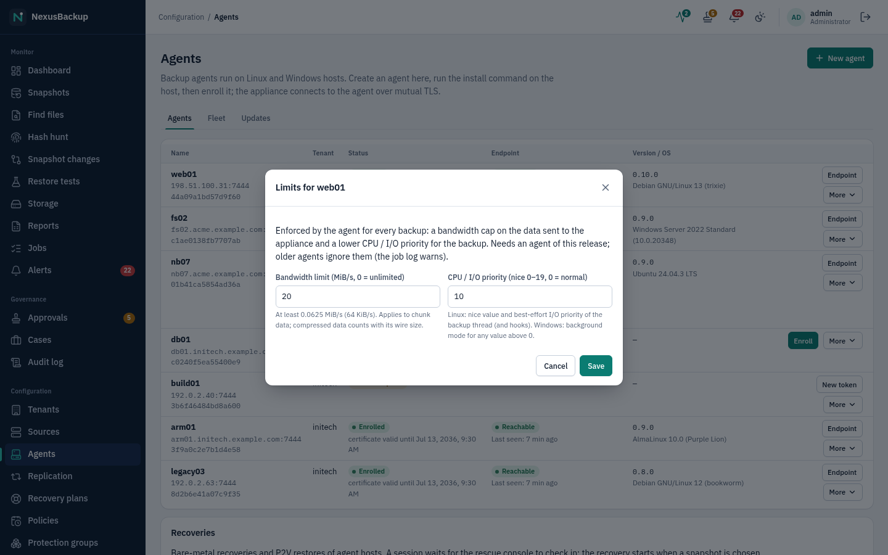

> **Status:** Limits, include paths, regex excludes, nested mounts and certificate renewal need an agent of this
> release (capabilities `prepare2` and `cert-renew`). Older agents back up as before and ignore include paths, regex
> excludes, nested mounts and limits; the job log then says "this agent version ignores …: update the agent". A
> renewal of an older agent fails with a hint to update or re-enroll it. Update the agent with **Update agent**.

#### Endpoint status and laptops

The appliance opens a short session to every enrolled agent every **2 minutes** (the agent still never connects
out). The **Endpoint** column of the Agents page shows the result:

- **Reachable** / **Not reachable** (hover: time of the last poll) / **Not polled yet**. An agent that does not
  answer is polled less often (after 4, 8, then every 15 minutes) until it answers again; **Last seen** is the
  last successful session of any kind.
- **On battery (n %)** and **Metered network (name)**, as the agent reports them (Linux: `/sys/class/power_supply`
  and NetworkManager; Windows: power status and the network cost of Windows).
- **Backup requested …**: a user on the host asked for a backup (tray icon, `nexus-agent tui`). The poll picks the
  request up and queues a backup of the agent in each of its groups; the job and the audit entry
  `agent.request_backup` name the actor `agent:<id>`. At most one request per 10 minutes is accepted (the agent
  refuses more, and so does the appliance: "Backup request refused (rate limited)").
- **Missed run since …**: a scheduled run was skipped or failed and waits for the laptop (see below).

**Endpoint** on an enrolled agent opens **Endpoint settings for <name>**:

- **Endpoint UI (administrators)**: **Accent colour** (`#rrggbb`), **Header text** (shown instead of the product
  name), **Hide "Back up now"** and **Hide the tray icon**. The policy reaches the agent with the next poll; the
  dialog shows "Version n, applied on the agent" once the agent stored it. Only administrators change it
  (audit `agent.ui_policy`).
- **Laptop** (administrators and tenant administrators, audit `agent.laptop`):
  - **Skip scheduled runs on battery below (%)** (0 = never) and **Skip scheduled runs on a metered network**: the
    scheduler leaves the agent out of a scheduled group backup while the last poll (at most 10 minutes old) says
    so. If every agent of the group is left out, the run is recorded as a cancelled job with the reason in its log
    (no alert); otherwise the other agents run. Audit `agent.backup_skipped`.
  - **Catch up missed runs when the laptop is back**: a scheduled run that was skipped, or that failed (e.g. the
    laptop was off the network), is queued again as soon as a poll reaches the agent and it is fit (not on low
    battery or a metered network), within **Catch up within (hours, 0 = 24)**. With this option a laptop that is
    not reachable at the scheduled time is left out instead of failing the group's backup. Audit
    `agent.missed_run_queued` / `agent.missed_run_expired`.
  - "Back up now" requests from the endpoint and **Back up now** on the appliance always run.
  - **Reach via edge**: an edge proxy (Settings → **Edges**) through which the appliance reaches this laptop when
    it is not reachable directly (direct first, then the edge); see [18 Edge proxy](18-edge-proxy.md).
- **Sessions shown on the endpoint**: the last backups and file restores of the agent as its endpoint UI shows them
  (result, time, transferred bytes, first error), and whether the agent already has them ("on the agent") or gets
  them with the next poll ("pending"). The appliance sends each finished session's summary with the agent's part
  of the job log (at most 200 lines); the agent keeps the last 100.

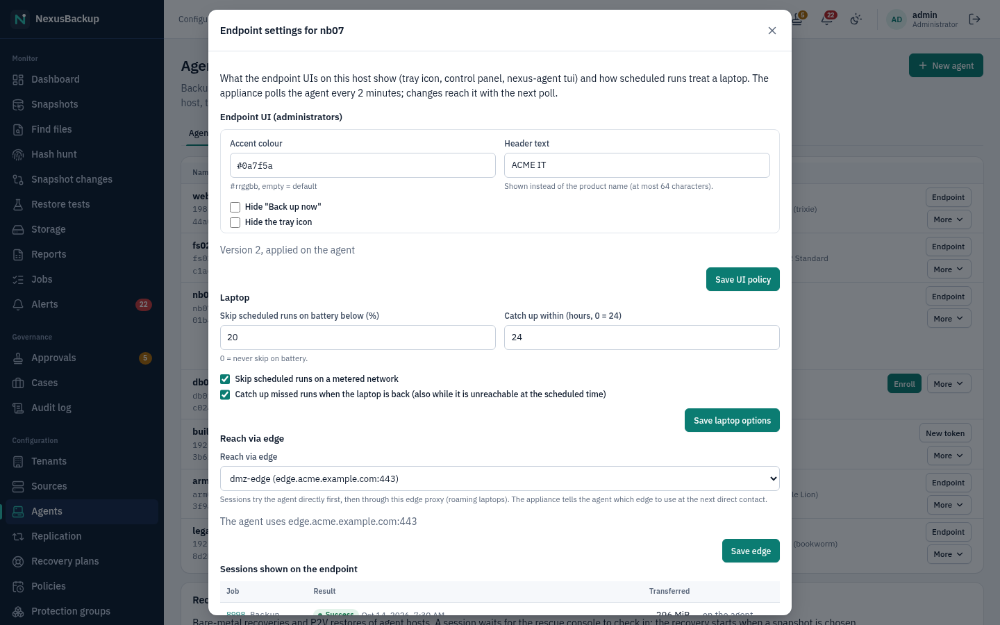

On the host, `nexus-agent status --json` prints the agent's own view (state, last success, next run, last poll by
the appliance, UI policy) for members of the group `nexus-agent-ui` and root.

> **Status:** Needs an agent of this release (capability `poll`, protocol v1.4). Older agents are polled for
> reachability and version only: they get no summaries, cannot request backups and report no power state, so the
> battery and metered options have no effect for them (the "not reachable" rule does). The endpoint UIs
> themselves (`nexus-agent tui`, the tray / control panel app) are described in the endpoint chapter.

### 4. Create the source


Choose **Linux or Windows host (agent)**, the **Agent**, and:

- **Paths to back up (one absolute path per line)**: 1 to 64 paths, e.g. `/etc`, `/home`. On Windows use the
  `/C/…` form: `/C/Users`, `/D/Shares` (`C:\Users` is accepted by the agent too).
- **Exclude patterns (one glob per line, optional)**: up to 256, e.g. `*.tmp`, `/var/cache/**`. On Windows they are
  matched case-insensitively, e.g. `C:\Users\*\AppData\Local\Temp`.
- Fieldset **File selection**: **Include only**, **Regex excludes**, **Also back up file systems mounted below these paths** and **Never cross these file system types**: see
  [File selection](#file-selection-include-paths-regex-excludes-nested-mounts).
- **Run pre/post backup hooks on the host**: scripts in `/etc/nexus-agent/hooks.d` (`pre`, `post`) run before and
  after each backup, for example database dumps. A failing pre hook fails the backup. Hooks are local to the
  host: the appliance cannot send commands. Test them with `nexus-agent hooks test`. Windows has no hooks; VSS
  writers provide application consistency there.

A group of an agent source backs up exactly that agent's host. Snapshots are named `host-<agent id>`.

### Fleet enrollment (pre-installed agents)

For many hosts, deploy the agent with your software distribution (GPO, Intune, Ansible) and let the appliance find
it. Instead of one token per host, every host gets the same **fleet secret**: time-limited, reusable, and revocable.

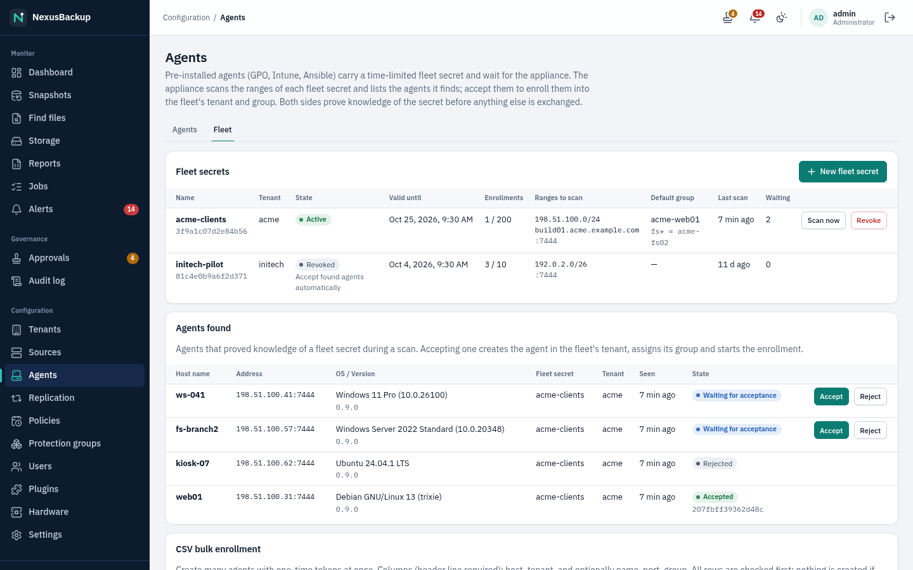

**1. Create a fleet secret** (administrators only): on **Configuration → Agents → Fleet**, click **New fleet secret**
and enter:

- **Name** and **Tenant**: every agent enrolled with this secret belongs to this tenant.
- **Valid for (days, 1–30)**: after that, nothing is scanned or enrolled with it any more.
- **Maximum enrollments** (optional): the secret stops working after this many accepted agents.
- **Agent port** (7444) and **Ranges to scan**: one entry per line. Allowed: an IPv4 network up to /22 (1024
  addresses), an IPv6 network up to /118, a single address, or a host name. At most 32 entries and 4096 addresses.
  The appliance's firewall allows outgoing connections to exactly these addresses on the agent port while the secret
  is active.
- **Default group** and **Group by host name**: the name of an existing protection group of an agent source in the
  tenant, used as a template. Each accepted agent gets its own source (the template's paths, excludes and filters)
  and its own group (the template's policy and settings). Rules have the form `pattern = group` (`*` and `?` match,
  case-insensitive, the first matching rule wins, otherwise the default group). Without a group, create the source
  later as in step 4 above.
- **Accept found agents automatically**: off by default. Leave it off unless the ranges contain only hosts you
  control: with it on, any host that holds the secret is enrolled without review.

The secret is shown **once**, with the commands for each platform. Store it in your deployment tool (Ansible vault,
Intune app configuration, GPO). **Revoke** stops it at once; already enrolled agents are not affected.

**2. Deploy the agent with the secret:**

- Linux, interactive: `sudo nexus-agent init --fleet-secret -` (paste the secret), then
  `sudo systemctl enable --now nexus-agent`.
- Linux packages (Ansible, scripts): write the secret to `/etc/nexus-agent/fleet-secret` (owner root, mode 0600),
  then install the `.deb`/`.rpm`. The package starts the agent, which takes the secret over at its first start and
  deletes the file. If the package was installed first, run `sudo systemctl enable --now nexus-agent` after writing the
  file.
- Windows: `msiexec /i nexus-agent-<version>-x64.msi /qn FLEETSECRET=<secret>` (GPO software installation or an
  Intune line-of-business app). The property is not written to the MSI log. On a host that is already enrolled it is
  ignored.

docs/agent-linux.md and docs/agent-windows.md, section "Fleet deployment (GPO / Intune / Ansible)", have complete
examples.

**3. Accept the agents:** the appliance scans the ranges of every active fleet secret every 15 minutes (a **Fleet
discovery scan** job; **Scan now** starts one at once). It connects only to the agent port, at most 20 connections
per second. An agent answers only when the appliance proves that it knows the fleet secret, and then proves the
same. Then it reports its host name, operating system and agent version. The secret itself never crosses the network.
Agents found are listed under **Agents found** with the state **Waiting for acceptance**. Check that you expect
each host, then click **Accept**: the appliance creates the agent (name = host name, address = the scanned address)
in the fleet's tenant, assigns the group, and starts the enrollment job. Tenant admins accept agents of their own
tenant. **Reject** hides a host from later scans. Accepting, rejecting and automatic acceptance are recorded in the
audit log (`fleet.accept`, `fleet.reject`, `fleet.auto_accept`).

> **Note:** If a fleet secret leaks, someone could start a rogue agent inside your ranges. It would wait for
> acceptance, and with automatic acceptance it would become an agent of the tenant whose backups only ever contain its
> own files: it cannot read other hosts' backups. Keep the validity short, set a maximum, keep automatic acceptance
> off, and revoke the secret when the rollout is done.

### CSV bulk enrollment

To create many agents with one-time tokens at once (hosts that you install one by one, or with a tool that can pass a
per-host token), use **CSV bulk enrollment** on the **Fleet** tab. The first line names the columns; `host` and
`tenant` are required, `name` (default: the host), `port` (default 7444) and `group` (a template group as above) are
optional:

```csv
host,tenant,name,group
10.20.0.11,acme,web11,acme-web01
10.20.0.12,acme,web12,acme-web01
fs03.acme.example.com,acme,fs03,acme-fs02
```

All rows are checked first. If one row is wrong, nothing is created and the message names the line. At most 500 rows.
The result lists the new agents; **Download CSV** saves them with their one-time tokens (valid for 24 hours). The
tokens are shown only this once. Install each host with its token as in step 2, then click **Enroll** next to each
agent.

> **Status:** Fleet enrollment and CSV bulk enrollment are tested in unit and API tests and against the demo
> backend. They have not run in the VM lab yet, and the MSI property `FLEETSECRET` has never run on Windows (as for
> the whole Windows agent).

### The agent as a restore target

An enrolled agent can also receive files from every other snapshot of its tenant: other hosts, NAS shares,
TrueNAS datasets, plugin file trees and files from VM or container snapshots
([06 Restores](06-restores.md#restore-files-to-a-host-agents)). An agent used only as a restore target needs no
source and no group: create and enroll it as above. Files from another machine are owned by the agent's restore
user (root for the installed service), setuid/setgid bits are cleared, and only extended attributes the host can
store are kept. The agent writes only below the target directory you choose, after you typed its name.

### Machine layout (bare-metal recovery)

With every backup the Linux agent also records how the machine is built: its disks and partitions, LVM volume
groups and volumes, file systems with their UUIDs and labels, swap, UEFI or BIOS boot, the boot loader, the kernel
command line and the network addresses. The appliance keeps this in the snapshot as `.nexus-system/layout.json`
(you see it in the file browser). It is what a bare-metal recovery or "Restore as PVE VM" rebuilds the disks from
([06 Restores](06-restores.md#bare-metal-recovery-linux-hosts)). The backup job log shows a line
`layout: N disk(s), …` and a `layout note` for anything that could not be recorded.

For a recovery that boots, back up the whole system: path `/` with **Include nested mounts**, so `/boot` and the
EFI system partition are in the snapshot too.

### Consistency on Linux

For each volume, the agent takes a snapshot before reading:

- LVM thin or thick snapshots
- ZFS snapshots
- btrfs read-only snapshots (nested subvolumes are handled as volumes of their own)

If a volume cannot be snapshotted (for example plain ext4 on a partition), the agent reads it live. The backup is
then marked **not point-in-time consistent**, files that changed while being read are flagged `inconsistent`,
and the alert `backup_inconsistent` is raised. Recommendation: put data on LVM, ZFS or btrfs. On Windows the agent
uses VSS (copy-only) and the USN journal for change detection.

### File selection: include paths, regex excludes, nested mounts

Agent sources and NFS/SMB sources share the same selection rules:

- **Exclude patterns** (globs): `*` within one path component, `?` one character, `**` any number of components. A
  pattern with `/` is matched against the whole path (`/var/cache/**`), one without against the name (`*.tmp`).
- **Regex excludes** (one regular expression per line): matched against the whole path, e.g. `\.(bak|old)$` or
  `^/home/[^/]+/\.cache(/|$)`. On Windows paths look like `/C/Users/alice/…` and the match ignores case. Invalid
  expressions are refused when you save.
- **Include only** (optional, one absolute path per line): if set, only what is inside one of them is backed up;
  the directories leading to them are kept (so restores show the full path) but nothing else in them. Example: paths
  `/`, include `/home` and `/etc`. Windows: `C:\Users\alice`. NFS/SMB: paths inside the share, e.g. `/projects/a`.
- **Exclusion always wins**: an excluded directory is skipped even if it leads to, or is, an include path.
- **Global file excludes** of the group's policy are added to every source's excludes
  ([05 Policies and groups](05-policies-and-groups.md#policies)).
- **Also back up file systems mounted below these paths** (Linux agents): file systems mounted below the paths (e.g. `/srv/data` below `/`) are
  normally not backed up; tick this to include them, each from its own snapshot. **Never cross these file system types**
  lists types that are never included (empty = the default list: `proc`, `sysfs`, `devtmpfs`, `tmpfs`, `overlay`,
  `squashfs`, `nfs`, `nfs4`, `cifs`, `smb3`, `fuse`, `autofs`, `cgroup`, …); only local data file systems (ext4,
  xfs, btrfs, zfs, vfat, …) are ever included. Skipped network and data file systems are named in the job log. The
  Windows agent backs up the volumes you list (mounted folders are not followed) and ignores this setting; NFS/SMB
  sources never descend into nested mounts.

### Desktop agent: backup status for the user (Windows, Linux desktops)

Users of a protected computer can see its backup status themselves, in the style of Veeam Agent for Windows: a tray
icon and the **NexusBackup Agent** window. It only shows status and can request a backup; it cannot change the
configuration or restore files (restores stay with the administrators on the appliance).

- **Windows:** part of the agent MSI. It starts in the notification area at every logon (per-machine Run key; a
  user can switch it off in Task Manager > Startup) and from the Start menu entry **NexusBackup Agent**.
- **Linux desktops:** install `nexus-agent-desktop` (.deb / .rpm from the release page) next to `nexus-agent`. The
  package adds nobody to any group: give each user who should see the status access with
  `sudo usermod -aG nexus-agent-ui <user>` (effective after the next login). It starts in the tray at login; the
  application menu entry **NexusBackup Agent** opens the window. GNOME shows the tray icon only with the
  AppIndicator extension (enabled on Ubuntu); the menu entry works everywhere.

**Tray icon.** The NexusBackup logo with a badge for the state; the tooltip names it (and the progress while a
backup runs, otherwise the next backup):


From left: no backup configured yet; waiting (first backup scheduled, or a requested backup waits for the
appliance); backup running; last backup succeeded; last backup finished with warnings; last backup failed; last
backup cancelled; not connected (the agent service does not answer, or the appliance has not reached this computer
since the time shown, e.g. a laptop away from the office network). Right-click: **Open**, **Request backup now**,
**Quit**; a left click opens the window.

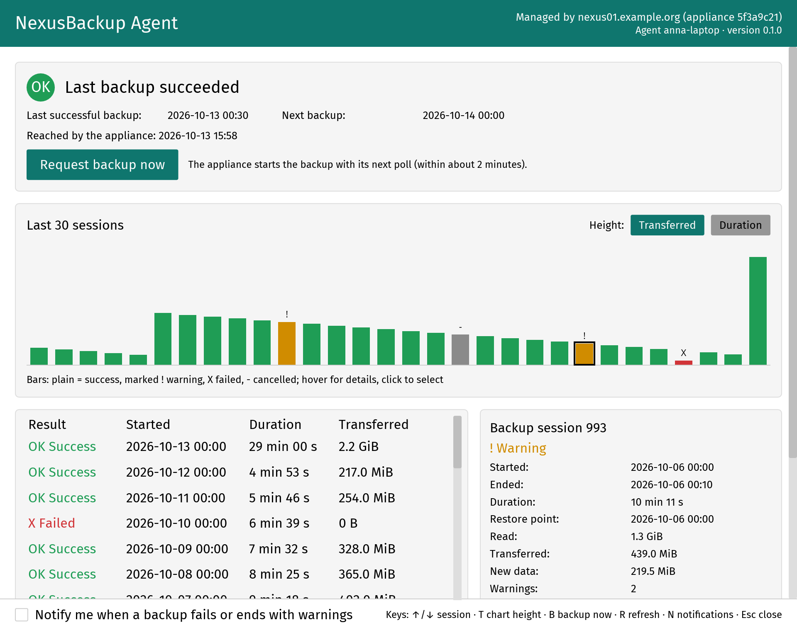

**Window.** The header shows who manages the computer (appliance name), with the header text and accent colour the
administrator set for this agent. Below it:

- **Status:** state, last successful backup, next backup, when the appliance last reached the computer.
- **Request backup now:** queues a request; the appliance picks it up with its next check of the agent (about every
  2 minutes) and starts the backup with the computer's normal job settings. One request per 10 minutes. The
  administrator can hide the button (and the tray icon) per agent.
- **Last 30 sessions:** one bar per session, oldest left. Green = success, yellow with **!** = warnings, red with
  **X** = failed, grey with **-** = cancelled. **Height** switches between transferred data and duration. Hovering
  a bar shows result, start time, duration and size; clicking it selects the session.
- **Session list and details:** started, duration, transferred data; the details show read, transferred and new
  data, warnings, the first error and the last lines of the job log.
- **Notify me when a backup fails or ends with warnings:** a desktop notification per new problem; off by default,
  stored per user.

The window follows the light or dark setting of the desktop and works with the keyboard: arrow keys select a
session, **T** switches the chart height, **B** requests a backup, **R** refreshes, **N** toggles notifications,
**Esc** closes the window (the tray icon stays).

> **Status:** built for Windows (x86_64) and Linux (x86_64, aarch64) and tested with a simulated agent service
> (Linux, KDE Plasma). It has **not run on Windows** yet, and it needs an agent version that serves the local status
> socket / pipe.

### On the endpoint: status and backup now

End users of a host see its backup status with `nexus-agent tui` (Linux): see
[16 Linux agent](16-linux-agent.md#on-the-endpoint-status-and-backup-now).

## TrueNAS

Supported: TrueNAS Community Edition (tested: 25.10.7). The appliance creates a ZFS snapshot through the TrueNAS
API, finds changes with `zfs diff`, and reads only changed files from the snapshot over SSH. A restricted SSH user
with a forced command serves the reads. Nothing is installed on TrueNAS besides a key. Restores are **download
only** (tar/zip) in v1.

### 1. Prepare TrueNAS (once, in the TrueNAS UI)

1. Create the group and user `nexusbackup`. The home directory must be on a pool dataset (e.g. `/mnt/tank/home`),
   with shell `bash`, password disabled, and SMB access off. Under "Allowed sudo commands with no password" add
   `/usr/bin/find`, `/usr/bin/tar`, `/usr/bin/realpath`, `/usr/sbin/zfs`.
2. Create a privilege for that group with exactly the roles `SNAPSHOT_WRITE`, `SNAPSHOT_DELETE`, `DATASET_READ`,
   and no web shell.
3. Create an API key for `nexusbackup` (Credentials → API Keys).
4. Turn on the SSH service, with key login only.
5. Download the TrueNAS certificate (System → Certificates, `truenas_default`) and note the SSH host key
   (`/etc/ssh/ssh_host_ed25519_key.pub`).
6. Generate an SSH key pair for the appliance (e.g. `ssh-keygen -t ed25519 -N ''`). Both halves go into the
   source form. The private key is stored sealed and is write-only.

> **Status:** Privilege model: `nexusbackup` runs `find`/`tar`/`realpath`/`zfs` via passwordless sudo, which is
> root-equivalent. The security boundary is the forced command: it accepts only four operations, only on the
> configured datasets and `nexus-*` snapshots, and only canonical paths. This model was accepted as the v1 design.

### 2. Create the source


| Field | Content |
|---|---|
| **TrueNAS host (API)**, **API port** | e.g. `nas01.acme.example.com`, 443 |
| **Connect address (optional, ip:port)** | connect here instead of resolving the host name |
| **TrueNAS user**, **API key of that user** | `nexusbackup` and its API key (write-only) |
| **SSH host**, **SSH port**, **SSH user** | default: the API host, 22, `nexusbackup` |
| **Appliance address as TrueNAS sees it** | optional: restricts the key with `from=` |
| **Datasets (one per line, e.g. tank/data)** | 1 to 64 datasets. Names may only contain A–Z a–z 0–9 `_ -`, and datasets must not overlap. |
| **Include child datasets** | also back up mounted child datasets |
| **Read files via sudo (find, tar, realpath)** | default on (needed to read files the user cannot read) |
| **Run zfs diff via sudo** | default on. Off requires `zfs allow -u nexusbackup diff <dataset>` plus traverse permission on every dataset root. |
| **TrueNAS certificate or CA (PEM)** | **pinned**: the exact certificate TrueNAS serves, or the CA that issued it. Public CAs are never trusted. |
| **SSH host key** | pinned, no trust on first use |
| **Appliance SSH private key** | write-only |
| **Appliance SSH public key** | the public half of that key. Enter it: the `authorized_keys` line below is built from it (the built-in source does not derive it from the private key). |

After **Create**, the dialog stays open and shows **Paste into the "SSH public key" field of the TrueNAS user**:
one `authorized_keys` line with `restrict`, optional `from=` and the forced command. Paste it into the user's
"SSH public key" field on TrueNAS. **Whenever you change the datasets or the sudo options, the line changes. Paste
it again.**

In a group you select datasets with checkboxes (none selected = all datasets of the source). Snapshots are named
`nas-<source id>-<pool.dataset>`. TrueNAS keeps one `nexus-<source>-<time>` snapshot per dataset as the reference
for the next incremental run. Your own snapshots are never touched.

Limits: a changed file is re-read completely. The certificate pin breaks when TrueNAS renews its certificate:
backups fail with a TLS error until you update the source. A read limit (MB/s, with windows) works as for
[Proxmox VE](#limits-guests-at-once-busy-storages-read-rate).

### Use existing snapshots (periodic snapshot task)

TrueNAS often takes periodic snapshots anyway (**Data Protection → Periodic Snapshot Tasks**, names like
`auto-2026-10-14_00-00`). Tick **Use existing snapshots (periodic snapshot task)** and give the **Snapshot name
prefix** (default `auto-`): each run then backs up the newest snapshot with that prefix of every dataset instead of
creating and deleting `nexus-<source>-<time>` snapshots.

- The next run diffs (`zfs diff`) the newest periodic snapshot against the one the last backup came from, so only
  changes are read. The snapshot name is shown under the snapshot on **Snapshots** (`@auto-…`).
- No new periodic snapshot since the last backup: the dataset is skipped (job log: `was already backed up; waiting
  for the next periodic snapshot`), not failed. Schedule the group shortly after the periodic task.
- If TrueNAS deleted the snapshot the last backup came from (its retention is shorter than the backup interval),
  the run reads everything once.
- Nothing is created or deleted on TrueNAS; the snapshot names must sort by time (the default naming does).
- The forced command must allow these snapshot names: **paste the `authorized_keys` line again** after switching
  the mode on.

> **Status:** Tested against the fake TrueNAS (incremental, skip, lost reference). The lab run against a real
> TrueNAS with a periodic snapshot task is pending.

### TrueNAS as a plugin (`plugin:truenas`)

The same connector also exists as the plugin **TrueNAS (plugin)** (source kind **TrueNAS datasets (plugin)**). It
uses the same TrueNAS setup and forced command, but runs sandboxed without access to the store or keys (see
[12 Plugins](12-plugins.md)). Differences:

- one ZFS snapshot per dataset instead of one atomic recursive snapshot per root
- TrueNAS keeps two `nexus-*` snapshots per dataset
- renamed files are transferred again
- datasets are guests named like `tank.media`, and a group **must** select them
- the `authorized_keys` line is not shown in the form. **Validate connection** writes it to the job log.

Both kinds can exist side by side, even for the same datasets: each source only touches its own `nexus-<id>-*`
snapshots. To migrate a source to the plugin:

1. Install the plugin.
2. Create a `plugin:truenas` source with the same values.
3. Validate it. Paste the line again if the datasets or flags differ.
4. Create a group with the same policy, then disable the old group.

The first plugin backup is a full read into new `plugin-truenas-…` snapshots. The old `nas-…` snapshots stay
restorable until retention removes them. When you finally delete the built-in source, delete its last
`nexus-<old id>-*` ZFS snapshot on TrueNAS by hand. The built-in kind is not deprecated.

> **Status:** The TrueNAS plugin passed its integration tests (sandbox, fake TrueNAS, local sshd). The lab run
> against a real TrueNAS VM and through the appliance image is still pending.

## NFS and SMB shares

The appliance mounts a share read-only and walks it. Unchanged files are detected from the previous snapshot by
path or inode plus size, mtime and ctime. The mount is done by a small privileged helper and is never visible in
any mount table. Restores: tar/zip download, or the files onto a host with an agent
([06 Restores](06-restores.md#restore-files-to-a-host-agents)); there is no restore into the share itself.

### Server side: give the appliance read access to everything

These are the supported setups:

- **NFS:** export the share read-only to the appliance's address with `ro,all_squash,anonuid=0,anongid=0`. Every
  request of the appliance is then root on the server: it can read everything and write nothing. Without this,
  only world-readable files are backed up, and unreadable ones make the snapshot not consistent. Only `sec=sys`
  is supported (no NFS Kerberos).

  ```text
  /export/projects  198.51.100.5(ro,all_squash,anonuid=0,anongid=0)
  ```

- **SMB:** use a dedicated backup account that can read everything. On Windows servers, make it a member of
  **Backup Operators** (the appliance opens files with backup intent). On Samba, set
  `admin users = <backup user>` on a read-only share definition, or grant read ACLs on everything. Only password
  authentication (NTLMSSP) is offered. **Kerberos is not supported in v1.**

### Create the source


Common fields: **Server (host name or IP)**, **Port** (NFS 2049, SMB 445), **Protocol version** (NFS 4.2/4.1/4.0/3,
SMB 3/3.1.1/3.02/3.0/2.1), **Scan threads** (default 16), **Server timeout (seconds)**,
**Back up extended attributes and ACLs**, **Exclude patterns**, **Include only (share paths)** and **Regex excludes** (see
[File selection](#file-selection-include-paths-regex-excludes-nested-mounts)). Snapshot directories (`.snapshot`,
`~snapshot`, `.zfs`) are always excluded.


- NFS: **Export path (e.g. /srv/share)**. For NFSv3 also the **mountd port (NFSv3)**: the appliance does not use
  the portmapper, so the server must run mountd on a fixed port (default 20048).
- SMB: **Share name**, **User**, **Domain (optional)**, **Password** (write-only), **Require signing** (default on),
  **Require encryption (SMB 3)**. SMB 2.1 has no encryption.

**Point-in-time consistency:** set **NAS snapshot directory (optional)**, e.g. `.zfs/snapshot`, `.snapshot` or
`~snapshot`. The appliance then reads the newest snapshot below it instead of the live share. Use
**Snapshot name prefix** to filter snapshot names, and **Newest snapshot by** to choose between **Name** (time-stamped
names) and **Modification time** (NetApp-style `hourly.0`). Without a NAS snapshot, the live share is read and the
backup is not point-in-time consistent. The job then shows a warning, and the alert `backup_inconsistent` is
raised once per source for the missing snapshot. Files that actually changed while being read raise the alert
every time.

A share's group has no guest selection: it backs up the whole share. Snapshots are named `share-<source id>`.

Limits: all entries are held in memory until the commit. Over SMB to Samba, a same-size rewrite with a restored
mtime is not detected. A read limit (MB/s, with windows) works as for
[Proxmox VE](#limits-guests-at-once-busy-storages-read-rate).

### Sizing, overlaps and splitting a share

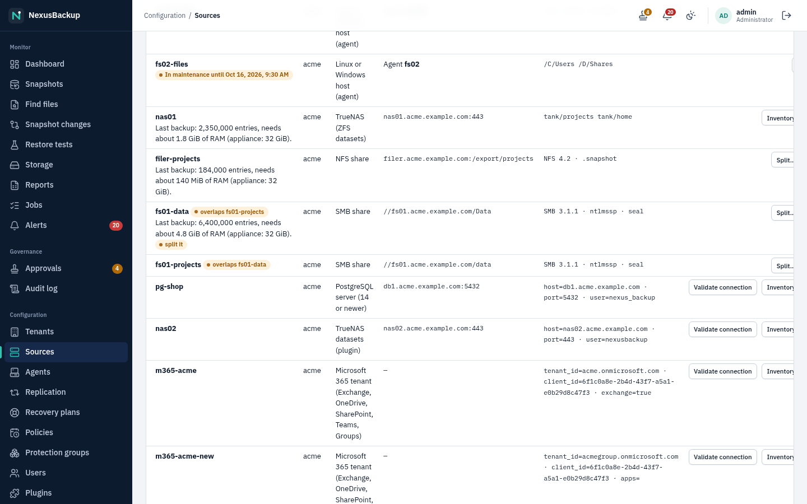

- **Sizing note.** Under each share and TrueNAS source, **Sources** shows the entries of its newest backup and the
  memory a run needs for them (about 0.8 KB per entry: the previous and the new tree are both in memory; the lab's
  1-million-file share peaked at 0.73 GB). **split it** appears above 5 million entries or when a run needs more
  than a quarter of the appliance's memory.
- **Overlap warning.** **overlaps …** appears when another source backs up the same paths: the same server and
  export or share (SMB share names ignore case) with overlapping include roots, or TrueNAS sources with nested
  datasets. The files are then read and stored twice. Narrow the include roots or remove one of the sources.
- **Split.** **Split…** turns one share into several sources, one per include root (e.g. `/Finance`, `/Projects`,
  `/Home`): each gets its own snapshots, runs and retention and needs only the memory of its part. Optionally the
  original source's groups (policy, schedule, time zone) are copied to every new source. For SMB, enter the
  password again: the stored one is sealed to the original source. The original source stays as it is: delete it,
  or narrow its include roots to what is left, once the new sources have backed up (until then the overlap warning
  shows). Its snapshots stay until retention removes them.

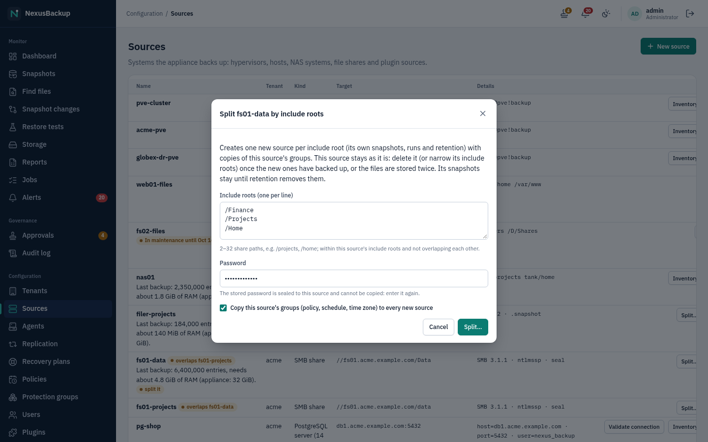

### Skipped files

Entries a share backup could not read (permission denied, a file locked by another program, a path too long) are
listed in the job log as `error <path>: <reason>`, nested mounts as notes. On the job page, **Skipped files (CSV)**
downloads them as `path,reason,kind` (the connector lists the first 1000; a last row says how many more there
were). File names that start with `=`, `+`, `-` or `@` are prefixed with `'` so spreadsheets do not run them as
formulas.

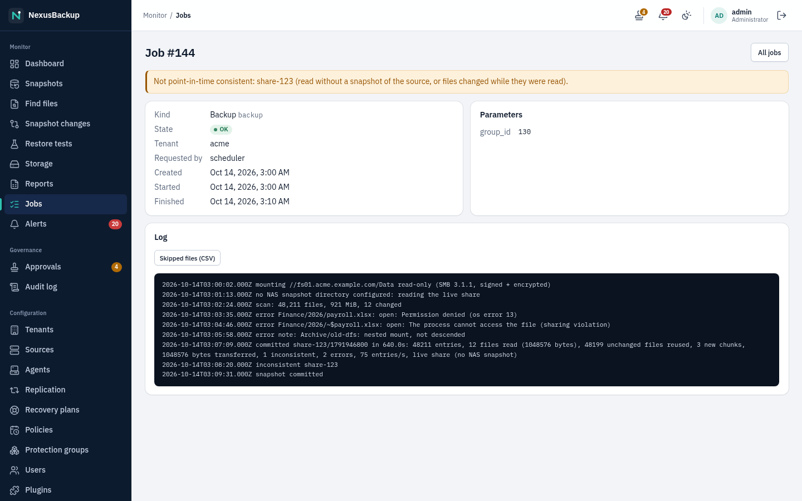

## Plugin sources (PostgreSQL, Microsoft 365)

Kinds provided by installed and **enabled** plugins appear in the **Source type** list under **Plugins**. The form
is generated from the plugin's configuration schema, and fields declared as secret are write-only. A note under
the form names the plugin, its version and its publisher. The plugin only gets network access to the endpoints
its source config declares. Installing plugins: [12 Plugins](12-plugins.md).


### PostgreSQL (14 or newer; tested 14, 17, 18)

Prepare the server. The role needs `REPLICATION` and `pg_read_all_data`:

```sql
CREATE ROLE nexus LOGIN REPLICATION PASSWORD '…';
GRANT pg_read_all_data TO nexus;     -- logical dumps
ALTER ROLE nexus CREATEDB;           -- only for dump restores to the source server
```

`pg_hba.conf` must allow the role for its databases **and** for `replication` from the appliance's address. Also
set `wal_level` to at least `replica` and keep one `max_wal_senders` and one `max_replication_slots` free.

Form fields (from the plugin manifest):

- **Server**, **Port** (5432), **User**, **Password**
- optional **More servers of the cluster (HA: host or host:port; backups use the primary)**, one per line: the other
  members of a primary/standby cluster (streaming replicas, Patroni). Every backup connects to all servers and
  uses the one that is not in recovery (`pg_is_in_recovery()` = false); **Validate connection** fails on the
  **More servers** field when none is a primary, and the job log lists each server as primary, standby or
  unreachable. The role, `pg_hba.conf` and TLS settings must be the same on all of them.
- **TLS**: `require` (encrypted, certificate not checked, the default), `verify-full` (CA below or public CAs, plus
  the host name), `disable`. **CA certificate (PEM, verify-full)**.
- **Databases offered (patterns, empty = all)**, **Databases hidden (patterns)**
- **Replication slot (cluster backups)** (default `nexusbackup`), **New base backup every … days** (default 7)
- optional **Alternate restore server**, **Alternate server port**, **Alternate server user (CREATEDB)**,
  **Alternate server password**: a second server for dump restores
- optional **Point-in-time restore host (SSH)**, **SSH port**, **SSH user (owner of the restored data directory)**
  (default `postgres`), **SSH private key (OpenSSH, unencrypted)**, **SSH host key (known_hosts line or public
  key)**: where point-in-time restores create a new data directory; optional **pg_ctl on the restore host**
  when the plugin starts the restored server and `pg_ctl` is not in a standard place

Click **Validate connection** to check connectivity and permissions.

What the group selects decides the backup type:

- **Databases selected:** one consistent logical dump per database (stream `<db>.sql`). These are restored to a
  server.
- **No database selected:** the whole cluster, as a base backup (`data/`) plus all WAL since then (`wal/`). This
  is restorable to a point in time. Runs between two base backups send only the new WAL, so such a group can run
  every 15 minutes (schedule `every 15m`, with **Keep all snapshots of the last N hours** in its policy, see
  [05 Policies](05-policies-and-groups.md#frequent-runs-keep-all-recent-snapshots)). Each cluster snapshot records
  its **recoverable range** (end of the base backup → time of the run), which the point-in-time restore dialog
  shows. Each run commits one tiny transaction on the server (it assigns a transaction ID), so that the run's time
  is reachable by a point-in-time restore even when nothing else changed.
- **High availability:** after a failover the new primary is on a new timeline: the next cluster backup is a new
  base backup from it (and creates the replication slot there). Drop the slot on the old primary when it comes
  back as a standby (`SELECT pg_drop_replication_slot('nexusbackup')`), or it retains WAL.

> **Caution:** the replication slot keeps WAL on the server between backups. If backups stop, WAL accumulates.
> When you remove the source, drop the slot (`SELECT pg_drop_replication_slot('nexusbackup')`), or set
> `max_slot_wal_keep_size`.
>
> **Status:** Logical dumps do not cover owners/grants, comments, RLS policies, aggregates, operators, range types,
> rules, foreign tables, table inheritance, large objects, publications, event triggers, statistics objects or
> roles. Each backup warns about the ones present; use a cluster backup where they matter. The plugin (1.2.0,
> incl. a streaming replica, failover by promotion, tablespaces) passed integration tests against real PostgreSQL
> 14 and 17 servers. A run on the appliance image (signed bundle, UI) is still pending.

### Microsoft 365 (Exchange, OneDrive, SharePoint, Teams)

The **Microsoft 365** plugin (`m365`) backs up a Microsoft 365 tenant through Microsoft Graph: Exchange mailboxes
(mail, calendars, contacts, and the Recoverable Items "Deletions" folder), OneDrive, SharePoint document libraries,
Teams (team files incl. the sites of private and shared channels and, optionally, channel messages) and Microsoft
365 groups (conversations, group files). Optionally it also exports the **Entra ID directory** (users, groups
with their members, devices, app registrations) as JSON files. It signs in as an **app registration** in your Entra ID with a **certificate**. There is no
password and no client secret. Details and limits: `docs/m365.md` in the repository.

Prepare Entra ID once (a Global or Application Administrator does this). The quickest way is one of the helper
scripts in the repository, run on your own admin computer (never on the appliance):

- `plugins/m365/tools/register-app.sh` needs the Azure CLI and OpenSSL. Sign in with
  `az login --tenant contoso.onmicrosoft.com --allow-no-subscriptions`, then run
  `./register-app.sh` (add `--chats`, `--teams-messages` or `--entra` for those workloads, `--backup-only` for
  read-only permissions).
- `plugins/m365/tools/register-app.ps1 -TenantId contoso.onmicrosoft.com` needs PowerShell 7.3 or later with the
  `Microsoft.Graph` module (same switches: `-Chats`, `-TeamsMessages`, `-Entra`, `-BackupOnly`).

Both create the app registration and a certificate, grant the permissions of the table below with admin consent,
and print the tenant ID, client ID, the SharePoint and OneDrive hosts and the paths of the certificate and key
files to paste into the form. Delete the output folder afterwards. To do it by hand instead:

1. Entra admin center → **App registrations** → **New registration**: "Accounts in this organizational directory
   only", no redirect URI. Note the **Application (client) ID** and the **Directory (tenant) ID**.
2. Create a certificate on any computer with OpenSSL:

   ```sh
   openssl req -x509 -newkey rsa:3072 -sha256 -nodes -days 730 \
     -subj "/CN=NexusBackup M365" -keyout nexus-m365.key -out nexus-m365.crt
   ```

   In the app registration, open **Certificates & secrets → Certificates → Upload certificate** and upload
   `nexus-m365.crt`. Do not create a client secret.
3. **API permissions → Add a permission → Microsoft Graph → Application permissions**, then **Grant admin
   consent**:

   | Workload | Needed for backups | Also needed for restores |
   |---|---|---|
   | always | `User.Read.All` | |
   | Exchange mailboxes | `Mail.Read`, `Calendars.Read`, `Contacts.Read` | `Mail.ReadWrite`, `Calendars.ReadWrite`, `Contacts.ReadWrite` |
   | OneDrive, SharePoint, Teams files | `Sites.Read.All`, `Files.Read.All` | `Sites.ReadWrite.All`, `Files.ReadWrite.All` |
   | Teams | `Team.ReadBasic.All`, `Channel.ReadBasic.All` | |
   | Teams channel messages | `ChannelMessage.Read.All` | `Teamwork.Migrate.All`, `Channel.Create` |
   | Microsoft 365 groups | `Group.Read.All` | |
   | 1:1 and group chats | `Chat.Read.All`, `Chat.ReadBasic.All` | (download only) |
   | Entra ID directory objects | `Group.Read.All`, `Device.Read.All`, `Application.Read.All` | (export only) |

4. Only if you want **Teams channel messages**: Microsoft treats the export of channel messages as a *protected
   API*. Request access for your app through the form linked from https://aka.ms/teamsgraph/requestaccess.
   Approval can take several days. Until then, leave **Teams: channel messages** off. Team files are backed up
   without it. **Chats** use the same kind of protected API and are **metered**: with payment model `B` Microsoft
   bills every exported message to the Azure subscription linked to the app. Turn them on only if you must keep
   chats.

Create the source with **Source type** **Microsoft 365 tenant (Exchange, OneDrive, SharePoint, Teams)**. Form
fields (from the plugin manifest):

- **Tenant ID (GUID) or primary domain**, **Application (client) ID of the app registration**
- **Certificate (PEM, uploaded to the app registration)** and **Private key of the certificate (PEM, RSA,
  unencrypted)**: paste the contents of `nexus-m365.crt` and `nexus-m365.key`. Both are write-only and sealed.
  Delete the key file afterwards.
- The workloads: **Exchange mailboxes (mail, calendars, contacts)**, **OneDrive**, **SharePoint sites (document
  libraries)**, **Teams: team files**, **Teams: channel messages (protected Microsoft API, needs Microsoft's
  approval)** (off by default), **Users: 1:1 and group chats (protected, metered Microsoft API; download only)**
  (off by default; each chat is saved as `.json` and as a readable `.html` page under `chats/` in the user's
  snapshot), and **Teams export payment model (channel messages and chats)**: `B` (backup use, billed by Microsoft through an
  Azure subscription linked to the app), `A` (security/compliance licences) or `evaluation` (a small free monthly
  quota, for tests). **Microsoft 365 groups: conversations, calendar, files (needs Group.Read.All)** is on by
  default; it also lets the plugin recognise team and group sites. **Entra ID directory objects: users, groups
  with members, devices, app registrations (export only; …)** is off by default because it needs three more
  permissions (table above).
- **SharePoint host** (`contoso.sharepoint.com`) and **OneDrive host** (`contoso-my.sharepoint.com`): needed for
  OneDrive, SharePoint and Teams files. If you enter wrong values, validation tells you the right ones.
- **Further app registrations (used round-robin; a throttled app hands over to the next)**: optional. Microsoft
  limits the request rate per app, so large tenants back up faster with two to four apps. Click **Add entry** per
  app and enter its **Application (client) ID** and, in **Certificate and private key**, the certificate and the
  key in one PEM (the helper scripts write it as `app.pem`). Every app needs the same permissions as the first.
  Users, sites and teams are spread over the apps; when Microsoft throttles one app, the plugin continues with the
  next one at once. If you remove an entry in the middle, enter the certificates of the entries after it again.
- Leave **Graph host**, **Sign-in host**, **HTTPS port** and **Additional CA certificate** empty. They exist for
  national clouds and test setups.

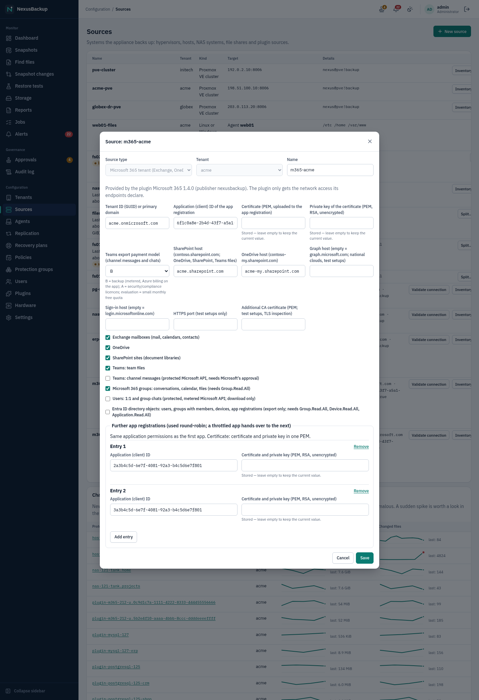

Click **Validate connection**. The plugin signs in, logs the certificate's SHA-1 thumbprint (compare it with the
one in the app registration) and makes one test call per enabled workload. A missing permission is reported
next to the workload with the permission names. With further apps, validation signs in with each of them and
names the failing one under **Further app registrations**. A sign-in failure shows Microsoft's error code (for example
`AADSTS700027` when the certificate is not uploaded to the app).

In the protection group, click **Load …** and tick the **users** (mailbox + OneDrive), **sites**, **teams** and
**groups** to back up, or use an auto-protect group (see [05 Policies and groups](05-policies-and-groups.md)). Each
becomes its own snapshot (`plugin-m365-<source>-u.…`, `-s.…`, `-t.…`, `-g.…`). Sites of teams and groups are listed
with the note "backed up with its team / group" and the tag `site:team`; users without a license carry
`license:none`. Groups of mode **All guests** leave both out. A group without any ticked
object is refused: the plugin never backs up a whole tenant as one snapshot. Backups after the first one are
incremental: the plugin asks Microsoft only for what changed (mail folders and drives) or compares the lists
(calendars, contacts, Teams messages), and unchanged items are not downloaded again.

With **Entra ID directory objects** on, the list also offers **Entra ID directory: users, groups, devices, app
registrations (export only)** (tag `type:directory`, snapshot `plugin-m365-<source>-e.directory`). Its snapshot has
one JSON file per object in `users/`, `groups/` (with `members` and `owners`), `devices/`, `applications/` and
`service-principals/`. Microsoft never hands out secrets or private keys, so app registrations contain only the
metadata of their credentials. You can browse and **download** these files, for example to compare group
memberships before and after an incident or to rebuild an object by hand. A restore into Entra ID is not offered:
the plugin refuses **Restore to the original** and **Restore to another** for this snapshot. Directory roles,
conditional-access policies and sign-in logs are not included.

If single items cannot be read even after retries (Microsoft answers with a server error), the plugin skips them
and the backup still completes: the job ends **ok** with a **warning** chip on **Jobs**, the job page names the
first skipped items, and the dashboard counts the job as a warning. The next backup tries those items again. A user
without a mailbox or OneDrive is not an error; the job log notes it.

> **Caution:** the app's application permissions are tenant-wide. To limit which mailboxes it can read, use
> Exchange Online *RBAC for Applications*. When the certificate approaches its expiry date, upload a new one,
> enter both new fields in the source, then remove the old certificate from the app.
>
> **Status:** The plugin passed its integration tests against a local Microsoft Graph simulation. A run against a
> real Microsoft 365 tenant is still pending. Not covered in this version: modified occurrences of recurring
> meetings, event attachments, contact photos, archive mailboxes, public folders, Recoverable Items other than
> "Deletions", file versions and sharing permissions, SharePoint lists and subsites. Chats are download only. Group
> calendars: Microsoft documents no app permission for them, so on a real tenant the backup most likely only notes
> "group calendar not readable". Versions 1.1 (further apps, chats, restore into another tenant, helper scripts) and
> 1.2 (skipped items as warnings, Recoverable Items, private/shared channel sites, groups) are also tested against
> the simulation only; the PowerShell helper has not been run yet. Version 1.4 (Entra ID directory objects, export
> only) is likewise tested against the simulation only.

