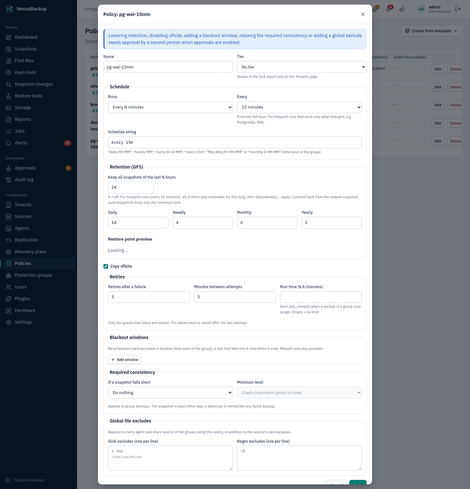
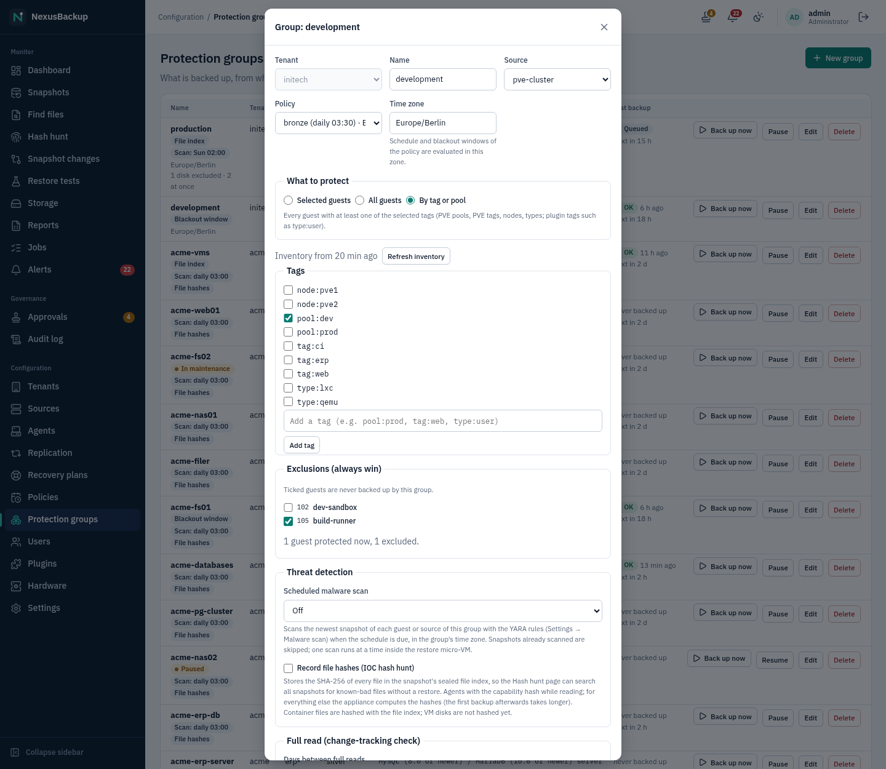
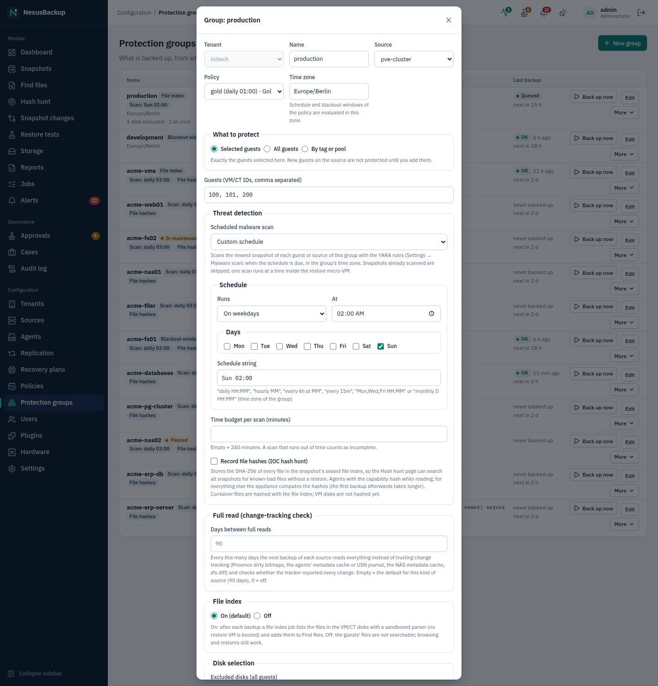
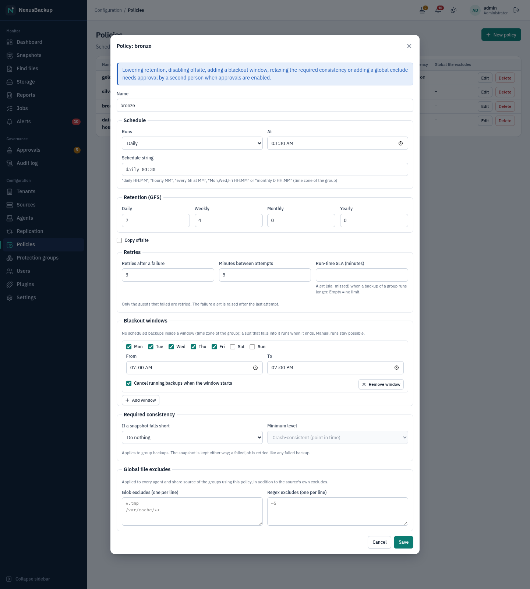
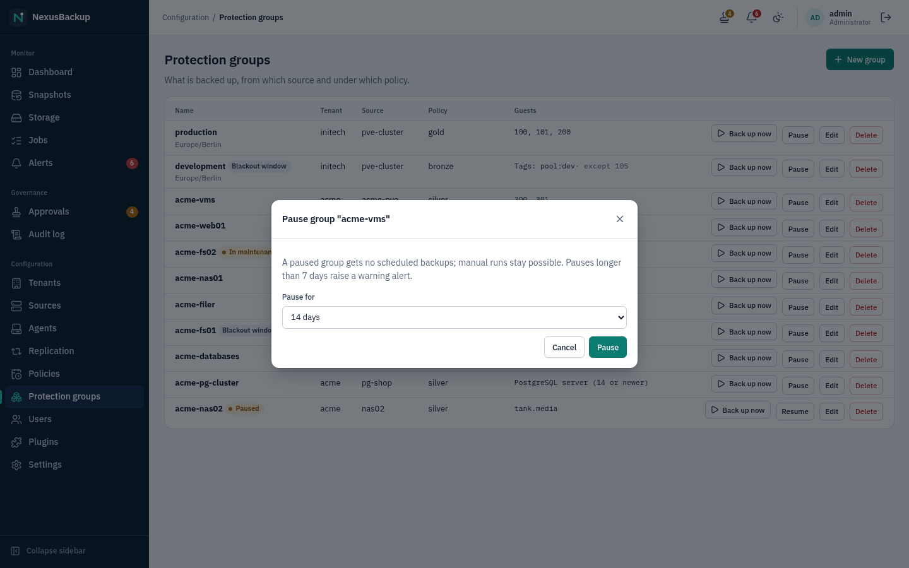
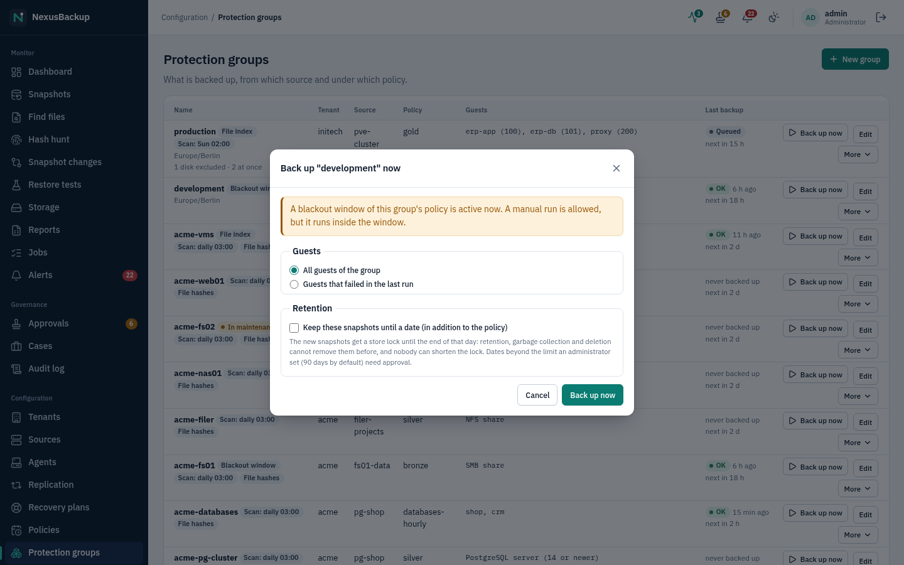
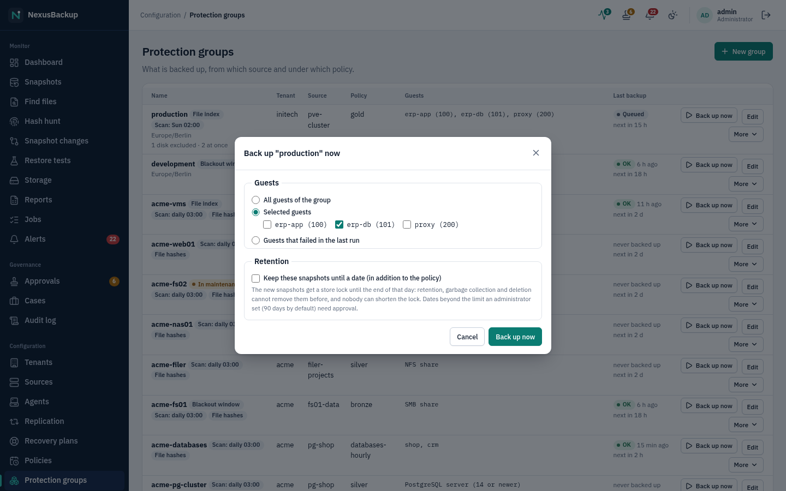

# 05 Policies and protection groups

You do not schedule individual backup jobs. You define **policies** (when to back up, how long to keep, whether to
copy offsite) and **protection groups** (which guests of a source get which policy). The scheduler does the rest.

Only administrators can change policies and groups. Operators can start a group's backup at any time with
**Back up now** on the Dashboard, cancel running jobs and pause groups (see [Run control](#run-control)).

## Policies

Open **Configuration → Policies**.

Click **New policy** (or **Edit** on an existing one) and fill in:

| Field | Meaning |
|---|---|
| **Name** | e.g. `gold`, `databases-hourly` |
| **Schedule** | when the group's backup runs, in the **time zone of the group** (see [Schedules](#schedules)) |
| **Retention (GFS)** | **Keep all snapshots of the last N hours** (0 = off, see [Frequent runs](#frequent-runs-keep-all-recent-snapshots)), then how many **Daily**, **Weekly**, **Monthly** and **Yearly** restore points to keep (0 = none of that class) |
| **Copy offsite** | upload the snapshots to the tenant's offsite target after each backup |
| **Retries** | how often a failed backup is retried (0–10, default 3) and the minutes between attempts (default 5) |
| **Run-time SLA (minutes)** | optional: raise an `sla_missed` warning when a backup of a group runs longer |
| **Blackout windows** | times in which no scheduled backups start, optionally cancelling running ones |
| **Required consistency** | optional: warn or fail when a snapshot is less consistent than a minimum level (see [Required consistency](#required-consistency)) |
| **Global file excludes** | glob patterns and regular expressions excluded from **every** agent and NFS/SMB source of the policy's groups, on top of each source's own excludes (see [File selection](04-sources.md#file-selection-include-paths-regex-excludes-nested-mounts)) |

How retention counts is explained in [01 Concepts](01-concepts.md#retention-gfs). A good starting point is the
default 14 daily, 4 weekly, 6 monthly, 2 yearly.

### Frequent runs: keep all recent snapshots

Sources whose incremental runs are cheap can run every few minutes, above all PostgreSQL cluster backups: a run
on an unchanged base backup sends only the new WAL (see [12 Plugins](12-plugins.md)). Daily/weekly/… retention
would keep only the last snapshot of each day, so a policy for such a group sets **Keep all snapshots of the last
N hours**, for example `every 15m` with 24 hours: every snapshot of the last 24 hours stays (96 restore points,
each a point-in-time restore range), older ones are thinned out to one per day, week, month and year.

- The hours count back from the **newest** snapshot of the object, not from now: if backups stop, nothing of the
  last day is pruned.
- Snapshots kept only for this reason are not locked beyond the lock every new snapshot gets when it is written
  (the store's minimum lock, 14 days by default). They are pruned once that lock has expired, so on an appliance
  with the default minimum lock the store keeps 14 days of 15-minute snapshots anyway; the space is small because
  they share their data with each other.
- Lowering the hours shortens retention and needs approval, like lowering any other class.
- Offsite copies and replication keep the daily/weekly/monthly/yearly classes only.

Rules:

- **Lowering** any retention value, switching **Copy offsite** off, **adding a blackout window**, **relaxing the
  required consistency** (a milder action, or a lower minimum level) or **adding a global file exclude** weakens
  protection. With approvals enabled the change becomes an approval request ("Pending approval: request #N …") and
  takes effect only after another administrator or security officer approves it. Raising values, removing blackout
  windows or global excludes, a stricter consistency requirement and changing the schedule, retries or SLA take
  effect immediately.
- Lowering retention never shortens existing retention locks. Snapshots that are locked stay until their lock
  expires, even if the new policy would no longer keep them.
- Deleting a policy needs approval (when approvals are enabled).
- **Copy offsite** only has an effect if the group's tenant has an offsite target
  (see [07 Offsite copies](07-offsite.md)).

### When backups run

- The scheduler checks every 30 seconds and queues a group's backup once per schedule period.
- If the appliance was down when backups were due, it runs **one** catch-up backup per group after it is back, not one
  per missed period. The same applies to a slot that passed while the group was paused, its source was in
  maintenance or a blackout window was active: it runs once when that ends.
- A failed backup is retried for the guests that failed (see [Retries](#retries)).
- At most one job per source runs at a time; further jobs of that source wait in the queue.
- After each successful backup the scheduler runs **retention** for that source and then, if the policy has
  **Copy offsite**, the **offsite copy** of the tenant.
- Garbage collection and verification run once a day per tenant (daily maintenance at 03:00 UTC).

The schedule also sets the recovery point objective (RPO) the Dashboard measures against: 24 hours for a daily
schedule, 1 hour for an hourly one, N hours for `every Nh`, the longest gap between two run days for a weekday
schedule (e.g. 3 days for `Mon-Fri`) and 31 days for a monthly one. Its key figures count an object as **RPO breached** when the last good backup is
older than 1.5 × the RPO (36 hours or 90 minutes). The **Protection status** table below them uses the same
rule: a guest shows **RPO breached** when its newest snapshot is older than 1.5 × the policy period. Guests of a paused group
(or of a source in maintenance) show **Paused** instead and do not count as breaches. See
[03 The web interface](03-web-interface.md#dashboard).

## Protection groups

Open **Configuration → Protection groups**.

A group belongs to one tenant and one source and uses one policy. Click **New group** and choose **Tenant**,
**Name**, **Source** (only sources of that tenant are offered), **Policy** and **Time zone** (an IANA name such as
`Europe/Berlin`; default `UTC`: the policy's schedule and blackout windows are evaluated in it). What you select next depends on the
kind of source:

| Source kind | What the group backs up |
|---|---|
| Proxmox VE cluster | the VMs and containers you list in **Guests (VM/CT IDs, comma separated)**, e.g. `100, 101, 200`, or all of them / those with given tags ([auto-protect](#auto-protect-all-guests-or-guests-by-tag)) |
| Linux or Windows host (agent) | the agent's host, with the paths configured in the source (nothing to select) |
| TrueNAS (ZFS datasets) | the datasets you tick; none ticked = **All guests**: every dataset of the source, including datasets added to the source later |
| NFS share / SMB share | the whole share (nothing to select) |
| Plugin source with guests (e.g. PostgreSQL) | the guests you tick after **Load …**; none ticked = the whole source (Microsoft 365: at least one user, site or team must be ticked) |
| Plugin source without guests | the whole source as configured |

For plugin sources that offer guests, click **Load …** (for PostgreSQL: **Load Databases**). The appliance starts a
short **List plugin guests** job that asks the source what it has and then shows check boxes.

For PostgreSQL the choice matters:

- Ticked databases are backed up as **logical dumps**, one snapshot per database
  (`plugin-postgresql-<source>-<database>`). They can be restored into a database.
- No database ticked backs up the **whole cluster** (base backup plus WAL, snapshot `plugin-postgresql-<source>`).
  Only this kind of snapshot supports point-in-time restore.

You can create two groups on the same PostgreSQL source (one with databases, one without) to get both, as the demo
does with `acme-databases` and `acme-pg-cluster`. See [04 Sources](04-sources.md) and [06 Restores](06-restores.md).

### Auto-protect: all guests or guests by tag

For sources with a guest inventory (Proxmox VE clusters, TrueNAS sources and plugin sources whose kind lists guests,
such as PostgreSQL or Microsoft 365) the group dialog offers **What to protect**:

| Choice | The group protects |
|---|---|
| **Selected guests** | exactly the guests you list or tick (as before) |
| **All guests** | every guest the source lists, now and in future |
| **By tag or pool** | every guest with at least one of the ticked **Tags** |

The guests come from the source's **inventory** (see [04 Sources](04-sources.md#guest-inventory)), which the
appliance refreshes every hour and when you click **Refresh inventory**. A new VM in a selected pool, or a new
Microsoft 365 user, is therefore backed up from the first backup after the next refresh, without anyone editing the
group. The audit log records it (`group.auto_protect`, with the new guests); guests that disappear from the source
are no longer selected (their snapshots stay).

Tags you can select:

| Tag | Meaning |
|---|---|
| `pool:<pool>` | member of the Proxmox VE resource pool (TrueNAS: the ZFS pool of the dataset) |
| `tag:<tag>` | Proxmox VE tag of the VM or container |
| `node:<node>` | Proxmox VE node the guest runs on (changes with migrations) |
| `type:qemu`, `type:lxc` | Proxmox VE VM or container |
| `type:user`, `type:site`, `type:team`, `type:group` | Microsoft 365 object type |
| `license:none` | Microsoft 365 user without any license |
| `site:team` | Microsoft 365 site that belongs to a team or group (backed up with the team or group) |

Guests tagged `license:none` or `site:team` are **left out** of groups of mode **All guests**, and of tag groups that
do not select that tag explicitly: unlicensed accounts usually have no mailbox or OneDrive, and team sites would
otherwise be backed up twice. To back them up anyway, select the tag (for example `license:none`) in a tag group,
or tick the guests in a group with an explicit list.

The tag list shows the tags the inventory currently contains; type a tag and click **Add tag** to select one that no
guest has yet. **Exclusions** lists the guests the selection matches: ticked guests are never backed up by this group,
even if they match (exclusions always win). The line below shows how many guests the group protects right now.

Notes:

- Before the first inventory refresh an **All guests** or **By tag or pool** group protects nothing. Its backup fails
  with "nothing to back up" and raises a `job_failed` alert; click **Refresh inventory** after creating the group.
- `node:` tags follow migrations: a group selecting `node:pve1` loses a VM that moves to another node. Prefer pools and
  PVE tags.
- Agent hosts and NFS/SMB shares have no inventory: their groups are always **Selected guests**.
- When the inventory cannot be refreshed (source unreachable), the last listing stays in effect and an
  `inventory_refresh` warning is raised (once while it is open).
- Microsoft 365 tags by Entra group (`group:<name>`) are not available yet.

### Index files in VM/CT disks

Files of host, TrueNAS, NFS/SMB and plugin snapshots are always findable under **Monitor → Find files**
([06 Restores](06-restores.md#find-a-file)). The files inside VM and container disks are not, unless you switch
it on per group: open **Edit** on a Proxmox VE group and tick **Index files in VM/CT disks (boots the restore
micro-VM after every backup)**. The list of groups shows a **File index** label for such groups.

After each backup of the group, the appliance queues a **File index** job per VM or container snapshot. For a VM it
starts the restore micro-VM, mounts the guest file systems read-only and lists them; for a container it reads the
stored tar stream. The file list is sealed with the tenant key and stored next to the snapshot. Costs: a micro-VM boot
(a few seconds with KVM) plus the walk over all files for every VM snapshot, and a full read of the container's
backup for every CT snapshot, so the index job can take minutes for large guests. Only snapshots taken while the
flag is on are indexed. Turning it on or off is recorded in the audit log (`group.index_files`).
### Excluded disks and parallel guests (Proxmox VE)

A Proxmox VE group has two more settings in its dialog:

- **Excluded disks (all guests)** and **Excluded disks per guest** (fieldset **Disk selection**, one line per guest: `101: scsi2`): disk keys of the guest configuration that are **not** backed up, e.g. `scsi1` (a scratch or
  swap disk) or `virtio2`. Enter them for **all guests of the group** or for single guests (by VM ID). Disks that
  have `backup=0` in Proxmox VE are skipped by PVE itself as before; the job log names them ("disk scsi2 of VM 101
  has backup=0: skipped by PVE"), and excluded disks too ("excluded disk scsi1 of VM 101 (… bytes): not backed up").
  Containers are not affected: exclude a mount point there with `backup=0` in PVE.
- **On restore, excluded disks are**:
  - **recreated empty (original size and settings)** (default): the restored VM gets the disk with its original size and options, filled with
    zeros, so the VM configuration stays complete (boot order, `/etc/fstab` on the guest still find a disk);
  - **left out of the restored VM**: the restored VM has no such disk (its line is removed from the configuration).
  The choice is stored in each snapshot at backup time; changing it later affects new snapshots only. Instant
  recovery always leaves excluded disks out.
- **Guests backed up at once** (1–8, default 1): how many guests of the group are backed up in parallel. The appliance spreads
  them over the cluster nodes (the next guest goes to the node with the fewest running backups). Snapshots, the
  per-guest statistics, retries of failed guests and **Cancel** work per guest as before; a cancel stops every running
  vzdump task. The same setting runs several guests of a **plugin** group (e.g. several PostgreSQL databases) at once.

Excluding another disk backs up less: like a weaker policy it needs approval when approvals are enabled. Removing an
excluded disk, the restore choice and **Guests backed up at once** take effect immediately.

> **Status:** Proxmox VE may run only one vzdump at a time on a node (its global vzdump lock): guests on the same node
> then wait for each other and parallel backups only help across nodes. This, the empty-disk restore and the
> cancellation of parallel vzdump tasks are covered by unit and scheduler tests; the VM lab run is pending.

### Changing and deleting groups

- **Edit** lets you change the name, source, policy, guests, the **What to protect** choice, tags and exclusions. Moving a group to a policy that is weaker in any
  respect (a lower retention value, no offsite copy, more global excludes) or excluding another disk needs approval,
  like weakening the policy itself.

- **Delete** needs approval when approvals are enabled. Deleting a group stops future backups. Existing snapshots are
  not deleted.

### Snapshots of objects in no group

Retention normally runs after a group's backups, with that group's policy. Snapshots of a guest, host, dataset or
share that no longer belongs to any group of its tenant (the guest was removed from its group, the group was deleted,
or it was backed up once by hand) are *orphaned*. The daily maintenance prunes them before garbage collection with the
default retention (14 daily, 4 weekly, 6 monthly, 2 yearly), so the newest restore points stay and the space of the
older ones is freed. Retention locks are respected as always. The first time this happens for an object, an `orphaned`
info alert names it (see [11 Alerts and monitoring](11-alerts-and-monitoring.md)).

- Put the object into a group again to give it that group's retention instead.
- To remove restore points you no longer need before they expire, delete them one by one on **Snapshots** once their
  lock has expired (see [06 Restores](06-restores.md#deleting-a-snapshot)).
- Tenants replicated from another appliance are not affected: their snapshots follow the replication source's
  retention.

> **Status:** The default retention for orphaned snapshots can be changed only in the catalog setting `orphan_gfs`
> (JSON like a policy's retention, e.g. `{"daily":7,"weekly":4,"monthly":3,"yearly":1}`); there is no page for it yet.
- Groups cannot be created in a tenant that is replicated from another appliance: replicated tenants receive no local
  backups (see [08 Replication](08-replication.md)).

## Run control

### Schedules

The schedule editor offers five kinds; the **Schedule string** below it is what is stored (you can also type it):

| Kind | Schedule string | Runs |
|---|---|---|
| Daily | `daily 01:30` | every day at 01:30 |
| Every N minutes | `every 15m` | every 15 minutes from the full hour (:00, :15, :30, :45; N = 5, 6, 10, 12, 15, 20 or 30) |
| Every N hours | `hourly 15`, `every 6h at 15` | every hour at :15; every 6 hours at 00:15, 06:15, 12:15, 18:15 (N = 1, 2, 3, 4, 6, 8 or 12) |
| On weekdays | `Mon,Wed,Fri 22:00`, `Mon-Fri 20:00` | on the listed days (`Mon` … `Sun`, lists and ranges) |
| Monthly | `monthly 1 03:00` | on that day of the month (a month without day 29–31 runs on its last day) |

All times are in the **time zone of the group**. Daylight saving time is handled: a time that does not exist on the
day the clocks go forward (for example 02:30 in Central Europe) runs one hour later (03:30); a time that occurs twice
when the clocks go back runs once. Groups created before this release use `UTC`, so their backups keep their times.

### Retries

When a group's backup fails, the scheduler queues a new attempt after **Minutes between attempts**, for **the guests
that failed** only (the ones without a committed snapshot in the job log; if that cannot be told, for example for a
share, the whole group). The failed job's log ends with `attempt 1 of 4 failed; retry as job N in 5 min`, and the
job list shows the attempt number. The `job_failed` alert is raised only after the last attempt failed
("… failed after 4 attempts: …"). Retries apply to scheduled and manual group backups; they are not created while
the group is paused or its source is in maintenance. Set **Retries after a failure** to 0 to alert on the first
failure.

### Blackout windows

A blackout window is a time range (**From**, **To**, in the group's time zone) on the selected start days (none
selected = every day). A window whose end is before its start runs over midnight (e.g. 22:00–06:00). Inside a
window the scheduler starts no scheduled backups; a slot that falls into the window runs when it ends. **Back up
now** stays possible; the dialog warns that a window is active. Retries are not held by a window.

With **Cancel running backups when the window starts**, a backup of the policy's groups that started before the
window and is still running when it begins is cancelled (as if an operator had cancelled it, actor `blackout` in the
job). A backup started by hand inside the window is left alone.

Adding a window needs approval when approvals are enabled (it reduces protection); removing one does not.

### Run-time SLA

With **Run-time SLA (minutes)** set, a group backup that is still running after that time raises one
`sla_missed` warning per job (see [11 Alerts and monitoring](11-alerts-and-monitoring.md)). The job keeps running.

### Required consistency

Every snapshot records how consistent it is: **application**, **crash**, **inconsistent** or **unknown** (see
[06 Restores](06-restores.md#consistency)). Under **Required consistency** a policy sets:

- **If a snapshot falls short**: **Do nothing** (default), **Warn (alert)** or **Fail the job (and warn)**.
- **Minimum level**: **Application-consistent** or **Crash-consistent (point in time)**. **inconsistent** and
  **unknown** never meet a minimum.

With **Warn**, a snapshot below the minimum raises one `consistency` warning per guest (alert key
`consistency:<tenant>/<guest>`). It resolves by itself with the next snapshot of that guest that meets the minimum.
With **Fail**, the backup job also ends **failed**: the snapshot is kept (it is still a restore point), and the job is
retried like any failed backup, which helps when, say, the guest agent was not running yet.
The requirement applies to backups of the policy's groups (scheduled, **Back up now** and retries). A backup of a
single VM through the API outside a group is not checked.

Typical settings: **Warn** at **Application-consistent** for database servers (finds VMs whose guest agent stopped
working), **Fail** at **Crash-consistent** for file servers backed up by an agent (finds hosts read without a
snapshot).

### Pausing a group

**Pause** on the Protection groups page stops scheduled backups of the group for 1–30 days or until **Resume**.
Manual backups stay possible, and nothing is deleted. A paused group shows a **Paused** badge, and the Dashboard shows
its guests as **Paused** instead of overdue. A pause of more than 7 days (or until resumed) raises a `paused` warning,
so a forgotten pause does not go unnoticed. Pausing needs no approval but is recorded in the audit log
(`group.pause`, `group.resume`). The Protection groups page is for administrators; operators may pause and resume
too, through the API (`POST /api/v1/groups/{id}/pause` with `{"until": <unix time>}` or `{}` for "until resumed",
`POST /api/v1/groups/{id}/resume`).

To stop backups of all groups of a source (for example during a host upgrade), put the source into
[maintenance](04-sources.md#maintenance) instead.

### Back up now

**Back up now** (Protection groups page or Dashboard) asks what to back up:

- **All guests of the group**,
- **Selected guests** (groups with more than one guest), or
- **Guests that failed in the last run**: refused when the group's last finished run did not fail.

Running jobs can be cancelled from the job list or the job's page (see
[03 The web interface](03-web-interface.md#jobs)).

## Tips

- Put guests with the same recovery requirements into one group; a group's backup runs them one after the other.
- Use an hourly schedule (`hourly MM`) only where one backup run is short. A logical PostgreSQL dump, for example,
  reads the whole database on every run (storage stays small thanks to deduplication).
- Check the Dashboard the morning after you create a group: every guest should be **Protected**, and nothing of the
  group should appear under **Objects needing attention**.
- Objects counted as **Not in a group** on the Dashboard are known to the appliance (from the inventory of each
  source, enrolled agents and NFS/SMB sources) but not backed up. The Dashboard lists them under **Not in a group**;
  add them to a group, use an **All guests** group, or decide consciously to leave them out (an exclusion documents
  that decision).
