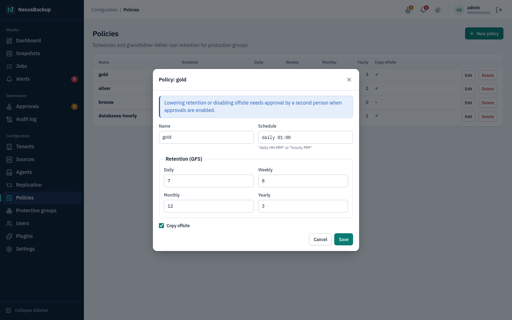
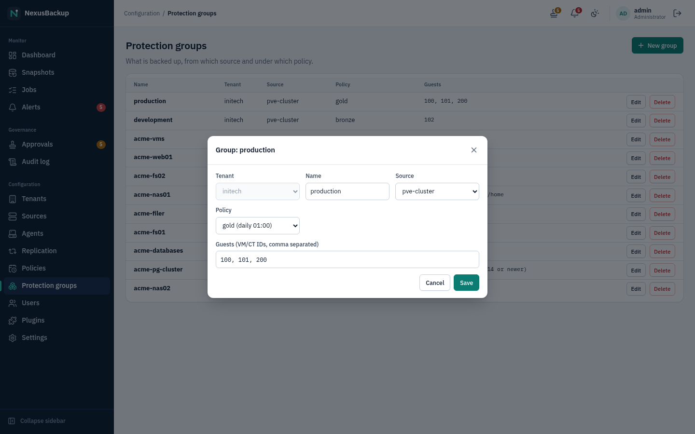
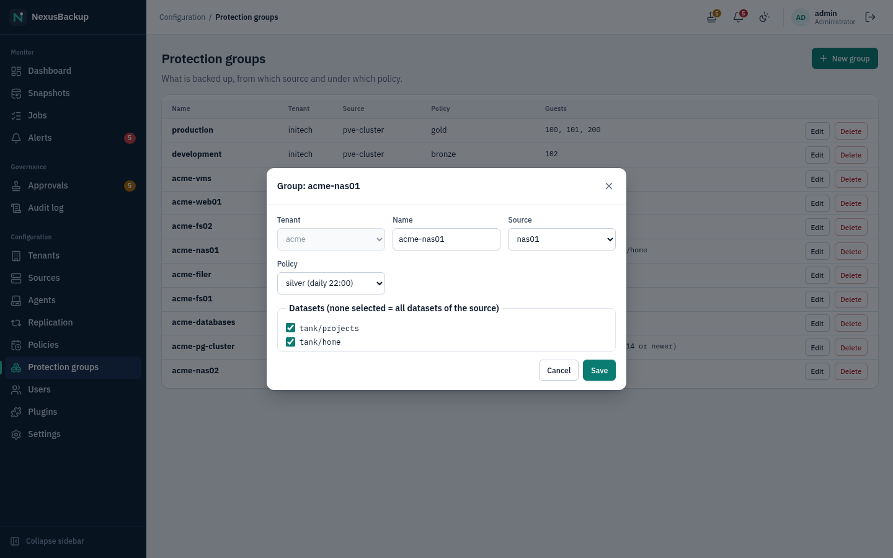
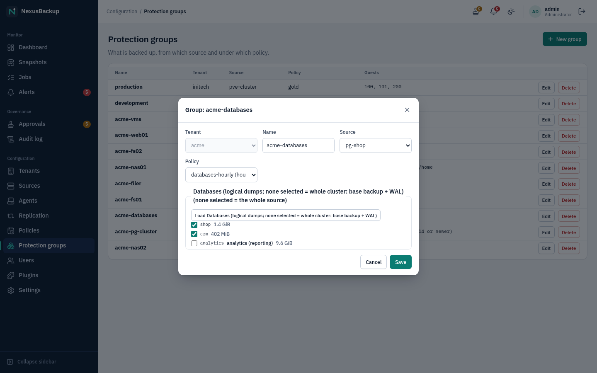

# 05 Policies and protection groups

You do not schedule individual backup jobs. You define **policies** (when to back up, how long to keep, whether to
copy offsite) and **protection groups** (which guests of a source get which policy). The scheduler does the rest.

Only administrators can change policies and groups. Operators can start a group's backup at any time with
**Back up now** on the Dashboard.

## Policies

Open **Configuration → Policies**.

Click **New policy** (or **Edit** on an existing one) and fill in:

| Field | Meaning |
|---|---|
| **Name** | e.g. `gold`, `databases-hourly` |
| **Schedule** | `daily HH:MM` (once a day at that time) or `hourly MM` (every hour at that minute). Times are **UTC**. |
| **Retention (GFS)** | how many **Daily**, **Weekly**, **Monthly** and **Yearly** restore points to keep (0 = none of that class) |
| **Copy offsite** | upload the snapshots to the tenant's offsite target after each backup |

How retention counts is explained in [01 Concepts](01-concepts.md#retention-gfs). A good starting point is the
default 14 daily, 4 weekly, 6 monthly, 2 yearly.

Rules:

- **Lowering** any retention value or switching **Copy offsite** off weakens protection. With approvals enabled the
  change becomes an approval request ("Pending approval: request #N …") and takes effect only after another
  administrator or security officer approves it. Raising values and changing the schedule take effect immediately.
- Lowering retention never shortens existing retention locks. Snapshots that are locked stay until their lock
  expires, even if the new policy would no longer keep them.
- Deleting a policy needs approval (when approvals are enabled).
- **Copy offsite** only has an effect if the group's tenant has an offsite target
  (see [07 Offsite copies](07-offsite.md)).

### When backups run

- The scheduler checks every 30 seconds and queues a group's backup once per schedule period.
- If the appliance was down when backups were due, it runs **one** catch-up backup per group after it is back, not one
  per missed period.
- At most one job per source runs at a time; further jobs of that source wait in the queue.
- After each successful backup the scheduler runs **retention** for that source and then, if the policy has
  **Copy offsite**, the **offsite copy** of the tenant.
- Garbage collection and verification run once a day per tenant (daily maintenance at 03:00 UTC).

The schedule also sets the recovery point objective (RPO) the Dashboard measures against: 24 hours for a daily
schedule, 1 hour for an hourly one. Its key figures count an object as **RPO breached** when the last good backup is
older than 1.5 × the RPO (36 hours or 90 minutes). The **Protection status** table below them uses the same
rule: a guest is **Overdue** when its newest snapshot is older than 1.5 × the policy period. See
[03 The web interface](03-web-interface.md#dashboard).

## Protection groups

Open **Configuration → Protection groups**.

A group belongs to one tenant and one source and uses one policy. Click **New group** and choose **Tenant**,
**Name**, **Source** (only sources of that tenant are offered) and **Policy**. What you select next depends on the
kind of source:

| Source kind | What the group backs up |
|---|---|
| Proxmox VE cluster | the VMs and containers you list in **Guests (VM/CT IDs, comma separated)**, e.g. `100, 101, 200` |
| Linux or Windows host (agent) | the agent's host, with the paths configured in the source (nothing to select) |
| TrueNAS (ZFS datasets) | the datasets you tick; none ticked = all datasets of the source |
| NFS share / SMB share | the whole share (nothing to select) |
| Plugin source with guests (e.g. PostgreSQL) | the guests you tick after **Load …**; none ticked = the whole source (Microsoft 365: at least one user, site or team must be ticked) |
| Plugin source without guests | the whole source as configured |

For plugin sources that offer guests, click **Load …** (for PostgreSQL: **Load Databases**). The appliance starts a
short **List plugin guests** job that asks the source what it has and then shows check boxes.

For PostgreSQL the choice matters:

- Ticked databases are backed up as **logical dumps**, one snapshot per database
  (`plugin-postgresql-<source>-<database>`). They can be restored into a database.
- No database ticked backs up the **whole cluster** (base backup plus WAL, snapshot `plugin-postgresql-<source>`).
  Only this kind of snapshot supports point-in-time restore.

You can create two groups on the same PostgreSQL source (one with databases, one without) to get both, as the demo
does with `acme-databases` and `acme-pg-cluster`. See [04 Sources](04-sources.md) and [06 Restores](06-restores.md).

### Changing and deleting groups

- **Edit** lets you change the name, source, policy and guests. Moving a group to a policy that is weaker in any
  respect (a lower retention value or no offsite copy) needs approval, like weakening the policy itself.
- **Delete** needs approval when approvals are enabled. Deleting a group stops future backups. Existing snapshots are
  not deleted.

> **Status:** Retention runs as part of a group's backups, with that group's policy. Snapshots of guests that no
> longer belong to any group are therefore not pruned automatically, and the web interface has no function to delete
> individual snapshots. They keep using space until the guest is in a group again.
- Groups cannot be created in a tenant that is replicated from another appliance: replicated tenants receive no local
  backups (see [08 Replication](08-replication.md)).

## Tips

- Put guests with the same recovery requirements into one group; a group's backup runs them one after the other.
- Use an hourly schedule (`hourly MM`) only where one backup run is short. A logical PostgreSQL dump, for example,
  reads the whole database on every run (storage stays small thanks to deduplication).
- Check the Dashboard the morning after you create a group: every guest should be **Protected**, and nothing of the
  group should appear under **Objects needing attention**.
- Objects counted as **Not in a group** on the Dashboard are known to the appliance (e.g. VMs of a connected cluster)
  but not backed up; add them to a group or decide consciously to leave them out.
