# 06 Restores

Every restore starts on the **Snapshots** page. Pick a snapshot, open its **Restore** menu (or **Browse files**),
choose the restore type, and the appliance queues a job. The job's detail page shows its log live. The appliance initiates every connection, as it does for
backups. It reaches PVE nodes, agents and database servers. Nothing on the source side reaches the appliance.

## Who may restore

| Role | Restores |
|---|---|
| **Administrator** | all restore types, all tenants |
| **Operator** | all restore types, all tenants |
| **Tenant user** | all restore types, own tenant only (the UI shows only that tenant's snapshots) |
| **Security officer** | none: reads everything, restores nothing |

Restores need no approval. They write only to new
targets or to targets you confirm explicitly. Existing backups are never touched. The one exception is
**Replace the original guest** (below). It changes the original guest, so it needs approval, and only
administrators and operators can request it.


## Which restores a snapshot offers

Each snapshot row has a **Browse files** button and a **Restore** menu. Click **Restore** to see the restores that fit
the snapshot; each entry has a short explanation below its name.


The snapshot name tells you what was backed up. The menu follows from it:

| Snapshot name | Source | **Restore** menu | Other button |
|---|---|---|---|
| `vm-<id>` | Proxmox VE virtual machine | **Full restore to a new VM / container**, **Instant recover**, **Restore files to a host…** | **Browse files** |
| `ct-<id>` | Proxmox VE container | **Full restore to a new VM / container**, **Restore files to a host…** | **Browse files** |
| `host-<agent id>` | Linux/Windows host (agent) | **Restore to path** | **Browse files** |
| `nas-<source>-<pool.dataset>` | TrueNAS dataset (built-in connector) | **Restore to a host…** | **Browse files** |
| `share-<source>` | NFS / SMB share | **Restore to a host…** | **Browse files** |
| `plugin-<plugin>-<source>[-<guest>]` | plugin source, e.g. PostgreSQL or Microsoft 365 | the plugin's restores that apply to this kind of snapshot (see below); **Restore to a host…** if the plugin offers a download | the plugin's download button, e.g. **Download (tar/zip)** |

Plugin snapshots come in two kinds: a **guest** snapshot (`plugin-<plugin>-<source>-<guest>`, e.g. one database or
one mailbox) and a **source** snapshot (`plugin-<plugin>-<source>`, the whole source, e.g. a PostgreSQL cluster). A
plugin declares for each of its restores whether it applies to guest snapshots, source snapshots or both, and the
menu offers only the matching ones. The appliance refuses a restore that does not match the snapshot kind.

Use the **Tenant** and **Guest (e.g. vm-100)** filters to narrow the list. Each row shows **Local**,
**Offsite** and **Verified** marks, the **Locked until** date and the **Consistency** of the snapshot. A
locked snapshot cannot be deleted before that date (see [01 Concepts](01-concepts.md)). **Changes** opens the
snapshot diff against the previous snapshot ([11 Alerts and monitoring](11-alerts-and-monitoring.md#snapshot-changes-diff)).

### Anomalous snapshots: restore the latest clean one

A snapshot with a red **Anomalous** badge was flagged by the ransomware checks: far more new data than usual, data
that no longer compresses, ransom-note file names or a mass rename of files (see
[11 Alerts and monitoring](11-alerts-and-monitoring.md#flagged-snapshots)). Its files may be encrypted.

Every restore dialog opened on a flagged snapshot (**Full restore**, **Instant recover**, plugin restores,
**Restore to a host…**, **Restore to path**) and the **Legal hold…** dialog **switch to the latest clean snapshot
before it**. A yellow notice names both snapshots; **Use the flagged snapshot instead** switches back (for example to
fetch files changed after the last clean snapshot that were not hit), **Use the latest clean snapshot** returns.
**Restore several** picks the latest clean snapshot of each guest and notes when a newer flagged one was skipped.
Snapshots whose flag a security officer cleared (**Flag cleared**) count as clean. When malware scans ran (on
request or scheduled per group), **the newest snapshot a scan found clean is preferred** over newer snapshots that
were never scanned, both in these dialogs and in **Restore several**.

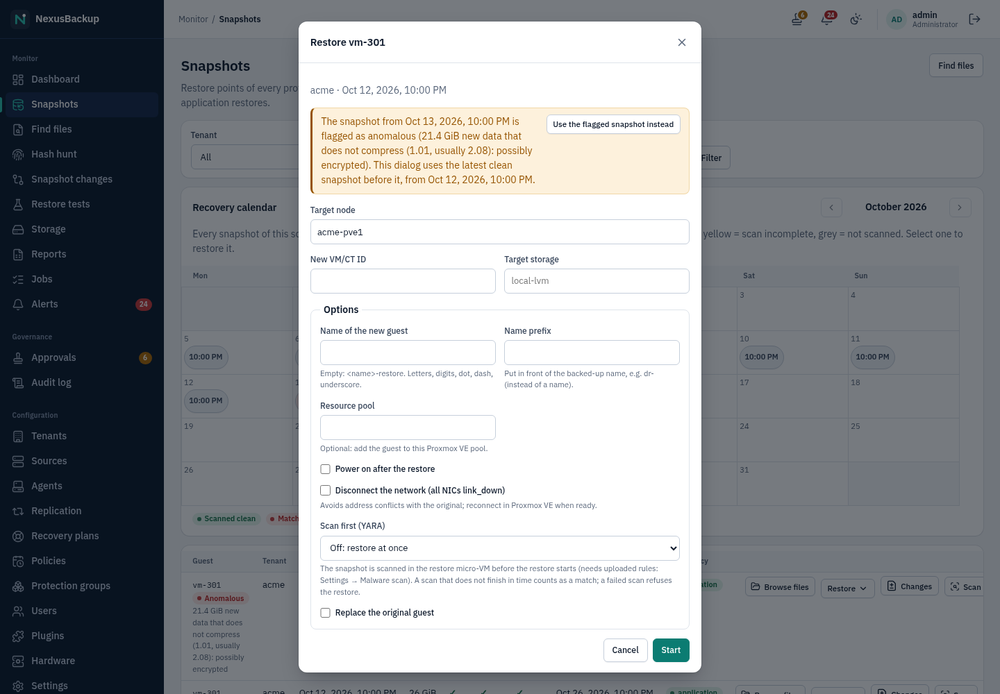

Filter the Snapshots page to one guest or source to see its **Recovery calendar**: every snapshot of the month by
day, coloured by its scan state (green scanned clean, red matches or flagged, yellow scan incomplete, grey not
scanned). Selecting a snapshot opens its first restore action. See
[11 Alerts and monitoring](11-alerts-and-monitoring.md#scheduled-scans-and-the-recovery-calendar).

> **Status:** The file browser and **Find files** show flagged snapshots without a notice.

### Scan first (secure restore)

When YARA rules are uploaded (**Settings → Malware scan**, see
[11 Alerts and monitoring](11-alerts-and-monitoring.md#malware-scan-yara)), the **Full restore**, **Instant
recover**, plugin restore and **Restore to a host…** dialogs offer **Scan first (YARA)**:

- **Off: restore at once** (default);
- **Scan; on a match refuse the restore**: the restore job waits on **Jobs** (state *queued*, log "scan first:
  snapshot_scan job … queued") until the snapshot was scanned in the restore micro-VM. Clean: it runs. A match, or a
  scan that ran out of time: the job fails with "scan first: … restore refused" (audit `restore.refused`);
- **Scan; on a match restore with the network disconnected** (full restore and instant recovery only): on a match
  the guest is restored anyway, with every network card disconnected (`link_down`, audit `restore.link_down`), so
  you can inspect or clean it without it reaching the network.

A scan that fails (no rules any more, rules that do not compile, the micro-VM did not start) always refuses the
restore. A match also flags the snapshot and raises a `malware` alert, so the next restore dialog defaults to the
latest clean snapshot before it. Scanning a large VM takes time (one scan at a time, at most 4 hours); for
urgent restores scan the snapshot ahead (**Scan** on **Snapshots**).

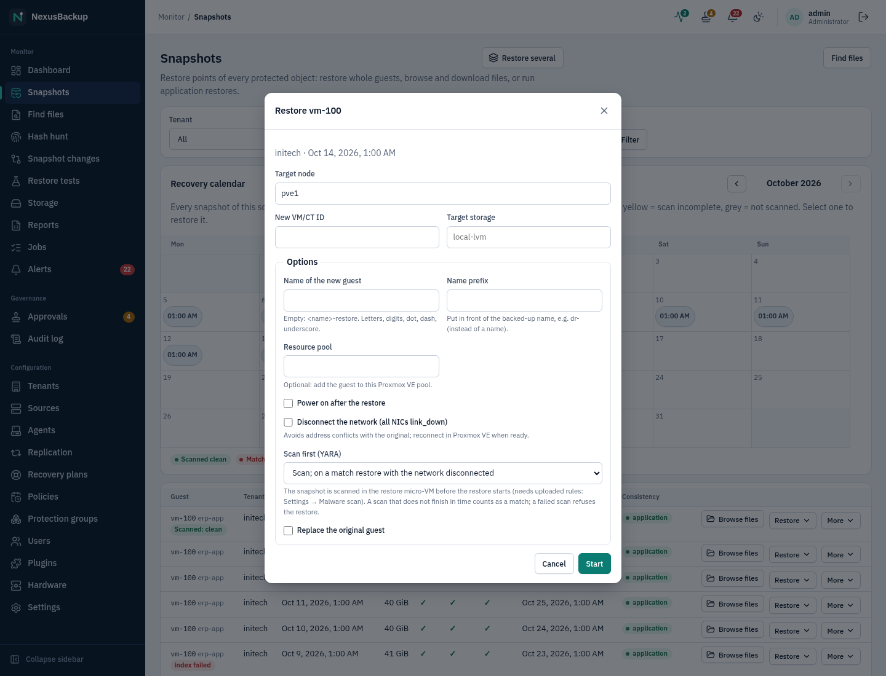

> **Status:** The scan runs in the restore micro-VM with Debian's `yara` 4.5. The micro-VM test boots it with real
> file systems (ext4, XFS, NTFS, btrfs, vfat, LVM, ZFS) and a file-tree tar and checks matches, skipped large files
> and that symlinks are not followed; the hold-and-verdict logic is covered by scheduler tests. A run on the
> appliance VM against a real VM snapshot is a lab step that is still open. **Restore several** and downloads from
> the file browser have no scan-first option in the UI.

### Flagged snapshots: restores to production need approval

A snapshot counts as **flagged** while it carries an anomaly flag or a malware scan found matches in it, and no
security officer cleared the flag. Restoring such a snapshot **to production** needs a second person:

- **Production restores** are: a full restore that replaces the original guest or starts with the network
  connected (**Disconnect the network** not ticked), an instant recovery with the network connected, an instant
  disk recovery (the disk goes into a running VM), **Restore to a host…** to the original paths (`/`) or with
  **Overwrite** other than **Never**, and plugin restores.
- **Isolated restores stay possible without approval**: restores with every network card disconnected, files to
  another path without overwriting, downloads, mounts, the file browser and restore tests.

The restore dialogs show a yellow notice when the chosen options are a production restore of a flagged snapshot,
with buttons that switch to the isolated variant (**Disconnect the network**, **Restore to another path without
overwriting**). Usually the dialog already uses the latest clean snapshot (above); the notice appears when you chose
the flagged one on purpose.

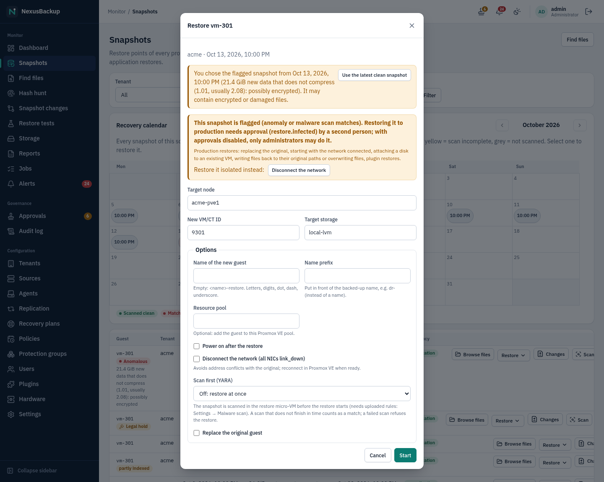

When you start it anyway, the restore becomes the approval request `restore.infected` ("Approval requested:
request #… (restore of a flagged snapshot)"): another administrator or security officer checks the request on
**Approvals** (tenant, kind, parameters and the reason of the flag) and approves it; then the scheduler runs the
restore. With approvals disabled, only **administrators** may start such a restore (it runs at once and is
audited); other roles get "restore it isolated: network disconnected or another path", and API tokens are always
refused. **Restore several** refuses flagged snapshots unless **Disconnect the network** is ticked.

To find the snapshot to restore from, use **Scan back** ([11 Alerts and monitoring](11-alerts-and-monitoring.md#scan-back-to-the-last-clean-snapshot)):
it marks the **Recommended restore point**, which the restore dialogs then prefer.

During incident mode or a tenant lockdown, restores to production can be **frozen** altogether
([14 Disaster recovery](14-disaster-recovery.md#freezes-during-an-incident)); isolated restores still work.

> **Status:** Implemented in Phase 29 (API tests, demo backend); a lab run is pending.

### Consistency

The **Consistency** badge shows how consistent the snapshot is. Hover over it for an explanation.

| Badge | Meaning | Typical source |
|---|---|---|
| **application** | The applications were quiesced, or the guest was off. | VM with a running QEMU guest agent (vzdump freezes and thaws the file systems); stopped VM or container; agent with pre/post hooks; Windows agent (VSS writers); plugin with application-consistent backups (e.g. database dumps) |
| **crash** | A point-in-time snapshot without quiescing, like pulling the power plug. | VM without guest agent, or the freeze failed / was skipped; running container (frozen, then storage snapshot); Linux agent with a volume snapshot but no hooks; NAS / TrueNAS snapshot |
| **inconsistent** | Read live, without a snapshot. Files may have changed while they were read. | agent or share without a usable snapshot |
| **unknown** | No information. | snapshots taken before this version, replicated or offsite-only snapshots |

For VMs the level comes from the vzdump task log on Proxmox VE: `issuing guest-agent 'fs-freeze' command` and
`… 'fs-thaw' command` mean application-consistent; `unable to freeze guest fs …` or `skipping guest filesystem
freeze …` mean crash-consistent. To get application-consistent VM snapshots, install the QEMU guest agent in
the guest and enable it in the VM options. A policy can require a minimum level (see
[05 Policies and groups](05-policies-and-groups.md)).

## Restore a VM or container (full restore)

1. On **Snapshots**, open **Restore** on the snapshot and choose **Full restore to a new VM / container**.
2. Fill in the dialog:
   - **Target node**: the PVE node that runs the restore. The list offers the nodes of the tenant's PVE
     sources.
   - **New VM/CT ID**: an ID that is not in use on the cluster yet.
   - **Target storage**: the PVE storage for the disks or the root file system, e.g. `local-lvm`. It must be a
     storage that holds VM disk images / container volumes, not the NexusBackup storage itself.
3. Set the **Options** you need (all optional):
   - **Name of the new guest**: the VM name or container host name. Empty: the backed-up name with
     `-restore` appended, e.g. `web1-restore`.
   - **Name prefix**: instead of a name, put a prefix in front of the backed-up name, e.g. `dr-` gives
     `dr-web1`.
   - **Resource pool**: adds the guest to this Proxmox VE pool. The pool must exist, and the PVE API
     token needs `Pool.Allocate` on it.
   - **Power on after the restore**: starts the guest when the restore has finished.
   - **Disconnect the network (all NICs link_down)**: sets `link_down=1` on every network interface before
     the guest first starts. Use it when the original still runs on the same network. Reconnect the
     interfaces in Proxmox VE when you are ready.
   - **Replace the original guest**: see below.
4. Click **Start**. The job page opens.

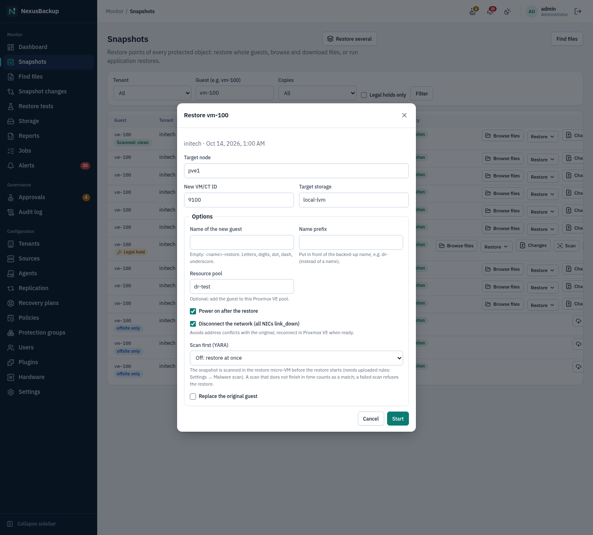

What happens:

- **VMs**: PVE creates the VM from the backed-up configuration. The node attaches the appliance's read-only
  NBD export (over the restricted SSH helper) as a block device and copies every disk.
- **Containers**: PVE restores them as **unprivileged** containers with new MAC addresses (`unique=1`).
  PVE refuses privileged restores from backup providers. The node extracts the container into a staging
  directory under `/var/tmp/nexusbackup` first, so it needs that much free space on its root file system.
- PVE cannot live-restore from a backup provider: the guest starts only after the copy has finished. To
  start it immediately, use instant recovery.

A new guest never overwrites an existing one: PVE refuses a VM/CT ID that is in use.

> **Status:** Full VM and CT restore was verified in the nested PVE 9 lab (single node). Multi-node clusters
> are untested. The PVE API token needs `SDN.Use` on the guest's bridge zone for restores. The restore
> options (name, pool, power on, link_down) and replacing the original are covered by unit tests against a
> simulated PVE API; the lab run on a real cluster is pending.

### Replace the original guest

Use this when the original guest is broken and the restored copy should take its place. Tick **Replace the
original guest** in the full-restore dialog. The original is the guest with the snapshot's ID (for example
VM 100 for `vm-100`).

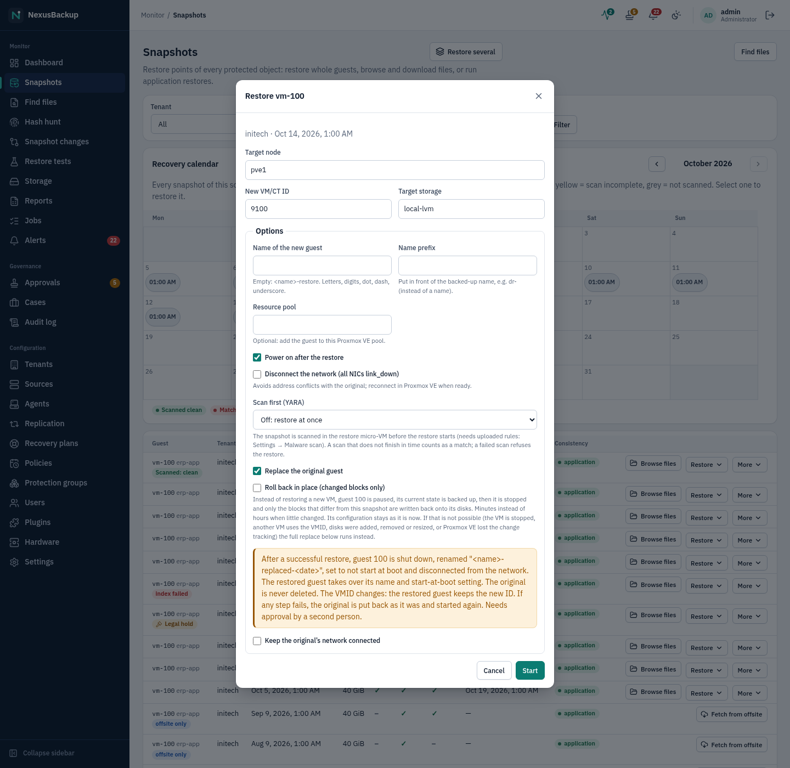

The request needs approval by a second person (administrator or security officer) when approvals are enabled
(see [10 Approvals and audit](10-approvals-and-audit.md)). After the approval, the scheduler runs the restore
job. The steps run in this order:

1. The snapshot is restored to the **new** VM/CT ID. The restored guest keeps the original's MAC addresses,
   stays switched off and does not start at boot.
2. Only if the restore succeeded: the original is shut down (hard stop after 3 minutes).
3. The original is renamed `<name>-replaced-<YYYYmmddHHMM>` (UTC), set to not start at boot (`onboot=0`), and
   all its network interfaces are disconnected (`link_down=1`). Tick **Keep the original's network
   connected** to leave them as they are.
4. The restored guest gets the original's name and start-at-boot setting.
5. With **Power on after the restore** ticked, the restored guest starts.

Keep in mind:

- **The VM/CT ID changes.** The restored guest keeps the new ID. Update monitoring, firewall rules, HA
  resources, replication jobs and backup groups that refer to the old ID. A protection group with the old ID
  still backs up the original, now switched off.
- **The original is never deleted.** Remove it in Proxmox VE yourself once the restored guest works.
- A replacing restore can be cancelled while it waits in the queue, not while it runs: stopping it half-way
  could leave the original switched off and renamed.
- If any step after the restore fails, the appliance puts the original back as it was (name, start at boot,
  network) and starts it again if it was running. The restored guest stays, switched off, under its
  `-restore` name. The job log lists every step, including a rollback that did not complete.

### Restore several guests at once

**Restore several** (top right on the Snapshots page) restores many guests of one tenant in one step, for
example a whole protection group after losing a cluster.

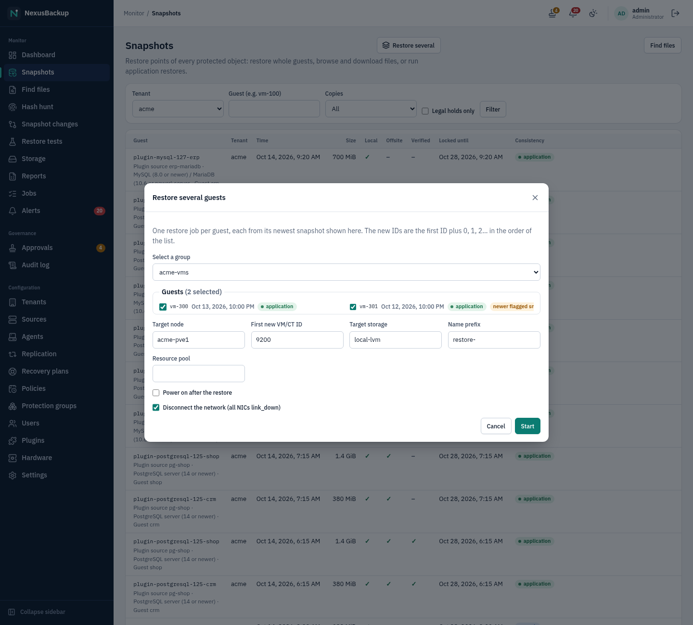

1. Pick the tenant (if you see several), then tick the guests or choose **Select a group** to tick the
   guests of a protection group. The list shows each VM and container with its newest local snapshot.
2. Enter **Target node**, **Target storage** and **First new VM/CT ID**. The guests get consecutive IDs in
   the order of the list: the first ID, the first ID + 1, and so on.
3. Set the options: **Name prefix** (default `restore-`), **Resource pool**, **Power on after the restore**,
   **Disconnect the network** (on by default).
4. Click **Start**. The appliance creates one restore job per guest and checks all of them first: if one
   guest cannot be restored (e.g. an ID out of range), no job is created. The request is audited once
   (`job.create_many`).

Replacing originals is not offered here. Request it per guest, so that each replacement gets its own
approval.

## Instant recovery (VMs)

Instant recovery boots the VM straight from the backup, then moves its disks to real storage while it runs.

1. Open **Restore** on a `vm-` snapshot and choose **Instant recover**.
2. Enter **Target node**, **New VM/CT ID** and **Target storage** (the storage the disks move to).
3. Check the options:
   - **Name prefix** (optional): put in front of the backed-up name. Empty: `<name>-restore`.
   - **Resource pool** (optional).
   - **Power on**: on by default. Switched off, the VM is created powered off and its disks are moved
     while it is off. It is ready to start afterwards.
   - **Disconnect the network (all NICs link_down)**: on by default, because the original often still
     runs. Reconnect the interfaces in Proxmox VE when you are ready.
4. Click **Start**.

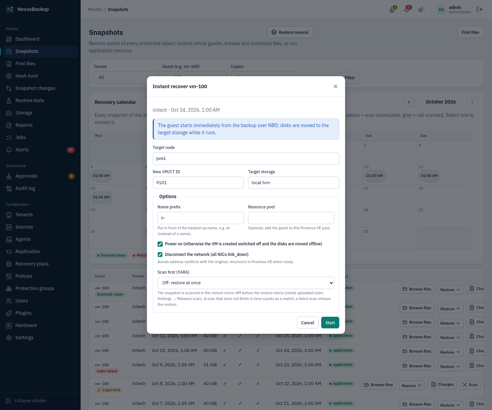

How it works: the node creates qcow2 overlays whose backing file is the appliance's read-only NBD export.
The VM starts from them. Guest writes go into the overlays on the node. A live disk move then copies each
disk to the target storage and drops the overlay. In the lab the VM ran about 4.5 s after the start, and a
4 GiB disk moved in 24–30 s.

Limits:

- VMs with a TPM state (`tpmstate0`) and templates are refused.
- Guest writes accumulate on the node's root file system until the disk move finishes. Keep enough free
  space there.
- The VM gets new NIC MAC addresses and a new `vmgenid`. If the original VM still runs on the same network,
  keep **Disconnect the network** ticked.
- Instant recovery cannot replace the original. Use a full restore with **Replace the original guest**.
- If the appliance or the network to the node fails during instant recovery, reads of blocks that are not
  yet in the overlay stall, and fail after 60 s. Moved data and guest writes are not affected. Resuming the
  serving is a command-line step (`nexus-pve … ir-serve`, see `docs/pve-connector.md`).

> **Status:** Lab-verified on PVE 9.2 (single node). Behaviour after a node reboot during instant recovery is
> untested.

## Instant disk recovery (one disk to an existing VM)

When one disk is lost or damaged (a data volume, a deleted database disk), attach it from the backup to a running
VM instead of restoring the whole VM:

1. Open **Restore** on a `vm-` snapshot and choose **Attach one disk to a VM…**.
2. Enter **Disk of the backup** (its slot in the backed-up VM, e.g. `scsi1`), **Target node** and **Attach to VM
   (VMID)**: a VM that a protection group of the same tenant protects, on that node. Another tenant's VMs, or VMs
   in no group, are refused.
3. Optional: **As slot** (default: the first free `scsi` slot of the target VM) and **Then move to storage**.
4. Click **Attach disk**.

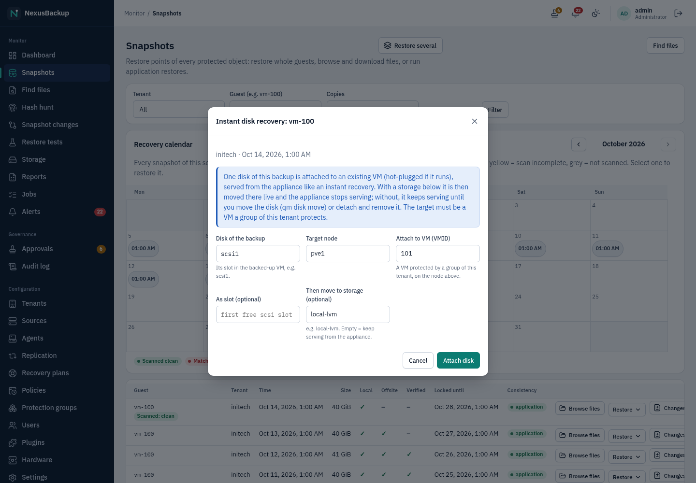

The disk is served exactly like an instant recovery: the node creates a qcow2 overlay whose backing file is the
appliance's read-only export, and attaches it to the VM (hot-plugged if the VM runs; the guest sees a new disk).
Guest writes go into the overlay. With **Then move to storage** the disk is moved there live and the appliance
stops serving when the move is done. Without, the job keeps running and serving until you move the disk
(`qm disk move <vmid> <slot> <storage> --delete 1`) or detach it and remove the unused entry. Cancelling the job
stops serving: the guest's reads of that disk then fail, so move or detach it first.

Limits: EFI and TPM state disks cannot be attached, nor disks that were excluded from the backup. The guest may
need a rescan to see a hot-plugged disk. In vault mode the attach is a request that a second person approves.

> **Status:** Implemented and tested against the scheduler and API; the overlay path is the one of instant recovery.
> The lab check on PVE (hot-plug into a running VM, move, detach) is pending.

## Restore tests

A backup is only as good as the restore. A **restore test** proves that a VM or container snapshot boots: the
appliance starts an isolated copy of it on a Proxmox node, checks it and destroys it again. Open **Monitor →
Restore tests**.

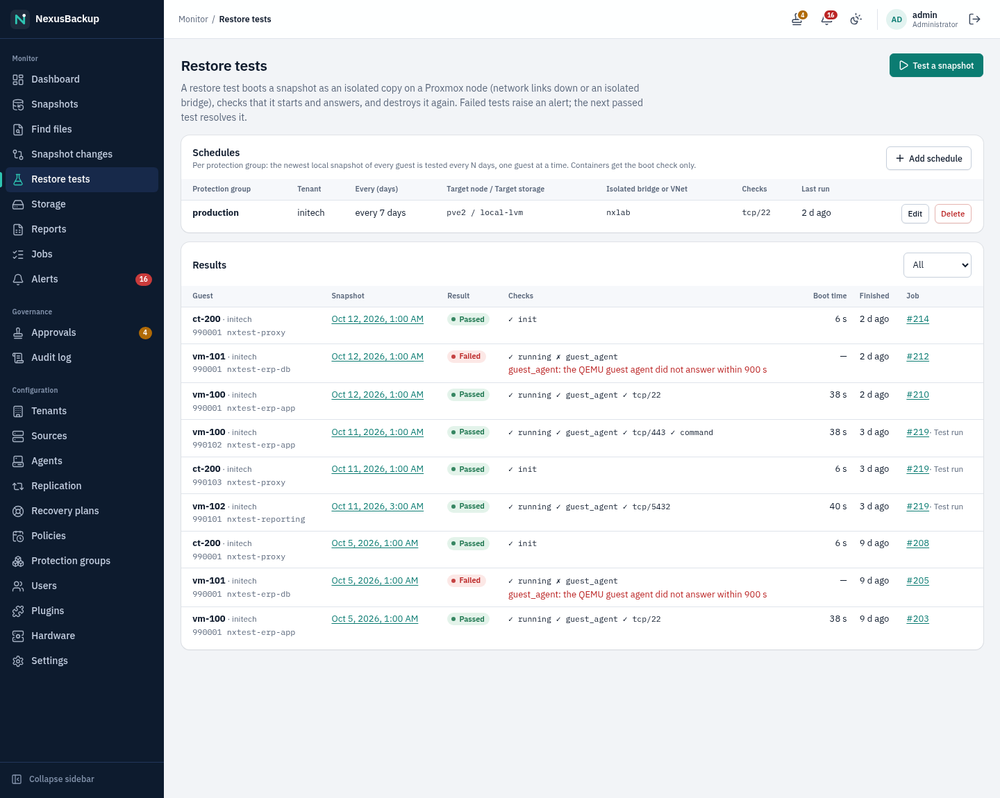

What a test does:

1. **Start isolated.** A VM boots straight from the backup (the instant recovery overlays, nothing is copied
   and no disk is moved). A container is restored fully to the target storage (Proxmox VE has no overlay for
   containers). The copy gets the next free VMID from 990000 upwards and the name `nxtest-<name>`. All its
   network links are down, or, if you name an **isolated bridge or VNet**, its NICs are on that bridge (VLAN
   tags removed). Use a bridge without an uplink: then the guests of a recovery plan reach each other and
   nothing else.
2. **Check.** VMs: the VM runs, and the QEMU guest agent answers within the **boot timeout** (default 600 s).
   Optional: **TCP ports that must listen** (checked inside the guest through the guest agent with `ss` or
   `netstat`, because the network is isolated) and a **custom check command** run through the guest agent with
   its expected exit code (for example `systemctl is-active nginx`). Containers: the init process must still
   run 10 s after the start (containers have no guest agent).
3. **Destroy.** The copy is stopped and destroyed with its disks, always: also when the start or a check
   failed and when you cancel the job. If destroying fails, the result says so and names the VMID; remove that
   guest on the node by hand (its name starts with `nxtest-`).

Every tested snapshot gets a result row (passed or failed, the checks, the boot time and the job). A failed test
raises the warning **restore_test** for that guest; the next passed test resolves it. The dashboard tile
**Restore tests** shows how many guests passed their newest test in the selected period.

**Test a snapshot now:** click **Test a snapshot**, choose the guest and the snapshot, the target node and
storage, optionally the isolated bridge, and the checks.

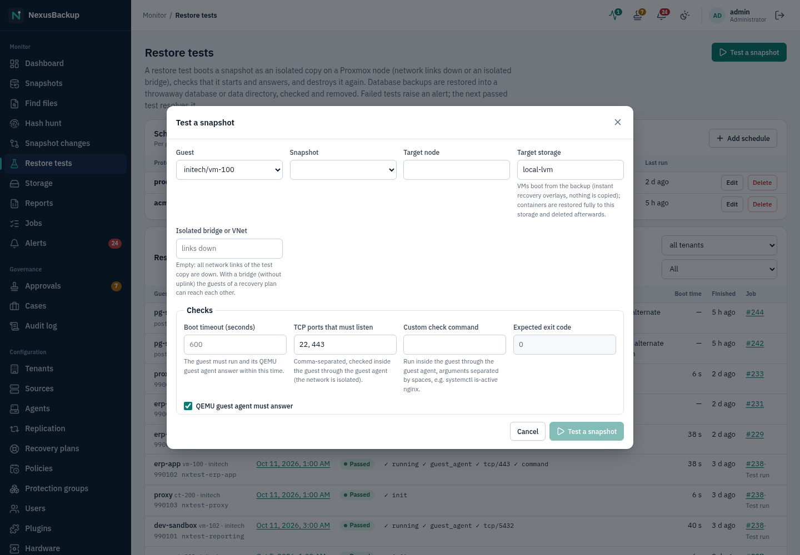

**Test regularly:** **Add schedule** tests the newest local snapshot of every guest of a protection group every
N days (one guest at a time, the first run right away). The schedule belongs to a group of a Proxmox VE source;
deleting the group deletes the schedule.

Who: admins, operators and tenant admins start tests; admins and tenant admins edit schedules; everyone sees
the results of their tenants. Tenant users do not start tests.

Requirements and limits:

- The QEMU guest agent must be installed and enabled in the VM (option **QEMU Guest Agent** in Proxmox VE), or
  untick **QEMU guest agent must answer** (then only "running" is checked; ports and commands need the agent).
- VMs with a TPM state and templates cannot be booted from the backup (as for instant recovery).
- A container test needs space for the whole container on the target storage while it runs.
- Many guests in a schedule run one after another; plan the interval so that one round fits.

> **Status:** The test flow (waves, checks, always destroying, cancellation) and the scheduler and API are covered
> by unit and integration tests against a simulated Proxmox VE. A run on the PVE lab is a lab step
> (`lab/e2e/m5-api.sh restore-test`), not yet done; Windows guests (port probe with `netstat`) are untested.

**VMs with a vTPM** (Windows 11, Windows Server with Secure Boot and BitLocker): the test VM boots with a **fresh
vTPM**, because the TPM state cannot be served over the network like the disks. Boot, guest agent and port checks
work; anything sealed to the original TPM (BitLocker without its recovery key, Windows Hello) is not available in the
test. Instant recovery of such VMs is refused; use a full restore, which restores the TPM state.

## Browse files and download them (tar or zip)

**Browse files** opens a file browser for the snapshot. The appliance reads the file system from the backup:

- **VM images**: the disks are attached read-only to an isolated restore micro-VM on the appliance. Its kernel
  mounts the guest file systems read-only: ext4, XFS, btrfs, NTFS, vfat, exFAT, ISO 9660, LVM, md and ZFS.
  The appliance's own kernel never mounts guest file systems. The first listing takes a few seconds.
  Not supported: encrypted volumes (LUKS, ZFS native encryption, BitLocker), Windows dynamic disks and
  Storage Spaces, ZFS zvols, and duplicate pool or volume-group names across disks.
- **Containers, hosts, TrueNAS datasets, NFS/SMB shares, plugin snapshots**: read directly from the stored
  backup (container tar stream or file tree). No VM is needed.

To download:

1. Open folders by clicking their names, and tick the files and folders you want.
2. Choose **tar** or **zip** and click **Prepare download**. The appliance packs the archive in a job.
3. Click **Download …** when it appears.


- tar keeps owners, modes, modification times, symlinks, hard links and extended attributes (incl. ACLs).
  zip keeps modes and modification times.
- A prepared download is valid for **24 hours** and can be fetched only by the user who requested it.
- For TrueNAS datasets and NFS/SMB shares there is no restore back into the dataset or share itself. Download
  the files, or restore them onto a host with an agent (next section), for example a server that mounts the share.

## Find a file

When you do not know which snapshot (or which guest) holds a file, open **Monitor → Find files** (or **Find files**
on the Snapshots page). The search answers while you type: results appear about 0.3 seconds after the last key
press, and **Enter** searches at once.

1. Choose the **Tenant** (tenant users search their own tenant only).
2. Type a **Name, path or words**. **Match** decides how the text is read; **Auto** (the default) picks:
   - **Path** when the text contains a `/`: a pattern against the whole guest path, `*` within one folder name
     (`/home/*/Documents/*.docx`, `C:/Users/*/Desktop/*`, or `Users/*/Documents/*` for every drive);
   - **Name** when it contains `*` or `?`: a pattern against the file or folder name (`budget*.xlsx`,
     `report-202?.pdf`);
   - **Words** otherwise: every word must start a word of the name or path (`report 2026` finds
     `/srv/reports/q3-2026.pdf`). Upper and lower case are treated alike.
3. Optionally narrow it to one **Source** (`vm-100`, `host-…`, `share-…`) or one **Protection group**.
4. **More filters** offers the **Source kind** (VMs, containers, agents, NAS, shares, plugins), **Extensions**
   (`pdf, docx`, without dots), a size range (**Size from / up to** with a unit), the modification time
   (**Modified from / until**), the **Type** (files only, folders only) and **Deleted files** (show all, only
   deleted, hide deleted). With a filter set, the text may stay empty: for example all `.pst` files above 2 GiB,
   or everything deleted in the last week. **Reset filters** clears them.

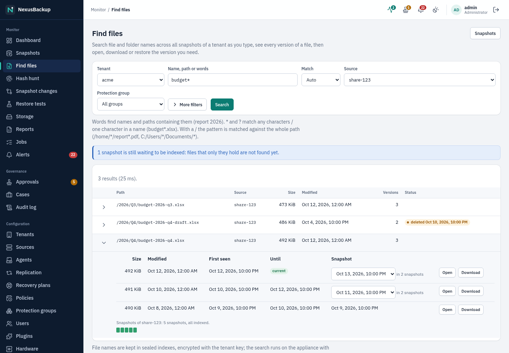

Each row is one path in one source, with the size and modification time of its newest version, the number of
versions and, if it no longer exists in the newest snapshot, a **deleted** chip with the date of the first snapshot
without it. Paths are shown as the guest sees them: `/home/ann/report.docx` in a Linux VM, `C:/Users/ann/…` in a
Windows VM or agent, `vol3/…` (or the volume label) for a volume without a mount point. 50 rows are listed at a
time; **Load more** fetches the next ones, sorted by path.

The arrow at the start of a row opens its **version timeline**: one line per version (size, modification time,
**First seen** in which snapshot, **Until** the snapshot that no longer has it, or **current**), with the snapshots
that hold it. Pick the snapshot (default: the newest holding that version), then:

- **Open** shows the folder in the file browser of that snapshot ([Browse files](#browse-files-and-download-them-tar-or-zip));
- **Download** packs the file as a tar archive (needs the download permission);
- **Restore…** (host snapshots) opens the [restore to a host](#restore-files-to-a-host-agents) dialog for this path.

A version whose snapshots were all deleted by retention says **snapshot deleted** and has no actions. Below the
versions, a strip shows every local snapshot of the source, oldest on the left: green indexed, amber waiting or partly
indexed, red failed, grey file index off. Snapshots that are not fully indexed are listed with the reason, because
files that only they hold cannot be found:

| Shown | Why | What to do |
|---|---|---|
| waiting to be indexed | the snapshot was taken a moment ago, or the index service is catching up (a note above the results counts them) | wait; after 48 hours the alert `index_backlog` is raised |
| partly indexed: `vdb1: BitLocker-encrypted volume` (or LUKS) | the volume is encrypted inside the guest; the appliance has no key | browse and restore the disk with the restore micro-VM, or protect that data with an agent |
| partly indexed: `ReFS`, `Storage Spaces`, striped or RAID-5 dynamic volumes | file systems and volume layouts the parser does not read | as above |
| partly indexed: `ZFS` or btrfs over several disks, listed only by the restore micro-VM | these are listed by the restore micro-VM; without it installed the volume is skipped | browse and restore them as usual: the file browser uses the restore micro-VM |
| partly indexed: corrupted partition table, missing LVM disk, parser limit | the disk layout cannot be read safely | check the guest; the rest of the snapshot is indexed |
| file index off | the VM/CT group has the file index switched off ([05](05-policies-and-groups.md#file-index-of-vmct-disks)) | switch it on; later snapshots are indexed |

Crash-consistent VM snapshots are read as they are on disk (no journal replay), so files changed in the last
seconds before the snapshot may be missing from the index; they are still in the snapshot. Files on Windows dynamic
volumes are found by the search (paths `ldm/<volume>/…` in the file browser), but the restore micro-VM cannot open
dynamic volumes: restore them through the Windows agent.

What is searched:

- Host (agent), TrueNAS, NFS/SMB and plugin snapshots: always. Their file list is written when the snapshot is
  committed.
- VM and container snapshots: for protection groups with the **File index** on (the default for new Proxmox VE
  groups, [05 Policies and groups](05-policies-and-groups.md#file-index-of-vmct-disks)). After each backup a
  **File index** job lists the guest file systems with a sandboxed parser, without booting a VM.
- Only the folders in the group's **File search scope** ([05](05-policies-and-groups.md#file-search-scope)): by
  default system folders such as `/usr`, `/proc`, `C:/Windows` and `C:/Users/*/AppData` are left out. Browsing,
  downloads and restores always show everything.
- Snapshots that exist only offsite are not searched.

When the index service is not running, **Find files** says so and falls back to the older search job: it starts with
**Search** (not while typing), uses only the name or pattern and the source, and lists at most 500 versions within 30
seconds. **Try the instant search again** switches back.

Privacy: file names never appear in plaintext in the catalog. The per-snapshot file lists and the search index of a
tenant are sealed with the tenant key; the search runs on the appliance, and the web interface only receives the
results. Every search is recorded in the audit log (`file.search`) with the query and filters. Only names, sizes and
times are indexed, never file contents. When a snapshot is deleted, its versions disappear from the search at once.

The index size per tenant (file versions, size on disk, snapshots waiting) is shown on **Storage**
([03 The web interface](03-web-interface.md#storage)). If the index volume runs low on free space, indexing pauses
and the alert `index_space` is raised; searching keeps working with what is indexed.

> **Status:** The search index and the sandboxed parser are covered by unit tests with real disk images and by fuzz
> tests. The VM lab run of indexing after real Proxmox VE backups is still open.

## Restore files to a host (agents)

An enrolled agent writes files from a snapshot onto its host. This works for every snapshot with files:
host snapshots (`host-`, back onto the same host or onto another one), TrueNAS datasets (`nas-`), NFS/SMB shares
(`share-`), plugin snapshots whose plugin offers a download (`plugin-…`, including the streams under
`.nexus-streams/`), and files inside VM and container snapshots (`vm-`, `ct-`). The target is always an agent of the
snapshot's tenant; agents of other tenants are not offered and the appliance refuses them.

1. Choose what to restore:
   - **Host snapshots:** open **Restore** and choose **Restore to path** (everything), or open **Browse files**,
     select paths and click **Restore to path** (with nothing selected the button reads **Restore everything to
     path**).
   - **TrueNAS datasets, shares, plugin snapshots:** open **Restore** and choose **Restore to a host…**
     (everything), or select paths in **Browse files** and click **Restore to a host…**.
   - **VMs and containers:** open **Restore** and choose **Restore files to a host…**. The file browser opens;
     select files or folders (a VM shows its file systems at the top level, e.g. `/sda1`), then click
     **Restore to a host…**. The restore micro-VM reads the selection from the snapshot, the same way as for a
     download.
2. Fill in the dialog:
   - **Target directory on the host**: an absolute path, e.g. `/srv/restore`. The restored paths keep
     their structure below it. The directory is created if missing.
   - **Existing files**: **Never overwrite (skip existing files)**, **Overwrite if older than the backup
     copy**, or **Always overwrite**. Restoring onto `/` (or a Windows drive root) is refused unless you
     choose **Always overwrite**.
   - **Target agent**: for host snapshots by default the host the backup came from. Enrolled agents of the tenant
     are listed first, with their last contact; agents that are not enrolled cannot be chosen.
   - **Confirmation**: type the target agent's name. The appliance checks it, and the agent logs it.
3. Click **Start restore**. The job page opens.

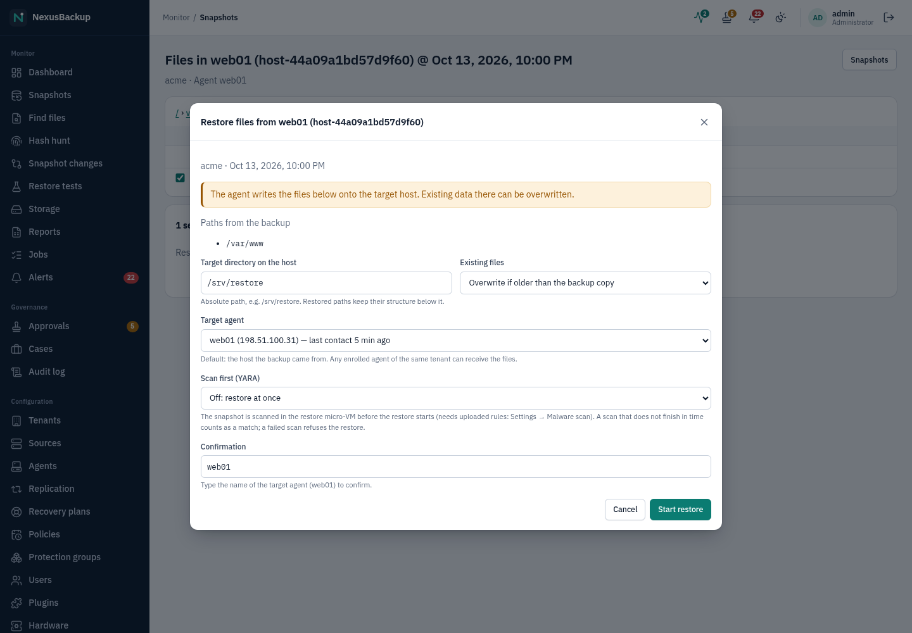

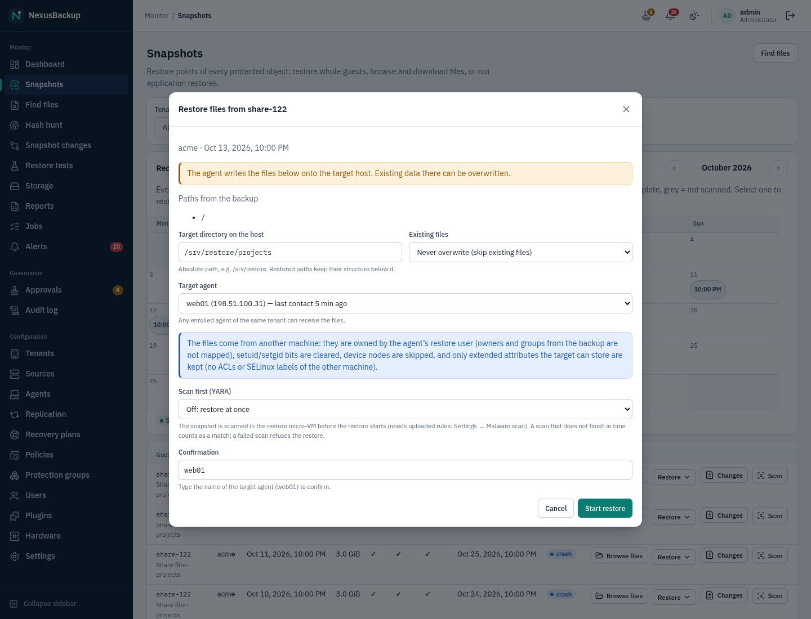

The agent writes only below the target directory. It never follows symlinks or junctions planted in the target.
Skipped files (kept by the overwrite policy) appear in the log, not as errors.

**Back onto the same host**, the agent restores owners, modes, extended attributes, ACLs and modification times.

**Onto another host** (and always for shares, TrueNAS, plugins, VMs and containers) the dialog shows a note, and the
appliance adapts the metadata, because owner IDs and ACLs of another machine mean something else there:

- Owners and groups are not mapped: the files belong to the agent's restore user (root for the installed service).
- setuid, setgid and sticky bits are cleared; permissions and modification times are kept.
- Device nodes and sockets are skipped; on Windows also FIFOs.
- Extended attributes are kept only if the target can store them: `user.*` attributes on Linux, Windows metadata
  (`win.*`) on Windows. ACLs, SELinux labels and SMB security descriptors of the other machine are dropped. The job
  log counts what was skipped.
- Files from VMs and containers carry modes, times, symlinks and hard links, but no extended attributes.
  Sparse files are written fully allocated.


On Windows, write paths as `/D/restore` or `D:\restore`. The agent restores security descriptors, alternate
data streams and attributes. The security descriptor of a directory that already exists is only replaced
with **Always overwrite**. EFS-encrypted files are not supported. Names that Windows does not allow (for example
`a:b` or `name.` from a Linux share) fail as single entries; the job then fails and lists them, the other files are
written.

> **Status:** Linux restore was tested in the agent VM lab (Debian, AlmaLinux, Ubuntu, Fedora). Restores from
> shares, TrueNAS, plugins and VM/CT files onto a host (Phase 15b) are tested against a fake agent, and restores onto
> another host also against the real Linux agent; the VM lab run is pending. Restores with the Windows agent were tested
> on Windows Server 2022 and Windows 11 (ACLs, owners, streams, links, junctions, long paths, confinement).

## Bare-metal recovery (Linux hosts)

Rebuilds a Linux host from a snapshot onto empty disks: after a disk failure, on new hardware, or as a new
Proxmox VE VM. The appliance recreates the partitions, LVM volumes and file systems (with their original UUIDs),
restores every file and reinstalls the boot loader. Details and limits: `docs/bmr.md`.

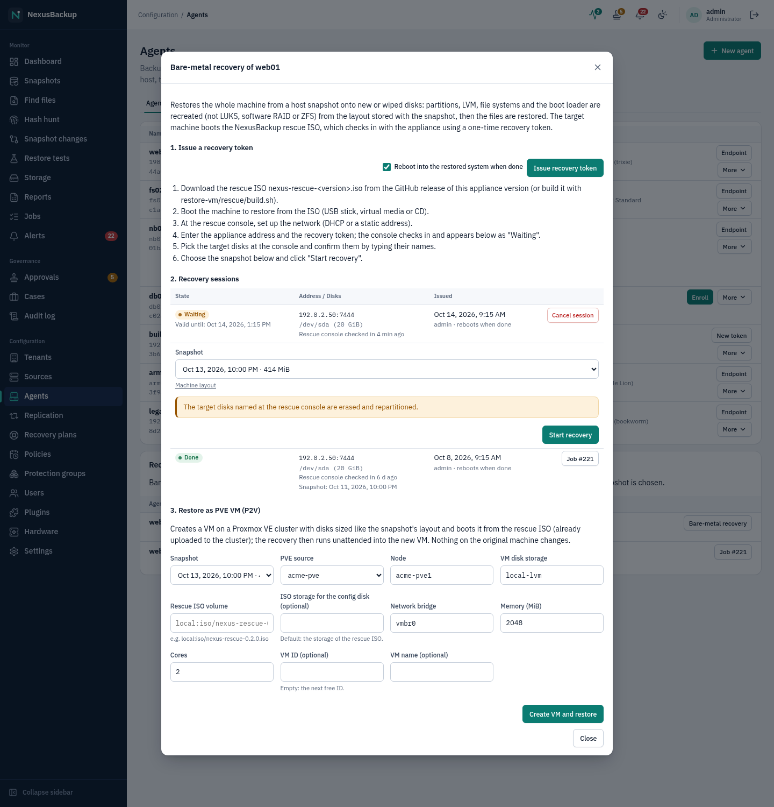

**Before you need it:** the host's backup must cover the whole system (path `/` with **Include nested mounts**),
and you need the rescue ISO `nexus-rescue-<version>.iso` from the release page (or built with
`restore-vm/rescue/build.sh`) on a USB stick or as a virtual CD.

1. **Agents** → the host's agent → **Bare-metal recovery** → **Issue recovery token** (admin or operator). The
   token is shown once and is valid for 4 hours. Leave **Reboot when done** on unless you want to check the result
   from the rescue console first.
2. Boot the machine from the rescue ISO (in UEFI mode if the original booted UEFI; Secure Boot off).
3. At the console: choose DHCP or a static address, enter the appliance address (as in your browser, e.g.
   `nexus.example.com` or `192.0.2.10:8443`) and the token. Then pick the target disks — one per disk of the
   original machine, in the same order (the web UI lists the original disks) — and type their names again to
   confirm. Nothing is erased yet.
4. The console checks in with the appliance. In the web UI the session changes to **waiting** and shows the
   machine's address and disks. Pick the snapshot and click **Start recovery**. The disks you confirmed at the
   console are erased now.
5. Follow the progress (recreate disks → restore files → boot loader) in the session or in the job. When it is
   done, the machine reboots into the restored system. SELinux systems relabel once and reboot again.

The target disks must be at least as large as the original ones; the extra space stays unallocated. Not supported:
encrypted (LUKS) volumes, software RAID (md) and ZFS — the recovery refuses them and says why; restore such
hosts by installing a minimal system and using **Restore files to a host**.

### Restore as PVE VM

**Agents** → **Bare-metal recovery** → **Restore as PVE VM** creates a new VM on a Proxmox VE source of the tenant
with one disk per original disk (same size), UEFI if the original booted UEFI, and boots it from the rescue ISO
together with a small config disk that carries the appliance address and a one-time token. The recovery then runs
without anyone at the console, and the VM boots the restored system. Upload the rescue ISO to an ISO storage of the
cluster once and enter its volume (e.g. `local:iso/nexus-rescue-0.1.0.iso`). The VM network must reach the
appliance's web address (DHCP), and the appliance must reach the VM on port 7444.

> **Status:** tested end to end in QEMU (`lab/linux/bmr.sh`, `docs/bmr.md` "Lab"): a Debian 13 VM with LVM, a thin
> pool and BIOS boot was recovered onto blank disks and booted with identical files. Not yet tested: a UEFI source
> machine, real hardware, and "Restore as PVE VM" against a real Proxmox VE cluster.

## Plugin restores (PostgreSQL)

Plugin snapshots offer the restores declared by the plugin in their **Restore** menu. Restores marked
**application-specific** do more than copy files. The download button of a plugin uses its own title and replaces
**Browse files**. In the file browser, application
streams such as database dumps and WAL appear under `.nexus-streams/`.

The PostgreSQL plugin ([12 Plugins](12-plugins.md)) produces two kinds of snapshots:

| Snapshot | Contains | Useful restores |
|---|---|---|
| `plugin-postgresql-<source>-<db>` (database snapshot) | logical dump of one database (stream `<db>.sql`) | **Restore database dump to a server**, download |
| `plugin-postgresql-<source>` (cluster snapshot, group without databases) | the whole cluster: `data/` (base backup) and `wal/` | **Point-in-time restore (new data directory via SSH)**, download |

The **Restore** menu offers the dump restore only on database snapshots and the point-in-time restore only on cluster
snapshots.

> **Status:** The per-snapshot filtering needs plugin manifests that declare it (manifest v1.4, `applies_to`). With
> an older plugin version the menu shows every restore of the plugin on every snapshot of it; then use the dump
> restore on database snapshots and the point-in-time restore on cluster snapshots.

### Restore a database dump to a server

1. Open **Restore** on a database snapshot and choose **Restore database dump to a server**.
2. Enter the **Target database**, choose **Server** (`source` = the backed-up server, `alternate` = the
   **Alternate restore server** configured in the source), and tick **Restore into an existing database**
   only if you really want that.
3. Click **Start**.

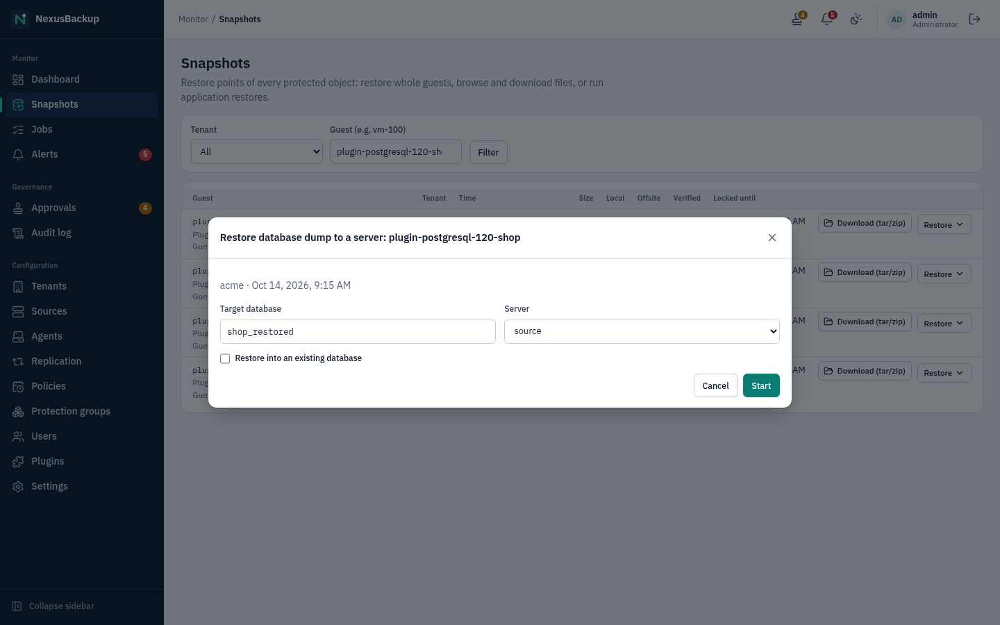

On the source server the backup role needs `CREATEDB`. The alternate server's user needs `CREATEDB` too.
A logical dump does not cover owners and grants, comments, RLS policies, large objects, roles and some other
objects (a warning in each backup log names those present). Use a cluster backup where these matter.

### Point-in-time restore

1. Open **Restore** on a cluster snapshot and choose **Point-in-time restore (new data directory via SSH)**.
2. The box at the top shows the snapshot's **recoverable range**: from the end of its base backup to the time of
   the backup run (with the WAL positions, LSNs, and the timeline). Pick a time in **Pick a time in this range**
   (your local time; it fills **Recover to time** in UTC), or fill in exactly one of the targets yourself:
   - **Recover to time**, e.g. `2026-10-10 14:30:00+00`;
   - **… or to LSN**, e.g. `0/3000060` (from `pg_current_wal_lsn()` or the server log);
   - **… or to a named restore point** created on the server with `SELECT pg_create_restore_point('before_upgrade')`.

   All targets empty = the end of the backup. A time outside the range is refused before the job starts.
3. Enter the **New data directory on the restore host (must not exist)** and optionally a port.
4. If the cluster has **tablespaces** besides the data directory, give each a new directory, one per line:
   `<oid or old path>=<new path>` (e.g. `16390=/srv/pg/restore-ts1` or `/srv/pg/ts1=/srv/pg/restore-ts1`). The
   error message of a restore without them lists the tablespaces of the snapshot. The new directories must not
   exist (their parents must) and may not lie inside the data directory.
5. Tick **Start PostgreSQL after the restore** to have the plugin start it, or leave it to start it yourself.
6. Click **Start**.

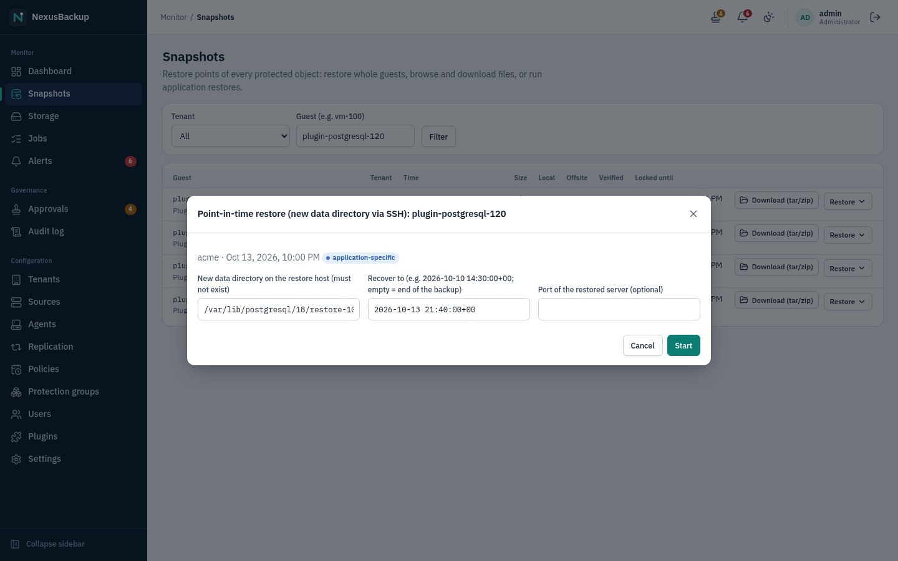

The plugin connects over SSH to the restore host configured in the source (host key pinned). It unpacks the
base backup into the new directory, each tablespace into its new directory (and points `tablespace_map` at it, so
PostgreSQL creates the links), the WAL into `<dir>/nexus_wal/`, and writes the recovery settings (the target, then
promote). If the source keeps its configuration outside the data directory (Debian and Ubuntu do), a minimal
`postgresql.conf` and a `pg_hba.conf` that allows local connections only are added.

With **Start PostgreSQL after the restore**, the plugin runs `pg_ctl start` on the restore host and waits up to 10
minutes until the server accepts connections. It uses the `pg_ctl` of the source's major version
(`/usr/lib/postgresql/<version>/bin` on Debian/Ubuntu, `/usr/pgsql-<version>/bin` with the PGDG packages, else the
one in `PATH`; the source field **pg_ctl on the restore host** overrides it). The server log is
`<dir>/nexus_restore.log`; if the start fails, its last lines are in the job log (for example when the requested
target is not in the WAL). Without the option, start a server of the same major version yourself:

```sh
pg_ctl -D /var/lib/postgresql/18/restore-1013 start
```

The restore always creates a new data directory and never writes into a running server. Choose a **port** that is
free on the restore host when the source runs there too.

> **Status:** Tested against PostgreSQL 14 and 17 (recovery to a time, an LSN and a restore point, tablespaces,
> start by the plugin) and 18 (earlier version of the test) in the plugin's container test box. A run on the
> appliance image (VM lab) is still pending.

## MySQL and MariaDB restores

The MySQL / MariaDB plugin ([04 Sources](04-sources.md#mysql-and-mariadb-mysql-80-or-newer-mariadb-106-or-newer-tested-mysql-84-mariadb-118),
[docs/mysql.md](../docs/mysql.md)) produces the same two kinds of snapshots as PostgreSQL:

| Snapshot | Contains | Useful restores |
|---|---|---|
| `plugin-mysql-<source>-<db>` (database snapshot) | logical dump of one database (stream `<db>.sql`) | **Restore database dump to a server**, download |
| `plugin-mysql-<source>` (server snapshot, group without databases) | `base/` (the backup tool's xbstream, in pieces) and `binlog/` | **Physical / point-in-time restore (new data directory via SSH)**, download |

### Restore a database dump to a server

1. Open **Restore** on a database snapshot and choose **Restore database dump to a server**.
2. Enter the **Target database**, choose **Server** (`source` or `alternate`), and tick **Restore into an existing
   database (tables of the dump are replaced)** only if you want that: the dump drops and recreates each of its
   tables, views, routines, triggers and events; other objects of the database stay.
3. Click **Start**.

A new database gets the character set and collation of the original. The statements run one by one over the TLS
connection; if one fails, the job log names it and a database the restore created is dropped again. The account
needs the restore privileges listed in [04 Sources](04-sources.md) (and `SET_ANY_DEFINER` / `SET USER` for objects
of other accounts).

### Physical and point-in-time restore

1. Open **Restore** on a server snapshot and choose **Physical / point-in-time restore (new data directory via
   SSH)**.
2. The box at the top shows the **recoverable range**: from the end of the base backup to the time of the run, with
   the binlog positions (`file:position`). Pick a time (your local time; it fills **Recover to time** in UTC), or
   fill in at most one target yourself:
   - **Recover to time**, e.g. `2026-10-10 14:30:00+00` (binlog event times; whole seconds; events before it are
     replayed);
   - **… or to binlog position**, e.g. `mysql-bin.000042:1234` (from `SHOW BINARY LOG STATUS` / `SHOW MASTER STATUS`
     or `mysqlbinlog` output; replay stops before the event at that position);
   - none = the end of the snapshot;
   - or tick **Base backup only (no binlog replay)**: the state at the end of the base backup.
3. Enter the **New data directory on the SSH host (must not exist)** and click **Start**.

The plugin connects over SSH to the database host of the source (host key pinned), unpacks the base backup into
the new directory (`mbstream -x` / `xbstream -x`) and prepares it (`--prepare`). For a point in time it then
writes the needed binlog files into `<dir>/.nexus-binlog/`, starts a temporary server on the directory (Unix socket
in the directory only, no network, no grant checks, no binlog), replays the binlog from the base backup's position
to the target (`mysqlbinlog … | mysql`), shuts the temporary server down and removes the helper files. The result
is a stopped data directory owned by the SSH user. Start a server of the same version on it, for example:

```sh
mysqld --datadir=/var/lib/mysql-restore --port=3307 --socket=/run/mysqld/restore.sock   # or mariadbd
```

The restore always uses a new directory and never touches the running server. Replaying many hours of binlog takes
time: for a recent target choose the newest snapshot (its base backup is the same, but a later snapshot holds the
binlog up to its own time).

> **Status:** Tested against MariaDB 11.8 and MySQL 8.4 (time, position, end, base only) in the plugin's container
> test box. MySQL servers with `gtid_mode = ON` are replayed with `--skip-gtids` (the temporary server runs without
> GTIDs; the restored server's `gtid_executed` ends at the base backup). A run on the appliance image is pending.

## Microsoft 365 restores

Microsoft 365 snapshots (`plugin-m365-<source>-u.…` for a user, `-s.…` for a site, `-t.…` for a team, `-g.…` for a
Microsoft 365 group) offer three
restores (download and two restores in the **Restore** menu). None of them overwrites anything in Microsoft 365: restores always write into a **new** folder,
calendar or channel.

| Snapshot | Contains (folders in the file browser) |
|---|---|
| user (`u.…`) | `mail/` (one `.eml` per message), `recoverable/Deletions/` (deleted items still recoverable in Outlook), `calendar/` (one `.ics` per event), `contacts/` (one `.vcf` per contact), `onedrive/` (the files), `chats/` (one `.json` and one readable `.html` per chat, if chats are backed up; download only) |
| site (`s.…`) | `libraries/<library>/` (the files) |
| team (`t.…`) | `files/` (the team's files), `channel-files/<channel>/` (files of private and shared channels), `channels/<channel>/` (one `.json` per conversation, if channel messages are backed up) |
| group (`g.…`) | `conversations/` (one `.json` per conversation with all posts), `calendar/` (if Microsoft allowed reading it), `files/` (groups that are not teams) |

### Download

Click the download button (**Download (mail .eml, mbox or PST; events .ics, contacts .vcf, files, threads and
conversations .json)**), select folders or single items and prepare a tar or zip archive as described in
[Browse files and download them](#browse-files-and-download-them-tar-or-zip). `.ics` files open in any calendar,
`.vcf` files in any address book. Names containing `/` or `%` are shown encoded (`Projects%2F2026` is the folder
`Projects/2026`).

#### Export formats for mail

Above the download buttons, **Conversion** offers the **Mail format** of the selected mail (`mail/` and
`recoverable/`):

| Mail format | What the archive contains | Open it with |
|---|---|---|
| **eml** (default) | one `.eml` file per message in its folder, as stored | any mail client (drag and drop), double click |
| **mbox** | one mbox file per mail folder, e.g. `mail/Inbox.mbox`, `mail/Inbox/Projects%2F2026.mbox` | Thunderbird (ImportExportTools NG), Apple Mail (File › Import Mailboxes), mutt, Evolution |
| **pst** | an Outlook data file `<user>.pst` with the folder tree below **Top of Personal Folders**; Recoverable Items "Deletions" as `Recoverable Items/Deletions` | Outlook (Windows, classic) |

Everything that is not mail (calendar, contacts, OneDrive files, chats) stays as stored in the same archive.
**PST: split into files of at most this many GB** (1–50, default 20) splits large mailboxes into several files
`<user>.pst`, `<user>-2.pst`, … (Outlook handles up to 50 GB per file; smaller files are easier to move).

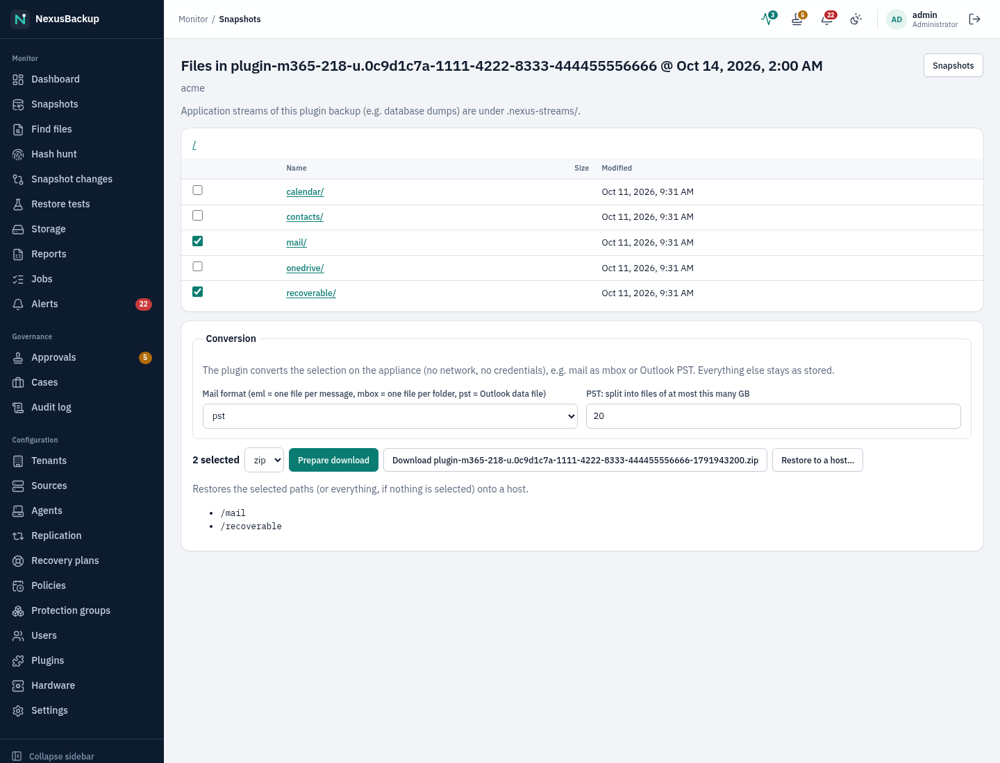

The plugin converts on the appliance, in its sandbox, without network access and without the source's
credentials. A PST contains, per message: subject, sender, recipients (To, Cc, Bcc), dates, plain-text and HTML
body, the internet headers, the message ID and the attachments (inline images included; attached messages as
`.eml` files). Messages are marked read; categories, flags and Outlook-specific properties (Graph does not
return them as MIME) are not part of the backup. Calendars and contacts stay `.ics` / `.vcf` files (import them in
Outlook with **File › Open & Export › Import/Export**).

Import the PST into Outlook (classic Outlook for Windows; the new Outlook and Outlook on the web cannot open PST
files):

1. Download the archive and extract `<user>.pst` (and `<user>-2.pst`, … if the mailbox was split).
2. In Outlook choose **File › Open & Export › Open Outlook Data File** and select the `.pst` file. It appears as
   **Microsoft 365 &lt;user&gt;** in the folder list; drag folders or messages into the mailbox.
3. Or choose **File › Open & Export › Import/Export › Import from another program or file › Outlook Data File
   (.pst)** to copy everything into a mailbox folder.

Disk space: the export job needs free space on the appliance for the converted files and the archive (about
twice the size of the selected mail at the end of the job; the archive is deleted after 24 hours).

### Restore to the original user, site, team or group

1. Open **Restore** on the snapshot and choose **Restore to the original user / site / team / group (into a new folder; group conversations: download only)**.
2. Optionally fill in **Only these snapshot paths**, one per line, e.g. `mail/Inbox` or
   `onedrive/Documents/Contracts` (empty = everything), and **New folder** (empty = `Restored <date> <time>`). The
   folder must not exist yet.
3. Click **Start**.

Where the items end up:

- **Mail**: a new top-level mail folder with that name, containing the backed-up folder structure. Items from
  `recoverable/` go to its subfolder **Restored deleted items**.
- **Calendars**: a new calendar `<folder> – <calendar name>` per backed-up calendar. Restored events have **no
  attendees**, so nobody receives invitations. The attendee list is still in the `.ics` file of the backup.
- **Contacts**: a new contact folder with one subfolder per backed-up contact folder.
- **OneDrive, team files, group files**: the new folder in the user's OneDrive or the team's or group's document
  library.
- **Private and shared channel files**: the new folder in the site of the team's private or shared channel with the
  same name, so only that channel's members see them. Without such a channel they are skipped (the summary counts
  them).
- **Group conversations and group calendar**: download only. Microsoft offers no app permission to create group
  posts or events; the summary counts them as skipped.
- **SharePoint libraries**: the new folder inside the library of the same name. If the target site has no such
  library, `<folder>/<library>/…` in its default document library.
- **Teams conversations**: a new channel `<channel> (restored <date> <time>)` per backed-up channel. Messages
  appear with their original author and time. Deleted messages and messages from bots are skipped.

### Restore to another user, site, team or group

Use **Restore → Restore to another user / site / team / group (into a new folder; also into another Microsoft 365 tenant)**, for example to give a successor the mailbox
and OneDrive of a person who left. In addition to the fields above, enter the **Target**:

- for a user snapshot: the other user's sign-in name (`jane@contoso.com`) or object ID;
- for a site snapshot: the site's address (`https://contoso.sharepoint.com/sites/archive`) or Graph site ID;
- for a team snapshot: the team's ID or its exact name;
- for a group snapshot: the group's ID or its exact name.

The target must be of the same kind as the snapshot (a user's mailbox cannot be restored into a site). The job
fails with "target … not found" if the target does not exist.

### Restore into another Microsoft 365 tenant

The restore to another user, site or team can also write into **another Microsoft 365 tenant**, for example
after a merger (move selected users to the new company's tenant) or to recover into a new tenant when the old
one is lost or compromised. Register the other tenant as a second Microsoft 365 source in the **same appliance
tenant** (its own app registration, see [04 Sources](04-sources.md#microsoft-365-exchange-onedrive-sharepoint-teams)).
In the restore dialog, choose it under **Target source** and enter the **Target** as it exists in that tenant
(for example `jane@newcompany.com`). The appliance runs the restore with the target source's app and
certificate; the original tenant is not contacted. Teams conversations are not restored into another tenant
(their authors do not exist there) and are counted as skipped; team files are restored. Chats are never
restored (download them instead).

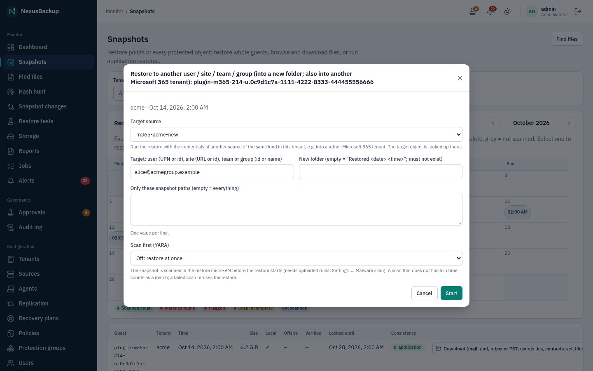

The app registration needs the write permissions listed in [04 Sources](04-sources.md#microsoft-365-exchange-onedrive-sharepoint-teams)
for restores, and for Teams conversations also `Teamwork.Migrate.All` and `Channel.Create`.

> **Status:** Tested against a local Microsoft Graph simulation only. A run against a real Microsoft 365 tenant is
> still pending; it also checks whether restored mails show up as drafts in Outlook. The mail export was tested
> with mails from the simulation: the PST files were read back with three independent readers (Microsoft's
> `outlook-pst` library, `readpst` from libpst and `pffexport` from libpff), the mbox files with the mbox rules.
> Opening an exported PST in Outlook itself has not been tested yet (lab step).

## Follow a restore job

Every restore is a job. The dialog opens the job page, which refreshes every 2 s while the job runs and shows the
log so far; a full VM restore also reports progress per disk it serves to Proxmox VE. All jobs are listed on
**Jobs** (see [03 The web interface](03-web-interface.md#jobs)).


## Tenant users

A tenant user sees only **Dashboard**, **Snapshots** and **Jobs**, and only for their own tenant. They can
use every restore type there. Restores still go only to targets the administrator configured: the tenant's
PVE nodes, its enrolled agents and the plugin's servers.


## Restores on a replication secondary

Snapshots that came from another appliance are marked **Replicated from <source>**
([08 Replication to a second appliance](08-replication.md)). They restore with the secondary's own keys, even when the primary is
gone:

- **Browse files** and downloads work without any source in the tenant.
- For a full VM/CT restore, add a PVE source to the replicated tenant as a **restore target**, e.g. the DR
  site's cluster. Replicated tenants take no backups, so that source is only used for restores.


## Deleting a snapshot

Retention deletes snapshots on its own (see [05 Policies and protection groups](05-policies-and-groups.md)). To remove
a restore point earlier, an administrator clicks **Delete** in its row on **Snapshots** and confirms.

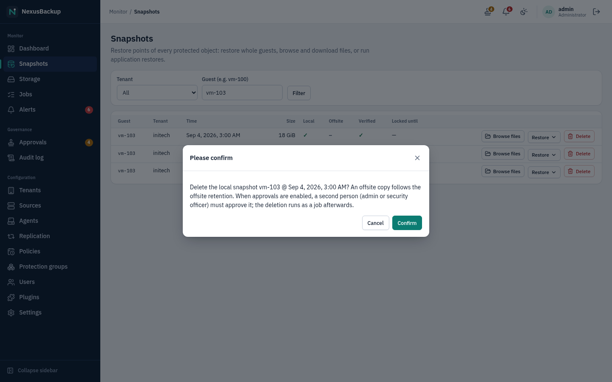

- **Delete** appears only when the snapshot's retention lock has expired (**Locked until** shows —). A locked
  snapshot cannot be deleted by anyone; the appliance refuses the request.
- Only the local copy is deleted. An offsite copy stays until the offsite retention removes it; a snapshot that
  exists only offsite has no **Delete**.
- Snapshots replicated from another appliance have no **Delete**: they follow the replication source's retention.
- A snapshot under a [legal hold](#legal-hold) has no **Delete**; the appliance refuses it until the hold is released.
- With approvals enabled, the deletion is a `snapshot.delete` request that a second person approves on
  **Approvals** (see [10 Approvals and audit](10-approvals-and-audit.md)). After approval (or at once with approvals
  disabled) the scheduler deletes the snapshot in a **snapshot_delete** job. The next garbage collection frees the
  space its data used, unless other snapshots share it.

## Legal hold

A legal hold keeps a snapshot for as long as it is needed as evidence or as the last good copy after an incident,
whatever its retention says. While a snapshot is held:

- the protection group's retention, the retention of [snapshots in no group](05-policies-and-groups.md#snapshots-of-objects-in-no-group),
  the offsite retention and the retention of a replication secondary never delete it;
- garbage collection keeps all its data;
- **Delete** is not offered, and a delete request approved earlier fails.

The hold adds protection only; nothing else about the snapshot changes (restores work as usual).

**Setting a hold** is up to the **security officer**, takes effect at once and is recorded in the audit log
(`snapshot.hold`):

- one snapshot: **Legal hold…** in its row on **Snapshots**, enter the reason (case or ticket reference) and
  **Put on hold**;
- many snapshots at once, e.g. everything since an incident began: **Hold a time range…** at the top of
  **Snapshots**, choose the tenant, optionally one guest, the time range and the reason;
- from an `anomaly` alert: **Hold last good snapshot** on **Alerts** puts the last clean snapshot before the
  anomaly on hold (see [11 Alerts and monitoring](11-alerts-and-monitoring.md#change-rate-anomalies));
- **Legal hold…** on a flagged snapshot holds the latest clean snapshot before it by default; **Use the flagged
  snapshot instead** holds the flagged one (for example as evidence).

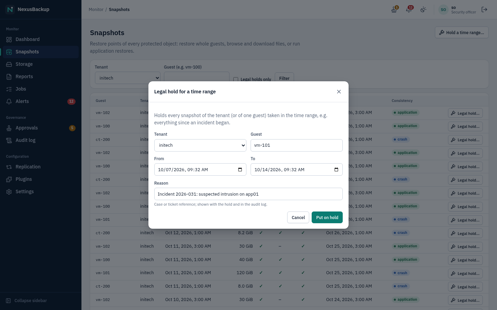

Held snapshots carry a **Legal hold** badge (hover it for who set it, when and why). **Legal holds only** in the
filter bar lists them.

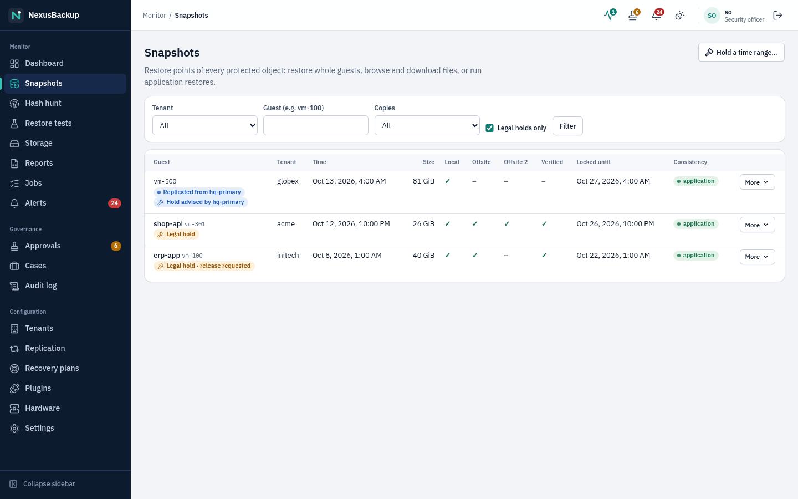

**Releasing a hold** needs a second person: a security officer or an administrator clicks **Release hold**, and
another administrator or security officer approves the `snapshot hold release` request on **Approvals** (see
[10 Approvals and audit](10-approvals-and-audit.md)). Until then the badge shows **release requested** and the hold
stays in force. After the release the snapshot follows its retention again and may be deleted by the next run.
The holds and their history (who set and released them, who approved) are also available over the API
(`GET /api/v1/holds`).

On a **replication secondary** the primary's holds are only advice: they show as **Hold advised by <primary>** and
raise a `legal_hold_advisory` alert, but the secondary's retention ignores them until its own security officer
clicks **Apply hold…** (or **Apply hold** on the alert). See
[08 Replication](08-replication.md#legal-holds-from-the-primary).

> **Status:** Retention reads the holds when a job starts; a hold set while a retention job is already running
> applies from the next run. The VM lab verifies that a hold blocks retention; the offsite and replication paths are
> covered by integration tests.

## Restore from the offsite copy

Restores always read the local store. Local retention usually keeps fewer snapshots than the offsite copy, so older
snapshots can exist **only offsite**. The **Snapshots** page lists them too: **Local** is empty, **Offsite** is
ticked, and the row is marked **offsite only**. To see just those, set **Copies** to **Offsite only** and click
**Filter**.

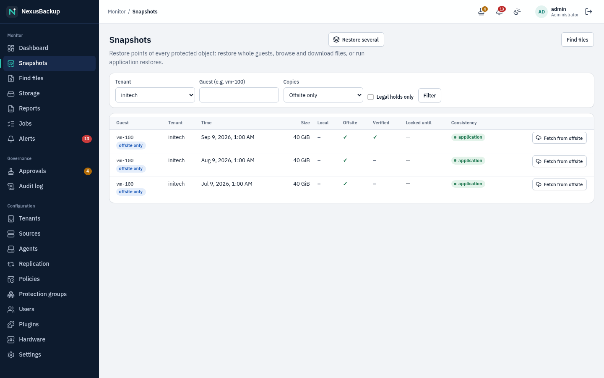

An offsite-only snapshot has no **Browse files** button and no **Restore** menu. Fetch it back first:

1. Click **Fetch from offsite** on the row and confirm. A **Fetch from offsite** job starts and its page opens. It
   downloads the snapshot's data from the Storage Box or bucket into the local store; every chunk is checked before
   it is stored. It takes about as long as downloading the snapshot's changed data.
2. When the job has finished, the snapshot is **Local** again. Browse it, download files or run any restore from it as
   usual.

A fetched snapshot is locked in the local store for at least **7 days**, so local retention does not delete it again
before you have used it. After that, retention removes the local copy on its normal schedule; the offsite copy is not
affected. While the lock runs, the local copy cannot be deleted by hand either.

Administrators, operators and tenant users (their own tenant) may fetch snapshots back, like restores. To see what
the offsite target holds right now, use **Offsite copy** on the tenant ([07 Offsite copies](07-offsite.md#check-the-offsite-copy)).
Rebuilding a lost appliance from the offsite copy is covered in [14 Disaster recovery](14-disaster-recovery.md).

> **Status:** Fetching back was tested with the SFTP test box and MinIO (integration tests) and is a lab step
> (`offsite-fetch`); not yet against a real Hetzner Storage Box or a real S3 provider. The keep time of 7 days is the
> scheduler default (`offsite_fetch_keep_secs`); there is no setting for it in the web UI.
