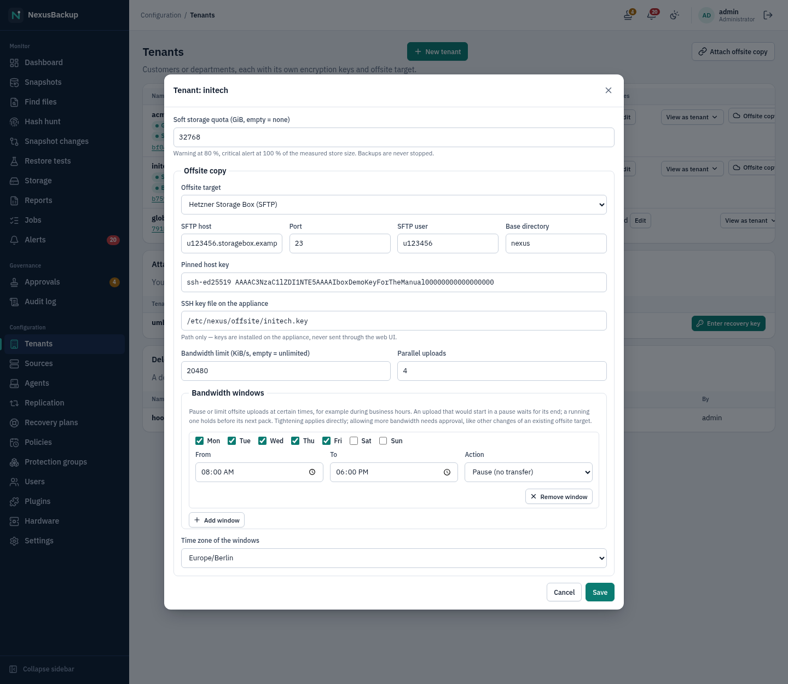
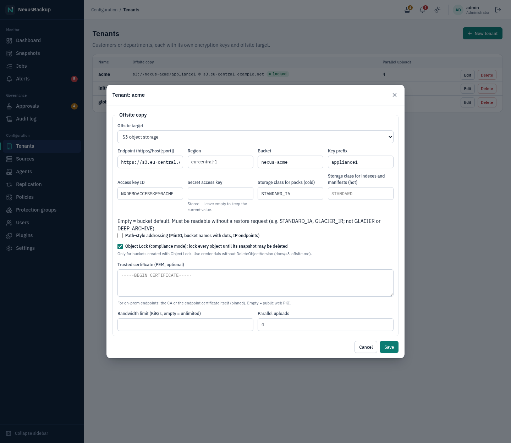
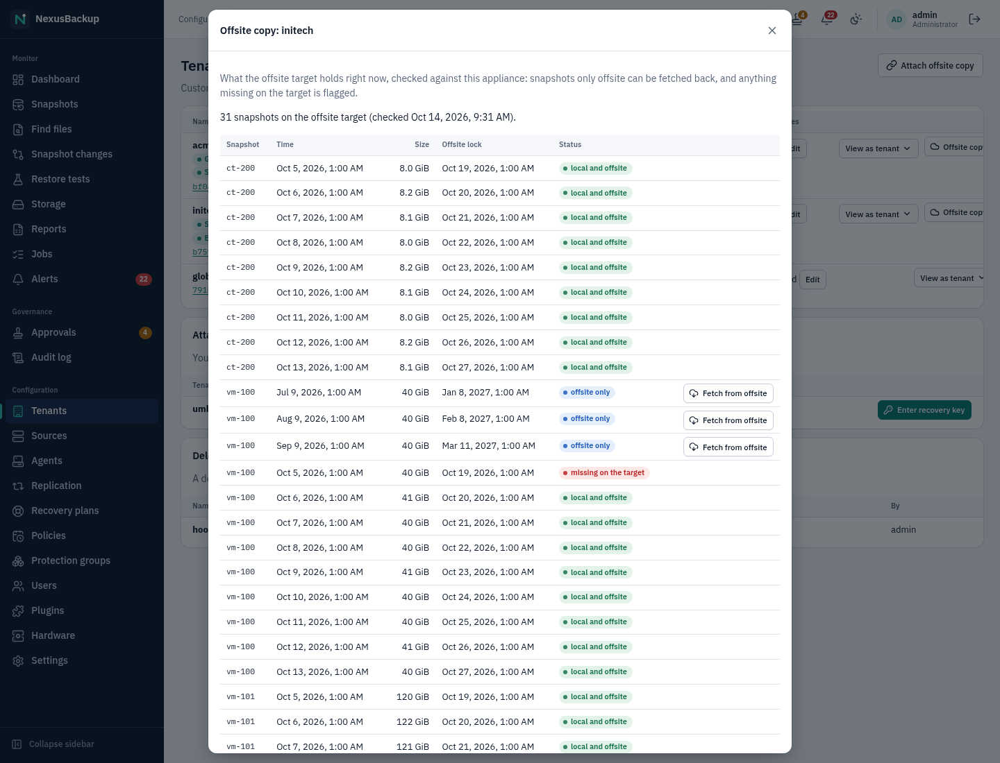
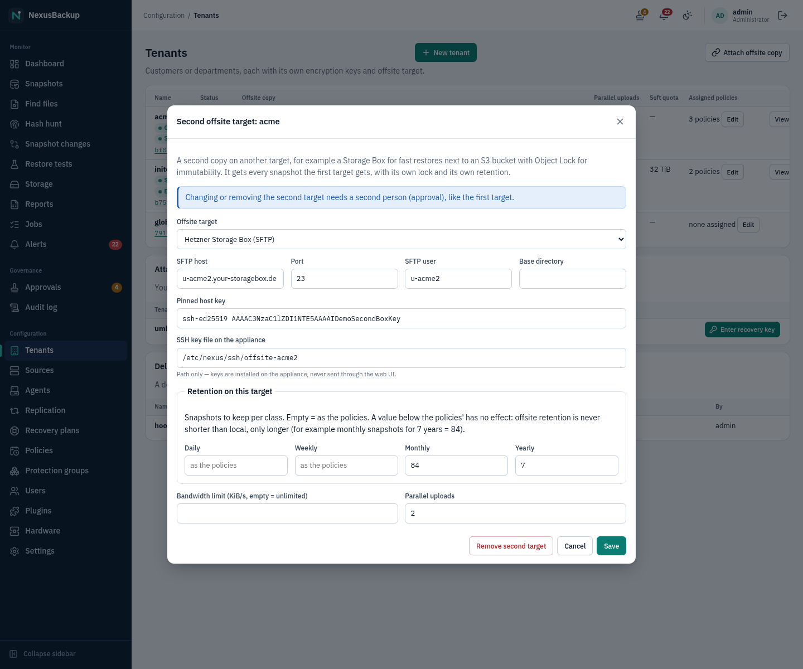

# 07 Offsite copies

Each tenant can have up to two offsite targets, each a **Hetzner Storage Box (SFTP)** or an **S3 object storage**
bucket (the second one: [A second offsite target](#a-second-offsite-target)).
The appliance uploads the tenant's snapshots there, encrypted and deduplicated. The copy is
**self-describing**: with the storage credentials and the recovery key, a fresh appliance can restore it
without the original one ([14 Disaster recovery](14-disaster-recovery.md)).

> **Status:** The offsite engine was tested against a local SFTP container that mimics the Storage Box limits
> and against MinIO with Object Lock. A final run against a real Hetzner Storage Box and a real S3 provider is
> still pending.

## What goes offsite

- **Packs**: 32–64 MiB containers of chunks. The chunks stay byte-identical to the local ones: compressed
  and sealed with the tenant key (XChaCha20-Poly1305).
- **Snapshot files**: the sealed indexes and the manifest of every snapshot. The manifest is written last, so
  a snapshot counts as offsite only when all its data is there.
- **Key escrow** (`keys/`): the tenant's data keys, wrapped. Only the recovery key can open them. If the tenant
  has a **tenant recovery key**, its data keys are also stored sealed to that key
  (`keys/tenants/<tenant>/tenant-escrow.*`), so the tenant can rebuild from this copy on its own
  ([14 Disaster recovery](14-disaster-recovery.md#the-tenant-recovery-key-optional)). When that key is replaced,
  the next upload removes the old key's files (on S3 with Object Lock they stay until their lock ends).

The provider sees random names and ciphertext. Chunk IDs are keyed hashes, so the provider cannot even test
whether a known file is stored.

## When uploads run

The **Copy offsite** setting of a policy ([05 Policies and protection groups](05-policies-and-groups.md)) decides
whether a group's snapshots go offsite. After every successful backup, the scheduler runs retention for that
source, then an **Offsite copy** job for the tenant. That job:

1. uploads new packs and snapshots (resumable, nothing is ever overwritten);
2. runs the **inventory check**: are all expected packs and manifests still on the target?
3. applies offsite retention.

Daily maintenance also runs garbage collection and a sampled **verify** on the offsite copy: 3 packs are
downloaded, decrypted and checked.

Retention offsite uses the GFS settings of the tenant's policies with **Copy offsite**, taking the largest
value of each class (daily, weekly, monthly, yearly) per tenant. It is computed and locked separately from
the local retention. A deletion on
the appliance is never just mirrored to the target. Offsite locks are extend-only, like local ones.

The **Offsite** column on **Dashboard** and **Snapshots** shows which snapshots are offsite. The alert
`offsite_lag` fires when a snapshot of a tenant has not reached the target for more than 48 hours
([11 Alerts and monitoring](11-alerts-and-monitoring.md)).

## Configure the target of a tenant

Go to **Configuration → Tenants** and click **Edit** on the tenant (or **New tenant**). In **Offsite copy**,
choose the **Offsite target**: **None**, **Hetzner Storage Box (SFTP)** or **S3 object storage**.


Fields for both target types:

- **Bandwidth limit (KiB/s, empty = unlimited)**: covers all uploaders together.
- **Parallel uploads**: 1–8 in the form, default 4.
- **Bandwidth windows** and **Time zone of the windows**: see below.

Changing or removing a target that is already configured needs approval by a second person while approvals
are enabled ([10 Approvals and audit](10-approvals-and-audit.md)). Setting the first target does not.

**One target per installation.** The escrowed keys in `keys/` on the target are written once and never
replaced, so that a compromised appliance cannot swap them. A reinstalled appliance (or another one) has new
keys: pointed at a target or path that already holds keys of an earlier installation, every upload fails with
"the offsite target holds other escrowed keys" and the tenant gets an offsite alert. Use a new target or
path for the new installation. To rebuild from the old copy instead, use **Attach** (chapter 14) or a
configuration backup restore.

## Bandwidth windows

Bandwidth windows pause or slow down the uploads at certain times, for example during office hours when the
internet line is needed for other work. Each window has start days (none = every day), a **From** and a **To**
time (a **To** earlier than **From** ends the next day) and an **Action**:

- **Pause (no transfer)**: no uploads inside the window. An Offsite copy job that would start in a pause waits
  until it ends (the job shows as queued, with the end of the pause as its earliest start). An upload that is
  already running holds before its next pack and continues when the pause ends.
- **Limit** with a **Rate (MB/s)**: at most this rate over all uploaders while the window is active.

How the windows combine: a pause wins over a limit; of several active limits the lowest applies; while a limit
window is active it replaces the **Bandwidth limit** field (it may also allow more, e.g. a faster night). The
uploader checks the windows every few seconds, so a new window takes effect while a long upload runs. The times
are evaluated in the **Time zone of the windows** (default UTC), including daylight-saving changes.

Tightening applies at once: adding or lengthening a pause, lowering a rate or the bandwidth limit. Anything that
lets more data through at some time of the week (removing or shortening a pause, a higher rate, another time
zone) counts as a change of the offsite target and needs approval while approvals are enabled.

> **Status:** Bandwidth windows are covered by automated tests (local target, throughput measured); a run
> against a real Storage Box is still pending.

## Hetzner Storage Box (SFTP)

Plan for **one Storage Box per tenant**. A box allows 10 concurrent connections. The appliance uses 4 by
default and leaves the rest for restore and verify. Separate boxes also keep tenants isolated and billed
separately.



| Field | What to enter |
|---|---|
| **SFTP host** | the box's host name, e.g. `u123456.storagebox.example.net` |
| **Port** | `23` (the Storage Box SSH port; default) |
| **SFTP user** | the box user, e.g. `u123456` |
| **Base directory** | optional directory on the box, e.g. `nexus` |
| **Pinned host key** | the box's SSH host key: a public key (`ssh-ed25519 AAAA…`) or a known_hosts line (`[host]:23 ssh-ed25519 AAAA…`). There is no trust on first use: any other key is refused. Get it out of band, e.g. `ssh-keyscan -p 23 u123456.storagebox.example.net` from a trusted machine. |
| **SSH key file on the appliance** | the path of the private key the appliance logs in with, e.g. `/etc/nexus/offsite/initech.key` |

The SSH private key never goes through the web UI: the tenant settings hold only its path, and the web API
refuses inline secrets there. Add the matching public key to the box's authorized keys (Storage Box: enable
SSH support, then `.ssh/authorized_keys` on the box).

**Settings → Appliance SSH keys** lists the appliance's SSH keys with their public halves, fingerprints and a
**Copy** button, and lets administrators rotate them (see [04 Sources](04-sources.md#appliance-ssh-keys)). Copy the
public key for offsite SFTP targets from there.

> **Status (gap):** The **Appliance SSH keys** tab is still being integrated on the appliance side, and the tenant
> settings still take a key file path. Until the appliance creates the key itself, the key file is placed on the
> appliance file system directly (as in the lab). Plan for this until key management is complete.

**Immutability on a Storage Box.** A box has no object lock. The appliance never overwrites files and deletes
only through delayed GC. Protection against a compromised appliance comes from the box's own snapshots. Turn
on automated snapshots in the Hetzner console, e.g. 14 daily + 4 weekly. The appliance has no Hetzner
console credentials, so it cannot delete them. That gives about six weeks to notice an attack on the offsite
copy. The inventory check raises an alert as soon as expected packs or snapshots disappear.

## S3 object storage with Object Lock

An S3 bucket with **Object Lock in compliance mode** makes the offsite copy immutable: locked objects cannot
be deleted or overwritten by anyone, not even the provider's root account, until their lock ends.



| Field | What to enter |
|---|---|
| **Endpoint (https://host[:port])** | e.g. `https://s3.eu-central.example.net`. HTTPS only, no path. |
| **Region** | the signing region (MinIO: usually `us-east-1`) |
| **Bucket** | one bucket per tenant is recommended |
| **Key prefix** | optional; all objects live below it, e.g. `appliance1` |
| **Access key ID** / **Secret access key** | credentials restricted by the policy below. The secret is write-only: it is sealed for the scheduler and never shown again. Changing endpoint, region, bucket, access key, path style or certificate requires re-entering it. |
| **Storage class for packs (cold)** / **Storage class for indexes and manifests (hot)** | optional, e.g. `STANDARD_IA` / `STANDARD`. Only classes that can be read without a restore request. `GLACIER` and `DEEP_ARCHIVE` are refused. Mind minimum storage durations: GC and repacking delete packs. |
| **Path-style addressing (MinIO, bucket names with dots, IP endpoints)** | tick for MinIO and on-prem endpoints |
| **Object Lock (compliance mode): lock every object until its snapshot may be deleted** | tick only for buckets created with Object Lock |
| **Trusted certificate (PEM, optional)** | for on-prem endpoints: the private CA or the endpoint certificate itself (pinned). Empty = the public web PKI. |

With Object Lock, every snapshot file is locked until the snapshot may be deleted. Every pack is locked until
the latest such date of all snapshots that use it. The key escrow is locked as long as the longest snapshot
lock. Locks are extended before a new snapshot's manifest is written, and when retention promotes a snapshot
(e.g. a daily becomes a monthly). Locks are never shortened.

### Prepare the bucket

1. Use a **separate account or project** for backups. Its root credentials do not belong on the appliance.
2. Create a **new bucket with Object Lock enabled** (this also enables versioning; most providers allow it
   only at creation). **Do not set a default retention.** The appliance sets each object's date itself.
3. Add a **lifecycle rule** that removes noncurrent versions a few days after they became noncurrent, expired
   delete markers and incomplete multipart uploads. Lifecycle never removes a version while its lock runs.
4. Create a user or key **restricted to the bucket**: list, get, put, delete (current version), put/get
   object retention, multipart cleanup. Deny `DeleteObjectVersion`, `BypassGovernanceRetention` and every
   bucket-configuration change. `docs/s3-offsite.md` has the complete IAM/MinIO policy and setup steps for
   MinIO, AWS, Hetzner Object Storage and Wasabi.

Example for MinIO:

```sh
mc mb --with-lock site/nexus-acme
mc ilm rule add --noncurrent-expire-days 7 --expire-delete-marker site/nexus-acme
mc admin policy create site nexus-appliance policy.json
mc admin user add site appliance-acme '<secret>'
mc admin policy attach site nexus-appliance --user appliance-acme
```

Provider notes:

- **Hetzner Object Storage**: credentials are project-wide and cannot be restricted by a policy. Use a
  separate project for backup buckets. Storage classes are not supported, so leave both empty.
- **Wasabi**: minimum storage duration (90 days by default) applies to deleted and repacked packs.
- **AWS S3**: works, but S3's DNS rotates through many addresses. The appliance's outbound firewall
  allow-list resolves the endpoint name periodically, so an upload can hit an address that is not allowed
  yet. Prefer providers with stable addresses, or expect occasional retries. Allowing provider IP ranges is
  an open item.

## Check the offsite copy

Click **Offsite copy** on a tenant row (**Configuration → Tenants**). The appliance reads the offsite target and
compares it with what it knows (a **List offsite copy** job, usually a few seconds). The dialog lists every
snapshot with its size, its offsite lock and a status:

- **local and offsite**: the normal case.
- **offsite only**: local retention removed the local copy. **Fetch from offsite** brings it back
  ([06 Restores](06-restores.md#restore-from-the-offsite-copy)).
- **missing on the target**: the appliance uploaded it, but its manifest is gone from the target. Check the target
  (deleted files, a wrong base directory or prefix). The inventory check of the next offsite run raises an alert too.
- **not in this appliance's inventory**: on the target, but not uploaded by this appliance (for example by another
  appliance using the same target by mistake).

**Check offsite copy** reads the target again. Administrators, operators and the tenant's own users can open it.



## A second offsite target

A tenant can keep a **second offsite copy** on another target, for example a Storage Box for fast restores next to
an S3 bucket with Object Lock for immutability, or a second provider in another region. Click **Second target** on
the tenant row (**Configuration → Tenants**, administrators; the tenant needs a first target):

- the **target**: a Storage Box or an S3 bucket, with the same fields as the first one, including its own **Object
  Lock**;
- **Retention on this target**: how many daily, weekly, monthly and yearly snapshots this target keeps. Empty means
  as the policies. **Offsite retention is never shorter than local**: a value below the policies' has no effect, a
  larger one keeps snapshots longer on this target only (for example **Monthly 84** = monthly snapshots for 7 years
  while the appliance itself keeps a few months). The first target has the same fields in its own form.
- uploads and bandwidth limit, like the first target.

After every backup the scheduler runs one offsite job per target; each target has its own upload state, its own
inventory check (alert `inventory`) and its own lag alert (`offsite_lag`, "second offsite copy of tenant … lags").
**Snapshots** shows an **Offsite 2** column once snapshots are on the second target, and **Offsite copy** on the
tenant row can list either target and fetch a snapshot back from it. Setting up the second target applies at once;
changing or removing it needs a second person, like the first target. Garbage collection and verify cover both
targets.



> **Status:** Implemented in Phase 30 and tested in the API and the scheduler with a stand-in for the offsite tool;
> not yet run against two real targets.

## Firewall

You do not open anything by hand. The scheduler adds each tenant's offsite endpoint (SFTP host:port, or the S3
endpoint, as `<bucket>.<host>` for virtual-hosted style) to the outbound allow-list. All other outbound
traffic is dropped. For **Attach offsite copy** ([14 Disaster recovery](14-disaster-recovery.md#attach-an-offsite-copy-in-the-web-ui))
the target is allowed as soon as the request is approved, before the tenant exists, for at most 72 hours.

> **Status:** S3 was tested against MinIO (Object Lock compliance, restricted user, TLS): locks, refused
> overwrite and version deletion, GC skipping locked packs, DR with locks restored. A run against a real
> provider is pending.
