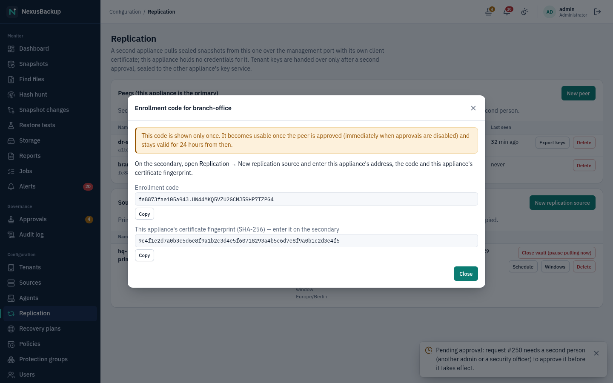
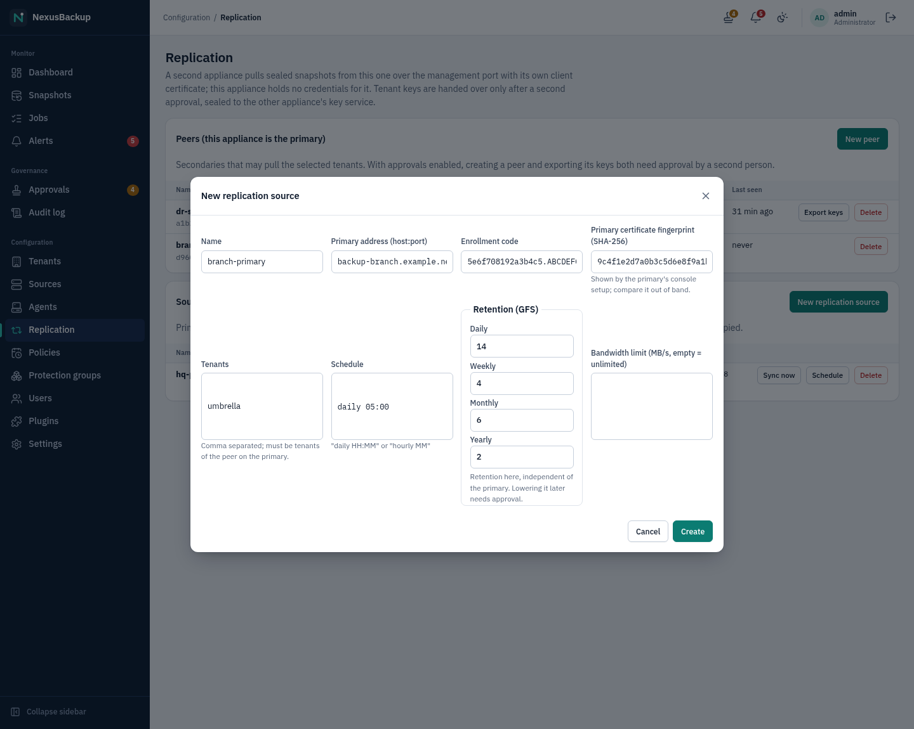
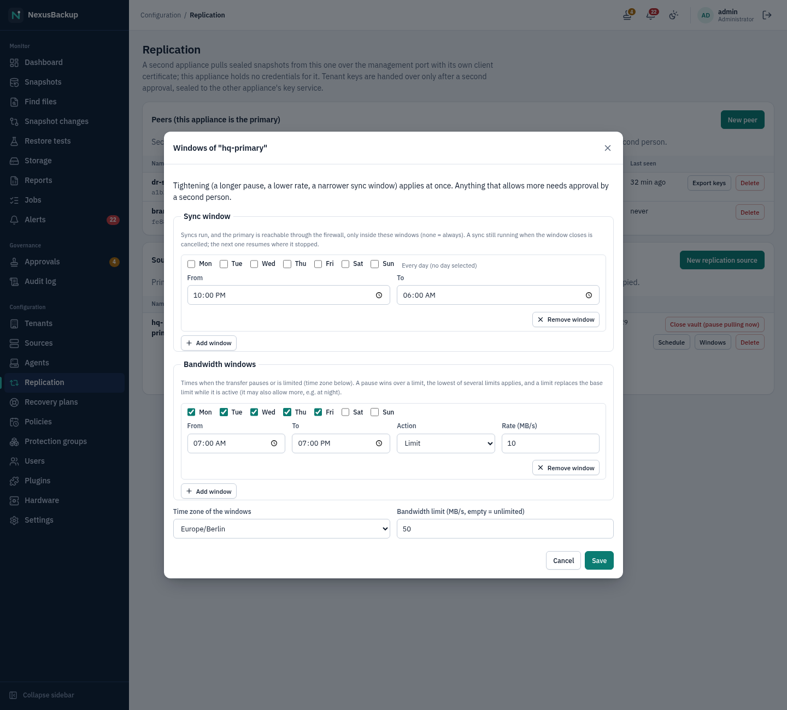
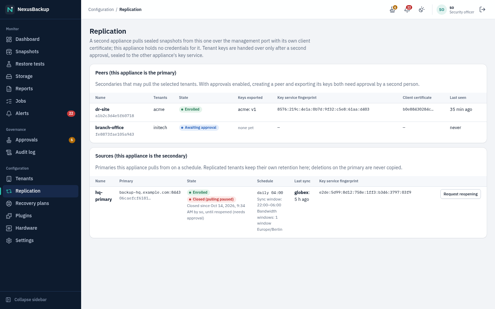
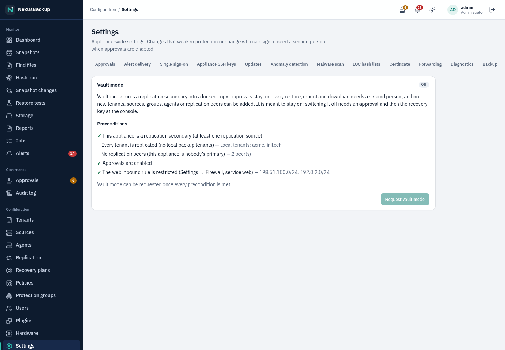

# 08 Replication to a second appliance

Replication keeps a second, independent copy of whole tenants on another NexusBackup appliance, for example at a
disaster-recovery site.

- The **primary** holds the tenant and its backups.
- The **secondary pulls** sealed snapshots from the primary over the primary's management port (8443). It uses
  its own client certificate (mutual TLS). No new inbound port is opened.
- The primary holds **no credentials** for the secondary. A compromised primary therefore cannot reach the
  secondary or delete replicated restore points.
- Tenant keys are handed over only after a second approval, sealed so that only the secondary's key service
  can open them.

> **Status:** Replication runs in a two-VM lab (two appliance images, SELinux enforcing): enrollment through the
> real port 8443, initial sync about 181 MB/s, incremental sync, file restore on the secondary with the primary
> powered off. A lab rerun after the latest integration is still pending (`state.md`). Sync windows, bandwidth
> windows and **Close vault (pause pulling now)** are covered by automated tests; their run in the two-VM lab is still pending.


The **Replication** page has two parts. **Peers (this appliance is the primary)** lists the secondaries that
may pull from this appliance. **Sources (this appliance is the secondary)** lists the primaries this appliance
pulls from. One appliance can be both, for different tenants.

## Roles

| Task | Who |
|---|---|
| Create, revoke peers; request a key export; create, change, delete replication sources | **Administrator** |
| **Sync now** | Administrator, Operator |
| **Close vault (pause pulling now)**; **Request reopening** | Administrator, Security officer |
| View the page | Administrator, Security officer, Operator (tenant users do not see it) |
| Approve peer creation, key export, revocation; reopening a closed vault | another Administrator or a Security officer |

## Step 1 — On the primary: create a peer

1. Open **Configuration → Replication** and click **New peer**.
2. Enter a **Name** for the secondary (e.g. `dr-site`) and tick the **Tenants** it may pull.
3. Click **Create**.
4. The dialog **Enrollment code for …** shows two values **once**: the **Enrollment code**
   (`<peer-id>.<token>`) and **This appliance's certificate fingerprint (SHA-256) — enter it on the
   secondary**. Copy both and pass them to the secondary's administrator over a trusted channel.



Creating a peer exposes all data of the selected tenants, so with approvals enabled it needs a second
person's approval (**Approvals**, action `replication peer create`). The code works only after the approval
(immediately when approvals are disabled) and stays valid for 24 hours from then. The peer's state goes from
**Awaiting approval** to **Waiting for enrollment** to **Enrolled**.

## Step 2 — On the secondary: create a replication source

1. Open **Configuration → Replication** and click **New replication source**.
2. Fill in:
   - **Name**: e.g. `hq-primary`.
   - **Primary address (host:port)**: e.g. `backup-hq.example.com:8443`.
   - **Enrollment code**: the code from step 1.
   - **Primary certificate fingerprint (SHA-256)**: from step 1. The primary's console setup shows it too.
     Compare it out of band. The secondary pins this certificate and refuses any other.
   - **Tenants**: comma separated, e.g. `globex`. They must be tenants of the peer on the primary.
     Missing tenants are created on the secondary.
   - **Schedule**: `daily HH:MM` or `hourly MM` (UTC; the other forms of [05](05-policies-and-groups.md#schedules) work too).
   - **Retention (GFS)**: **Daily**, **Weekly**, **Monthly**, **Yearly**. This is the retention on the
     secondary, independent of the primary.
   - **Bandwidth limit (MB/s, empty = unlimited)**.
3. Click **Create**. An **Enroll at primary** job runs: the secondary creates its key pair, connects to the
   primary with the pinned certificate, proves it knows the code, and receives its client certificate. The
   code works once. The token never travels in clear, and a man in the middle cannot relay the proofs.



A tenant that already has local groups, agents or keys on the secondary cannot be a replicated tenant. If the
enrollment failed or the code was used up, ask the primary for a new code and click **More** > **New code** on the
source.

## Step 3 — On the primary: approve the key export

After the enrollment, the primary automatically requests the **key export** (`replication key export`) for
the peer's creator. The request names the secondary's **Key service fingerprint**. Before you approve:

- compare it with the **Key service fingerprint** shown for the source on the secondary's **Replication**
  page;
- only then approve it on **Approvals** (see [10 Approvals and audit](10-approvals-and-audit.md)).

The primary's scheduler then seals each tenant key to the secondary's key service. The secondary imports the
keys at its next sync and stores them under its own key-encryption key. Until the export is approved, syncs
fail with "approve the key export on the primary". The peer table on the primary shows the exported key
versions under **Keys exported**.

A secondary that enrolled with this release sends a post-quantum key as well: the exports are sealed with
X25519 and ML-KEM-768 together, so a copy of the primary's catalog taken today stays closed even if one of the
two methods is broken later. The peer table marks such peers **Post-quantum**; a peer marked **X25519 only**
enrolled with an earlier release: update it, revoke it and enroll it again to switch.

## Syncing

- The secondary runs one **Replication sync** job per tenant on the source's **Schedule**. Click
  **Sync now** to start one immediately, or **More** > **Schedule** to change the schedule. While a sync
  is queued or running, **Last sync** shows it per tenant with a link to its job, and **Sync now** is greyed out.
  The page refreshes itself every 15 seconds.
- A sync fetches only snapshots that are missing locally **and** that the secondary's own retention keeps.
  Every chunk is verified (authenticated decryption and keyed hash) before it is stored. If anything fails
  verification, nothing of that snapshot is imported, and a `replication_verify` alert is raised.
- **Last sync** shows per tenant when the last successful sync was, and the last error if one followed it.

## Sync window and bandwidth windows

Click **More** > **Windows** on a source (administrators) to restrict when and how fast the secondary pulls:

- **Sync window**: syncs run only inside these windows (start days, **From**, **To**; none = always). Outside
  them the firewall of the secondary does not even let it reach the primary, so the copy is offline most of the
  time (an "air gap" by schedule). The row shows **Outside sync window** then, and **Sync now** is not offered.
  A sync still running when the window closes is cancelled; the next one continues where it stopped (chunks
  already fetched stay, a snapshot is committed only when complete). A cancelled sync is not an error.
- **Bandwidth windows**: **Pause (no transfer)** or **Limit** with a **Rate (MB/s)**, exactly as for offsite
  uploads ([07 Offsite copies](07-offsite.md)): a pause wins over a limit, the lowest of several limits
  applies, a limit replaces the **Bandwidth limit** while it is active.
- **Time zone of the windows** applies to both (default UTC).



Tightening applies at once: a narrower sync window, a longer pause, a lower rate. Widening the sync window,
removing or shortening a pause, a higher rate or another time zone needs approval by a second person while
approvals are enabled ([10 Approvals and audit](10-approvals-and-audit.md)). Choose the sync window so that the
schedule's runs fall into it; the `replication_lag` alert still fires after 48 hours without a successful sync.

## Close vault (pause pulling now)

**More** > **Close vault (pause pulling now)** on a source (administrator or security officer) cuts the secondary off from that primary
immediately, for example when the primary may be compromised. It acts on this one replication source only and is
not the same as [vault mode](#vault-mode-secondary-only), the appliance-wide profile below; both can be used together.

- the firewall target of the primary is removed within a few seconds, a running sync is cancelled, queued syncs
  are dropped and no new ones start;
- the row shows **Closed (pulling paused)** with who closed it and since when; the info alert `vault_closed` stays open
  while it is closed (no `replication_lag` warnings meanwhile);
- closing needs no approval (it only adds protection) and is recorded in the audit log
  (`replication_source.close`).



**More** > **Request reopening** asks for the source to be opened again. Another administrator or security officer
approves it on the **Approvals** page (action `replication.reopen`); syncs resume with the next scheduled run.
With approvals disabled the source reopens at once. The API also accepts a closing time
(`POST /api/v1/replication/sources/{id}/close` with `{"until": <unix time>}`); a closure can be extended but never
shortened without the approval.

## Replicated tenants on the secondary

- They are **read-only copies**: the secondary refuses protection groups, agents and backups in them.
- Their snapshots appear on **Snapshots** marked **Replicated from <source>**.
- Retention is independent. **The secondary never deletes because the primary deleted**: syncs only add,
  and deletions come only from the secondary's own GFS retention. Lowering that retention later needs approval
  while approvals are enabled.
- Restores use only the secondary's keys and work while the primary is down. Browse and download work as
  usual. For full VM/CT restores, add a PVE source of the DR site to the replicated tenant as a restore
  target ([06 Restores](06-restores.md#restores-on-a-replication-secondary)).
- The secondary uploads replicated snapshots offsite only if you give the tenant an offsite target on the
  secondary (untested in the lab).


### Legal holds from the primary

Every sync also fetches the primary's active [legal holds](06-restores.md#legal-hold) of the tenant. On the secondary
they are **advisory**: the snapshot shows **Hold advised by <primary>**, a `legal_hold_advisory` warning names the
snapshot, the reason and who set it, and nothing is enforced. The secondary's security officer decides: **Apply
hold** (on the alert, or **Apply hold…** on **Snapshots**) makes it a hold of this appliance, set by them and
released only with this appliance's approval. When the primary releases its hold before that, the advice is
withdrawn and the alert resolves itself. Holds are only advised for snapshots the secondary has.

## Key rotation on the primary

New snapshots after a tenant key rotation on the primary use a new key version. The secondary skips snapshots
whose key version it lacks and raises the critical alert `replication_keys` ("re-export the keys on the
primary"). Fix: on the primary, click **Export keys** on the peer. With approvals enabled a second person
approves it after comparing the key service fingerprint. The next sync imports the new version.

## Revoke a peer or stop replicating

- **Primary:** **Delete** on a peer revokes it (approval needed while approvals are enabled). Its certificate
  is refused on the next request, even on an open connection. Its token and key exports are dropped. A peer
  that is still awaiting approval is revoked at once, without an approval.
- **Secondary:** **More** > **Delete** on a source stops replication. The replicated snapshots stay under the
  secondary's retention.

A peer certificate cannot be renewed in place. Delete the peer and create a new one (the certificates are
valid for 10 years).

## Alerts on the secondary

| Alert | Severity | Meaning |
|---|---|---|
| `replication_lag` | warning | no successful sync of a source/tenant for more than 48 hours |
| `replication_keys` | critical | key version mismatch, no export yet, or a key export failed |
| `replication_verify` | critical | a fetched object failed verification; nothing was imported |
| `job_failed` | critical | a sync or enrollment job failed |
| `legal_hold_advisory` | warning | the primary holds a replicated snapshot under a legal hold (below) |
| `vault_closed` | info | the source was closed with **Close vault (pause pulling now)**; resolves when it is reopened |

See [11 Alerts and monitoring](11-alerts-and-monitoring.md).

## Vault mode (secondary only)

Vault mode turns a secondary into a locked copy that one stolen administrator account cannot empty or read out
unnoticed. It is a one-way profile: switching it off needs an approval **and** the recovery key at the console.

Open **Configuration → Settings → Vault**. The tab lists the preconditions; **Request vault mode** (administrators)
is available only when all of them are met:

- this appliance is a replication secondary (at least one replication source);
- every tenant is replicated (no local backup tenants);
- it has no replication peers (it is nobody's primary);
- approvals are enabled;
- the web inbound rule is restricted (**Settings → Firewall**, service **Web UI and API**: a source list).



The request needs approval by another administrator or security officer; the preconditions are checked again then.
While vault mode is on (a **Vault mode** badge in the top bar):

- approvals cannot be disabled, neither in the web interface nor with `nexus-setup disable-approvals`;
- every restore, instant recovery, file restore to a host, plugin restore or mount and every file download becomes a
  request (`vault restore`, shown with the job and its parameters). The buttons read **Request restore** /
  **Request download**. After approval the job starts as the requester; a download is then on the job's page.
  Browsing the files of a snapshot needs no approval;
- no new tenants, sources, protection groups, agents or replication peers can be added (the secondary only receives
  replication). New replication sources can still be added;
- the web inbound rule cannot be emptied (any address).

**Switching vault mode off:**

1. An administrator clicks **Request to switch off** on the Vault tab.
2. Another administrator or security officer approves the `vault disable` request.
3. Within 72 hours, someone with the recovery key runs, as root on the appliance console:

   ```
   nexus-setup vault-disable
   ```

   It asks for the recovery key, switches vault mode off, audits `vault.disable` (actor `console`) and raises the
   warning alert `vault_disabled`. The web interface never asks for the recovery key: the web service has no access
   to the key escrow. A root shell on the console is opened as described in
   [14 Disaster recovery](14-disaster-recovery.md#emergency-root-shell-on-the-console).

> **Status:** Vault mode is covered by API and unit tests (preconditions, enforced approvals, restores through
> approval, the console step). It was not yet run in the two-appliance lab.

## Using the secondary for disaster recovery

If the primary is lost, the secondary already holds restorable copies of the replicated tenants, with its own
keys and its own recovery key. Restore from it as described in [06 Restores](06-restores.md). To rebuild
an appliance from an offsite copy instead, see [14 Disaster recovery](14-disaster-recovery.md).

Known limits: no bandwidth limit on the primary side (only the secondary's **Bandwidth limit**). Chained
replication (secondary to a third appliance) is not tested.
