# 09 Users and access

Every person who works with the appliance gets an own account with a role. There are two kinds of accounts:

- **Local accounts** (appliance accounts) have a password and a TOTP authenticator, optionally also
  [passkeys](#passkeys) (security keys, phones, the computer's built-in authenticator). They are created by an
  administrator, but **the administrator never sets or learns another person's password or authenticator**: the new
  user activates the account with a one-time activation code and chooses both themselves.
- **Single sign-on accounts** sign in through your organization's identity provider (Microsoft Entra ID, Keycloak,
  Okta, Authentik, …). They are created automatically at the first sign-in; see
  [Single sign-on (OIDC)](#single-sign-on-oidc).

## Roles

| Role | May | May not |
|---|---|---|
| **Administrator** | configure tenants, sources, agents, policies, groups, users, replication, plugins and **Settings** (approvals, alert delivery, single sign-on, appliance SSH keys, updates); run backups and restores; enable approvals; confirm a large GC while approvals are disabled; read the audit log | approve own requests |
| **Security officer** | approve or reject requests of others; read everything incl. the audit log and verify the chain; read replication, plugins and all **Settings** tabs | change configuration, run backups or restores |
| **Operator** | run backups (**Back up now**), restores and file downloads; cancel queued jobs; acknowledge alerts; start a replication sync; read approvals, replication, plugins and the **Settings** tabs Approvals, Appliance SSH keys and Updates | change configuration, approve requests, read the audit log |
| **Tenant admin** | within one tenant: manage its accounts (tenant admins, tenant users, viewers), sources, agents and protection groups (with the policies the provider assigned to the tenant); run backups, restores, file searches and downloads; read its jobs, reports, its own approval requests and the audit entries concerning the tenant | anything outside the tenant; Settings, approving requests, offsite targets, keys and recovery keys, quotas, deleting snapshots, legal holds, replication, plugins, firewall, hardware, vault; creating administrators, security officers or operators |
| **Tenant user** | see one tenant's dashboard, snapshots and jobs; restore and download that tenant's data | everything else |
| **Viewer** | read-only: the dashboard, snapshots (and their file lists), jobs and their logs, storage, sources, groups, policies, agents and users of its scope; with no tenant also the alerts | run any job (no backups, no restores, not even browsing files), download, acknowledge alerts, see approvals, the audit log, replication, plugins or settings, change anything |

Any account except administrators and security officers can be limited to one tenant with the **Tenant** field
(required for tenant admins and tenant users, optional for viewers: a viewer without a tenant sees all tenants, for example an
auditor or a management dashboard). Tenant-scoped accounts see only their tenant's data and do not see alerts,
approvals, replication or settings. Secrets (source passwords, keys, tokens) are never shown to anybody; they are
write-only.

### Tenant admins (service providers)

A **tenant admin** runs one tenant on behalf of a customer while the provider keeps the appliance: the customer's
own administrator manages the tenant's accounts, sources, agents and protection groups, and backs up and restores
on their own. The provider decides the protection on offer: a tenant admin's groups can only use the policies an
administrator **assigned** to the tenant (**Configuration → Tenants**, **Assigned policies**; see
[05 Policies and groups](05-policies-and-groups.md#assigned-policies-and-tiers)). A tenant admin

- sees a reduced navigation: Dashboard, Snapshots, Find files, Storage, Reports, Jobs, Approvals (their own
  requests), Audit log (their tenant), Sources, Agents, Protection groups and Users;
- creates and changes accounts of their own tenant only, with the roles tenant admin, tenant user and viewer
  (activation codes and new activation codes work as for administrators); the tenant cannot be changed;
- needs the same approvals as an administrator: deleting a group, source or agent and weakening changes (another
  policy with less retention) wait for an administrator or security officer of the provider — a tenant admin never
  approves anything, not even another tenant admin's request ([10 Approvals and audit](10-approvals-and-audit.md));
- may download restored files by default (**May download files**, like tenant users).

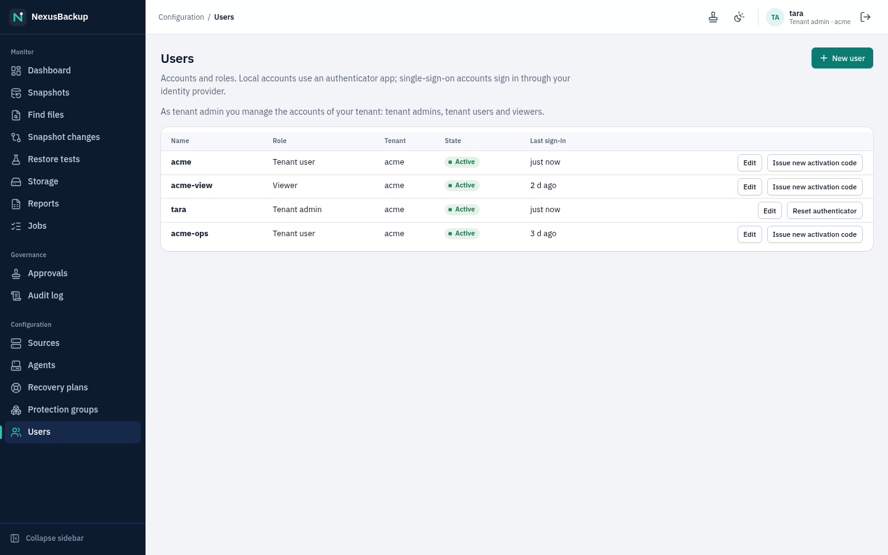

### Onboarding a new tenant

**Configuration → Tenants → New tenant** (administrators) walks through what a new customer needs, in five steps:

1. **Tenant**: the name (lowercase letters, digits, dashes). Name and tenant ID never change, and a deleted tenant's
   name is never used again.
2. **Quota and tier**: the soft storage quota (optional) and the **policy tier** the customer bought. The tenant gets
   the policies of that tier assigned; if there is none yet, one is created from the tier template
   ([05 Policies and groups](05-policies-and-groups.md#assigned-policies-and-tiers)).
3. **Tenant admin**: the user name of the customer's first tenant admin (optional). The wizard creates the account and
   shows its one-time **activation code** at the end; hand it over as described in
   [Creating an account](#creating-an-account).
4. **Offsite**: none, a Hetzner Storage Box (SFTP) or S3 object storage. The SFTP key is installed on the appliance;
   only its path is entered. More options (bandwidth windows, storage classes) are under **Edit** afterwards.
5. **Review** and **Create tenant**: the steps run one after the other and each shows **done** or **failed** with the
   reason; a failed step stops the rest (fix it with **Edit** on the tenant, or on the Users page).

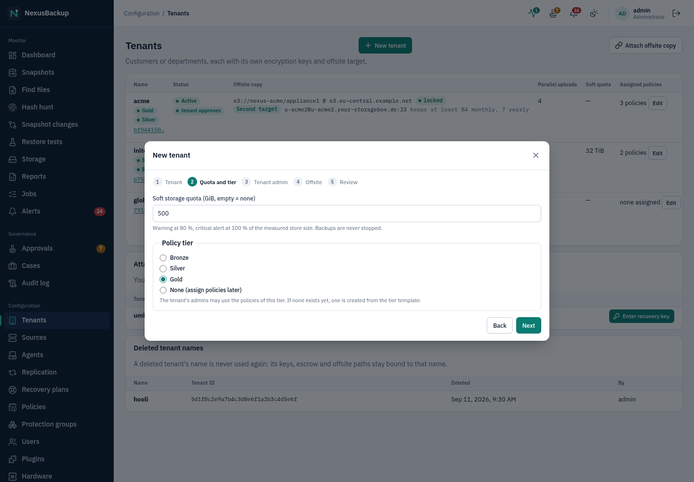

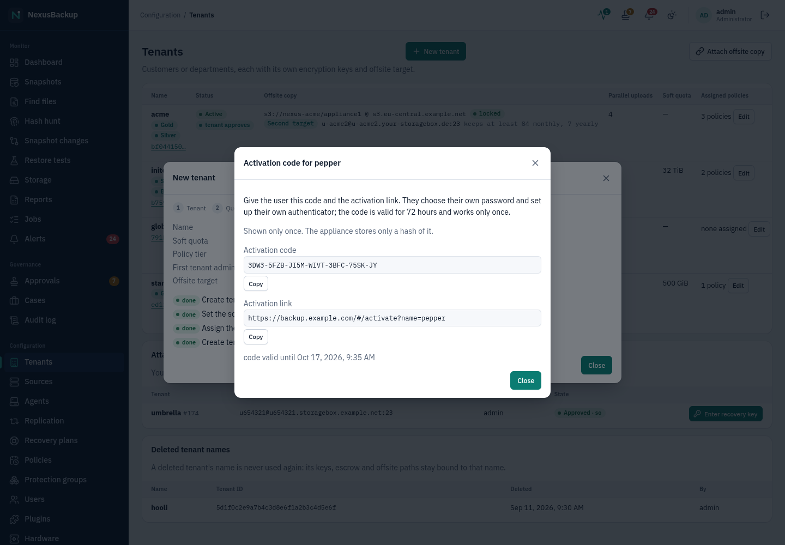

Every step is the same action as on the individual pages, with the same checks and audit entries (`tenant.create`,
`tenant.quota`, `tenant.policies`, `user.create`).

### View as tenant (impersonation)

To see what a customer sees, an administrator opens **Configuration → Tenants**, **View as tenant** on the tenant's
row:

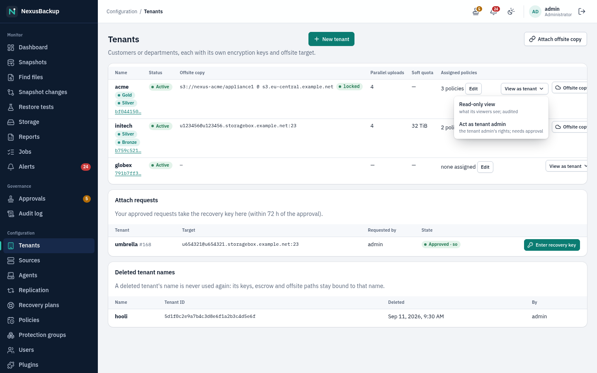

- **Read-only view** starts at once: the session continues as a *viewer of that tenant* (the intersection of the
  administrator's rights and the tenant's scope), so nothing can be changed and nothing outside the tenant is
  visible. A banner shows the view; **End view** returns to the administrator's own role.
- **Act as tenant admin** gives the session the tenant admin's rights in that tenant. It needs approval by another
  administrator or security officer while approvals are enabled (`tenant impersonate`); once approved, the
  requesting session switches. Downloads stay off in both modes.

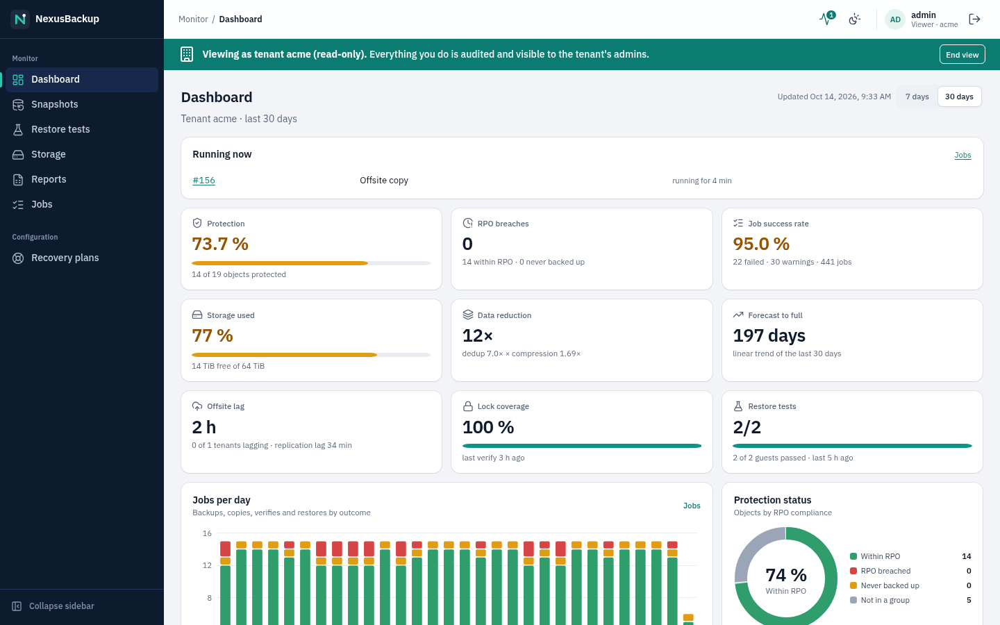

Everything done while viewing is audited under the administrator's own name with the tenant, for example
`alice impersonating:acme`, and these entries — like starting and ending the view — appear in **the tenant's own
audit log**, which its tenant admins can read. The view ends with the session at the latest.

### Tenant names and IDs

A tenant cannot be renamed, and the name of a deleted tenant is never used again: encryption keys, the key escrow
and the offsite paths are bound to the name, and a new tenant with an old name could be confused with the old one
(for example by a replication secondary). **Configuration → Tenants** lists **Deleted tenant names** for
administrators and security officers. Every tenant also has an immutable **Tenant ID** (128 bit, shown under its
name; click to copy); replication checks it in addition to the name.

> **Status:** Tenant admins, assigned policies, "view as tenant", the tenant-scoped audit log and the tenant name
> rules are covered by API tests and the demo backend; they were not yet run in the VM lab.

### Download privilege

Downloading restored files to the browser (**Files → Prepare download**) is a separate privilege, **May download
files**, set per account on the **Users** page. By default administrators, operators, tenant admins and tenant
users have it;
viewers and security officers do not (they cannot request it either: viewers run no jobs, and a security officer's
job is approvals and the audit log). Without it, the Files page still lists the files but offers no download, and
the API refuses `files_get` jobs and download links (403), also for downloads prepared before the privilege was
taken away. Restores to a VM, container or agent path are not affected.

### Account expiry

An account can get an end date (**Account expires**, e.g. for a contractor). From that day on it cannot sign in
(the refusal is audited with the reason `expired`), its open sessions end at the next request, and an expired
administrator or security officer no longer counts as a possible approver. Clearing the date makes the account
usable again. The last administrator without an end date cannot get one.

The appliance needs at least one enabled administrator; the last one cannot be disabled or demoted. For approvals to
work you need at least two people who can approve (administrators or security officers), see
[10 Approvals and audit](10-approvals-and-audit.md).

## The Users page

Open **Configuration → Users**.


The **State** column shows **Active**, **Disabled**, **expired …** or **Pending activation** with the date until
which the code is valid ("waiting for the second code part" or "code expired" are also possible). Further chips:
**expires …** (an end date is set), **no downloads** (the download privilege was taken away) and **Single sign-on**
(accounts that sign in through the identity provider; they offer only **Edit**, see
[Single sign-on accounts on the Users page](#single-sign-on-accounts-on-the-users-page)). **Last sign-in** shows
when the account last signed in; it is what [dormant accounts](#dormant-accounts) are measured by.

## Creating an account

This creates a local account. Single sign-on accounts are not created here; they appear at their first sign-in.

1. Click **New user**.
2. Enter the **Name** (letters, digits, `.`, `_`, `-`), choose the **Role** and, for tenant users (optionally for
   viewers), the **Tenant**. **May download files** follows the role's default until you change it; **Account
   expires** is empty (never) unless you pick a date. There is no password field.

   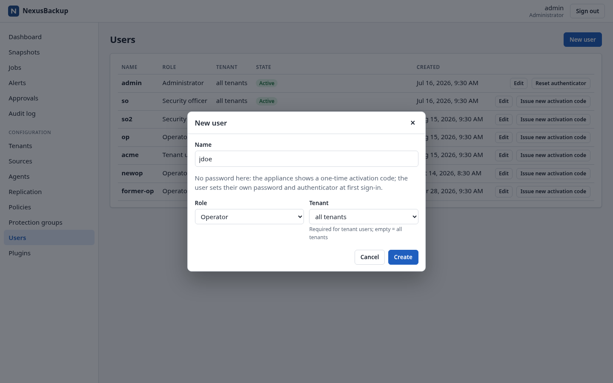

3. Click **Create**. A dialog shows the **Activation code** and the **Activation link** exactly once.

   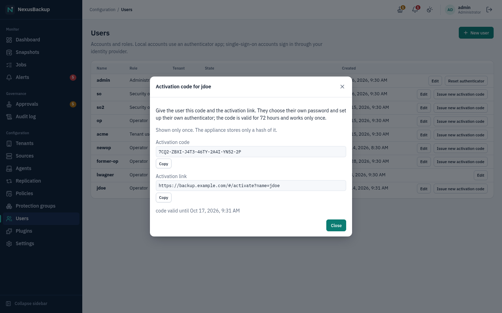

4. Give the user the code and the link, preferably through two different channels (for example the link by email
   and the code by phone). The code is valid for **72 hours** and works only once. The appliance stores only a hash
   of it; if it is lost, issue a new one.

### Administrators and security officers (split code)

With approvals enabled, creating an **Administrator** or **Security officer** is an approval request, and the code
is split in two halves so that no single person can create an account they control:

1. You (the requesting administrator) receive only **part 1 of 2** and a "Pending approval" message. Give this half to
   the new user.

   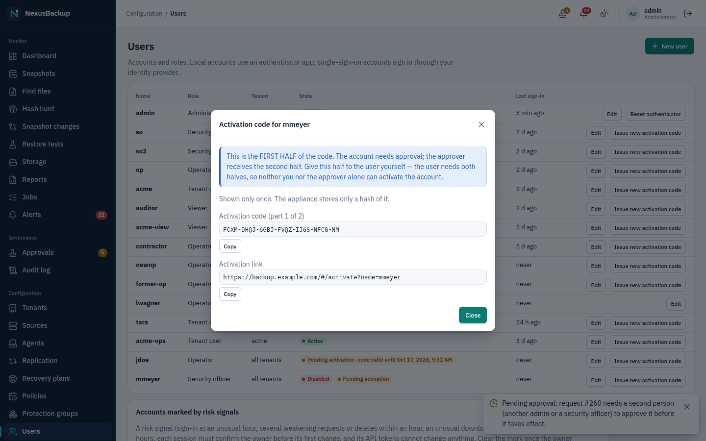

2. Another administrator or security officer approves the request on the **Approvals** page and then receives
   **part 2 of 2**. They give it to the user through a different channel.

   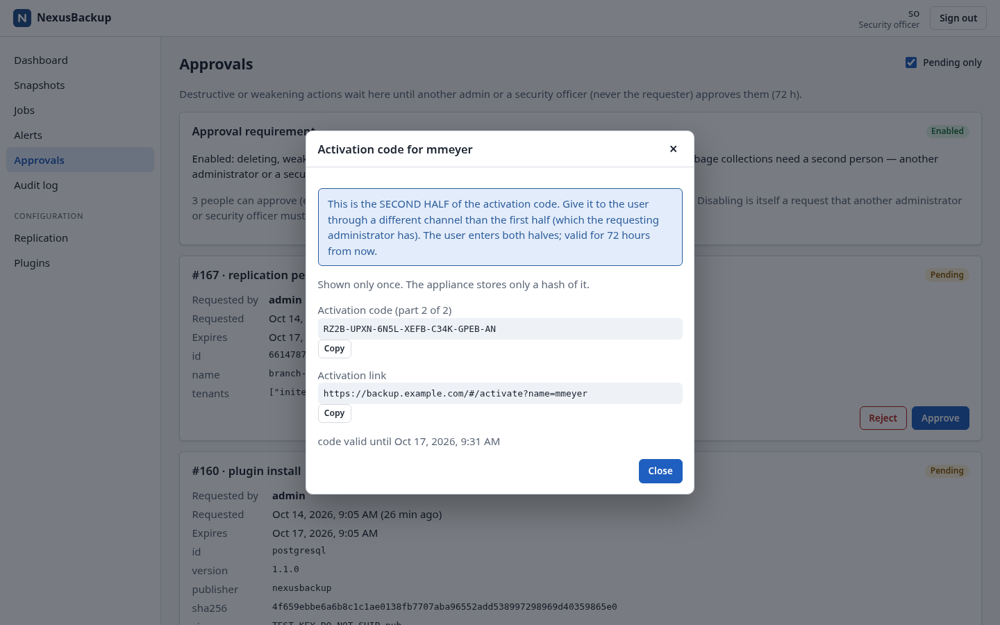

3. The user enters both halves one after the other in the **Activation code** field. The code is valid for 72 hours
   from the approval.

With approvals disabled (single administrator), the whole code is shown at once.

## Activating your account

You received a user name, an activation link and an activation code (or two halves of it).

1. Open the activation link, or open the sign-in page and click **Activate account**.
2. Enter your **User name** and the **Activation code** (case, spaces and dashes do not matter; with two parts, first
   the part from the administrator who created the account, then the part from the approver). Click **Continue**.

   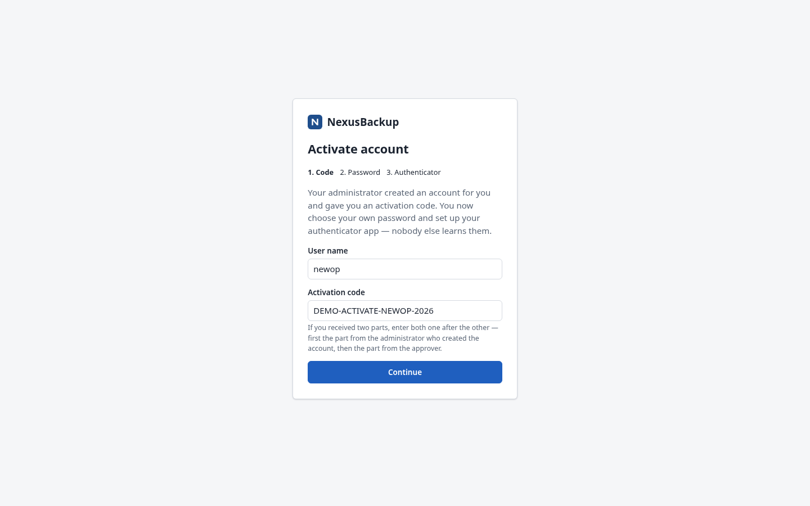

3. Choose your **New password** (at least 12 characters), repeat it and click **Continue**.

   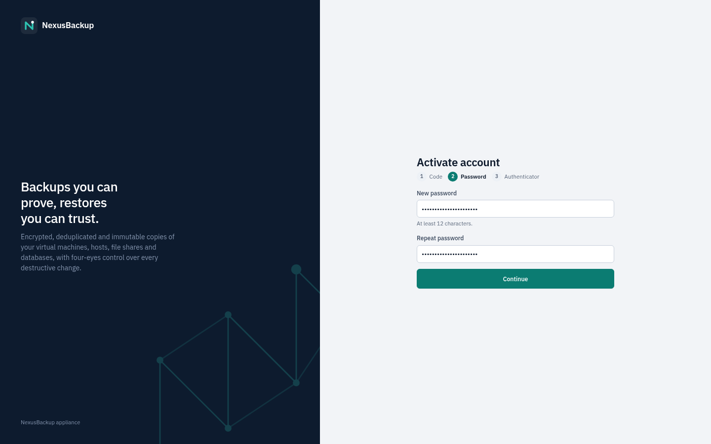

4. Scan the QR code with an authenticator app (any TOTP app, e.g. on your phone) or type the **Secret** into the app.
   Enter the 6-digit code the app shows and click **Activate**.

   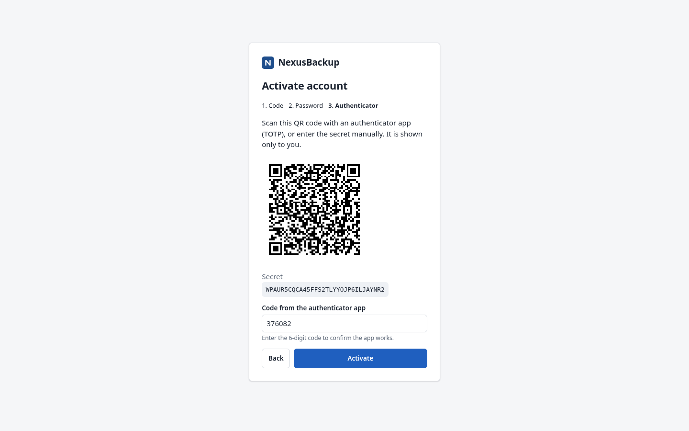

   Optionally register a **Passkey** in the same step: enter a name, click **Register passkey** and follow your
   browser's prompt. For administrators and security officers the passkey is **required** while
   [passkeys are required](#requiring-passkeys-for-administrators-and-security-officers); the step then says so.

5. Sign in with your user name, your new password and a code from the app (or your passkey).

   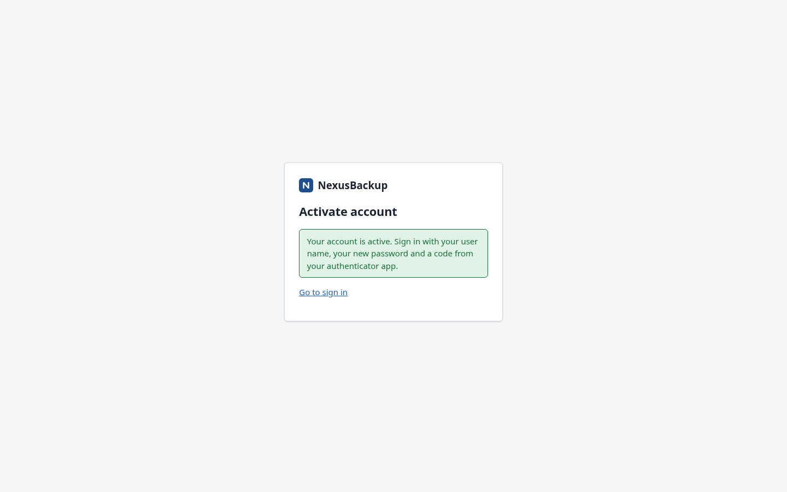

The QR code and secret are shown only to you, only once. If the activation fails five times, it is locked for 15
minutes like a sign-in.

## Changing an account

Click **Edit** next to a local account to change its **Role**, **Tenant**, **May download files**, **Account
expires** or the **Disabled** flag. Every change ends the account's sessions (the person signs in again with the
new rights); **End all sessions** ends them without changing anything.

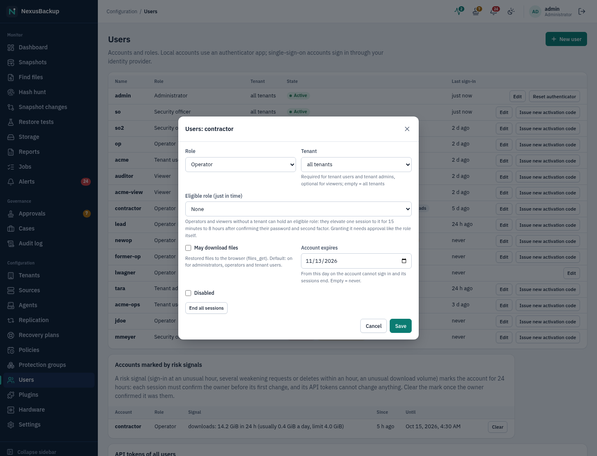

- Granting **Administrator** or **Security officer** needs approval when approvals are enabled. A pending account must
  be activated by its owner before it can get a privileged role.
- With approvals enabled, a change that would leave fewer than two people able to approve is refused.
- Disabled accounts cannot sign in; their sessions end. Re-enabling an administrator or security officer needs
  approval when approvals are enabled.

### Your own password and authenticator

- To change your own password, **Edit** your own account, enter the **New password for your own account**, then
  confirm with **Your current password** and **Your authenticator code**.
- **Reset authenticator** (shown on your own row) issues a new TOTP secret for your account, after the same
  re-authentication. Scan the new QR code; the old one stops working immediately.

Wrong re-authentication attempts count toward the sign-in lockout and are audited.

### Lost password or authenticator

Another administrator clicks **Issue new activation code** on your row and confirms with their own password and
authenticator code. Your old password and authenticator stop working at once, your sessions end, and you activate
the account again with the new code as described above.

For an administrator or security officer with approvals enabled, the new code is split like at creation and needs
approval; the old credentials keep working until the request is approved.

A **lost passkey** is handled the same way: remove it on **My account** if you can still sign in with another
passkey or your authenticator code; otherwise ask for a new activation code. A new activation code (and the console
break-glass reset) removes all passkeys of the account; you register new ones while activating.

If you are the **only** administrator and lost your authenticator or password, nobody can issue you a new code in
the web interface. Use the console break-glass procedure with the recovery key: see
[14 Disaster recovery](14-disaster-recovery.md#break-glass-the-only-administrator-lost-their-authenticator).

If approvals can no longer be granted because approvers are unavailable, see
[10 Approvals and audit](10-approvals-and-audit.md#when-approvers-are-unavailable). Keep at least three people who
can approve.

## Deactivating a tenant

When a customer or department pauses (contract on hold, project ended), an administrator deactivates its tenant
instead of deleting it: **Configuration → Tenants**, **Deactivate** on the tenant's row, and a reason (one line,
recorded in the audit log).

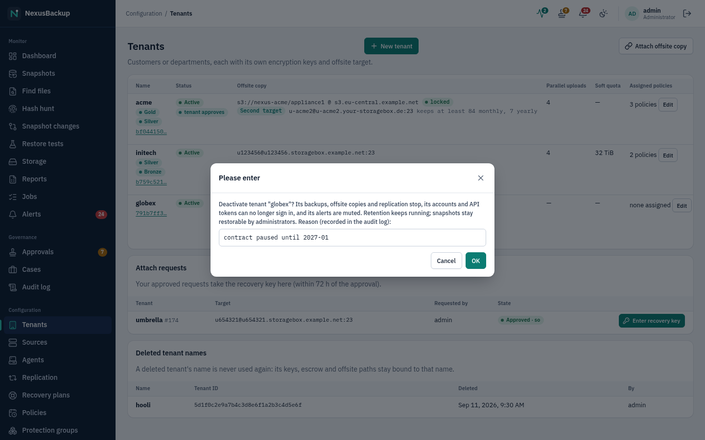

Deactivating stops the tenant's protection, so it needs approval by another administrator or security officer while
approvals are enabled (`tenant disable`). Once it takes effect:

- no backups, offsite copies or replication syncs run for the tenant; **Back up now** is refused;
- accounts limited to that tenant (tenant users, tenant viewers) are signed out and cannot sign in, and their API
  tokens are refused. Their accounts stay as they are (not disabled on **Users**);
- retention, garbage collection and verification keep running: snapshots are not deleted early, and administrators
  and operators can still restore them;
- the Dashboard shows the tenant's objects as **Deactivated** (not as RPO breaches) and names the tenant in a
  banner; the tenant's alerts are muted, except one info alert `tenant_disabled`.

The **Status** column on **Tenants** shows **Deactivated** with the reason. **Reactivate** applies at once (it only
restores protection, audited `tenant.enable`): schedules resume and the tenant's accounts can sign in again.

> **Status:** Tenant deactivation is covered by API and scheduler tests; it was not yet run in the VM lab.

## Sessions and sign-in protection

- Sessions end after **30 minutes** without activity and after **12 hours** at the latest by default. An
  administrator changes both in **Settings → Security → Session timeouts** (idle 5–120 minutes, absolute 1–24 hours).
  Shorter timeouts apply at once, also to open sessions; longer ones are an approval request
  (`security.session`) while approvals are enabled.
- 5 failed sign-ins (or activation attempts) for a user or from an address within 15 minutes lock further attempts for
  15 minutes.
- Each authenticator code can be used once; a replayed code is refused.
- Passwords are stored as Argon2id hashes; authenticator secrets are stored encrypted.
- Single sign-on accounts get the same sessions as local accounts; their password and second factor are checked by
  the identity provider.
- Who may reach the sign-in page at all is set per network in **Settings → Firewall** (the web service's source
  list, an approval request for every change); see [02 Installation](02-installation.md#inbound-firewall).

- Administrators and security officers can be required to use a passkey instead of an authenticator code: see
  [Passkeys](#passkeys).

### Passkeys

A **passkey** (WebAuthn: a security key such as a YubiKey, a phone, or the computer's built-in authenticator such as
Windows Hello or Touch ID) can replace the authenticator code as the **second factor** of a local account. Your
password is still needed; the appliance has no sign-in with a passkey alone. Unlike a code, a passkey cannot be
phished: the browser signs only for the appliance's own address.

**Add a passkey:** **My account → Passkeys → Add passkey**. Enter a name (for example "YubiKey 5C"), confirm with
**Your current password** and **Your authenticator code** (or leave the code empty to confirm with a passkey you
already have), click **Add passkey** and follow the browser's prompt (touch the key, use the fingerprint, …). The
list shows each passkey's name, algorithm (ES256 or EdDSA), the host name it belongs to, when it was added and last
used. **Rename** and **Remove** act on one passkey (audited `passkey.register`, `passkey.rename`,
`passkey.remove`). You can register up to 10.

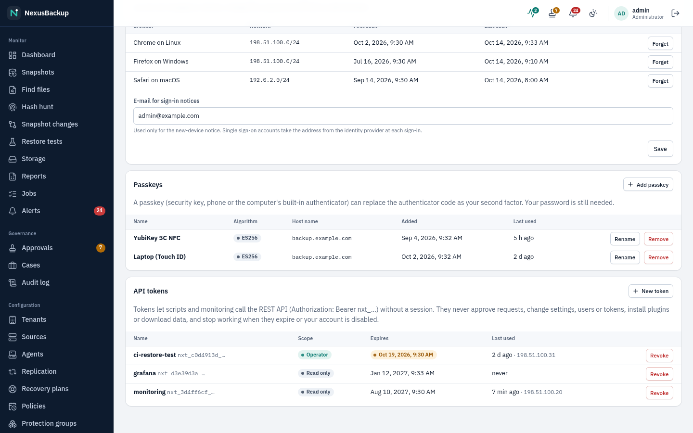

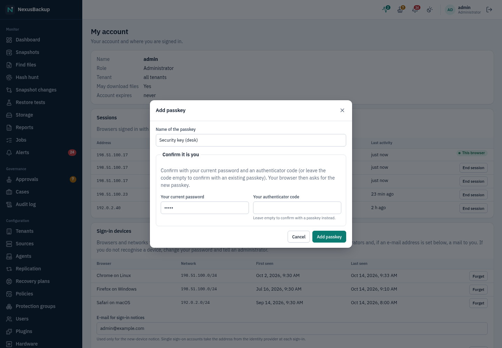

**Sign in with a passkey:** enter your user name and password, leave **Authenticator code** empty and click **Sign in
with a passkey**. Wherever the appliance asks you to confirm it is you (password change, new activation codes,
API tokens, ending all sessions), leave the authenticator code empty to confirm with a passkey instead.

Things to know:

- A passkey belongs to the **host name** the appliance was opened with when you registered it (the *relying party
  ID*, for example `backup.example.com`). Open the appliance always under the same name. Passkeys do not work when
  the appliance is opened by its IP address. An administrator can fix the name in **Settings → Security →
  Passkeys → Relying party ID**; empty means "the host name this page is served on".
- The appliance accepts any authenticator (no vendor attestation). A synced passkey (e.g. in a password manager or a
  phone's cloud account) is as safe as that account.
- If an authenticator reports a signature counter, every sign-in must count up; a cloned key is refused and the
  attempt is audited (`auth.login_failed`, reason "signature counter …").
- Single sign-on accounts have no passkeys on the appliance; their identity provider can require security keys.

#### Requiring passkeys for administrators and security officers

**Settings → Security → Passkeys → Require passkeys for admins and security officers** makes passkeys mandatory for
local administrators and security officers: they sign in and confirm changes with a passkey only; authenticator
codes are refused for them. Operators, tenant admins, tenant users and viewers keep using codes or passkeys as they
like.

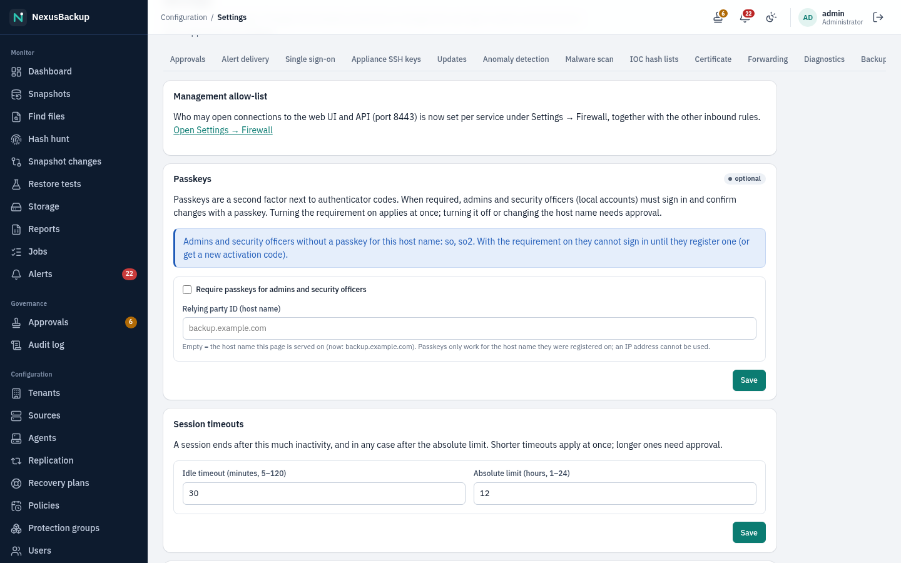

- Turning the requirement **on** applies at once (it only tightens sign-in). It is refused if your own account has
  no passkey for the current host name, so that you cannot lock yourself out. The card lists the administrators and
  security officers who still have no passkey: they cannot sign in once the requirement is on, until they get a new
  activation code (and register a passkey while activating). Ask them to add a passkey first.
- Turning it **off** or changing the relying party ID is an approval request (`security.passkeys`) while approvals
  are enabled. The relying party ID cannot be changed while the requirement is on (all passkeys would stop working).
- While it is on, an administrator or security officer cannot remove their last passkey, granting one of these roles
  to an account without a passkey is refused (issue a new activation code with the role change instead), and new or
  reset privileged accounts must register a passkey during activation.

> **Status:** Passkeys are covered by API tests with a software authenticator (ES256 and Ed25519 keys, origin,
> relying party, counter and policy checks) and by the demo backend; they were not yet tried with real security keys
> and browsers in the VM lab. The browser's own passkey prompt does not appear in the screenshots.

### Your sessions (My account)

Click your name in the top bar to open **My account**. It shows your role, tenant, download privilege and end date,
and every browser that is signed in with your account: address, browser (user agent), when it signed in and when it
was last active. **This browser** marks the current one. **End session** signs the other browser out at its next
request (audited `session.revoke`). If you see a session you do not recognise, end it and change your password.

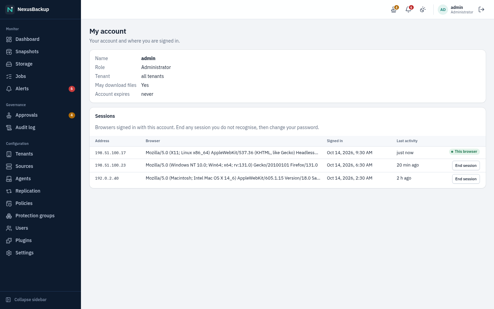

Administrators see the sessions of all users in **Settings → Security → Sessions of all users** and can end any of
them, all sessions of one user (**Users → Edit → End all sessions**, `session.revoke_user`), or, for a suspected
stolen session, **End all other sessions on the appliance** (everybody except you; needs your password and a fresh
authenticator code, audited `session.revoke_all`). Single sign-on administrators have no password on the appliance
and cannot use the last one; a local administrator can.

### Sign-in devices and the new-device notice

Every sign-in records the **device** of the account: the browser and operating system (from the user agent) and the
network (the first three parts of an IPv4 address, `/24`, or the first 48 bits of an IPv6 address). **My account →
Sign-in devices** lists them with first and last use; **Forget** removes one. The first sign-in of an account sets
the baseline. After that, a sign-in from a combination the account has never used raises the alert
`login_new_device` (warning for administrators and security officers, info for the other roles), which is
forwarded to the SIEM like every alert and, when an **E-mail for sign-in notices** is set, also mailed to the
account itself through the alert SMTP server (**Settings → Alert delivery**). Single sign-on accounts take the
address from the identity provider's `email` claim at every sign-in.

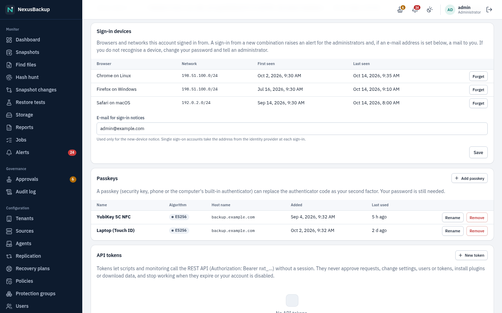

If you get such a notice and it was not you: change your password, end the unknown session above and tell an
administrator. The device check is a heuristic: a new browser or network of your own also raises it, and someone who
copies your browser's identification from the same network is not noticed.

### Risk signals and step-up

The appliance watches what privileged accounts do and marks an account when its behaviour looks like a stolen
account or an insider at work. The rules are fixed and deterministic:

| Signal | Rule | Severity |
|---|---|---|
| Unusual hour | a sign-in at an hour of day (UTC, plus or minus one hour) the account has not used in the last 90 days, once it has at least 10 sign-ins of history | warning |
| Weakening burst | 5 or more weakening requests within one hour: switching approvals off, cutting retention in a policy, changing the management allow-list, firewall or forwarding, deleting offsite or replication settings, vault or keep-until changes, releasing holds | critical |
| Bulk deletes | 10 or more delete requests within one hour (snapshots, sources, groups, agents, tenants, policies) | critical |
| Download volume | downloads in 24 hours above ten times the account's median daily volume of the last 30 days, and above 1 GiB | warning |

A signal raises the alert `user_risk` (security category, forwarded to the SIEM) and **marks the account for 24
hours**. While it is marked:

- the **first change of each session** (any request that is not a plain read) asks the user to **confirm it is
  them**: password plus an authenticator code, or a passkey when the code field is left empty. The change is sent
  again right after; later changes in the same session go through. Reading is never blocked;
- the account's **API tokens cannot change anything** (they still read);
- the user sees a banner with the reason and the end of the mark.

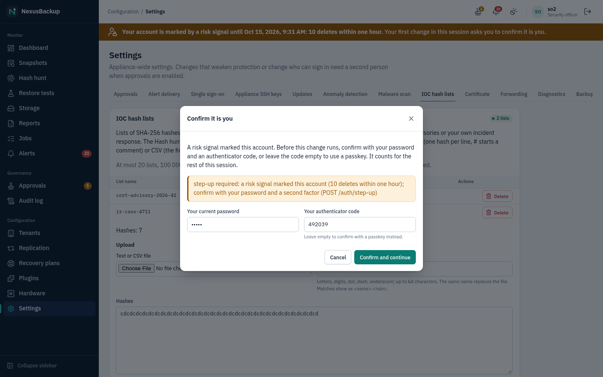

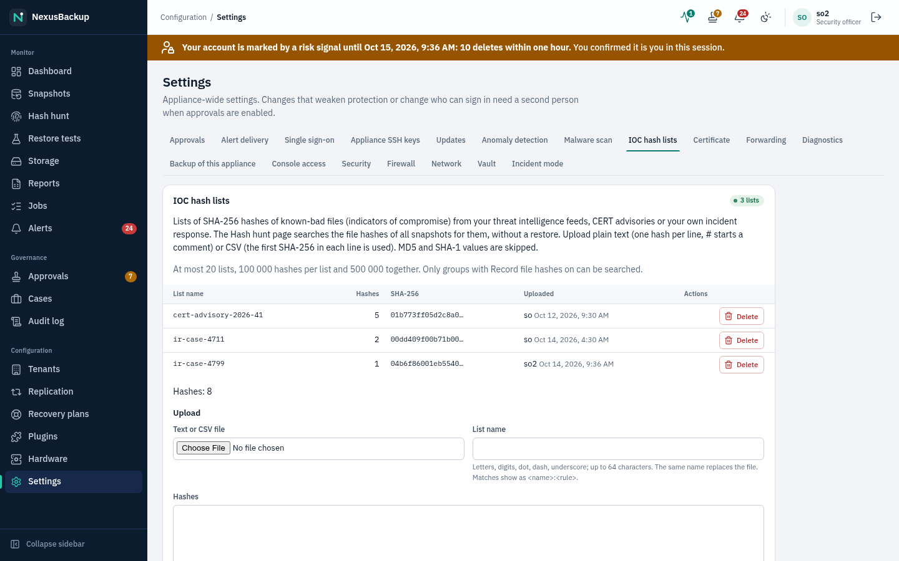

The step-up does not stop an attacker who also has the password and the second factor, but it stops a stolen
session cookie or API token, and every signal reaches the security team at once. Security officers and
administrators see the marked accounts under **Settings → Security → Accounts marked by risk signals** (administrators
also on the **Users** page) and **Clear** a mark once the owner confirmed it was them (audited `user.risk_clear`;
nobody clears their own mark). If it was not the owner: disable the account, end its sessions and enter incident
mode if needed ([14 Disaster recovery](14-disaster-recovery.md#incident-mode)).

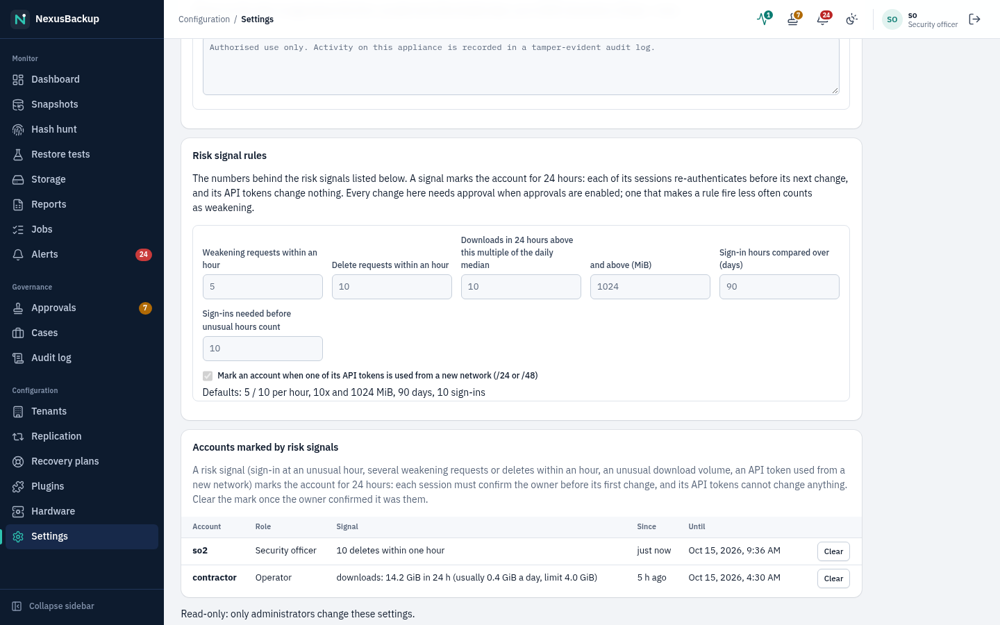

> **Status:** Implemented in Phase 29 (API tests, demo backend). Single sign-on accounts have no local password: they
> cannot complete the step-up in this version; clear their mark after checking with the owner.

### Just-in-time elevation

People who administer the appliance now and then do not need the administrator role all day. Give them a lower
standing role, **Operator** or **Viewer**, and an **eligible role** (**Administrator** or **Security officer**): when
they need it, they elevate one session to it for a limited time, and a stolen password or session of that account is
worth much less the rest of the time.

**Set it up:** on the **Users** page, **Edit** the account (an appliance-wide local operator or viewer: no tenant, no
single sign-on) and choose the **Eligible role (just in time)**. Granting it needs a second person when approvals are
enabled, like granting the role itself. Choosing **None** removes it at once. The Users page shows the eligible role
and, while an elevation lasts, **elevated until** with its end.

**Elevate:** the account sees an **Elevate** button (shield icon) in the top bar. Choose for how long (15 minutes to
8 hours), enter a reason (a ticket number, for example) and confirm with your password and an authenticator code,
or leave the code empty to use a passkey (only a passkey when passkeys are required for that role). The session then
acts in the eligible role; a banner shows the role and the end time. **End now** in the banner, signing out, or any
change of the account ends it earlier; other sessions of the account and its API tokens keep the standing role.

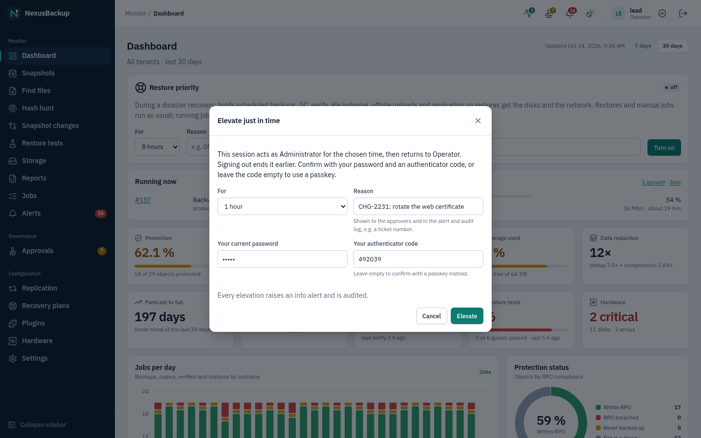

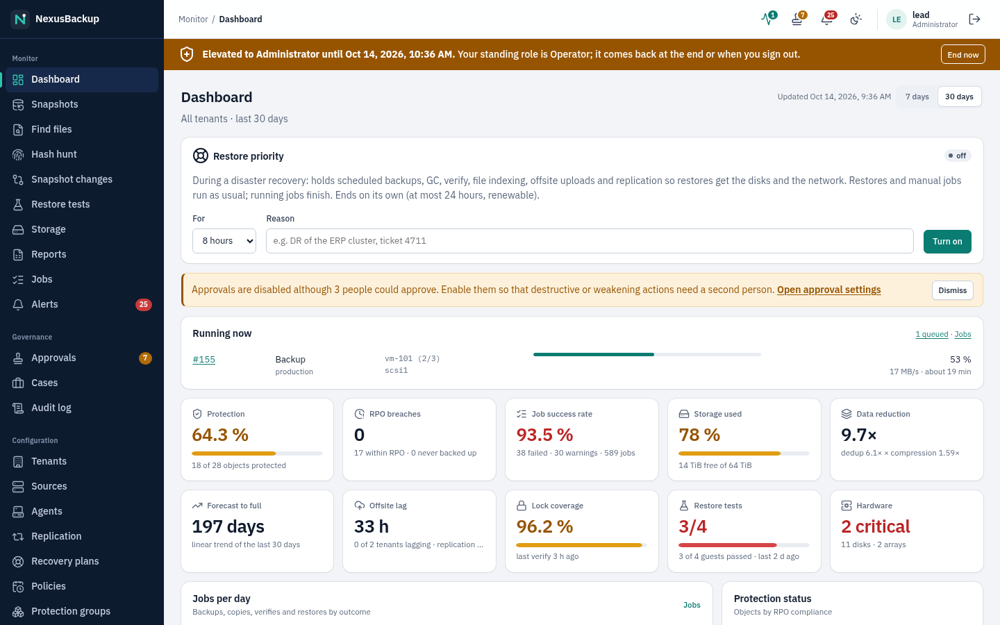

Every elevation raises an info alert `role_elevation` (resolved when it ends) and is audited (`role.elevate`,
`role.elevate_end`). Under **Settings → Security → Role elevation** an administrator can require a **second person
for every elevation**: the elevation then becomes a request (`role.elevate`) on the **Approvals** page and starts when
it is approved. Switching that requirement off again needs approval.

The posture check **standing administrators** (Settings → Diagnostics) warns when more than two accounts hold the
administrator role permanently: keep a break-glass account and one more, and give everybody else an eligible role.

> **Status:** Implemented in Phase 30 (API and housekeeping tests, demo backend). Single sign-on accounts cannot hold
> an eligible role in this version (their role comes from the identity provider's group mapping).

### Concurrent sessions

**Settings → Security → Sessions per account** limits how many browsers may be signed in with one account at the
same time (1–50, default 5). A new sign-in beyond the limit ends the account's oldest session; this is audited
(`session.limit`, with the number of sessions ended). It applies at the next sign-in of each account; changes are
audited (`security.max_sessions`).

### Dormant accounts

With **Settings → Security → Dormant accounts** set to a number of days (30–3650; 0 = off, the default; 90 is a
common policy), the appliance disables accounts nobody has signed in with for that long, within a day. Each one is
audited (`user.dormant_disabled`, actor `scheduler`) and raises an info alert (`account_dormant`); an administrator
re-enables the account on the Users page if it is still needed. Never disabled: the last enabled local
administrator, and, with approvals enabled, an administrator or security officer whose loss would leave fewer than
two people who can approve. Accounts waiting for activation and expired accounts are not counted as dormant. After
an upgrade, the time counts from the upgrade (accounts get their first "last sign-in" then).

### Login banner

**Settings → Security → Login banner** sets a text (up to 2000 characters, plain text, line breaks kept) that the
sign-in page shows above the form, for example a legal notice ("Authorised use only …"). Changes are audited
(`security.login_banner`).


> **Status:** Viewers, the download privilege, expiry dates, sessions, timeouts, dormant accounts and the login
> banner are tested in the API and the demo backend; a run on the appliance image (lab) is pending. The session
> limit and the encryption key rotation reminder ([14 Disaster recovery](14-disaster-recovery.md#rotating-a-tenants-encryption-key))
> were added in Phase 21b (API and demo backend tests).

## API tokens

Scripts, monitoring and automation (Grafana, Ansible, a CI job that tests restores) call the REST API with an **API
token** instead of a session: `Authorization: Bearer nxt_…`. Every user manages their own tokens under **My account**
(click your name at the top right).

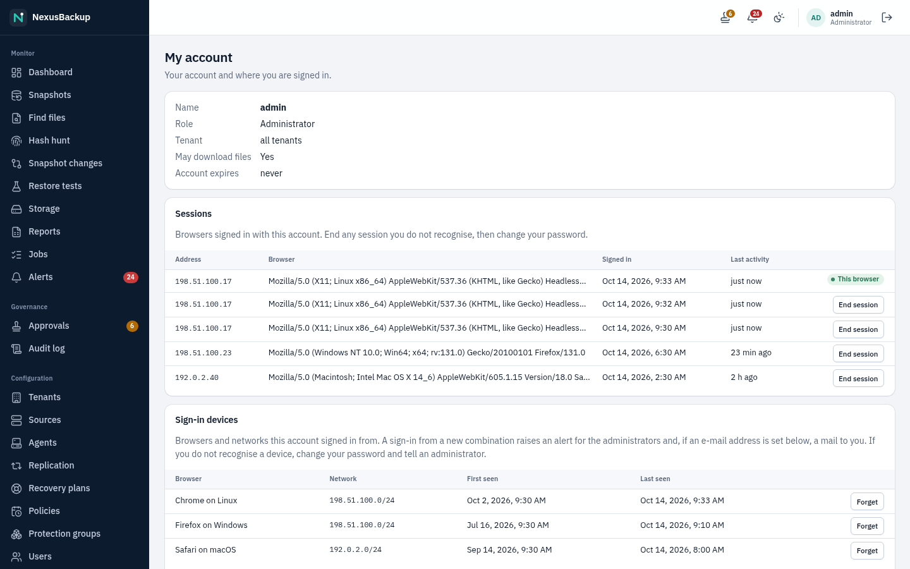

**Create a token:** **New token**, then:

| Field | Content |
|---|---|
| **Name** | what the token is for, e.g. `grafana` (unique per user) |
| **Scope** | **Read only** or **Operator** (see below) |
| **Valid for** | 7, 30, 90, 180 days or 1 year. Every token expires; there are no tokens without an end date. |
| **Your current password**, **Your authenticator code** | local accounts confirm it is really you, as for a password change. Single sign-on accounts instead need a session that is at most 15 minutes old (sign in again first). |

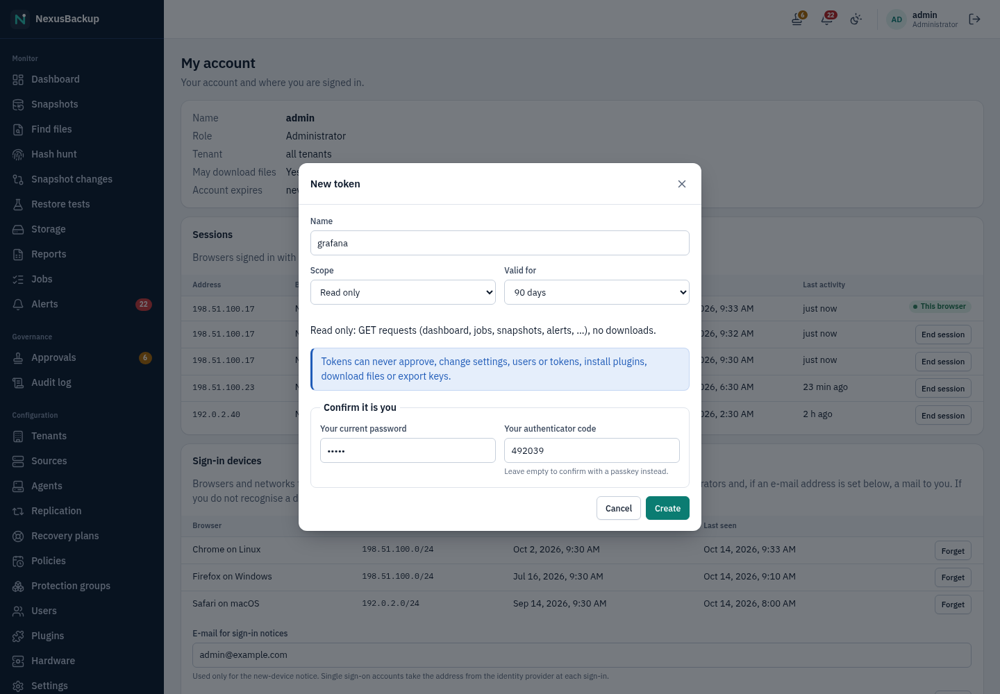

After **Create** the token is shown **once**. Copy it into your script or secret store; the appliance keeps only a
hash of it and cannot show it again. The dialog shows a `curl` example.

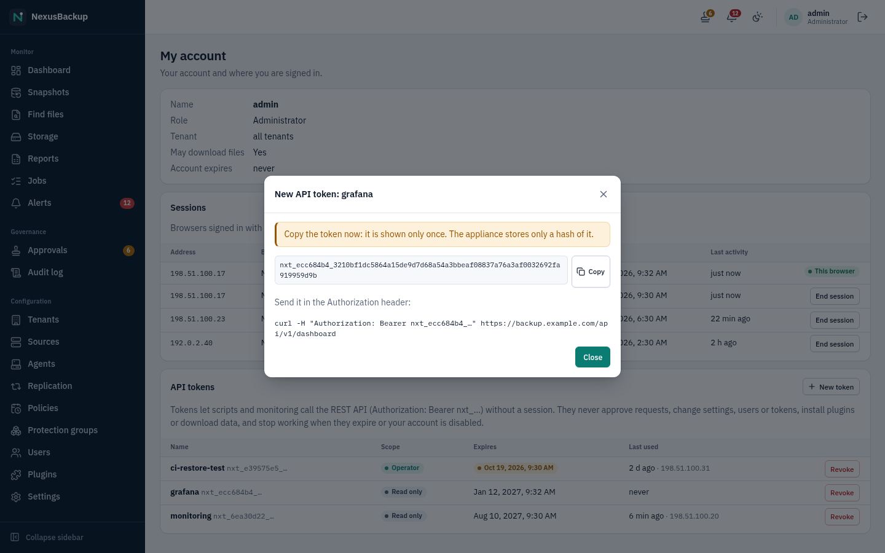

**Scopes.** A token never has more rights than its user:

- **Read only:** GET requests on the dashboard, storage, tenants, sources and their inventory, policies, groups,
  agents, snapshots, jobs, alerts, approvals (the list), the audit log and its verification, replication and plugins
  (what the user's role may read).
- **Operator:** in addition, start jobs (backups, restores, verify, …) and cancel them, pause and resume protection
  groups, start and end source maintenance, acknowledge alerts and start a replication sync. An administrator's
  operator token acts as an operator; a tenant user's stays a tenant user and a tenant admin's a tenant admin in
  their tenant (still limited to the endpoints above). Security officers and
  viewers can create read-only tokens only.

**Never with a token**, whatever the scope: approving or rejecting requests, changing settings, users or tokens,
installing plugins or keys, the certificate, downloading files (also no `files_get` or mount jobs), exporting
replication keys, OS updates, deleting anything, signing in or out. Endpoints are open to tokens only if they are on
the token allow-list, so a new endpoint is closed to tokens until it is reviewed.

**Revoke** removes a token at once. Tokens stop working when they expire, when their user is disabled, expired or reset
(pending activation), or when the user is deleted. The table shows when and from which address each token was last
used. Administrators see and revoke every user's tokens at the end of the **Users** page.

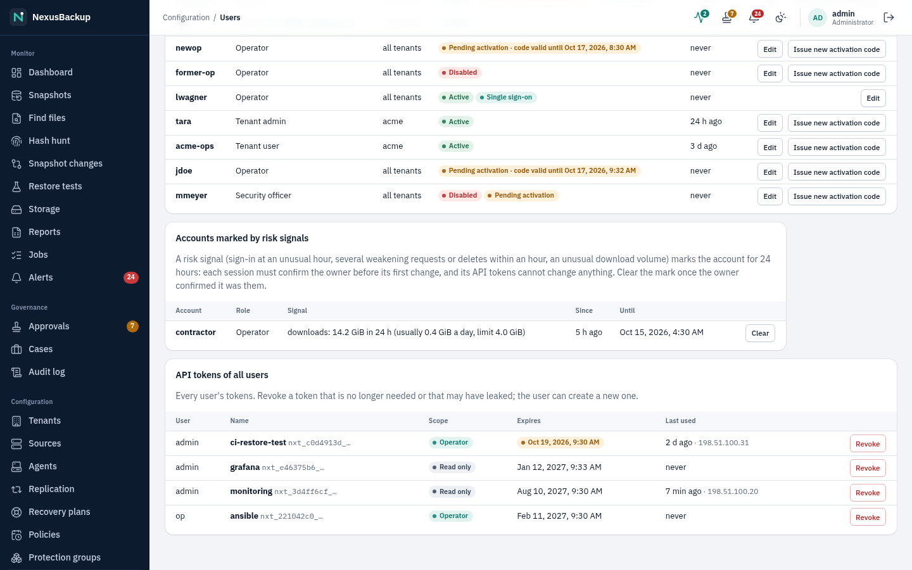

Audit entries made with a token name the user and the token, e.g. `admin via token grafana`; creating and revoking
are audited (`token.create`, `token.revoke`). An `info` alert reminds of tokens in their last 7 days
([11 Alerts](11-alerts-and-monitoring.md#expiry-warnings)).

Example:

```sh
curl -H "Authorization: Bearer nxt_5ed9920e_9a80…" https://backup.example.com:8443/api/v1/dashboard
curl -X POST -H "Authorization: Bearer $TOKEN" -H "Content-Type: application/json" \
  -d '{"kind": "backup", "tenant": "acme", "params": {"group_id": 1}}' https://backup.example.com:8443/api/v1/jobs
```

No CSRF header is needed with a token. The Prometheus `/metrics` endpoint keeps its own token
([11 Alerts](11-alerts-and-monitoring.md#metrics-prometheus)).

**API description.** `https://<appliance>/api/openapi.json` is the OpenAPI 3.1 description of the endpoints tokens
can use (plus the billing export); it needs no sign-in and describes the API only, nothing about your appliance.
Import it into Postman or generate a client from it. `GET /api/v1/usage` (monthly usage per tenant, also as CSV with
`format=csv`) is open to read tokens.

**`nexusctl`.** A small command-line client for scripts and administrators' workstations (Linux, from the source
tree: `cargo build --release -p nexusctl`):

```sh
export NEXUS_URL=https://backup.example.com:8443 NEXUS_TOKEN=nxt_… NEXUS_CA=/etc/ssl/nexus-ca.pem
nexusctl jobs --state failed            # jobs, newest first (--kind, --tenant, --limit)
nexusctl job 4711 --log                 # one job's state and log
nexusctl snapshots --tenant acme        # snapshots with size, local/offsite, lock
nexusctl sources                        # sources; `nexusctl groups` for protection groups
nexusctl run 12 --keep-until 2027-06-30 # back up group 12 now (operator token), keep until that day
nexusctl usage --month 2026-10 --csv    # the billing export
nexusctl openapi                        # the API description
```

`--json` prints the API's answer instead of a table. `NEXUS_CA` (or `--ca`) names the PEM file of the appliance's
certificate or its CA when it is not publicly trusted. A run whose `--keep-until` lies beyond the approval limit
creates an approval request and says so.

**Several appliances: `nexusctl fleet`.** A service provider that runs one appliance per customer gets a read-only
overview of all of them on the workstation: for each appliance whether it answers, incident mode, protected objects,
SLA breaches, open alerts per severity, failed jobs of the last 24 hours and store use, then the open critical and
warning alerts and the failed jobs by name. Nothing is changed anywhere. Create a **read** API token on each
appliance (a token with operator scope is refused) and list them in a configuration file:

```json
{"appliances": [
  {"name": "acme", "url": "https://backup.acme.example:8443", "token_file": "~/.config/nexusctl/acme.token",
   "ca": "~/.config/nexusctl/acme-ca.pem"},
  {"name": "globex", "url": "https://10.20.0.5:8443", "token_env": "NEXUS_TOKEN_GLOBEX"}]}
```

```sh
chmod 600 ~/.config/nexusctl/*.token     # token files readable by others are refused
nexusctl fleet --config ~/.config/nexusctl/fleet.json
nexusctl fleet --config fleet.json --hours 72 --html /tmp/fleet.html   # also a static HTML report
nexusctl fleet --config fleet.json --check                             # exit code 2 if one needs attention
```

Tokens never go into the configuration file itself (`token_file` or `token_env` only). The appliances are asked in
parallel; one that cannot be reached is listed as **UNREACHABLE** with the reason, the others still show. `--json`
prints everything the appliances answered. The HTML report has no scripts and is written readable by you only. The
workstation must be allowed through each appliance's inbound firewall for the web interface (**Settings → Firewall**,
port 8443). `--check` is meant for a monitoring system: exit code 2 when an appliance is unreachable, in incident
mode, or has a critical alert, a failed job or an SLA breach.

> **Status:** The OpenAPI document is maintained by hand; a test checks that it covers every endpoint on the token
> allow-list. `nexusctl` is tested against the web-api in process; it is not packaged yet (build it from source).

## Single sign-on (OIDC)

With single sign-on, people sign in with the account of your organization's identity provider (IdP) through OpenID
Connect: **Sign in with …** on the sign-in page sends them to the IdP and back. Any standard OIDC provider works, for
example Microsoft Entra ID, Keycloak, Okta or Authentik.

How it works:

- **Accounts are created at the first sign-in** ("just in time"). Nobody has to create them on the appliance.
- **Role and tenant come from group mappings.** You map IdP groups to appliance roles (and, for tenant users, one
  tenant). At every sign-in the appliance reads the user's groups from the IdP's answer and sets the account's role
  and tenant again, so a change at the IdP takes effect at the next sign-in.
- **No matching mapping = no access.** If none of the user's groups is mapped, the sign-in is refused, an existing
  account is disabled, and the refusal is audited (`auth.oidc_denied`).
- **An administrator's "Disabled" wins.** An SSO account an administrator disabled stays disabled: the next SSO
  sign-in is refused and does not enable it again; only an administrator can.
- **SSO accounts never take over local accounts.** Accounts are matched by the IdP's subject, not by name. If a local
  account already has the same user name, the SSO sign-in is refused (audited as `auth.oidc_denied`).
- **The highest privilege wins.** If several mappings match, the user gets the role of the highest-privileged one:
  Administrator, then Security officer, then Operator, then Tenant admin, then Tenant user, then Viewer.
- **Multi-factor authentication is the IdP's job.** Single sign-on accounts have no password and no authenticator on
  the appliance and cannot use the appliance sign-in form. Enforce MFA at the IdP (see the examples below).
- **Local accounts keep working** as break-glass access, for example when the IdP is down. Keep at least one local
  administrator with a stored password and authenticator.
- Approvals treat single sign-on users like local users (by name): nobody can approve their own request.

Audit entries: `auth.oidc_login` (sign-in), `user.oidc_created` (first sign-in), `auth.oidc_denied` (refused),
`settings.oidc` (settings changed).

> **Status:** Single sign-on was tested against the demo backend only. The appliance-side implementation and a lab
> run against Keycloak are in progress; a run against Microsoft Entra ID is pending.

### Before you start

- The IdP must be reachable over HTTPS from the appliance (it reads the IdP's configuration and signing keys and
  exchanges the sign-in code there) and from the users' browsers. The appliance adds the IdP's host to its outbound
  firewall allow-list.
- Open **Settings → Single sign-on** through the same address your users will use (e.g.
  `https://backup.example.com:8443/`). The **Redirect URI to register at the identity provider** is built from it.
- Create the groups at the IdP first, for example `nexus-admins`, `nexus-security`, `nexus-operators` and one group
  per tenant for tenant users (`acme-backup-users`).

### Example: Keycloak

1. In your realm (e.g. `nexus`), open **Clients → Create client**: client type **OpenID Connect**, **Client ID**
   `nexusbackup`. Turn on **Client authentication** and keep only **Standard flow** as authentication flow.
2. Under **Valid redirect URIs**, enter the **Redirect URI** shown in **Settings → Single sign-on**, e.g.
   `https://backup.example.com:8443/api/v1/auth/oidc/callback`. Save.
3. Copy the **Client secret** from the client's **Credentials** tab.
4. Create the groups claim: **Client scopes → Create client scope** named `groups` (type OpenID Connect), then in its
   **Mappers** add **By configuration → Group Membership** with **Token Claim Name** `groups`, **Full group path**
   off and **Add to ID token** on. Add the scope to the `nexusbackup` client (**Client scopes → Add client scope**,
   as Default).
5. Enforce a second factor in the realm, for example with **Configure OTP** as a default required action, or with a
   browser flow that requires OTP or WebAuthn.
6. The **Issuer URL** is `https://<keycloak host>/realms/<realm>`, e.g. `https://idp.example.com/realms/nexus`.

The appliance's defaults fit Keycloak: scopes `openid profile email` (the `groups` client scope added as **Default**
in step 4 is included without being requested), user name claim `preferred_username`, groups claim `groups`.

### Example: Microsoft Entra ID

1. In the Microsoft Entra admin center, open **App registrations → New registration**: name `NexusBackup`,
   supported account types **Accounts in this organizational directory only**, redirect URI platform **Web** with the
   **Redirect URI** shown in **Settings → Single sign-on**. Register.
2. Note the **Application (client) ID** and the **Directory (tenant) ID**. The **Issuer URL** is
   `https://login.microsoftonline.com/<directory (tenant) ID>/v2.0`.
3. **Certificates & secrets → New client secret**: copy the secret's **Value** (not its ID). Entra client secrets
   expire (at most after 24 months): note the date and enter a new secret in **Settings → Single sign-on** before
   then.
4. **Token configuration → Add groups claim**: choose **Security groups** (or **Groups assigned to the application**,
   recommended when users are in many groups) and, for the ID token, **Group ID**. The `groups` claim then contains
   the groups' **object IDs** (e.g. `3f2b6c1e-…`); use these object IDs as **IdP group** in the mappings. Users in
   more than 200 groups get no groups claim unless you limit it to groups assigned to the application.
5. In **Settings → Single sign-on**, keep the default **Scopes** `openid profile email` (Entra ID has no `groups`
   scope; the claim comes from the token configuration), **User name claim** `preferred_username` (the user's
   sign-in name, e.g. `anna@example.com`; SSO user names may contain `@`) and **Groups claim** `groups`.
6. Require MFA with a Conditional Access policy for the NexusBackup application. Optionally set **Assignment
   required** on the enterprise application, so that only assigned users and groups can sign in at all.

### Configure single sign-on on the appliance

Open **Configuration → Settings → Single sign-on** (administrators; security officers see it read-only).


1. Under **Identity provider**, tick **Allow single sign-on** and fill in:

   | Field | Content |
   |---|---|
   | **Issuer URL** | the IdP's issuer (`https://…`). The appliance reads `/.well-known/openid-configuration` below it. |
   | **Client ID**, **Client secret** | from the IdP registration. The secret is write-only ("Stored — leave empty to keep the current value."). |
   | **Client secret expires (optional)** | the date the IdP lets the secret expire (Entra ID: at most 2 years). The appliance warns 90, 30 and 7 days before ([11 Alerts](11-alerts-and-monitoring.md#expiry-warnings)). |
   | **Redirect URI to register at the identity provider** | read-only; **Copy** it into the IdP registration |
   | **Scopes** | space separated, must include `openid`; default `openid profile email` |
   | **User name claim** | the claim that becomes the appliance user name; default `preferred_username` |
   | **Groups claim** | the claim with the user's groups; default `groups` |
   | **Button text on the sign-in page** | e.g. `Sign in with Keycloak` (required, at most 64 characters) |

2. Under **Group mappings**, click **Add mapping** for each group: **IdP group** (the group name or ID exactly as the
   IdP sends it), **Role**, and, for the roles **Tenant admin** and **Tenant user** (required) and **Viewer**
   (optional), the one
   **Tenant** the user may see (an appliance account belongs to one tenant or to all; the other roles always see all
   tenants). The
   bin icon removes a mapping. While the list is empty, the page warns "No mappings yet: nobody can sign in with
   single sign-on."
3. Click **Save**. With approvals enabled, saving creates an approval request (`oidc.update`) because it changes who
   can sign in; another administrator or security officer must approve it on **Approvals**.
4. Click **Test connection**. It checks the saved issuer's discovery document and signing keys (JWKS) and shows one
   green or red line per check. It always uses the saved settings, so test after saving (and after the approval).
5. Open the sign-in page in a private browser window, click **Sign in with …** and sign in at the IdP. You land on the
   Dashboard; the new account appears on **Users** with the **Single sign-on** chip.

To turn single sign-on off, clear **Allow single sign-on** and save. The button disappears from the sign-in page;
local accounts are not affected.

### Single sign-on accounts on the Users page

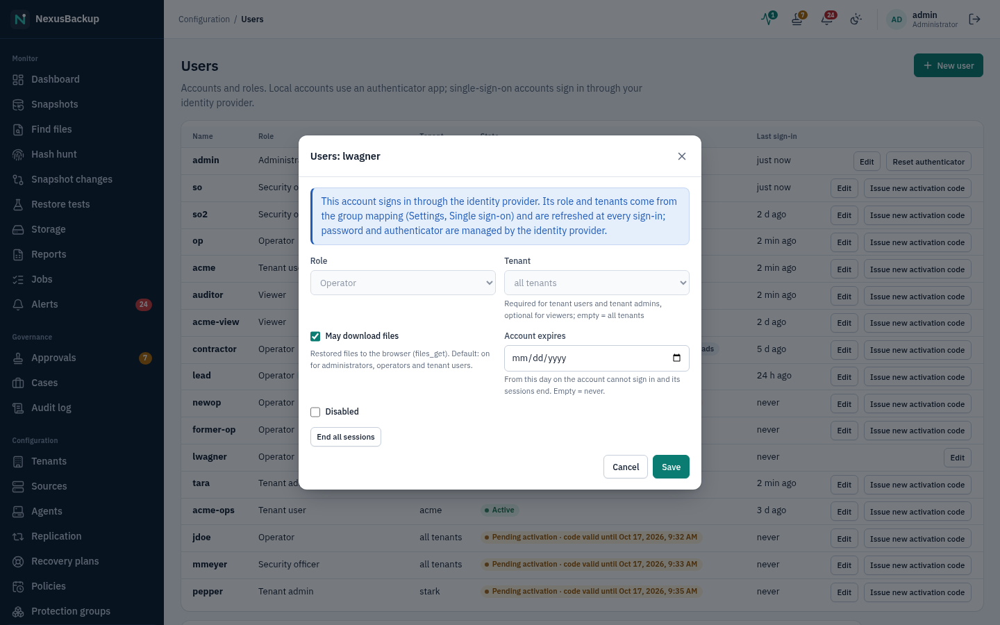

- **Role** and **Tenant** are greyed out: they come from the group mappings and are refreshed at every sign-in.
  Change the group membership at the IdP, or the mapping, instead.
- There is no **Issue new activation code** and no **Reset authenticator**: password and second factor are managed by
  the IdP. A lost phone or password is handled there.
- **Disabled** blocks the account on the appliance.
- To take access away, remove the person from the mapped groups at the IdP (the next sign-in is refused) and tick
  **Disabled** here.

If sign-in through the IdP fails, the sign-in page shows the reason; see
[15 Troubleshooting](15-troubleshooting-faq.md#single-sign-on).

### A tenant's own identity provider

A service provider's customers usually have their own IdP. **Configuration → Tenants**, **Sign-in** on the tenant's
row (administrators change it, security officers and the tenant's admins can read it) sets up an OIDC provider for
**this tenant only**:

- the same fields as the appliance-wide single sign-on (issuer, client ID and secret, scopes, claims, button text),
  registered at the customer's IdP with the same redirect URI;
- **E-mail domains** of the customer's users (e.g. `example.com`); a domain belongs to one tenant;
- **Group mappings** to the tenant roles **Tenant admin**, **Tenant user** and **Viewer** of this tenant only. Nobody
  signing in through a tenant's IdP becomes an administrator, operator or security officer, or sees another tenant.

Saving needs approval like the appliance-wide settings (it decides who can sign in; action `tenant_oidc.update`).
**Test connection** checks the discovery document and the signing keys.

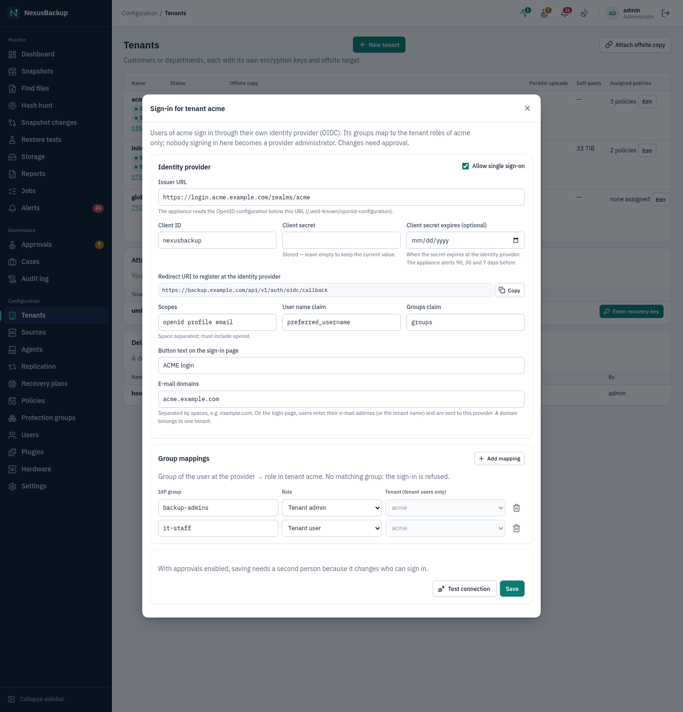

Once a tenant has an enabled IdP, the sign-in page offers **Sign in with your organization**: the user enters their
e-mail address (or the tenant name) and is sent to their tenant's IdP (the address is passed on as a login hint).
The page never lists tenant names. Unknown domains or names answer "No organization sign-in matches".

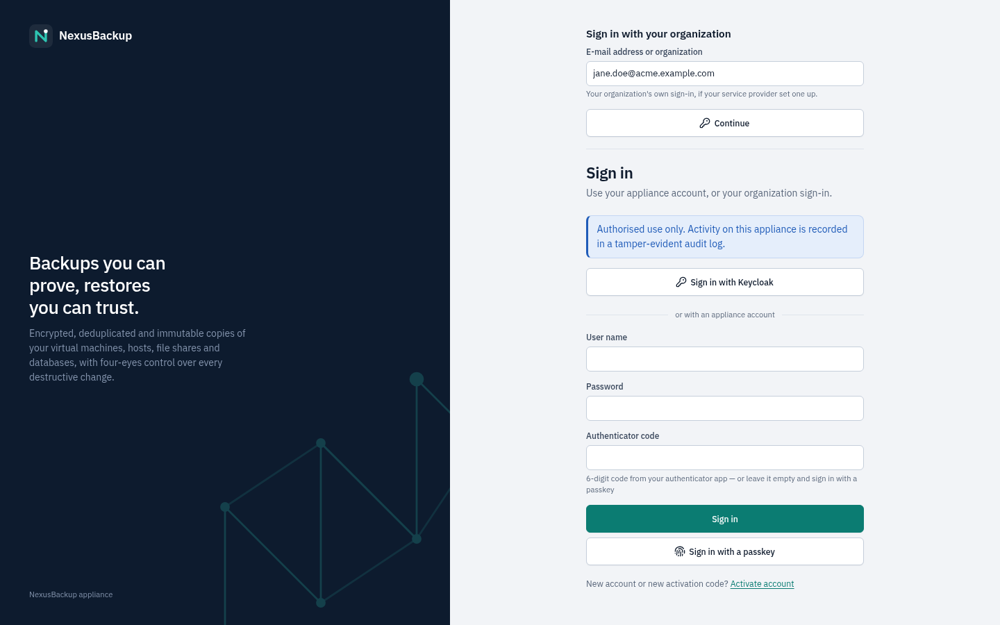

Accounts created through a tenant's IdP are separate from those of the appliance-wide IdP, even when both use the same
issuer: the account is bound to the tenant, the issuer and the IdP's subject. A deactivated tenant's IdP is not offered.
The appliance opens the issuer's and the token and key endpoints' addresses in its outbound firewall automatically.

> **Status:** Tenant IdPs are new in this release. The sign-in flow is tested end to end against a test IdP in the
> API tests (mapping limits, domain lookup, separate accounts, deactivated tenants); a real Keycloak or Entra ID per
> tenant has not been tried in the VM labs yet.
