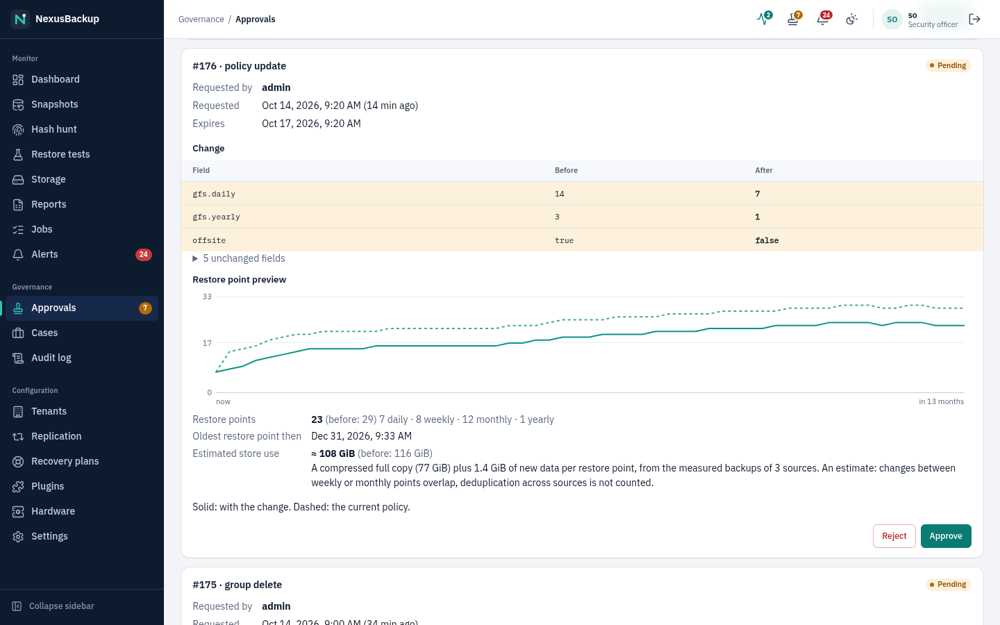
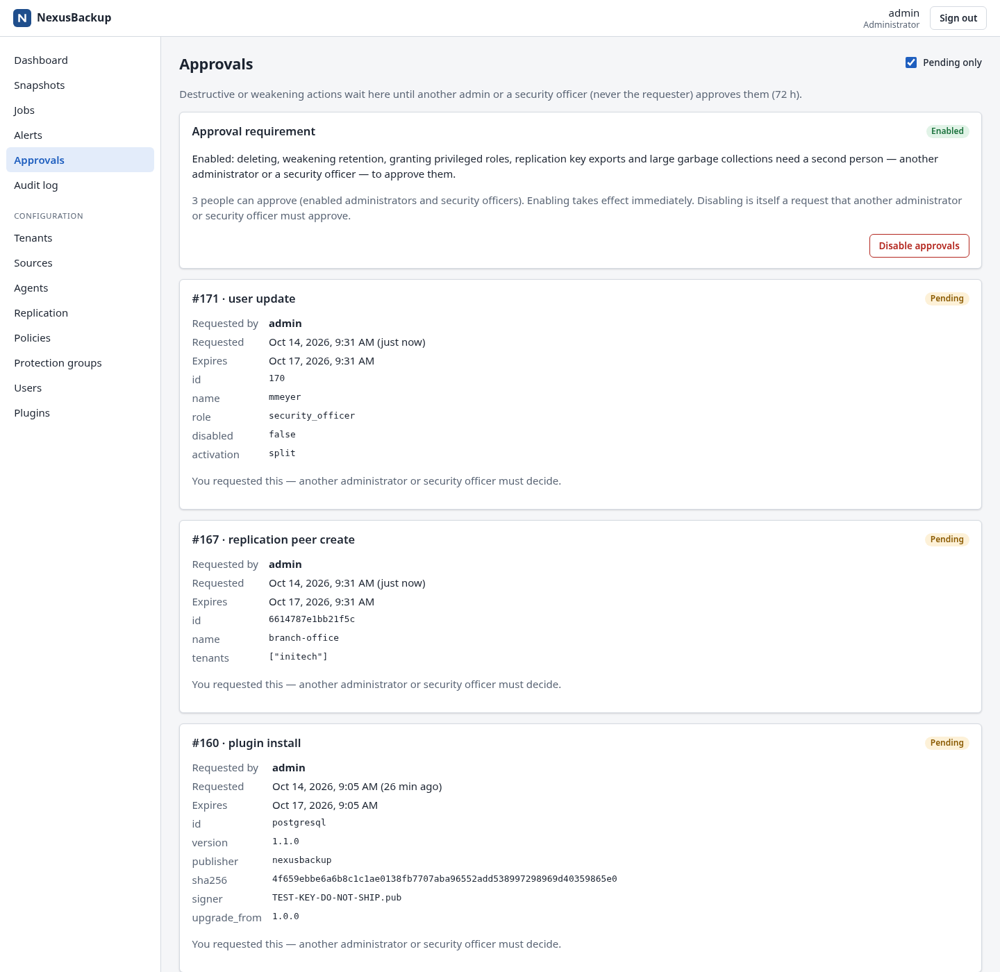
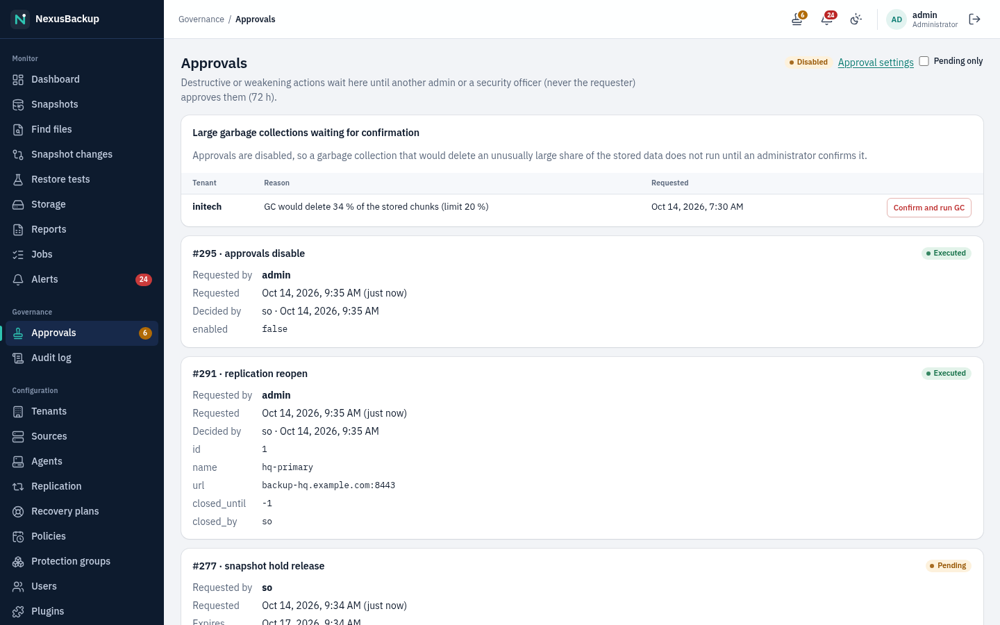

# 10 Approvals and audit

This chapter is mainly for **security officers** and administrators. It covers the four-eyes approval system and the
tamper-evident audit log.

## What needs approval

While approvals are **enabled**, these actions do not take effect when someone clicks them. They become requests that
a different administrator or security officer must approve:

| Area | Action (as shown on the Approvals page) |
|---|---|
| Configuration | deleting a tenant, source, policy, protection group or agent (`tenant delete`, `source delete`, …) |
| Retention | lowering any GFS value, switching off **Copy offsite** or relaxing the required consistency (`policy update`); moving a group to a weaker policy (`group update`) |
| Restore | replacing the original guest with a restored copy (`restore replace`, see [06 Restores](06-restores.md#replace-the-original-guest)) |
| Accounts | granting **Administrator** or **Security officer**, re-enabling such an account, a new activation code for one (`user update`) |
| Storage | deleting a snapshot by hand (`snapshot delete`; only unlocked snapshots without a legal hold can be requested); releasing a legal hold (`snapshot hold release`, see [06 Restores](06-restores.md#legal-hold)); a garbage collection that would delete more than 20 % of a tenant's chunks (`gc_large`, requested by `scheduler`) |
| Replication | creating a peer, exporting tenant keys to it, revoking a peer, deleting an enrolled replication source, lowering a replication source's retention |
| Plugins | installing or upgrading a plugin, switching to another installed version, disabling or removing a plugin, adding or removing a publisher key |
| Single sign-on | saving the single sign-on settings (identity provider, client secret, group mappings), because it changes who can sign in (`oidc update`) |
| Access | longer session timeouts (`security session`); every change of an inbound firewall rule (`firewall inbound`: the approver sees the service, the old and new source lists, whether it is switched on, and the requester's address), see [09 Users and access](09-users-and-access.md#sessions-and-sign-in-protection) and [02 Installation](02-installation.md#inbound-firewall) |
| Appliance SSH keys | rotating an appliance SSH key (`ssh key rotate`) |
| Updates | **Install now**: installing an available appliance update without waiting for the maintenance window (`update apply`) |
| Monitoring | weakening anomaly detection (`settings anomaly`); disabling or removing an enabled forwarding sink, or changing its destination, certificate trust or headers (`settings forwarding`, see [Forwarding](#forwarding-to-a-siem)) |
| Approvals | disabling the approval requirement itself (`approvals disable`) |
| Console access | a root shell on the appliance console (`console unlock`, **Settings → Console access**): after the approval the requester shows the one-time code once; see [14 Disaster recovery](14-disaster-recovery.md#emergency-root-shell-on-the-console) |

Rules:

- The requester can never decide their own request. Any **other** enabled administrator or security officer can.
- A request expires after **72 hours** without a decision.
- Approving runs the action immediately and cannot be undone. Some actions (the replication key export, a large GC, a snapshot delete, a restore that replaces the original)
  are carried out by the scheduler shortly after the approval; their state goes from **Approved** to **Executed**.
- Requests never show secrets: passwords, keys and activation codes are not part of a request.
- Some actions only add protection and therefore need no approval, e.g. a security officer putting snapshots on a
  legal hold. Taking such protection away (releasing the hold) does.

## Deciding requests

Open **Approvals** in the sidebar, or click the stamp icon in the top bar; both show the number of pending requests.
By default only pending requests are listed; clear **Pending only** to see the history. The chip next to it shows
whether approvals are **Enabled** or **Disabled**; **Approval settings** opens **Settings → Approvals**.


Each request shows the action, who requested it and when, when it expires, and its parameters. For changes to policies
and groups you see a **Change** table: **Before** and **After** for every field, with changed rows highlighted.



Before you approve:

- Check that the requester is who you expect and that the change was agreed, preferably by talking to them.
- For a replication key export, compare the **keyd_fingerprint** with the key service fingerprint shown on the
  secondary appliance's Replication page (see [08 Replication](08-replication.md)).
- For a plugin, compare the bundle SHA-256 and the signer with what the publisher announced
  (see [12 Plugins](12-plugins.md)).

Click **Approve** (and confirm) or **Reject**. When you approve the creation of an administrator or security officer,
you receive the second half of the user's activation code; pass it to the user through a different channel than the
first half (see [09 Users and access](09-users-and-access.md#administrators-and-security-officers-split-code)).

Your own requests show "You requested this — another administrator or security officer must decide."
Administrators see the same page and can decide requests of others:



Operators can read the page but not decide.

## Enabling and disabling approvals

The approval requirement is switched under **Configuration → Settings → Approvals** (or **Approval settings** on the
Approvals page). The **Approval requirement** box shows the current setting (**Enabled** or **Disabled**), what it
means, and how many people can approve (enabled, activated administrators and security officers). Only
administrators see the button; security officers and operators see the box read-only.


- **Enable approvals** (administrators): takes effect immediately. It is refused unless at least one other person
  could approve; otherwise nothing could ever be approved again.
- **Disable approvals** (administrators): creates a request that another administrator or security officer must
  approve. Only one such request can be pending; while it is, the box says "Disabling is pending (request #N)." with
  a link to **Approvals**.
- After setup, approvals are enabled if the wizard created an administrator and a security officer, and disabled if
  there is a single administrator (see [02 Installation](02-installation.md)).

With approvals **disabled**:

- The actions in the table above take effect immediately. Each one is still audited, marked
  `"approvals": "disabled"`, and the message says "Approvals are disabled, so it took effect without a second person
  (audited)."
- Retention locks, write-only secrets and re-authentication still protect existing backups.
- A garbage collection over the 20 % limit still does not run on its own. It waits under
  **Large garbage collections waiting for confirmation** until an administrator clicks **Confirm and run GC**.
- Administrators see a recommendation banner on the Dashboard as soon as two people could approve.



### Fewer than three approvers

With approvals enabled and fewer than **three** people who can approve (enabled, activated, not expired
administrators and security officers), **Settings → Approvals** and the Dashboard (for administrators and security
officers) warn: "Only 2 people can approve requests. If one of them is unavailable, nothing can be approved …". With
two approvers, each request needs exactly the other one; if that person is on holiday, ill or has left, nothing can
be approved, not even adding a third approver or disabling approvals. Add a third administrator or security officer
before that happens. [Dormant accounts](09-users-and-access.md#dormant-accounts) never disable an approver who is
needed to keep two of them.

### When approvers are unavailable

Go through these steps in order; stop at the first that works.

1. **Temporary absence.** Nothing is lost by waiting: requests expire after 72 hours and can be made again. Urgent
   restores and backups never need approval.
2. **Another approver exists.** Any enabled administrator or security officer other than the requester can decide.
   Check **Settings → Approvals** for the number of possible approvers, and **Users** for disabled or expired ones
   that an administrator could re-enable (re-enabling an approver needs approval itself, so this only works while a
   second approver is still there).
3. **The missing approver is a local administrator** who lost the password or authenticator: if you have the
   recovery key and console access, `nexus-setup recover-admin --user <name> --force-solo` gives that account a new
   activation code (see [14 Disaster recovery](14-disaster-recovery.md#break-glass-the-only-administrator-lost-their-authenticator)).
   Its owner, or the person taking over the role, activates it and can approve again.
4. **Nobody else can approve** (for example administrator plus one security officer who has left): on the console,
   as root, run

   ```sh
   nexus-setup disable-approvals
   ```

   and enter the recovery key. This switches approvals off at once (audited `approvals.break_glass`, actor
   `console`) and raises a critical `break_glass` alert: every administrator sees a red banner until it is
   acknowledged. Then create and activate the new approvers on **Users** (without approvals that takes effect
   directly), and switch **Enable approvals** on again in **Settings → Approvals**; enabling is immediate.
   Pending requests are not executed by this; they expire or are decided after approvals are on again.

The console steps need root on the appliance console **and** the recovery key; both are recorded and alerted, so
they cannot be used unnoticed.

## Audit log

Open **Audit log** (administrators and security officers).


Every entry has a sequence number (**#**), **Time**, **Actor**, **Action**, **Target**, **Details** and **Hash**.
Entries are listed newest first; **Load more** pages back in time.

### Filtering and exporting

The filter bar narrows the list; click **Apply** (or press Enter), **Clear** shows everything again:

- **Actor**: exactly this user (or `scheduler`, `web-api`, `system`, `setup`);
- **Action**: actions starting with the text, for example `user.` for all account changes or `quorum.approve`;
- **Target**: targets containing the text, for example `tenant/acme`;
- **From** / **To**: days (in your browser's time zone, both inclusive).

**Export CSV** downloads every entry matching the current filters as `nexus-audit.csv`, oldest first, with the
columns `seq, ts, actor, action, target, details, prev_hash, hash` (`ts` in Unix seconds, `details` as JSON). Each
row carries its own and the previous entry's hash, so an auditor can check the exported rows against the chain or
against the copies a SIEM received. The export itself is recorded (`audit.export`, with the filters). Values are
exported unchanged (the hashes cover them): open the file in a spreadsheet as text, not by double-clicking, so that
no cell is evaluated as a formula.

What is recorded:

- every change made through the web interface or API (create, update, delete, job requests), including the
  parameters, with secrets replaced by `<redacted>`;
- sign-ins, failed sign-ins (`auth.login_failed`), failed re-authentication (`auth.reauth_failed`), activations;
- single sign-on: sign-ins (`auth.oidc_login`), refusals (`auth.oidc_denied`), accounts created at first sign-in
  (`user.oidc_created`) and settings changes (`settings.oidc`);
- a break-glass recovery of an administrator on the console (`user.break_glass`, see
  [14 Disaster recovery](14-disaster-recovery.md#break-glass-the-only-administrator-lost-their-authenticator));
- emergency console access: the one-time code shown (`console.unlock_code`) or revoked (`console.unlock_revoke`),
  rejected codes at the console (`console.unlock_failed`), and every root shell with its start and end
  (`console.root_shell`, `console.root_shell_end`, actor `console`; see
  [14 Disaster recovery](14-disaster-recovery.md#emergency-root-shell-on-the-console));
- approval requests, decisions and executions (`quorum.request`, `quorum.approve`, `quorum.reject`, then the action
  itself with actor `system` or the scheduler);
- job state changes and scheduler events (e.g. `gc.confirm_required`, replication sessions on the primary,
  `replication_peer.enrolled`);
- the first-boot setup steps (`setup.*`).

### Verifying the chain

Each entry's hash covers the previous entry's hash and the entry's own fields. Click **Verify chain**: the appliance
recomputes every hash. "Chain intact (N entries)." means no entry was altered, removed or inserted in between.
"Chain BROKEN" names the first entry where the chain does not match; treat this as a security incident.

The audit table itself is append-only in the database (updates and deletes are refused by triggers).

Once a day the scheduler appends an **`audit.anchor`** entry (actor `scheduler`, target `audit/chain`) whose details
are the sequence number and hash of the newest entry at that moment (`head_seq`, `head_hash`). With forwarding
configured (next section), the anchor and every other entry leave the appliance, so the chain head is held outside
the box at least daily.

> **Status:** The chain proves integrity only against changes that do not recompute it. A process with write access
> to the catalog database (or root) could rebuild the whole chain on the appliance. What the appliance cannot rewrite
> is what it has already forwarded: compare the hashes your SIEM received (every forwarded audit entry carries `seq`
> and `hash`, and the daily `audit.anchor`) with **Export CSV** or the Audit log. Without a forwarding sink the
> chain is anchored nowhere outside the appliance; configure one when you rely on the audit log for compliance.

## Forwarding to a SIEM

**Configuration → Settings → Forwarding** (administrators change it, security officers read it) sends the audit log,
alert events and finished jobs to a log server or SIEM. Two sinks are available; you can use either or both:


- **Syslog over TLS**: RFC 5424 messages with RFC 5425 octet-counting framing over TLS, default port **6514**
  (rsyslog `imtcp` with `StreamDriver.Mode="1"`, syslog-ng `network(transport("tls"))`, most SIEM collectors).
  **App name** (default `nexus`) and **Facility** (default 13, "log audit") go into each message header.
- **HTTPS**: batches of up to **Entries per request** (default 100) entries, POSTed to the URL in the **Body
  format** chosen:
  - **JSON array** (default): `[{"type": …, "category": …, …}, …]`;
  - **Splunk HEC (HTTP Event Collector)**: one event object per line,
    `{"time": <unix>, "host": "<appliance>", "source": "nexusbackup", "sourcetype": "_json", "index": "<index>", "event": {…}}`,
    where `event` is the same object the JSON array would contain and `index` is sent only when **Splunk index** is
    set (otherwise the token's default index). Use the URL `https://<splunk>:8088/services/collector/event`. Choosing
    this format adds the header row `Authorization`: enter `Splunk <HEC token>` as its value.

  Optional **Extra headers** (for example `Authorization: Bearer …` or a collector token) are stored encrypted
  and never shown again; leave a value empty to keep it. Any 2xx answer counts as delivered.

**Server certificate** (both sinks): paste the CA that signed the receiver's certificate, or the receiver's
certificate itself, as PEM; or enter the SHA-256 fingerprint of the receiver's certificate (for example from
`openssl x509 -in server.pem -noout -fingerprint -sha256`). With neither, the receiver needs a certificate from a
public CA. There is no option to switch certificate checks off.

**Send test message** sends one test message (syslog MSGID `test`, JSON `{"type": "test"}`) to every configured
sink, enabled or not, and shows "ok" or the error per sink.

What is sent, in order and at least once:

| Type | Syslog MSGID | Structured data `[nexus@32473 …]` | JSON `type` and fields |
|---|---|---|---|
| every audit entry | `audit` | `seq`, `category`, `hash`, `actor`, `action`, `target` (details in the message text) | `audit`: `seq`, `ts`, `actor`, `action`, `target`, `details`, `prev_hash`, `hash` |
| alert raised, escalated, acknowledged, resolved | `alert` | `outbox_seq`, `id`, `event`, `severity`, `kind`, `category`, `key`, `tenant` | `alert`: `event`, `id`, `ts`, `severity`, `kind`, `key`, `message`, `tenant`, `alert_url`, … |
| job finished (ok, failed, cancelled) | `job` | `outbox_seq`, `id`, `kind`, `category`, `tenant`, `state`, `requested_by` | `job`: `id`, `kind`, `tenant`, `state`, `requested_by`, `created`, `started`, `finished`, `attempt` |

Every record has a stable `category` (also in every JSON object): `audit` for audit entries; for alerts the category
of their kind (security, backup, replication, hardware, system; table in
[11 Alerts and monitoring](11-alerts-and-monitoring.md#alert-kinds)); `replication` for replication jobs and
`backup` for all other jobs. Route on it in the SIEM rather than on individual kinds, which grow with new versions.

Every record also carries the appliance host name (`host` in JSON, HOSTNAME in syslog). Syslog severities: audit
entries are *notice*; alerts follow their severity (critical = *crit*, warning = *warning*, info = *info*; resolved
= *notice*); failed jobs are *warning*. `32473` in the structured-data ID is the example enterprise number reserved
for documentation (RFC 5612); filter on the SD-ID or the app name.

Delivery rules:

- The appliance remembers, per sink, the last audit entry and the last event it delivered. A new destination
  starts from the first audit entry, so the receiver gets the whole history.
- When the receiver is down or refuses the certificate, nothing is skipped: the appliance keeps the backlog, retries
  (10 seconds, doubling up to 5 minutes) and sends everything once it works again. After **15 minutes** of failure it
  raises a `forwarding` alert (warning), resolved after the next delivered batch (see
  [11 Alerts and monitoring](11-alerts-and-monitoring.md)).
- "At least once" means a batch may arrive twice after a failure in the middle of it; deduplicate by `seq` (audit)
  or `outbox_seq` (alerts, jobs). Syslog has no acknowledgement: a batch counts as delivered when the receiver
  closed the TLS connection cleanly after it.
- Adding or enabling a sink and changing app name, facility, batch size, body format or Splunk index take effect
  at once. **Disabling or
  removing an enabled sink, or changing its server, port, URL, certificate or headers, is a request** that another
  administrator or security officer must approve (`settings forwarding`) while approvals are enabled: otherwise one
  person could quietly stop the audit trail from leaving the appliance.
- The appliance's firewall allows connections to the configured sinks only (see
  [15 Troubleshooting](15-troubleshooting-faq.md) if a test fails with "No route to host" right after saving: the
  allow-list is applied within a few seconds).

The **Forwarding** box on the Audit log shows, per sink, its destination, its state (**up to date**, **N entries
behind**, **failing since …** or **disabled**), the last delivered sequence number against the newest one, the last
successful delivery and the last error.

## Good practice

- Have at least three people who can approve (for example one administrator and two security officers), so
  approvals continue when one is absent. Below three, the appliance shows a warning.
- Review pending requests daily; they expire after 72 hours.
- Verify the audit chain regularly, for example weekly, and after any incident.
- Forward the audit log to a system the appliance's administrators cannot change, and compare a recent
  `audit.anchor` there with the Audit log from time to time. Let the SIEM alert you when no `audit.anchor` has
  arrived for more than a day: forwarding stopped (receiver, network, or someone disabled it).
- Acknowledge alerts about approvals (`gc_quorum`) only after the request was decided.
