# 11 Alerts and monitoring

The appliance watches its own work and raises **alerts** when something needs attention. You see them on the
**Alerts** page, behind the bell in the top bar and on the Dashboard, and the appliance sends them by e-mail and to
webhooks according to **notification rules** (**Settings → Alert delivery**).

## The Alerts page


The page lists alerts newest first with:

- **Severity**: `critical`, `warning` or `info`.
- **Seen**: when the alert was last seen. Below it: how often it was seen and, for repeats, when it was first seen.
  Hover for the exact times.
- **Kind**: below it the **category** of the kind (see below) and, for alerts that belong to a tenant, the tenant.
- **Message**: the latest message. **What to do** opens a short hint for this kind of alert. A note written when
  the alert was acknowledged or resolved is shown below it.

The switch at the top right shows **Open** alerts (the default), **Resolved** ones or **All**; the list next to it
limits the page to one **category**. A link from a notification (`…/#/alerts?id=<n>`) opens that one alert,
whatever its state.

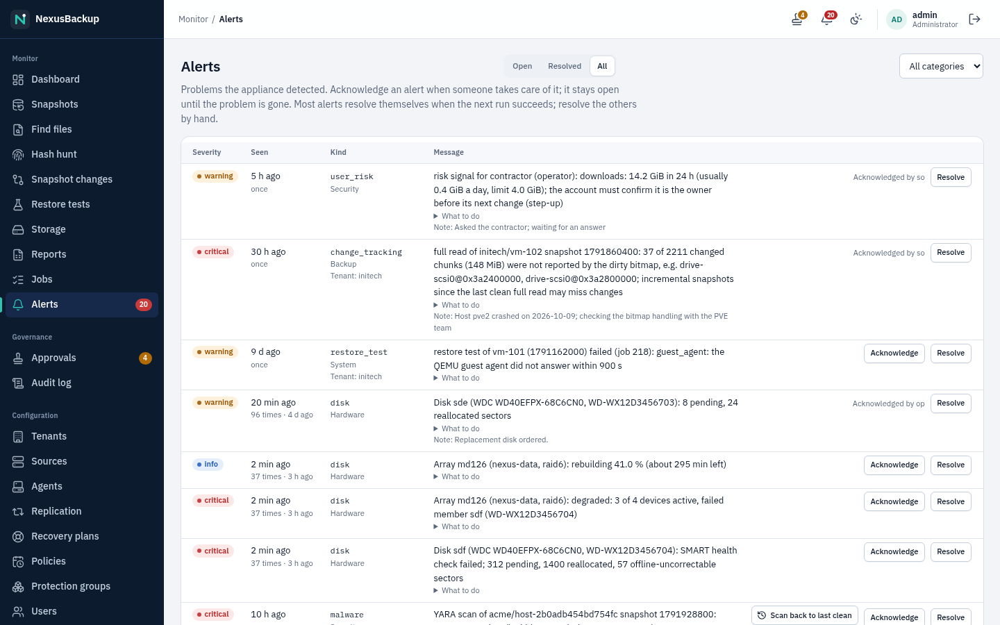

The bell in the top bar and the counter next to **Alerts** in the sidebar count the open alerts nobody has
acknowledged (red when one of them is critical). The Dashboard lists the newest of them under **Open alerts**.

Administrators, operators and security officers can acknowledge and resolve alerts. Only administrators and
security officers can close a `break_glass`, `console_unlock` or `console_root_shell` alert. Alerts are appliance-wide: accounts limited to one tenant do not see
them.

### Life of an alert

1. **Raised.** The appliance detects a problem and raises an alert. The alert is sent to the matching notification
   rules.
2. **Repeated.** While the alert is open, the same problem does not create a new alert. The appliance counts the
   repeat ("147 times"), updates **Seen** and keeps the latest message. A repeat is sent out again only when its
   severity rises (for example from warning to critical).
3. **Acknowledged** (optional). Click **Acknowledge** and add a note if you like ("Storage team is on it"). The alert
   stays open and keeps counting repeats, but it no longer counts in the bell and is no longer sent as a reminder.
4. **Resolved.** The alert is closed. Most kinds **resolve themselves** when the matching success happens, for
   example the next successful run of the failed job. These alerts are marked **auto-resolved**. Close the others with
   **Resolve**: the dialog takes an optional note on what was done. Resolving also acknowledges the alert.
5. **Back again.** If the problem comes back after the alert was resolved, the appliance raises a new alert.

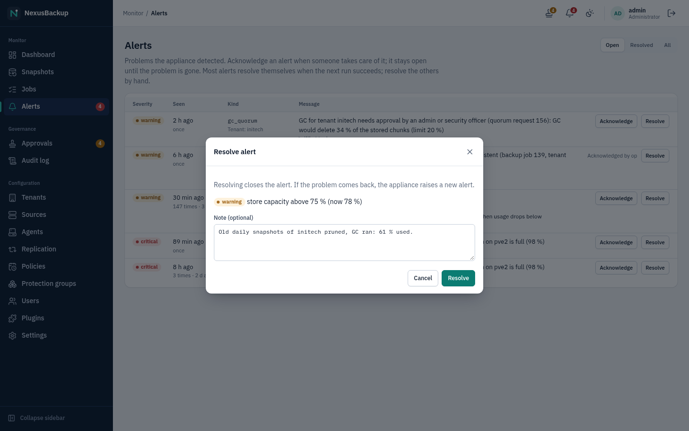

Reminders: an open alert that nobody has acknowledged is sent again every 24 hours (setting **Remind every**; 0
turns reminders off).

Resolved alerts are deleted after a while: `info` alerts after 14 days, `warning` and `critical` alerts after 180 days
(setting **Keep resolved … alerts**). Acknowledging, resolving and every automatic resolve are recorded in the audit
log (`alert.ack`, `alert.resolve`).

## Alert kinds

Every kind belongs to one fixed **category**, for filters here and for routing in a SIEM: the category is part of
webhook and e-mail notifications, forwarded events and the API (`GET /api/v1/alerts?category=…`).

| Category | Kinds |
|---|---|
| security | `anomaly`, `malware`, `scan_hit`, `hash_hunt_hit`, `tenant_lockdown`, `login_new_device`, `user_risk`, `role_elevation`, `console_unlock`, `console_root_shell`, `break_glass`, `firewall_reset`, `mgmt_allow_reset`, `legal_hold_advisory`, `cert_expiry`, `account_dormant`, `inventory`, `clock_skew`, `gc_quorum`, `gc_confirm`, `vault_disabled`, `incident`, `dek_rotation` |
| backup | `job_failed`, `sla_missed`, `paused`, `consistency`, `backup_inconsistent`, `orphaned`, `verify`, `snapshot_damaged`, `change_tracking`, `offsite_lag`, `inventory_refresh`, `config`, `vmid_reused`, `restore_priority`, `index_backlog` |
| replication | every `replication_…` kind |
| hardware | `disk`, `fleecing_space` |
| system | `capacity`, `quota`, `forwarding`, `report`, `tenant_disabled`, `index_space`, `test` and any kind not listed |
| audit | not an alert category: forwarded audit log entries carry it |

| Kind | Severity | Raised when | Resolves itself when | What to do |
|---|---|---|---|---|
| `job_failed` | critical | any job fails (backup, restore, offsite, GC, …); the message ends with the last log lines. Group backups are retried first (policy **Retries**): the alert comes only after the last attempt ("failed after 4 attempts") | the same job succeeds (same tenant, job kind and group, source, agent or guest), e.g. a later retry or **Back up now** | open the job on **Jobs**, read the log, fix the cause, run it again (**Back up now**, e.g. **Guests that failed in the last run**) |
| `sla_missed` | warning | a group backup runs longer than its policy's **Run-time SLA** (one alert per job) | — | check why the run is slow (source load, network, a hanging guest); cancel it on **Jobs** if needed, or raise the SLA |
| `paused` | warning | a group was paused, or a source put into maintenance, for more than 7 days or indefinitely (one alert per pause) | the group is resumed / the maintenance ends (next scheduler tick) | make sure the pause is intended; **Resume** the group / **End maintenance** when the work is done |
| `verify` | critical | the daily verification found missing or corrupt chunks (locally or in the offsite sample) | the tenant's next verification succeeds | see [15 Troubleshooting](15-troubleshooting-faq.md#verification-failed); do not run GC until it is understood |
| `snapshot_damaged` | critical | snapshots reference chunks that failed verification; the message names up to 10 of them (one alert per tenant) | no snapshot of the tenant is damaged any more (after **Repair**, or after a verification that finds the data stored again) | run **Repair** on **Snapshots**, see [Verification and repair](#verification-and-repair); do not delete the damaged snapshots |
| `inventory` | critical | the offsite inventory check found packs missing on the target or unknown packs there; or a locked snapshot disappeared from the local store | the tenant's next offsite job (with its inventory check) succeeds | treat as a possible attack or storage fault; check the offsite target, see [07 Offsite copies](07-offsite.md) |
| `capacity` | warning | the chunk store is more than 75 % full | usage is back under 75 % | add storage, or review retention; GC only frees chunks no snapshot uses any more |
| `offsite_lag` | warning | the oldest snapshot not yet offsite is more than 48 hours old (one alert per tenant) | the tenant's offsite copy has caught up | check the tenant's offsite jobs and the target's reachability and space |
| `backup_inconsistent` | warning | an agent or share backup could not use a snapshot of the source, or files changed while they were read (shown once per source for a missing snapshot) | — (resolve by hand) | configure snapshot support on the source (LVM/ZFS/btrfs on agent hosts, a NAS snapshot directory for shares), see [04 Sources](04-sources.md) |
| `consistency` | warning | a group backup's snapshot is less consistent than its policy requires (one per guest, see [05](05-policies-and-groups.md#required-consistency)) | the next snapshot of that guest that meets the requirement | enable the QEMU guest agent (VMs), hooks or VSS (agents) or snapshots on the source |
| `gc_quorum` | warning | a garbage collection would delete more than 20 % of a tenant's chunks and waits for approval | the request is approved (the GC is queued) | decide the `gc_large` request on **Approvals** after checking why so much data became unreferenced |
| `gc_confirm` | warning | the same, while approvals are disabled | the confirmed GC has run | an administrator confirms it on **Approvals** (**Confirm and run GC**) |
| `replication_lag` | warning | (secondary) no successful replication sync of a tenant for 48 hours | a sync of that tenant succeeds | check the replication source and the primary, see [08 Replication](08-replication.md) |
| `replication_keys` | critical | (secondary) the primary uses a tenant key version this appliance does not have, or a key export failed | — | export the keys again on the primary and have it approved |
| `replication_verify` | critical | (secondary) replicated data failed verification; nothing was imported | — | check the primary; the next sync retries |
| `vault_closed` | info | (secondary) a replication source was closed with **Close vault (pause pulling now)** | the source is reopened (after approval) | nothing while intended; see [08 Replication](08-replication.md#close-vault-pause-pulling-now) |
| `config` | warning | the scheduler cannot use a group or replication source configuration | — | fix the configuration named in the message |
| `vmid_reused` | warning | a VM's identity (vmgenid / SMBIOS UUID) changed between two backups: the VMID belongs to another VM now (`vmid_reused:<tenant>/vm-<id>`) | — (resolve by hand) | check that the group protects the VM you mean; the old snapshots belong to the previous VM. See [04 Sources](04-sources.md#vm-identity-and-reused-vmids) |
| `restore_priority` | warning | restore priority is on (scheduled backups, GC, verify, offsite and replication are held) | it is turned off or expires | turn it off when the recovery is done. See [14 Disaster recovery](14-disaster-recovery.md#restore-priority) |
| `index_backlog` | warning | a snapshot has waited more than 48 hours to be added to the file search (one alert per tenant) | the waiting snapshots are indexed | check the **File index** jobs on **Jobs** and the index service; files of those snapshots are not found by **Find files** meanwhile, browsing and restores work. See [06 Restores](06-restores.md#find-a-file) |
| `index_space` | warning | file indexing paused: the volume holding the search index is below its free space floor | indexing runs again | free space on the store (retention, GC) or add disks; **Storage** shows the index size and the free space. See [03 The web interface](03-web-interface.md#storage) |
| `orphaned` | info | snapshots of an object that is in no protection group of its tenant were found; they are pruned with the default retention (shown once per object) | — | put the object into a group if it should keep being protected with that group's retention, or ignore it; see [05 Policies and protection groups](05-policies-and-groups.md#snapshots-of-objects-in-no-group) |
| `anomaly` | critical (warning: duration alone) | a backup added far more new data than usual for its source, new data that suddenly does not compress, data that suddenly does not deduplicate, or a backup that took far longer than usual (see [Change-rate anomalies](#change-rate-anomalies)); or its files show ransom-note names or a mass rename ([File-level change signals](#file-level-change-signals)). The snapshot is flagged as anomalous | — | check the source for mass changes or encryption (ransomware), compare the snapshot with the previous one under **Snapshot changes**; a security officer puts the last clean snapshot on hold with **Hold last good snapshot** |
| `malware` | critical | a YARA scan found matches of the uploaded rules in a snapshot (see [Malware scan (YARA)](#malware-scan-yara)); the snapshot is flagged as anomalous | — (resolve by hand) | open the scan results on **Snapshots**, check the files and the source; a security officer clears the flag if a rule was too broad |
| `scan_hit` | critical | a **scheduled** scan of a protection group found matches in the newest snapshot of a source (`scan_hit:<tenant>/<source>`); the snapshot is flagged | — (resolve by hand) | as `malware`; the recovery calendar shows the snapshot red. See [Scheduled scans](#scheduled-scans-and-the-recovery-calendar) |
| `hash_hunt_hit` | critical | an IOC hash hunt found files whose SHA-256 is on an uploaded list (`hash_hunt_hit:<tenant>`); the snapshots holding them are flagged | — (resolve by hand) | open the results on **Hash hunt**; check the source machine; restore a clean version. See [IOC hash hunt](#ioc-hash-hunt) |
| `change_tracking` | critical | a scheduled full read found changes the change tracking did not report (`change_tracking:<tenant>/<source>`); the message names the tracker, how many changes were unreported and examples | the next full read of that source is clean | see [Change tracking](#change-tracking-scheduled-full-reads); incremental snapshots since the last clean full read may lack changes |
| `role_elevation` | info | an account elevated one of its sessions to its eligible role (`role_elevation:<account id>:<session id>`; the message names the role, the end time and the reason) | the elevation ends (expiry, **End now**, sign-out) | nothing if it was expected; otherwise end the account's sessions and remove its eligible role. See [09 Users and access](09-users-and-access.md#just-in-time-elevation) |
| `user_risk` | critical (weakening burst, bulk deletes), warning (unusual hour, download volume) | a risk signal fired for an account (`user_risk:<account id>:<rule>`); the account must step up for 24 hours | — (resolve by hand) | ask the owner; disable the account if it was not them, else clear the mark. See [09 Users and access](09-users-and-access.md#risk-signals-and-step-up) |
| `tenant_lockdown` | critical | a security officer or administrator locked one tenant down (`tenant_lockdown:<tenant>`) | the lockdown is lifted (approved) | investigate; see [14 Disaster recovery](14-disaster-recovery.md#tenant-lockdown) |
| `login_new_device` | warning (administrators, security officers), info (other roles) | an account signed in from a browser and network it never used before (`login_new_device:<account id>:<fingerprint>`); also mailed to the account's own address when one is set | — (resolve by hand) | confirm with the account owner; if it was not them, disable the account and check the audit log. See [09 Users and access](09-users-and-access.md#sign-in-devices-and-the-new-device-notice) |
| `legal_hold_advisory` | warning | (secondary) the primary holds a replicated snapshot under a legal hold; not applied here (one alert per snapshot) | a security officer applies the hold, or the primary releases it | decide whether the hold applies here too; **Apply hold** on the alert. See [08 Replication](08-replication.md#legal-holds-from-the-primary) |
| `quota` | warning at 80 %, critical at 100 % | a tenant's store reached 80 % or 100 % of its soft quota (**Tenants**); one alert per tenant, escalated at 100 % | usage is back under 80 % | review retention or what the tenant backs up, or raise the quota; backups continue either way |
| `cert_expiry` | info at 90 days, warning at 30, critical at 7 (API tokens: info, last 7 days) | a certificate, the IdP client secret or an API token expires soon (see [Expiry warnings](#expiry-warnings)); one alert per item, escalated | renewed (new certificate, new secret date, token revoked or replaced) | renew as the message says |
| `account_dormant` | info | an account was disabled because nobody signed in with it for the configured number of days (**Settings → Security → Dormant accounts**; one alert per account) | — | re-enable the account on **Users** if it is still needed, else leave it disabled. See [09 Users and access](09-users-and-access.md#dormant-accounts) |
| `incident` | critical | a security officer entered incident mode (holds, paused groups, sessions and API tokens ended) | incident mode is left (approved) | investigate; see [14 Disaster recovery](14-disaster-recovery.md#incident-mode) |
| `dek_rotation` | info | a tenant's data encryption key is older than the reminder interval (**Settings → Security**; one alert per tenant) | the key is rotated, or the reminder is switched off | rotate at the console; see [14 Disaster recovery](14-disaster-recovery.md#rotating-a-tenants-encryption-key) |
| `firewall_reset` | warning | every inbound firewall restriction was cleared on the console (`nexus-setup reset-firewall`) | — | confirm with the person who did it, then set correct source lists in **Settings → Firewall**. See [02 Installation](02-installation.md#inbound-firewall) |
| `tenant_disabled` | info | a tenant is deactivated (**Tenants**); its other alerts are muted meanwhile (one alert per tenant) | the tenant is reactivated | nothing, if intended; reactivate the tenant when it is needed again. See [09 Users and access](09-users-and-access.md#deactivating-a-tenant) |
| `vault_disabled` | warning | vault mode was switched off at the console (`nexus-setup vault-disable`) after an approved request | — | confirm with the requester and the approver (audit `vault.disable`), then acknowledge. See [08 Replication](08-replication.md#vault-mode-secondary-only) |
| `mgmt_allow_reset` | warning | (before Phase 16) the management allow-list was cleared on the console | — | as `firewall_reset` |
| `report` | warning | a scheduled report could not be mailed (SMTP server unreachable or refusing, no SMTP server configured, report removed meanwhile) or its schedule is invalid; one alert per report (`report:<name>`) | the report is mailed successfully (scheduled or **Send now**) | check the SMTP server under **Settings → Alert delivery** and the recipients on **Reports**, then **Send now** |
| `break_glass` | critical | an administrator account was reset on the console with the recovery key (`nexus-setup recover-admin`), or approvals were switched off there (`nexus-setup disable-approvals`) | — | make sure the recovery was planned (check the audit entry `user.break_glass`), then acknowledge it; until then every administrator sees a red banner. See [14 Disaster recovery](14-disaster-recovery.md#break-glass-the-only-administrator-lost-their-authenticator) |
| `console_unlock` | critical | a one-time code for a root shell on the console was shown to its requester (**Settings → Console access**) | — | make sure the request was planned; revoke the code there if not. See [14 Disaster recovery](14-disaster-recovery.md#emergency-root-shell-on-the-console) |
| `console_root_shell` | critical | a root shell was opened on the appliance console with a one-time code or the recovery key; while it runs every administrator, security officer and operator sees a red banner | — | confirm with the requester (or whoever holds the recovery key) what was done, check the audit log (`console.root_shell`, `console.root_shell_end`), then acknowledge |
| `disk` | critical: SMART failing, array degraded or failed, bad sectors growing; warning: bad sectors, NVMe wear ≥ 90 % or critical warning, media errors, too hot (HDD > 55 °C, SSD/NVMe > 70 °C), failed self-test, no disk status for 30 minutes; info: rebuild, resync or reshape running (with progress) | the scan of `nexus-disks` (every 5 minutes, SMART hourly) finds a problem; one alert per disk (`disk:<serial>`) and per array (`disk:md:<uuid>`, the rebuild as `disk:md:<uuid>:sync`) | the disk or array is healthy again (a rebuild finished, the disk was replaced) | open **Configuration → Hardware**; replace a failing disk, see [15 Troubleshooting](15-troubleshooting-faq.md#replacing-a-disk) |
| `fleecing_space` | critical | the fleecing storage of a Proxmox node is below the guard of its source (the VM was skipped) or below the critical level (a running VM backup was cancelled); one alert per node and storage (`fleecing_space:<tenant>/<node>/<storage>`) | a later backup finds enough room on that storage | free space in the storage (usually `local-lvm`), or choose a larger fleecing storage or other limits on the source. See [04 Sources](04-sources.md#proxmox-ve) |
| `clock_skew` | warning above 1 minute, critical above 10 minutes; info for a lag after a restart | system time and the compliance clock (the clock of retention locks, [01 Concepts](01-concepts.md#retention-locks-and-the-compliance-clock)) differ: system time jumped ahead while the appliance was running, or the compliance clock is ahead (system time moved back); info: the compliance clock was already behind when the scheduler started (the appliance was off) | the difference is under a minute | find out who or what changed the time (Diagnostics: `time.sync`, `time.nts`; the audit log). Locks are never shortened: the compliance clock moves towards system time by at most 0.1 % of the elapsed time. See [15 Troubleshooting](15-troubleshooting-faq.md#check-time-compliance) |
| `forwarding` | warning | audit / alert forwarding to a syslog or HTTPS sink has failed for 15 minutes (one alert per sink; the message names the destination and the error) | the sink delivers again (or is disabled / removed) | check the receiver (reachable, certificate, token) and **Settings → Forwarding** (**Send test message**); nothing is lost, the backlog follows. See [10 Approvals and audit](10-approvals-and-audit.md#forwarding-to-a-siem) |

## Verification and repair

Every night the `verify` job re-reads one seventh of the stored chunks: after seven days every chunk has been read
once. It also checks every night that each chunk a snapshot needs is present. If it finds a corrupt or missing chunk:

- the chunk goes on the tenant's **bad-chunk list** and a corrupt copy is moved aside. New backups never reuse it:
  when a source delivers the same data again, the appliance stores the chunk again, and that also heals older
  snapshots that need the same chunk;
- the next backup of each affected source does not build on the damaged snapshot. A Proxmox VM gets a fresh dirty
  bitmap and its disks are read in full once. An agent re-reads every file instead of using its change cache. A
  plugin source makes a full backup. NFS/SMB shares and TrueNAS datasets re-read the affected files;
- the affected snapshots are marked **Damaged** on **Snapshots**, with the number of bad chunks in the tooltip. A red
  banner per tenant names how many there are, and the critical `snapshot_damaged` alert lists them. The `verify`
  alert stays open as well;
- if the tenant has an offsite target or is a replication secondary, a **Repair** job starts by itself.

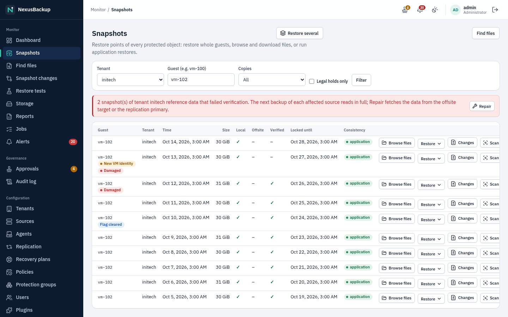

**Repair** (administrators, **Snapshots** page, per tenant) starts a `chunk_repair` job. It fetches each bad chunk
by its id from the tenant's **offsite target**. On a **replication secondary** it fetches the chunk from the
**primary**, but only while the replication source is open and inside its sync window. Every chunk is fully
checked with the tenant key before it is stored. A tampered or wrong copy is refused and counted as
**unavailable**. When all chunks of a snapshot are back, its **Damaged** mark goes, the audit log records
`snapshot.repaired`, and the `snapshot_damaged` alert resolves itself once no damaged snapshot is left.

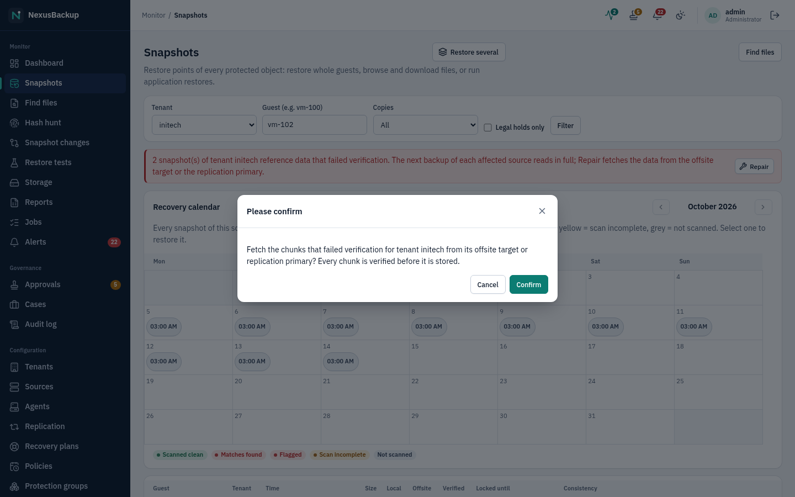

What to do when chunks fail verification:

1. Check the store disks (**Configuration → Hardware**, SMART) and the file system. Bit rot rarely affects a single
   chunk only.
2. Run **Repair**. Its job log shows how many chunks came back (`repaired`) and how many no copy had
   (`unavailable`).
3. If some remain unavailable: let the next backup of the affected sources run. If the source still has the same
   data, it is stored again. Otherwise restore those guests or files from an older healthy snapshot. The damaged
   snapshots stay readable apart from the lost chunks: a restore fails only where it reaches one.
4. Run **Verify** again (Jobs). The `verify` alert resolves after a verification without findings.

Do not delete damaged snapshots and do not approve large garbage collections while chunks are bad: a later repair
needs the snapshot to know which chunks belong to it.

> **Status:** implemented and tested against a local store, an offsite directory target and a replication primary
> in integration tests; the repair from a real Storage Box / S3 target and the PVE full re-read after a damaged base
> still need a run in the lab. A primary cannot repair from its secondary (the secondary does not serve data);
> use the offsite copy there. The daily share means bit rot in a chunk can stay unnoticed for up to seven days.

### Change tracking: scheduled full reads

Protection groups read their sources in full every so many days (**Full read** in the group's dialog,
[05 Policies and protection groups](05-policies-and-groups.md#full-read-change-tracking-check)) and compare that with
what the change tracking reported. The **Change tracking** card on the **Dashboard** sums it up: how many sources were
**verified** (the last full read found nothing unreported), have **drift** and were **never checked**, and the age of
the oldest verification. Below it, the sources with drift first: the last full read, the result, the tracker
(dirty bitmap, metadata cache, USN journal, zfs diff), how many changes were **unreported** (chunks or files, with
their size; examples such as `drive-scsi0@0x3a2400000` or file paths under the source in the tooltip) and when the
next full read is due.

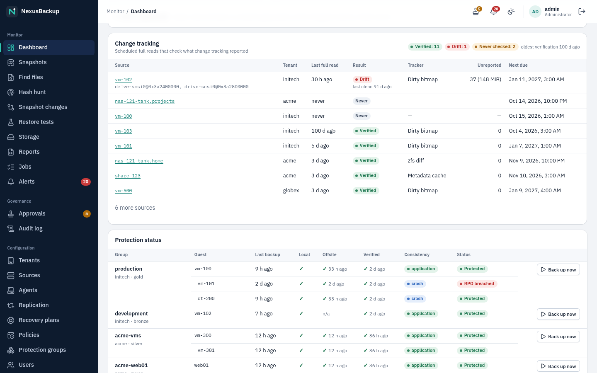

**Drift** raises the critical `change_tracking` alert. The snapshot of the full read itself is complete; the
incremental snapshots between the last clean full read and this one may lack the unreported changes, so for a
restore of data from that period prefer the full-read snapshot or check the restored data. Look for the cause (a
crash of the Proxmox host while the VM ran, a program that restores modification times, a USN journal that wrapped,
a clock jump) and set a short interval until a full read is clean again; the alert then resolves itself. **No
baseline** means there was nothing to compare with (the first snapshot, or a VM whose dirty bitmap was new).

## Expiry warnings

The scheduler checks every 15 minutes what expires and raises one `cert_expiry` alert per item: **info** 90 days
before, **warning** 30 days before, **critical** 7 days before and after expiry. The alert is escalated in place and
resolves itself once the item is renewed or gone.

| Item | Expiry from | Renew |
|---|---|---|
| **Web certificate** (imported) | the certificate | **Settings → Certificate**: new request, install the new certificate ([02 Installation](02-installation.md#use-your-own-certificate)) |
| **Self-signed appliance certificate** (pinned by replication secondaries) | the certificate (10 years from setup) | `nexus-setup --force-reconfigure-network` creates a new one; give the new fingerprint to the secondaries |
| **Agent certificates** | 10 years after the agent's enrollment | enroll the agent again ([04 Sources](04-sources.md)) |
| **Agent CA** (the appliance's client certificate for agents) | 10 years after the first agent enrollment | not automated yet: plan a re-enrollment of all agents |
| **Replication secondaries** (their client certificates, on the primary) | 10 years after enrollment | enroll the secondary again ([08 Replication](08-replication.md)) |
| **IdP client secret** | the date entered under **Settings → Single sign-on** (optional) | create a new secret at the IdP, enter it and the new date |
| **API tokens** (info only, last 7 days) | the token | create a new token, revoke the old one ([09 Users and access](09-users-and-access.md#api-tokens)) |

> **Status:** agent and replication certificates are not stored on the appliance (only their fingerprints), so their
> dates are computed from the enrollment time and the fixed lifetimes. A replication secondary does not warn about
> the primary's certificate.

## Change-rate anomalies

After every backup the appliance compares the amount of **new data** the backup added to the store (after
deduplication, before compression) with the same source's history. It raises a critical `anomaly` alert when

- the new data is more than **3 ×** the median of the source's last **14** backups and more than **1 GiB**, or
- the new data hardly compresses (factor below 1.05) while the source's data usually compresses well (median above
  1.3), and it is more than a quarter of that 1 GiB floor. Encrypted files do not compress, so this is the typical
  signature of ransomware encrypting a share or a server.

Two more checks watch how the backup behaved:

- **Dedup rate:** the share of the data read that turned out to be new (did not deduplicate) is far above the
  source's usual share (3 x its median and at least 75 %), and at least a quarter of the 1 GiB floor was read. A
  server that rewrites the same files every night usually adds a few percent of what it reads; after encryption
  nothing deduplicates any more. Critical.
- **Duration:** the backup took far longer than usual (3 x the median and at least 15 minutes more). On its own this
  is a **warning**, since slow storage or a busy network look the same; together with another finding the alert is
  critical.

All rules need at least 5 earlier backups of the source (the duration rule 5 backups whose duration was measured:
backups taken before this release have none). Example message:

```text
change-rate anomaly on acme/share-6: snapshot 1791580000: 412.0 GiB new data, limit 36.0 GiB (3× the median
12.0 GiB of the last 14 runs); last snapshot before: share-6/1791493600
```

```text
dedup-rate anomaly on acme/host-a1 (sensitivity high): snapshot 1791580000: 60 % of the 1.5 GiB read did not
deduplicate (usually 5 %, limit 50 %); last snapshot before: host-a1/1791493600
```

The message names the tenant, the source, the time of the suspicious snapshot and the **last snapshot before** it
that is not flagged itself: the one to restore from if the data was encrypted. While the alert is open, further
anomalies of the same source raise its count instead of a second alert.

**Sensitivity per source.** Each protected system has a sensitivity: **Low**, **Medium** (the default) or **High**.
High flags smaller deviations (change rate 2 x the median, dedup rate 2 x its median and at least 50 %, duration 2 x
and at least 5 minutes more); Low only large ones (4.5 x, 4 x and at least 90 %, 4 x and at least 30 minutes more).
Set it in **Change trends** on the **Sources** page (administrators, security officers and tenant admins for their
own systems). Raising it applies at once; lowering it weakens a ransomware signal and needs a second person when
approvals are enabled (request `anomaly.sensitivity`).

### Flagged snapshots

The suspicious snapshot itself is **flagged as anomalous** (with the reason) as well. On **Snapshots** it carries a
red **Anomalous** badge and the reason. Every restore dialog (full restore, instant recovery, plugin restores,
restore to a host) and the legal hold dialog opened on a flagged snapshot **default to the latest clean snapshot
before it**. A notice says so and offers **Use the flagged snapshot instead**, for example to recover the files that
were not encrypted. **Restore several** uses the latest clean snapshot of each guest and marks the guests whose newer
snapshot was skipped.

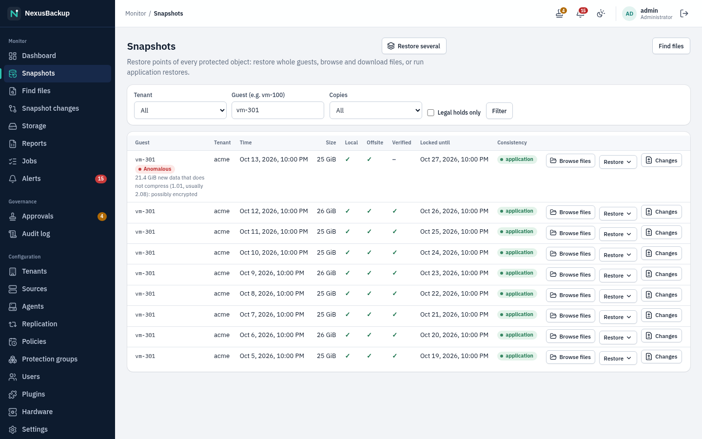


A **security officer** clears a flag after checking that it was a false alarm (a planned migration, a bulk import of
compressed archives): **Clear flag** on the snapshot, with a note on what was checked. The snapshot counts as clean
again; the badge changes to **Flag cleared** (the reason, who cleared it and the note stay visible), and the audit
log records `snapshot.anomaly_clear` with the note. Clearing the flag does not resolve the alert: resolve that on
**Alerts** as usual. A flag is set again if a later check finds something new in the same snapshot.

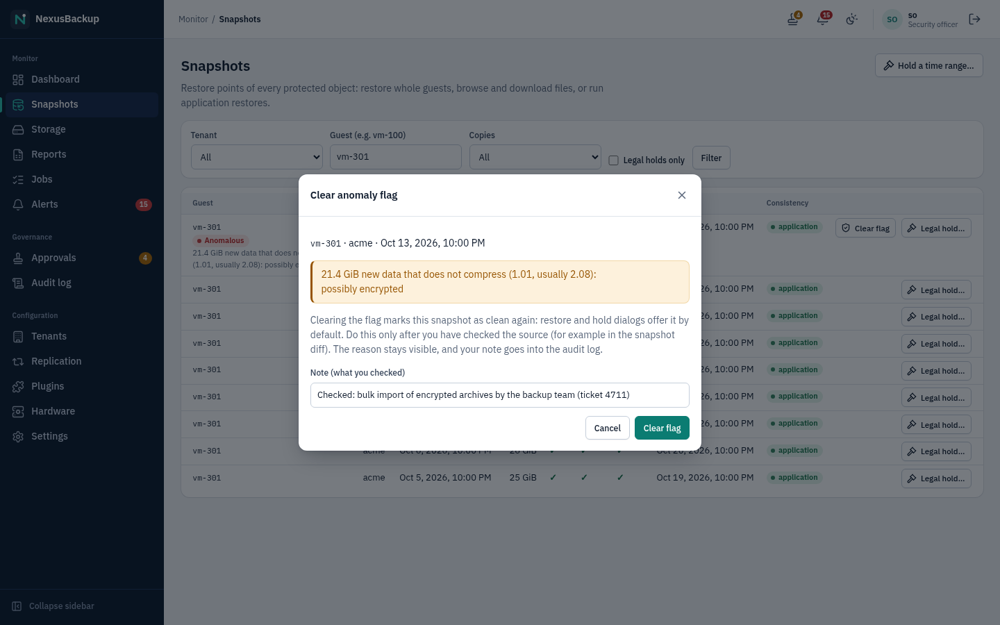

### File-level change signals

After every backup that has a **file name index** (agents, NAS shares, TrueNAS datasets and plugin snapshots always;
VM and container disks when their group indexes the guests' files, see
[06 Restores](06-restores.md#find-a-file)), the appliance compares the new snapshot's files with those of the
previous snapshot of the same source (job **File change signals**). It counts **added**, **changed** (size or
modification time) and **deleted** files; folders are not counted. A critical `anomaly` alert is raised and the
snapshot flagged when

- a new file has a **known ransom-note name** (for example `HOW_TO_DECRYPT.txt`, `README_FOR_DECRYPT.txt`,
  `!!!READ_ME!!!.txt`, `Restore-My-Files.txt`; a small built-in list, case-insensitive), or one of the extra patterns
  in **Settings → Anomaly detection**, or
- the files were **mass renamed**: at least 50 files and at least 10 % of the source's files were deleted, while at
  least half as many new files have extensions the previous snapshot never had (`report.docx` →
  `report.docx.lockbit3`).

Example message:

```text
file-level anomaly on acme/host-2b0adb454bd754fc: snapshot 1791928800: 12 ransom-note file name(s), e.g.
Users/HOW_TO_DECRYPT.txt; mass rename: 412 of 2906 files deleted, 412 added with new extensions (.lockbit3, .txt)
(424 added, 3 changed, 412 deleted); last snapshot before: host-2b0adb454bd754fc/1791842400
```

The counts are kept per backup and drawn as **Change trends** on the **Sources** page.

### Snapshot changes (diff)

**Monitor → Snapshot changes** (or **Changes** on a snapshot) compares two snapshots of a source: choose the source,
the newer snapshot (**To**) and the older one (**From**, default the previous snapshot), optionally only **Added**,
**Changed** or **Deleted**, then **Compare**. The list shows each path with its size and modification time (before →
after for changed files), 200 per page; a path opens the file browser in the snapshot that has it. Flagged snapshots
are marked in the lists.

The comparison runs on the appliance as a **Snapshot diff** job with the tenant key: it reads only the sealed file
name indexes (names, sizes, times), never file contents. It is open to the roles that may search files
(administrators, operators, tenant administrators and tenant users for their own tenant) and recorded in the audit
log (`snapshot.diff`). Snapshots without a file index (VM disks of groups with the file index off, offsite-only
copies) cannot be compared.

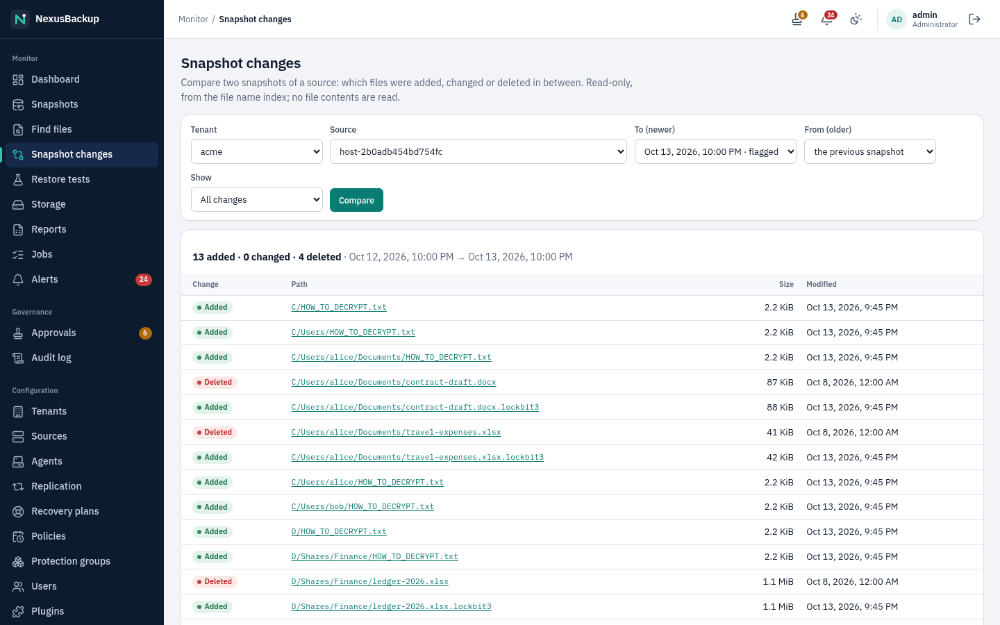

### Malware scan (YARA)

Snapshots can be scanned for malware with **YARA rules you supply** — there is no rule feed. Upload rule files on
**Settings → Malware scan** (administrators and security officers): one `.yar` file at a time, up to 50 files of
256 KiB, 1 MiB together; the same name replaces a file, **Delete** removes it. Every change is audited with the
file's SHA-256 (`scan.rules_put`, `scan.rules_delete`). Matches are shown as `<file>:<rule>`.

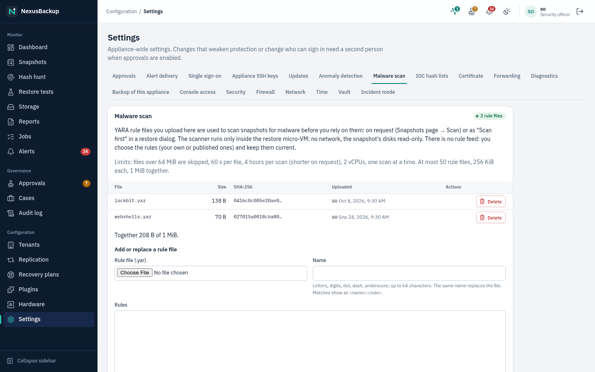

**Scan** on a local snapshot (**Snapshots**; administrators, operators, tenant administrators and security officers)
starts a **Malware scan (YARA)** job. It runs inside the restore micro-VM, never on the appliance itself: no network,
the snapshot's disks attached read-only. VM disks are mounted in the micro-VM; the files of agent, NAS, share,
plugin and container snapshots are streamed into it. Limits: files over 64 MiB are skipped, 60 seconds per file,
2 vCPUs, 4 hours per scan, one scan at a time. A scan that reaches its time limit is reported as **Scan
incomplete**.

The snapshot then shows **Scanned: clean**, **Malware: <n> matches** or **Scan incomplete**; click it for the
results (rule and path of every match, the first 1000 kept; files, skipped files and errors; the rule set used).
A match flags the snapshot as anomalous (reason `YARA: <n> matches (…)`, see [Flagged snapshots](#flagged-snapshots))
and raises the critical `malware` alert. Audit: `snapshot.scan_request`, `snapshot.scan`.

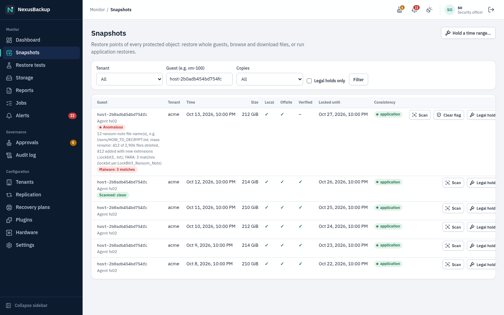

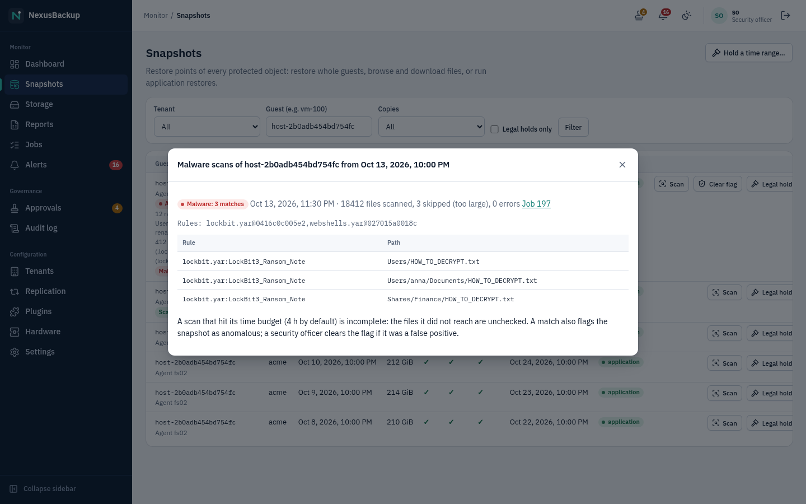

The same scan can run before a restore: **Scan first** in the restore dialogs, see
[06 Restores](06-restores.md#scan-first-secure-restore).

> **Status:** Rules are compiled in the micro-VM at the start of each scan, so a syntax error only shows as a
> failed scan job (with the compiler's message). Scans run on request, before a restore, or on a group's schedule
> (below); not after every backup.

### Scheduled scans and the recovery calendar

A protection group can scan its newest snapshots on a schedule: **Scheduled malware scan** in the group's dialog
([05 Policies and protection groups](05-policies-and-groups.md#threat-detection-scheduled-scans-and-file-hashes)),
for example **Daily** at 03:00. When it is due, the scheduler queues one **Malware scan (YARA)** job for the newest
local snapshot of each guest or source of the group that has no scan result yet; a snapshot already scanned is not
scanned again, and no new snapshot since the last run means no scan. The jobs queue behind each other and behind scans
on request (one at a time), with the group's time budget. Nothing is queued while there are no rules, during restore
priority, or for a deactivated tenant.

Every snapshot carries the result of its newest scan: **clean**, **matches** or **incomplete** (or none: not scanned).
A hit of a scheduled scan raises the critical `scan_hit` alert (scans on request keep raising `malware`) and flags
the snapshot as usual. Restore and hold dialogs prefer the newest **scanned-clean** snapshot
([06 Restores](06-restores.md#anomalous-snapshots-restore-the-latest-clean-one)).

Filter **Snapshots** to one guest or source to see its **Recovery calendar**: the snapshots of a month by day,
coloured by their state, with arrows for earlier months. Selecting one opens its first restore action (full restore,
restore to path, …).

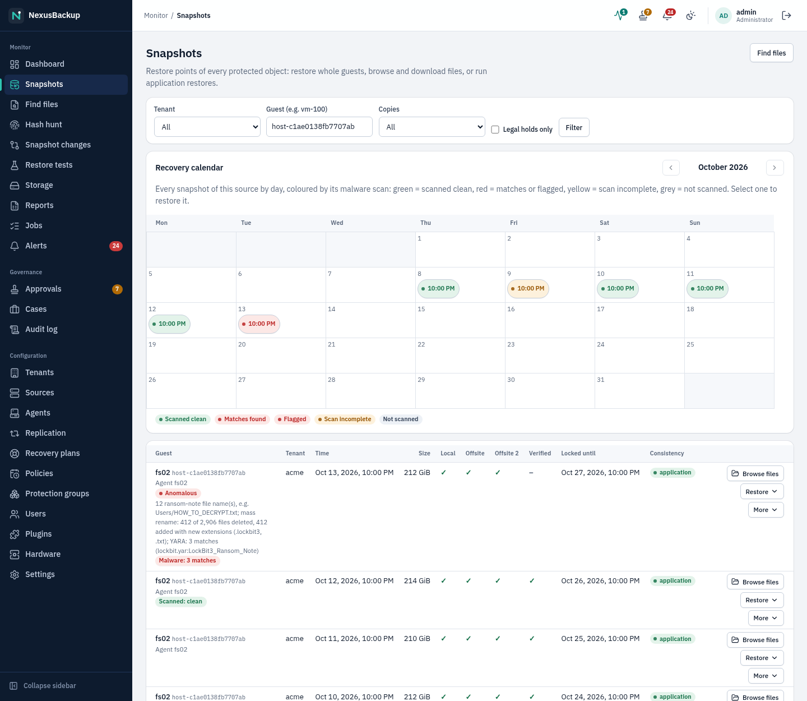

### Scan back to the last clean snapshot

When a snapshot is flagged or a scan found matches, the question is: which snapshot is the newest clean one?
**Scan back** answers it. On **Snapshots** the button appears on flagged snapshots and scan hits; on **Alerts** the
`malware` and `scan_hit` alerts offer **Scan back to last clean** (for the source in the alert, starting at its
newest flagged snapshot). Administrators, operators, security officers and tenant administrators may start it, as
with a scan.

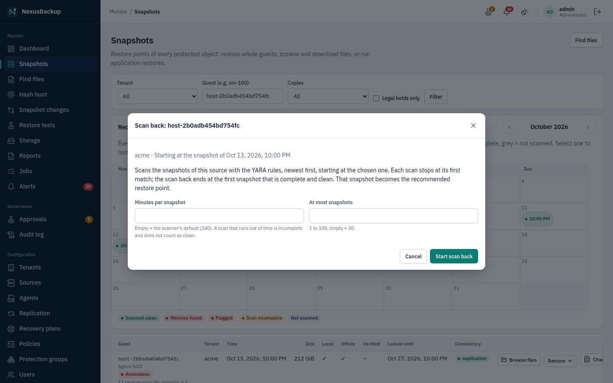

The scan back scans the snapshots of the source **newest first**, starting at the chosen one, one ordinary
**Malware scan (YARA)** job per snapshot. Each scan **stops at its first match** (finding one match is enough to rule
a snapshot out), so infected snapshots go quickly. It ends at the first snapshot whose scan is **complete and clean**:
that one becomes the **Recommended restore point**. Options: **Minutes per snapshot** (the time budget of each
scan; a scan that runs out of time is incomplete and does not count as clean) and **At most snapshots** (default
30, at most 100). Without YARA rules the scan back is refused.

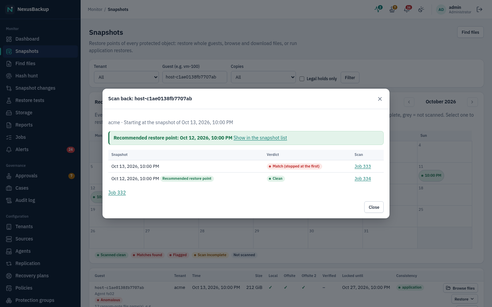

The dialog follows the job and shows every scanned snapshot with its verdict and scan job. Matches flag the
snapshots like any scan; the recommended snapshot gets the badge **Recommended restore point** in the snapshot list
(only the one of the newest scan back of a source), and restore dialogs opened on a flagged snapshot switch to it.
If the maximum was reached before a clean snapshot, the result says so: start another scan back at the oldest
scanned snapshot. Audit: `snapshot.scan_back_request`; the job kind is `scan_back`.

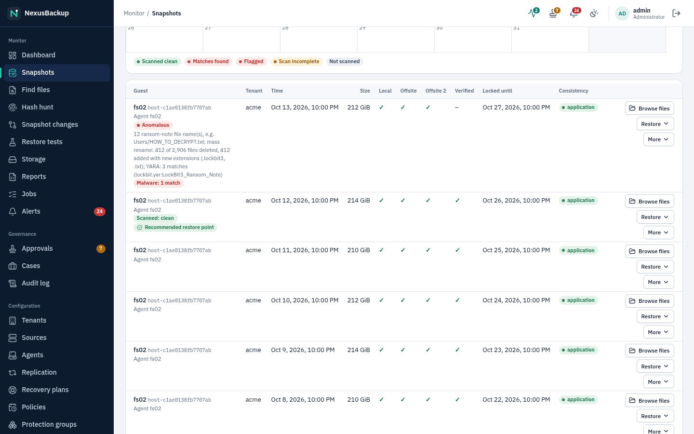

### IOC hash hunt

Threat intelligence feeds, CERT advisories and your own incident response publish **SHA-256 hashes of known-bad
files** (indicators of compromise). The hash hunt searches all snapshots of a tenant for them **without a restore**:
the SHA-256 of every file is recorded in the sealed file index of each snapshot when the group has **Record file
hashes** on ([05](05-policies-and-groups.md#threat-detection-scheduled-scans-and-file-hashes)).

1. **Settings → IOC hash lists** (administrators and security officers): upload a text file (one hash per line, `#`
   starts a comment) or a CSV (the first SHA-256 of each line is used; MD5 and SHA-1 values are skipped and
   counted). Up to 20 lists of 100 000 hashes, 500 000 together. The same name replaces a list. Audited with the
   list's SHA-256 (`hash_list.put`, `hash_list.delete`).

   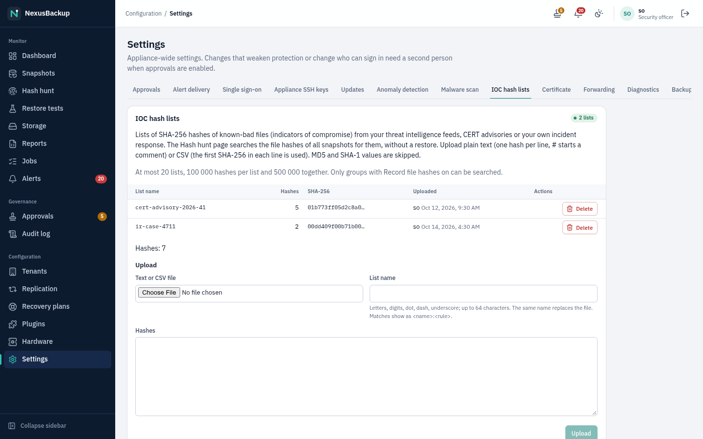

2. **Monitor → Hash hunt** (administrators, operators, security officers; tenant administrators for their tenant):
   choose the tenant, optionally lists, a source and a time range, **Start hunt**. The appliance opens the tenant's
   file indexes with the tenant key and compares the hashes; nothing leaves the appliance. A hunt over many
   snapshots takes seconds to minutes (at most 30 minutes, then the result is marked incomplete).
3. The results list every file version found: path, size, hash, the lists it is on, the source and the snapshots
   that hold it. **Open** shows it in the file browser, **Restore…** restores files (for example an earlier,
   clean version from a snapshot before the first hit) to a host, **Legal hold…** (security officers) holds the
   snapshot as evidence. Hits flag the snapshots (reason `IOC hash: …`) and raise the critical `hash_hunt_hit` alert.
   **Recent hunts** keeps the last results.

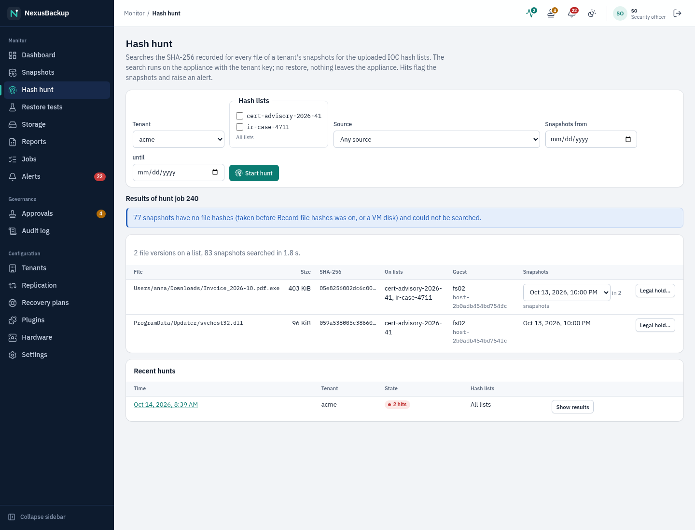

Snapshots taken before **Record file hashes** was switched on, and VM disks, have no hashes; the result says how many
snapshots could not be searched. Audit: `hash_hunt.request`, `hash_hunt.hits`.

> **Status:** Implemented in Phase 28 and tested in the API, the scheduler, the store and against agents with and
> without the hashing capability; not yet run on the lab appliance. VM disk files are not hashed.

### Change trends

**Configuration → Sources** ends with **Change trends**: for each protected system the new data, the number of
changed files (added + changed + deleted) and the duration of its last 30 backups, oldest on the left, with the last
value next to it (hover the last new-data value for the share of the data read that was new), and its anomaly
**Sensitivity**. A red dot marks a flagged snapshot; hover a point for its time and value. **no file index** means the source's
snapshots have no name index (only new data is shown). The figures come from the same per-backup statistics as the
storage accounting ([03 The web interface](03-web-interface.md#storage)).

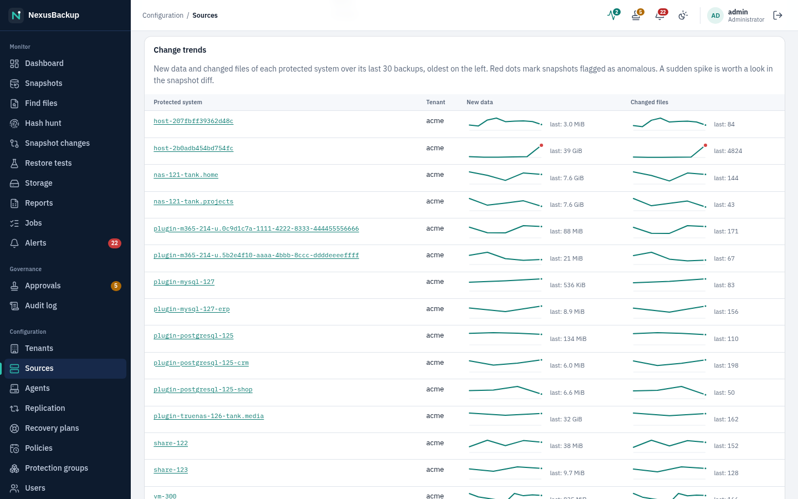

A **security officer** sees **Hold last good snapshot** on the alert. It opens the legal hold dialog for that snapshot
with a prepared reason; after **Put on hold** no retention, garbage collection or delete removes it until a release
is approved ([06 Restores](06-restores.md#legal-hold)). Without a hold, act before the snapshot reaches the end of
its retention.

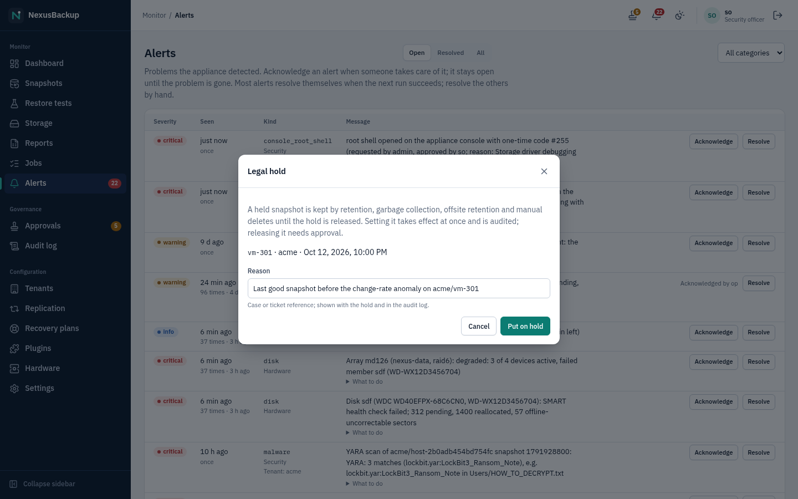

The thresholds are in **Configuration → Settings → Anomaly detection** (administrators; security officers read
only): **Detect unusual change rates**, **Alert above this multiple of the median**, **Median over the last runs**
and **Never alert below (GiB of new data)**, plus **Extra ransom-note file names** (one pattern per line, `*` and `?`
as wildcards, matched against the names of new files). Switching detection off also switches the file-level signals
off (the change counts are still kept). Stricter values and new patterns apply at once; switching detection off,
raising the multiple or the floor, or removing a pattern needs a second person when approvals are enabled (request
`settings.anomaly`).


> **Status:** The figures come from the connectors' per-backup statistics, introduced in this release. Backups taken
> before carry none, so detection starts after 5 backups per source with this release. File-level signals and flags
> exist since Phase 21a: snapshots taken before are neither flagged nor counted. The built-in ransom-note list is
> small and fixed (no update feed); the mass-rename thresholds are fixed. A ransomware that keeps file names and
> extensions is caught only by the change-rate rules. Scanning snapshot contents (YARA) for a "secure restore" is a
> later step.

## Delivery: notification rules

Administrators set up delivery under **Configuration → Settings → Alert delivery**; security officers see the tab
read-only.


A **notification rule** decides which alerts go where. Each rule has:

- a **Name** (letters, digits, dot, dash, underscore);
- **Send alerts of**: **Info and above**, **Warning and above** (default) or **Critical only**;
- **Alert kinds**: none ticked means every kind;
- **Tenants**: none ticked means every tenant, including appliance-wide alerts such as `capacity`. With tenants
  ticked, the rule gets only those tenants' alerts. This way a tenant's own team can receive its alerts;
- **Channels**: **E-mail recipients** (one per line) and/or a **Webhook URL**.

An alert goes to every rule it matches. If several matching rules have the same recipient, that person gets one
e-mail.

To add a rule, click **Add rule**. **Edit** and **Delete** change a rule. Each change is saved at once.
**Send test** sends one test alert through that rule's channels, using the saved settings, and shows the result per
channel: **Webhook** "ok", or **E-mail** "error: …" with the reason. A test ignores the rule's severity, kind and
tenant filters.

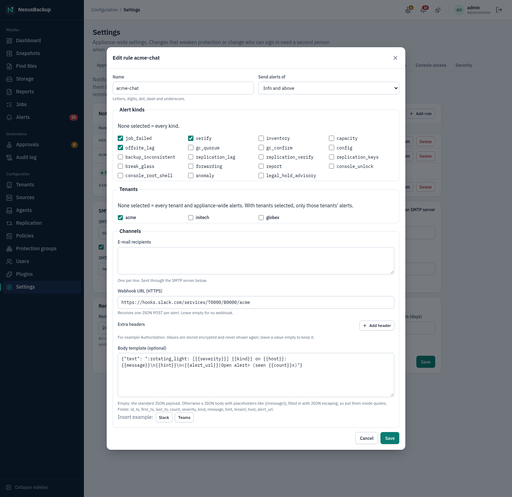

**SMTP server**: e-mail goes out through one SMTP server for all rules. Tick **Send e-mail through an SMTP server** and
fill in **SMTP server**, **Port** (e.g. 587), **Sender address**, **Use STARTTLS** and, if the relay needs them,
**SMTP user (optional)** and **SMTP password**. The password is write-only ("Stored — leave empty to keep the current
value."). If you change the server, port or user, you must enter the password again. Rules with e-mail recipients need
the SMTP server.

**Reminders and retention**: **Remind every (hours, 0 = never)** (default 24) and how many days resolved alerts are
kept per severity (defaults 14 / 180 / 180). Click **Save** to store these and the SMTP server.

### Webhook payload

Without a template, the webhook receives one JSON `POST` per alert:

```json
{
  "id": 1093, "ts": 1791712800, "first_ts": 1791712800, "last_ts": 1791968400, "count": 147,
  "severity": "warning", "kind": "capacity", "category": "system", "message": "store capacity above 75 % (now 78 %)",
  "hint": "The store is filling up. Shorten retention, run GC or add disks. Resolves when usage drops below the threshold.",
  "tenant": null, "host": "backup", "alert_url": "https://backup/#/alerts?id=1093"
}
```

- `ts` is the time the alert was first seen (the same as `first_ts`). `last_ts` and `count` describe the repeats.
- `hint` is the English "what to do" text.
- `tenant` is `null` for appliance-wide alerts.
- `alert_url` opens the alert in the web interface. It uses the appliance's host name.
- The same alert can arrive more than once: again when its severity rises, and as a reminder. Use `id` to tell
  them apart.

E-mails have the subject `[NexusBackup <host>] <severity>: <kind>`. The body has the message, the hint, the tenant,
the counts and the link.

**Extra headers**: a webhook can send headers such as `Authorization: Bearer …`. The values are stored encrypted
for the scheduler and never shown again; leave a value empty to keep it. If you change the webhook URL, you must enter
the header values again.

### Webhook templates (Slack, Teams, …)

Many chat tools expect their own JSON. Put it in **Body template (optional)**, with placeholders where the alert's
values go: `{{id}}`, `{{ts}}`, `{{first_ts}}`, `{{last_ts}}`, `{{count}}`, `{{severity}}`, `{{kind}}`, `{{category}}`,
`{{message}}`, `{{hint}}`, `{{tenant}}`, `{{host}}`, `{{alert_url}}`.

- Each value is inserted **JSON-escaped without quotes**, so write placeholders inside a JSON string (`"{{message}}"`).
  Quotes and line breaks in a message cannot break the JSON.
- Numbers (`{{count}}`, `{{id}}`, the times) can also stand outside quotes.
- A missing tenant becomes empty text.
- When you save, the template is checked: an unknown placeholder or a template that does not produce valid JSON is
  refused with the reason.
- **Insert example** fills in a Slack or a Teams template.

Slack (incoming webhook):

```json
{"text": ":rotating_light: [{{severity}}] {{kind}} on {{host}}: {{message}}\n{{hint}}\n<{{alert_url}}|Open alert> (seen {{count}}x)"}
```

Microsoft Teams (a Workflows webhook that posts an Adaptive Card):

```json
{"type": "message", "attachments": [{"contentType": "application/vnd.microsoft.card.adaptive", "content": {
  "$schema": "http://adaptivecards.io/schemas/adaptive-card.json", "type": "AdaptiveCard", "version": "1.4",
  "body": [{"type": "TextBlock", "weight": "Bolder", "wrap": true, "text": "[{{severity}}] {{kind}} on {{host}}"},
           {"type": "TextBlock", "wrap": true, "text": "{{message}}"},
           {"type": "TextBlock", "wrap": true, "isSubtle": true, "text": "{{hint}}"}],
  "actions": [{"type": "Action.OpenUrl", "title": "Open alert", "url": "{{alert_url}}"}]}}]}
```

Other details:

- Delivery is retried a few times (after 10 and 60 seconds).
- The webhook host of every rule and the SMTP server are added to the outbound firewall allow-list automatically.
- The settings are stored in the catalog. The SMTP password and the header values are sealed like other secrets.
- An appliance upgraded from a release without rules keeps working: its single webhook and recipient list become
  one rule `default` (every kind and tenant, at the old minimum severity).

### Fallback: the file `/etc/nexus/alerts.json`

Appliances set up before the **Alert delivery** tab existed may have the file `/etc/nexus/alerts.json`. The settings
in the web interface take precedence. The file is used only when nothing is configured there, and then acts as one
rule for every alert:

```json
{
  "webhook": { "url": "https://hooks.example.com/nexus", "headers": { "Authorization": "Bearer <token>" } },
  "smtp": {
    "host": "mail.example.com", "port": 587, "tls": "starttls",
    "from": "nexus@example.com", "to": ["backup-team@example.com"],
    "username": "nexus", "password_file": "/etc/nexus/smtp-password"
  }
}
```

- Both parts are optional.
- `tls` is `starttls` (default), `tls` (implicit TLS, usually port 465) or `none` (only for a local relay).
- The file has to be placed on the appliance from the console, which the hardened image does not make easy (see
  [02 Installation](02-installation.md)).

> **Status:** The alert lifecycle (counting, auto-resolve, reminders, retention) and the notification rules
> (routing, templates, sealed headers) are covered by the scheduler and API tests and were tried in the web interface
> against the demo backend. They have not yet been run on an installed appliance in the VM labs.

### Forwarding to syslog or a SIEM

Notification rules pick alerts for people. To feed a log server or SIEM with **every** alert event (raised,
escalated, acknowledged, resolved), every finished job and the audit log, use **Settings → Forwarding** (syslog
over TLS and/or HTTPS as a JSON array or Splunk HEC events, in order, at least once; every record carries its
`category`); see
[10 Approvals and audit](10-approvals-and-audit.md#forwarding-to-a-siem). A sink that fails for 15 minutes raises the
`forwarding` alert.

> **Status:** Forwarding is covered by scheduler tests against local TLS syslog and HTTPS receivers (resume after a
> restart, nothing skipped after failures) and by API tests; the lab step `lab/appliance/forwarding.sh` checks it
> on an installed appliance against an rsyslog container.

## Scheduled reports

Administrators can have the reports of **Monitor → Reports** (see
[03 The web interface](03-web-interface.md#reports)) mailed regularly, for example a weekly status for the
operations team or a monthly report per customer tenant.

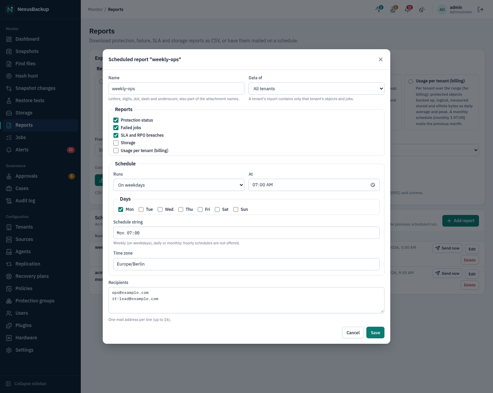

1. Set up the SMTP server first (**Settings → Alert delivery**); reports use the same server and sender address.
   The SMTP server is already in the appliance's outbound allow-list, nothing else needs to be opened.
2. **Reports → Scheduled reports → Add report**:
   - **Name**: letters, digits, `.`, `-`, `_`; it is part of the attachment names (`weekly-ops-failed-2026-10-12.csv`).
   - **Data of**: all tenants, or one tenant (the report then contains only that tenant's objects and jobs; useful for
     a customer's contact).
   - **Reports**: one or more of the four reports.
   - **Schedule**: on weekdays (`Mon 07:00`), daily (`daily 07:00`) or monthly (`monthly 1 06:00`; a month without
     the day sends on its last day), in the chosen **Time zone**. Hourly schedules are not offered.
   - **Recipients**: up to 16 mail addresses.
3. **Save**. The change applies at once and is recorded in the audit log (`settings.reports`).

What is sent: one HTML e-mail with a short summary per report (number of rows, the first 20 rows as a table) and
every report as a CSV attachment (all rows), plus a plain-text part. Each mail covers the time since the previous
scheduled run: a weekly report sent on Monday 07:00 covers Monday 07:00 of the week before up to this Monday 07:00; a
monthly one the previous month. Protection status and Storage show the state at sending time.

- The scheduler queues an appliance job `report_send` when a slot has passed. After downtime it sends once, not once
  per missed slot. A newly added report waits for its first slot.
- **Send now** sends a report immediately, covering one schedule period up to now (one week, one month). It does not
  move the schedule.
- **Last sent** shows the state of the latest send job; the job (on **Jobs**, appliance jobs) holds the log and the
  attachment names.
- A sent report is audited (`report.sent`, with recipients, range and attachment names). If it cannot be sent, the
  appliance raises a `report` warning (see [Alert kinds](#alert-kinds)) that resolves itself after the next successful
  send.
- The mail leaves the appliance unencrypted beyond the SMTP connection's TLS. Send tenant reports only to people who
  may see that tenant's data.

## Metrics (Prometheus)

`GET https://<appliance>:8443/metrics` serves Prometheus metrics. It requires the bearer token from
`/etc/nexus/metrics-token`, created by the first-boot wizard:

```sh
curl --cacert appliance.pem -H "Authorization: Bearer $(cat metrics-token)" https://backup.example.com:8443/metrics
```

Series:

| Metric | Meaning |
|---|---|
| `nexus_jobs{state}` | number of jobs per state |
| `nexus_snapshots{tenant,location}` | snapshots per tenant, `location` = `local` or `offsite` |
| `nexus_last_successful_backup_timestamp_seconds{tenant,group}` | time of the last successful backup of each group (0 = never) |
| `nexus_failed_logins_total` | failed sign-ins |
| `nexus_audit_entries` | number of audit log entries |
| `nexus_quorum_pending` | pending approval requests |

Useful alerting rules in your monitoring system: no successful backup of a group for more than 36 hours (1.5 × a daily RPO), any
pending approvals older than a day, a sudden rise in failed sign-ins, and the appliance not answering `/health`.

`GET /health` (no token) answers `{"ok": true}` while the web API runs.

For more than metrics, use a read-only **API token** ([09 Users and access](09-users-and-access.md#api-tokens)): for
example `GET /api/v1/dashboard` (protection status and RPO per group) or `GET /api/v1/alerts?state=open`.

## Daily checklist for operators

1. Dashboard: **RPO breaches** at 0, **Objects needing attention** empty ("Every object is within its RPO."), no
   new entries under **Failed jobs**.
2. **Alerts**: acknowledge new alerts when someone takes them on; resolve the ones that do not resolve themselves once fixed, with a note.
3. **Jobs**: no job stuck in **Queued** for hours (a long-running job of the same source blocks the next one).
4. **Approvals**: tell the approvers about pending requests (they expire after 72 hours).
