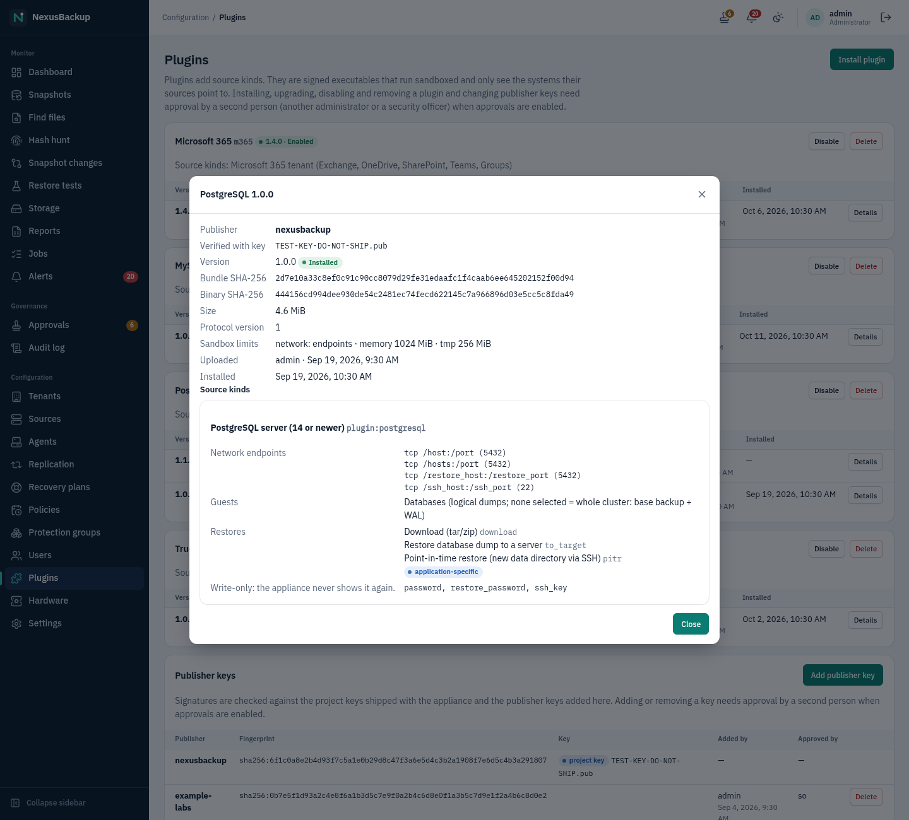
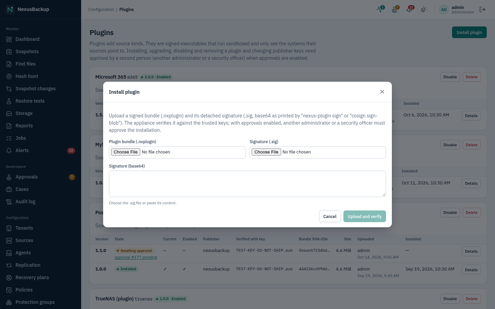

# 12 Plugins

Plugins add new **source kinds** and their restore functions without changing the appliance core. A plugin is a
signed executable. The appliance runs it as an isolated, untrusted process for each job (validate, list guests,
back up, restore). Shipped plugins:

| Plugin | Source kind | What it does |
|---|---|---|
| **PostgreSQL** (`postgresql`) | **PostgreSQL server (14 or newer)** | logical dumps per database; cluster base backup + WAL; restore to a server; point-in-time restore |
| **MySQL / MariaDB** (`mysql`) | **MySQL (8.0 or newer) / MariaDB (10.6 or newer) server** | logical dumps per database (mysqldump/mariadb-dump over SSH or over the connection); server base backup (mariadb-backup / XtraBackup) + binlog; restore to a server; physical and point-in-time restore (see [04 Sources](04-sources.md#mysql-and-mariadb-mysql-80-or-newer-mariadb-106-or-newer-tested-mysql-84-mariadb-118)) |
| **Microsoft 365** (`m365`) | **Microsoft 365 tenant (Exchange, OneDrive, SharePoint, Teams)** | mail, calendars, contacts, OneDrive, SharePoint libraries, Teams files and channel messages; download, restore to the original or another user/site/team (see [04 Sources](04-sources.md#microsoft-365-exchange-onedrive-sharepoint-teams)) |
| **TrueNAS (plugin)** (`truenas`) | **TrueNAS datasets (plugin)** | the TrueNAS connector on the plugin SDK (see [04 Sources](04-sources.md#truenas-as-a-plugin-plugintruenas)) |

The repository also contains `plugins/example-files`, an example for plugin authors. It is not a product
feature.

## How plugins are contained

A plugin never sees tenant keys, the chunk store, the catalog or other tenants. It talks to its source system
with the source's credentials and streams data to the trusted host process `nexus-pluginhost`. The host does
everything security-relevant: chunking, hashing, encryption, deduplication, commit and downloads. It validates
every message of the plugin and stops the plugin on any protocol violation, and then nothing is committed.

The plugin process runs in a sandbox:

- its own SELinux domain
- **Landlock**: read-only access to its install directory and the system libraries, a private size-limited tmp
  directory, and TCP connections only to the ports of the endpoints its source declares (plus DNS)
- a **seccomp** allowlist (no mount, ptrace, namespaces, BPF, …) and `NO_NEW_PRIVS`
- resource limits for memory, tmp space, CPU time and open files

On the appliance's firewall, only the endpoints that the plugin's manifest declares for a configured source are
opened.

> **Status:** `cpu_quota` from the manifest is not enforced in v1. Plugins run as the job user, not a separate
> uid. UDP endpoints are not opened (TCP only).

## The Plugins page

Open **Configuration → Plugins**. Administrators manage plugins. Security officers and operators see the page
read-only ("Read-only: only administrators change plugins."). Tenant users do not see it.


Each plugin has a card listing all its uploaded versions with **State** (**Awaiting approval**,
**Approved, installing**, **Installed**, **Failed**, **Rejected**, **Removing**, **Removed**), **Current**,
**Enabled**, **Publisher**, **Verified with key**, **Bundle SHA-256**, **Size**, **Uploaded** and **Installed**.
**Details** shows the manifest: source kinds, network endpoints, guests, restores, secret (write-only) fields
and sandbox limits.



## Installing or upgrading a plugin

A plugin comes as a bundle `<id>-<version>.nxplugin` and a detached signature `.sig` (base64, as printed by
`nexus-plugin sign` or `cosign sign-blob`).

1. Click **Install plugin**.
2. Choose the **Plugin bundle (.nxplugin)** (at most 128 MiB) and the **Signature (.sig)**, or paste the signature
   into **Signature (base64)**.
3. Click **Upload and verify**.



The appliance checks the bundle before anything is installed:

- the signature against the trusted keys (see below)
- that the key's publisher equals the manifest's `publisher`
- the protocol version
- that the plugin ID does not belong to another publisher
- that the version is strictly newer than every installed or approved version
- that no other plugin already provides the same source kind

On success, the dialog shows **Signature verified** and the request number. Installation is a four-eyes action:
another administrator or a security officer (never the uploader) approves the `plugin.install` request on
**Approvals**. Compare the shown SHA-256, publisher and signing key with what the publisher gave you. After the
approval, the installer verifies the bundle again, unpacks it read-only and makes the new version **current**.

With approvals disabled, the upload is recorded and approved at once. The upload is audited either way. See
[10 Approvals and audit](10-approvals-and-audit.md).

Uploading a newer version of an installed plugin is an upgrade: the dialog shows **Upgrade from** with the
previous version. The new version becomes current after approval, and existing sources keep working with it.

## Rolling back, disabling, removing

- **Make current** (on an older, still installed version) switches the plugin back to that version. Needs
  approval.
- **Disable** stops the plugin: jobs of its sources fail before they start. Needs approval. **Enable** is a direct
  administrator action.
- **Delete** removes all versions. Needs approval. It is refused while sources of the plugin's kinds exist, so
  delete those sources first.

Disabled or removed plugins: their sources cannot be edited (the form shows "The plugin of this source is not
installed or not active; its settings cannot be edited."). Their snapshots can still be browsed and downloaded.
Restore functions that the plugin itself performs (for example a PostgreSQL point-in-time restore) need the
plugin to be installed and enabled.

## Publisher keys

**Publisher keys** lists the keys signatures are checked against:

- **Project keys** (marked **project key**) ship with the appliance image in `/etc/pki/nexus/plugin-keys/`. They
  sign the project's own plugins (publisher `nexusbackup`). They cannot be removed in the UI.
- **Publisher keys** are added here for third-party publishers: **Add publisher key**, enter the **Publisher**
  (the `publisher` name in that publisher's manifests) and the **Public key (PEM, ECDSA P-256)**. Compare the
  fingerprint with the publisher out of band. Adding and removing a publisher key needs approval. Plugins signed
  only with a removed key can no longer be installed.

> **Status:** Lab and development images (and the demo screenshots) trust the key
> `TEST-KEY-DO-NOT-SHIP.pub`. Its private half is in the repository, so anyone can sign with it. A real release
> replaces it with the project's release public key (`release/inject-keys.sh`), and `release/check-trust.sh`
> refuses a release image that still contains the TEST key. The release key ceremony is still open, so treat
> any image that shows the TEST key as **not for production**.

## Using plugin sources

Once a plugin is installed and enabled, its source kinds appear under **Plugins** in **Configuration → Sources →
New source → Source type**. The form is generated from the plugin's schema. See [04 Sources](04-sources.md).
In protection groups you select the plugin's guests, for example databases, with **Load …** (see
[05 Policies and protection groups](05-policies-and-groups.md)). In **Snapshots**, the restores the plugin declares
appear in the snapshot's **Restore** menu. A plugin can limit a restore to guest snapshots (e.g. one database) or to
source snapshots (the whole source, e.g. a PostgreSQL cluster); the menu then offers it only on that kind (manifest
v1.4, `applies_to`). Download is provided by the appliance itself and appears as the plugin's download button instead
of **Browse files**. See [06 Restores](06-restores.md).

Plugin snapshots are named `plugin-<plugin id>-<source id>[-<guest>]`. Retention, offsite copies and replication
treat them like any other snapshot.

## Writing plugins

Plugin authors use the Rust SDK (`crates/plugin-sdk`) and the `nexus-plugin` tool to scaffold, build, pack, sign
and test a plugin in the real sandbox:

```sh
nexus-plugin keygen acme-labs                                   # once: acme-labs.key (keep offline) + acme-labs.pub
nexus-plugin pack manifest.json target/x86_64-unknown-linux-musl/release/my-plugin my-plugin-1.0.0.nxplugin
nexus-plugin sign my-plugin-1.0.0.nxplugin acme-labs.key        # -> my-plugin-1.0.0.nxplugin.sig
```

The complete guide is `docs/plugin-sdk.md`, and the contract is `docs/plugin-system.md`. Restore parameters end
up in the job record, which operators can see, so they must not carry secrets: put secrets into the source
configuration.

> **Status:** A full run of signed plugin bundles on the appliance image (VM lab: install through the UI with
> approval, scheduled backups, restores) is still pending. The plugin platform and both plugins passed their
> automated tests.
