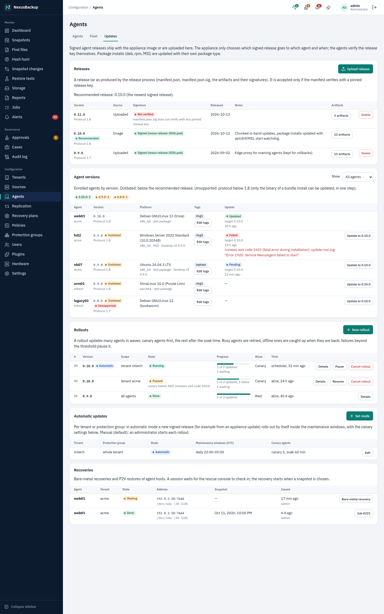
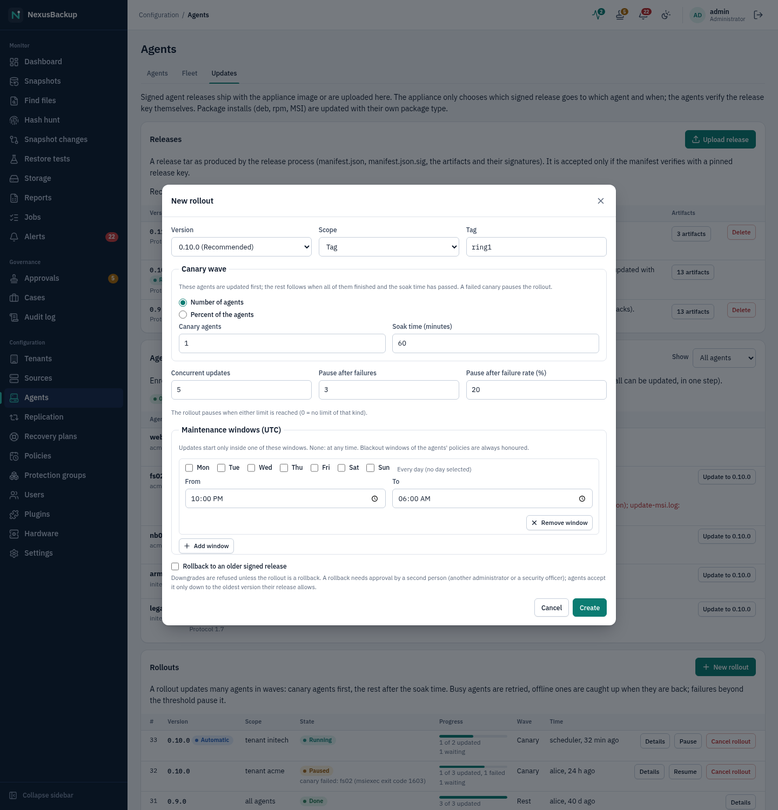
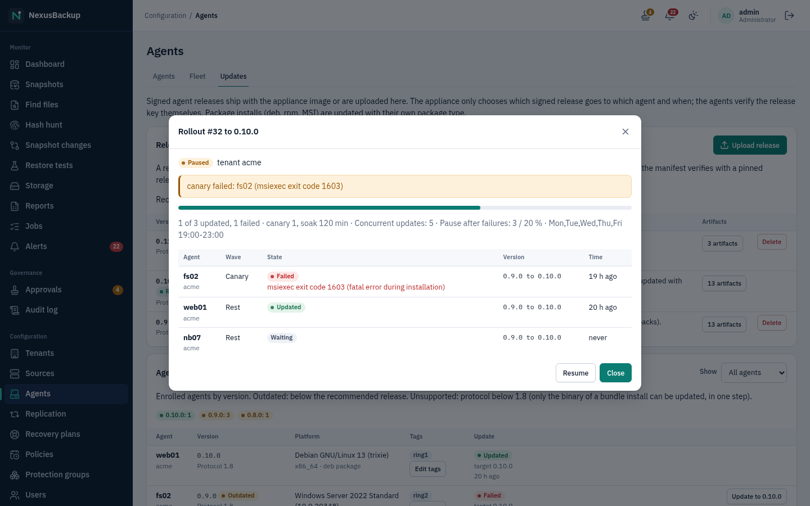

# 13 Updates and rollback

This chapter is for **administrators**. It covers the appliance OS image, the backup agents and plugins.

## How appliance updates work

The appliance is an image-based system (bootc). An update replaces the whole read-only system image; your data in
`/var` and the configuration in `/etc` stay. The appliance keeps the previous image and can boot back into it.

1. The project builds a release image and the release manager **signs** it with an offline cosign key.
2. The appliance checks the release channel (`ghcr.io/undone37/nexusbackup:stable`) once a day.
3. A new image is **downloaded and staged only**. An unplanned reboot or power loss does not apply it; if a staged
   download is lost, the appliance downloads it again on the next check.
4. The staged image is applied (reboot) in the **maintenance window**, by default Sunday 03:00–05:00 UTC, or when an
   administrator requests it (**Install now** under **Settings → Updates**, or on the console).
5. After the reboot a health check runs. If it fails three boots in a row, the appliance **rolls back** to the
   previous image automatically.

The update agent (`nexus-update`) runs every 15 minutes. For the download it opens the firewall for the registry
hosts (`ghcr.io`, `pkg-containers.githubusercontent.com`, TCP 443) and closes it again afterwards.

> **Status:** The **Updates** tab in the web interface (below) shows the status and offers **Check now** and
> **Install now**; it was tested against the demo backend, and its appliance-side part is still being integrated.
> Rollback and the maintenance window are set on the local console as root (see the console-access gap in
> [02 Installation](02-installation.md#known-gaps-after-installation)); without action the appliance applies staged
> updates in the maintenance window on its own. The signing chain, unsigned-image rejection,
> staged-only download, apply on request and automatic rollback were tested in a lab VM with a local registry and
> the TEST key. The maintenance window, the scheduler's "do not reboot while jobs run" signal and the downgrade
> guard are covered by unit tests only. No real release has been published or signed yet. The pre-update checks are
> covered by unit tests; their run on a real appliance (SELinux confinement of the check tool) is not lab-tested yet.

## What the appliance accepts

The appliance accepts an OS image only if it comes from its configured repository **and** carries a valid cosign
signature, made with a pinned project key, over that exact image digest. Unsigned images, images signed with another
key, and images from other registries are rejected. There is no online transparency-log or certificate-authority
check: the key is pinned in the image (`/etc/pki/nexus/cosign/`).

- **No downgrade:** the appliance refuses to apply an image with a lower version than the running one, unless an
  administrator forces it with an explicit `apply`.
- **No retry of a failed update:** an image that was rolled back is remembered and not applied again automatically.
  It waits for a fixed release.

## Updates in the web interface

Open **Configuration → Settings → Updates**. Administrators, security officers and operators see the status; only
administrators see the buttons.


| Line | Meaning |
|---|---|
| status chip | **Up to date**, **Update available**, **Checking…**, **Staged**, **Blocked by checks** (the failed pre-update checks are listed above the box, see below) or **Error** (the error text is shown above the box) |
| **Running version** | the booted image: version, digest and since when it runs |
| **Staged, boots next** | an image that is downloaded and verified and boots at the next reboot; "none" if there is none |
| **Available** | a newer signed image in the channel, or "No newer image available." |
| **Rollback image** | the previous image the appliance can boot back into |
| **Channel** | the release channel, e.g. `stable` |
| **Maintenance window** | when staged updates are applied, e.g. "Sun 03:00, 120 min" (UTC) |
| **Last check** | when the appliance last looked for a new image |

- **Check now** looks for a new image immediately instead of waiting for the next scheduled check. The status shows
  **Checking…** until it is done.
- **Install now** (shown when an update is available and nothing is staged yet) installs the available version now
  instead of waiting for the maintenance window: after you confirm, the appliance stages it and reboots into it. With
  approvals enabled this is an approval request (`update apply`) that another administrator or security officer must
  approve first. The same rules as for `nexus-update apply` below apply: make sure no restore is running.

The web interface does not change the maintenance window and has no rollback button; use the console commands below.

<a id="pre-update-checks"></a>
## Offline update (appliances without internet access)

Appliances that cannot reach the image registry are updated from a file. Every release has an **update bundle**
`nexusbackup-<version>-update.tar` (about 2 GB): the image and its signature, the same signature the appliance checks
online.

1. Download the bundle on a machine with internet access and bring it to a computer that can open the appliance's
   web interface.
2. **Settings → Updates → Offline update**: choose the file and click **Upload and verify**. The upload takes a few
   minutes; the appliance then checks the bundle. Nothing is installed yet.
3. The card shows the result: **Verified 0.2.0 (signed with nexus-release-2026-alpha.pub)**, and the image appears
   as **Staged** and **Available**. Install it with **Install now** (with approvals enabled, a second person approves)
   or let the maintenance window install it. The appliance reboots into it; a failed health check rolls back as with
   any update.

The appliance refuses a bundle, and installs nothing, when:
- its signature does not verify with a pinned release key, or it was signed for another image or repository;
- a file was changed or the upload was cut off (checksums);
- it is the running version, an older version, or a version that was rolled back before.

The reason is shown on the card ("The last uploaded bundle was refused: ..."). After an offline update the appliance
stops checking the registry by itself; **Check now** checks online again (needed only when the appliance gets
internet access).

> **Status:** Implemented in Phase 36 (unit tests for the checks, upload API test). Lab: see state.md. Not yet: a
> bundle larger than GitHub's 2 GiB asset limit (parts), `nexusctl update upload` and a USB stick at the console.

## Private image repository

The release images on `ghcr.io` are public: no credential is needed. For a private image repository (a mirror of
your own, or the 0.x test releases before 2026-10-21), the appliance needs a read-only pull credential to download
updates. Under **Settings → Updates → Registry credential** an administrator enters a user
name and a token; for GitHub (`ghcr.io`) that is a personal access token with only the `read:packages` scope. The
token is write-only: the page shows only the user name afterwards.

The appliance writes the credential into the update control directory (mode 0600). `nexus-update` turns it into
bootc's login file `/run/ostree/auth.json` (memory only) just for the download and deletes that file afterwards;
signature verification is unchanged. **Remove** deletes the credential. Both actions are audited
(`update.registry_auth`, `update.registry_auth_removed`).

## Pre-update checks

Before the appliance downloads an update, and again before it reboots into one, it runs the self-checks of
**Settings → Diagnostics** ([15 Troubleshooting](15-troubleshooting-faq.md#diagnostics-and-support-bundles)): disk
space, time synchronisation, firewall, key daemon, web certificate, audit log, catalog, SELinux, failed services and
the OS image. If a check of severity **error** or **critical** fails, the update is **not** downloaded or installed:

- **Settings → Updates** shows **Blocked by checks** and lists the failed checks, each linked to its entry in chapter 15;
- `nexus-update status` shows the result `refused: pre-update checks failed: …`;
- warnings (for example a certificate that expires within 30 days) do not stop an update.

Fix the causes, then click **Check now** (or wait for the next daily check). Rolling back is never blocked. If the
check tool itself cannot run, the update goes ahead, so that a broken check cannot block the update that fixes it.

## Check the update status on the console

On the local console, as root:

```sh
nexus-update status
```

It shows the booted, staged and rollback images (digest, version, signature mode), the channel, the maintenance
window, whether jobs currently postpone an update, the last check and its result, and any digests that failed.

## Update now

```sh
nexus-update stage     # check for a new image and download it now (not applied)
nexus-update apply     # reboot into the staged image now (ignores the window)
```

Both run the pre-update checks first and stop with `pre-update checks failed: …` if one fails. Only if support asks
you to: `NEXUS_UPDATE_DIAG=off nexus-update apply` skips them.

`apply` also applies an older version or a previously rolled-back image. Use it deliberately.

Before you apply: make sure no restore is running, and note the time. The web UI is unavailable while the appliance
reboots; scheduled jobs that were due during the reboot run once afterwards.

## Change the maintenance window

The default window is in `/etc/nexus/update.conf` (`NEXUS_UPDATE_WINDOW=Sun 03:00 120`, UTC, duration in minutes).
It can be overridden by writing one line into `/var/lib/nexus/update/window`:

```sh
echo "Sat 02:00 180" > /var/lib/nexus/update/window   # Saturdays 02:00–05:00 UTC
echo "daily 04:00 60" > /var/lib/nexus/update/window  # every day
echo off > /var/lib/nexus/update/window                # never apply automatically, only on "apply"
```

An invalid line falls back to the default window (and is logged).

## Roll back

**Settings → Updates** shows the **Rollback image**, i.e. the image a rollback boots into. Automatic rollback happens when the health check fails after an update. The check (`nexus-health`, run by greenboot)
requires:

- enough free disk space on `/var/lib/nexus`, `/var` and `/boot`;
- the services key service, web API and scheduler running;
- the web API answering `https://127.0.0.1:8443/health`;
- the catalog passing an integrity check and a full verification of the audit hash chain.

To go back manually to the previous image:

```sh
nexus-update rollback    # bootc rollback + reboot
```

Look at the health check log if an update was rolled back:

```sh
journalctl -u greenboot-healthcheck
```

> **Note:** If the health check fails for a reason an update cannot fix (full disk, damaged catalog), the appliance
> reboots up to three times and then rolls back, and the old image stays red as well. Fix the cause, then check the
> log above.

Releases keep the catalog backward compatible for one release, so a rollback to the previous image can still open it.
Do not skip back more than one release.

## Agent updates

The appliance updates Linux and Windows agents in-band, over the same mutually authenticated connection it uses for
backups. It can only choose **which signed release** goes to **which agent** and **when**: every agent checks the
release signature against the release keys pinned on the host and refuses anything else.

### Where agent releases come from

- **With the appliance image.** Each appliance update brings the agent release that belongs to it. No internet access
  is needed, and air-gapped sites get agent updates together with the appliance.
- **Signed upload.** An administrator uploads a release (the `.tar` from the release page) under
  **Agents → Updates → Upload release**. The appliance accepts it only if its manifest verifies with a pinned release
  key. Uploaded releases can be deleted again; releases from the image cannot.

**Agents → Updates** lists the releases with their signature state, notes and artifacts (bundle binaries, `.deb` and
`.rpm` packages per architecture, the Windows MSI and the desktop UI packages). The newest signed release is the
**recommended** one. A release that does not verify is shown as **Not verified** with the reason and is never sent.



### How each install type is updated

| Install type | How the update is installed |
|---|---|
| Bundle (`install.sh`) and manual Windows install | The binary is replaced (the old one is kept as `.prev`) and the agent restarts. A start watchdog swaps `.prev` back if the new binary does not start listening. |
| `.deb` package | `apt-get install` of the signed package (and of the desktop UI package, if installed), run as a separate systemd unit so it survives the agent's own restart. |
| `.rpm` package | `dnf install` (rollback: `dnf downgrade`) the same way. |
| MSI | `msiexec` installs the signed MSI (major upgrade) detached from the service; the MSI carries the desktop UI as well. |

The host keeps the last word: `self_update = off` in `agent.conf` refuses every update. The default (`auto`) allows
updates with the package type the agent was installed with; a package is never replaced by a binary swap. The
agent records the result in its update state, and the appliance shows it in the **Update** column (Pending, Sending,
Installing, Updated, Failed, Rolled back) with the error, for example the `msiexec` exit code.

The **Agent versions** section groups enrolled agents by version and shows platform, architecture, install type,
desktop UI version and tags. **Show: Outdated** lists agents below the recommended release, **Show: Unsupported**
agents with protocol below 1.8 (agents of releases before this feature; only their bundle binary can be updated, once,
after which they speak 1.8). **Update to …** updates a single agent at once. **Edit tags** sets tags such as
`ring1`, which rollouts can target.

### Rollouts

A rollout updates many agents to one release, in waves:

1. **New rollout**: choose the version and the scope: all agents, a tenant, a protection group, an operating system,
   a tag or selected agents.
2. **Canary wave**: a number or a percentage of the agents is updated first. The rest follows when all canaries have
   finished and the **soak time** has passed. A failed canary pauses the rollout.
3. **Concurrent updates** limits how many agents update at the same time.
4. **Pause after failures** / **failure rate**: the rollout pauses when either limit is reached
   (alert `rollout_paused`).
5. **Maintenance windows** (UTC, optional): updates start only inside one of them. Blackout windows of the agents'
   policies are always honoured.



The appliance never interrupts a backup: an agent with a running job is retried later. Agents that are offline
(laptops, agents behind an edge proxy) are updated when they are reachable again. After an update the appliance
waits up to 10 minutes for the agent to come back with the new version; otherwise the update counts as failed
(alert `agent_update_failed`, resolved by the next successful update of that agent).

**Details** shows every agent of a rollout with its wave, state, error and job. **Pause**, **Resume** and **Cancel
rollout** control it; updates that already run finish. All actions are recorded in the audit log
(`agent.rollout.*`).



### Automatic updates

Under **Automatic updates**, set a tenant (or one of its protection groups) to **Automatic**: when a new signed
release arrives (for example with an appliance update), the appliance starts a rollout for the outdated agents of
that scope by itself, inside the maintenance windows and with the canary settings given there. The default is
**Manual**: an administrator starts every rollout.

### Rollback

Agents refuse older versions. To go back to an older signed release, start a rollout with **Rollback to an older
signed release**. It needs approval by a second person (another administrator or a security officer, action
`agent.rollback`) and starts only once approved. Agents accept a rollback only down to the oldest version their own
release allows.

### Installer downloads

The enrollment token dialog of a new agent lists the signed installers of the recommended release (packages per
architecture, MSI, install bundle, desktop UI) with their SHA-256 checksums. **Download** fetches the file from the
appliance with a one-time download link (accounts with the download right). Compare the checksum on the host
(`sha256sum`, `Get-FileHash`).

Only administrators upload releases, start rollouts and change the automatic mode. Security officers, operators and
viewers can look at the Updates tab.

> **Lab status:** package and MSI updates through the appliance need the Linux and Windows lab runs (see
> [16 Linux agent](16-linux-agent.md) and [17 Windows agent](17-windows-agent.md)).

## Plugin upgrades

Plugins are updated by uploading a newer signed bundle on the **Plugins** page. The upgrade waits for approval (when
approvals are enabled), and older installed versions stay available, so you can switch back with **Make current**.
See [12 Plugins](12-plugins.md).

## Proxmox VE node plugin

The NexusBackup storage plugin on your Proxmox VE nodes is a Debian package (`nexusbackup-pve_<version>_all.deb`,
built by `pve-plugin/build-deb.sh`). The appliance does not update it. Install a new version on **every** node of the
cluster the same way as the first one (see [04 Sources](04-sources.md)), for example
`apt install ./nexusbackup-pve_<version>_all.deb`.
