# 14 Disaster recovery

This chapter is for **administrators** and **security officers**. It explains what you need when the appliance is
lost (hardware failure, fire, ransomware on the management network) and how the backups are recovered.

> **Status:** A tenant's offsite copy can be attached to a running appliance in the web UI
> ([Attach an offsite copy in the web UI](#attach-an-offsite-copy-in-the-web-ui)); the console procedure stays as the
> fallback. Both are proven in integration tests and lab drills only (a fresh store, an SFTP test box and MinIO with
> Object Lock); neither has been run on real hardware or against a real Hetzner Storage Box. The appliance
> configuration comes back from the daily [configuration backup](#the-configuration-backup)
> ([New appliance from a configuration backup](#new-appliance-from-a-configuration-backup)). Practise it before you
> depend on it.

## What protects you

| Scenario | What you need | Where the data comes from |
|---|---|---|
| Appliance lost, tenant has an offsite target | recovery key + offsite credentials (SFTP key or S3 access key) + new hardware | Storage Box or S3 bucket ([07 Offsite](07-offsite.md)) |
| Appliance lost: same configuration, users, agents and peers on new hardware | recovery key + the access data of one offsite target (or a downloaded configuration backup) | [New appliance from a configuration backup](#new-appliance-from-a-configuration-backup) (below) |
| A customer (tenant) rebuilds its own data elsewhere, without the appliance recovery key | that tenant's **tenant recovery key** + its offsite credentials + an appliance set up with the image | the tenant's offsite target ([Recover one tenant with its tenant recovery key](#recover-one-tenant-with-its-tenant-recovery-key)) |
| Appliance lost, tenant is replicated | the secondary appliance (it has its own keys) | the secondary's local store ([08 Replication](08-replication.md)) |
| Single snapshot damaged locally | nothing extra | `verify` finds it; restore an older snapshot, or fetch it from offsite (below) |
| The only administrator lost the authenticator or password | recovery key + local console | [Break-glass](#break-glass-the-only-administrator-lost-their-authenticator) (below) |
| A root shell is needed on the appliance (repairs, rollback, the break-glass reset) | a one-time code approved by a second person, or the recovery key + local console | [Emergency root shell on the console](#emergency-root-shell-on-the-console) (below) |
| Ransomware or another incident hit a protected system; evidence must be kept | a security officer | [Incident: hold the good snapshots first](#incident-hold-the-good-snapshots-first) (below) |

### The recovery key

During first boot the key service creates the appliance master key (KEK) and shows the **recovery key** once
(16 groups of 4 hex digits, see [02 Installation](02-installation.md#step-4-key-service-and-recovery-key)).

- Every tenant's data key (DEK) is wrapped with the KEK. The KEK itself is also stored wrapped with the recovery key
  (`kek.recovery`).
- Before every offsite run the appliance writes the **key escrow** to the offsite target, below `keys/`:
  `keys/kek.recovery` and `keys/tenants/<tenant>/dek.<version>`. These files are useless without the recovery key.
  On S3 with Object Lock the escrow objects are locked at least as long as the longest-locked snapshot.
- The offsite copy is therefore **self-describing**: packs, indexes, manifests and wrapped keys. With the recovery key
  and the storage credentials it can be read without the original appliance.

Keep the recovery key offline and separate from the offsite credentials (see
[02 Installation](02-installation.md#store-the-recovery-key)). A replicated secondary has its **own** recovery key:
store that one too.

### Boot menu password

The boot menu (GRUB) boots the appliance without any input. Changing a boot entry (key `e`) or opening the GRUB
command line (key `c`) asks for a user and a password, so nobody at the console can start the appliance with a
changed kernel command line (for example a root shell instead of the system). The emergency and rescue modes of the
system do not offer a shell either.

- **User:** `root`. **Password:** 20 lower-case letters, derived from the recovery key. There is nothing else to
  store: whoever holds the recovery key can compute it.
- On the appliance (root shell on the console) or on any Linux machine with the `nexus-setup` program:

  ```sh
  nexus-setup grub-password        # asks for the recovery key, prints: Password: xxxxx xxxxx xxxxx xxxxx
  ```

  Type it at the GRUB prompt without the spaces. GRUB uses the US keyboard layout; the letters were chosen so that
  they are on the same keys on US, German and French keyboards (no a, m, q, w, y, z).
- Without `nexus-setup`, Python 3 computes the same password (replace the key):

  ```sh
  python3 -c 'import hmac,hashlib,sys; k=bytes.fromhex("".join(c for c in sys.argv[1] if c not in "- ")); n=int.from_bytes(hmac.new(k,b"nexus-grub-password-v1",hashlib.sha256).digest()[:16],"big"); print("".join("bcdefghijklnoprstuvx"[n//20**i%20] for i in range(20)))' 'ABCD-1234-…'
  ```

- Appliances set up before this version have no boot menu password yet. Set it once from a root shell on the console:
  `nexus-setup grub-password --install` (asks for the recovery key, checks it, audited as `setup.grub_password`).
- The password does not protect the firmware: set a BIOS/UEFI password and disable booting from other media
  ([02 Installation](02-installation.md#store-the-recovery-key)).

> **Status:** Implemented in Phase 18 (unit tests; the image build checks the GRUB configuration, the masked rescue
> mode and the kernel arguments). The appliance VM test `lab/appliance/grub-lock.sh` drives the GRUB menu over the
> serial console; it has not been used on real hardware yet.

### The tenant recovery key (optional)

The appliance recovery key opens **every** tenant. A managed service provider usually cannot hand it to one
customer. For that case a tenant can get its own **tenant recovery key**: it opens only that tenant's data keys
in its offsite copy, never other tenants' and never the appliance's key.

1. On **Tenants**, click **Recovery key** in the tenant's row. The dialog shows whether the tenant has a key (with
   its **Key ID** and since when) and the recent requests.
2. **Generate tenant recovery key** (or **Replace tenant recovery key**). An administrator requests it; while
   approvals are enabled, a second person (another administrator or a security officer) approves it on
   **Approvals** ([10 Approvals and audit](10-approvals-and-audit.md)).
3. After the approval, the requester opens the dialog again and clicks **Show key once** within 24 hours. The key
   (16 groups of 4 hex digits, like the appliance recovery key) is generated at this moment and shown **once**. The
   appliance keeps only its public part: nobody can display it again. Hand it to the customer through a safe channel
   and store it apart from the appliance recovery key.

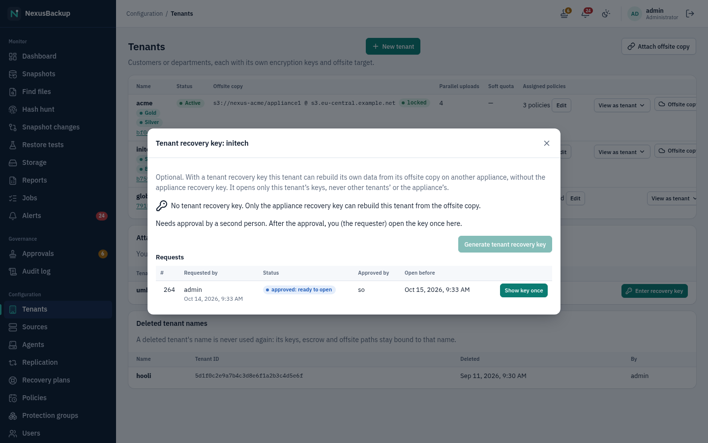

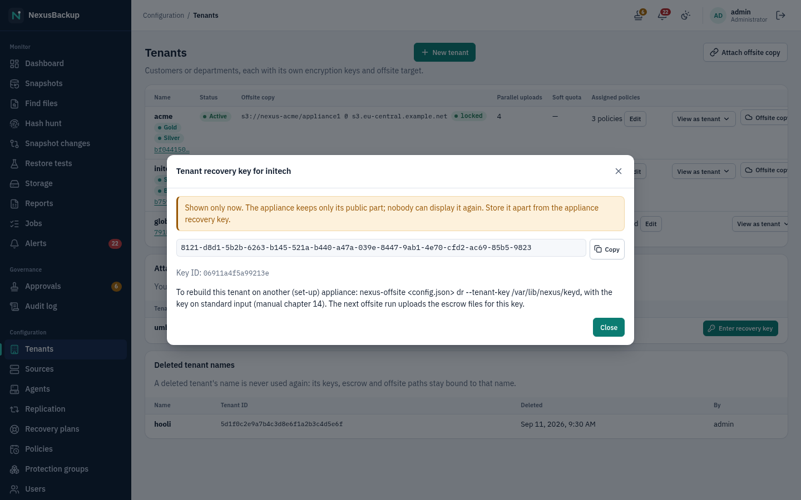

- Before the next offsite run the key service seals all of the tenant's data keys to the new key; the run uploads
  them to `keys/tenants/<tenant>/tenant-escrow.*`. Data keys created later (key rotation) are sealed automatically,
  without the key. A tenant without an offsite target gets nothing offsite.
- **Replacing** needs an approval again. The old key no longer receives new data keys, and the next offsite run
  removes its files from the target (on S3 with Object Lock the old objects stay until their lock ends).
- Who holds the key and the tenant's offsite credentials can read that tenant's offsite copy. Treat it like the
  recovery key, for one tenant.

## Incident: hold the good snapshots first

When a source was encrypted or tampered with, or a legal case needs its backups, keep the snapshots before anything
else can remove them. Retention keeps running during the investigation and would otherwise prune the last good
restore points on schedule.

1. **Security officer:** on **Alerts**, **Hold last good snapshot** on the `anomaly` alert, or on **Snapshots**
   **Hold a time range…** for the affected tenant (and guest) from well before the incident until now. Give the case
   or ticket number as the reason. The holds apply at once ([06 Restores](06-restores.md#legal-hold)).
2. If the tenant is replicated, the secondary shows the holds as advice: its security officer applies them there too
   ([08 Replication](08-replication.md#legal-holds-from-the-primary)).
3. Restore from a held snapshot as usual ([06 Restores](06-restores.md)); check the audit log for what happened.
4. When the case is closed, request **Release hold** for each snapshot; a second approver confirms it. Retention then
   prunes them on its normal schedule.

### Incident mode

For a suspected attack on the appliance itself or on the sources it protects (ransomware, a stolen administrator
account), a **security officer** can do all of the containment in one step: **Configuration → Settings → Incident
mode**.

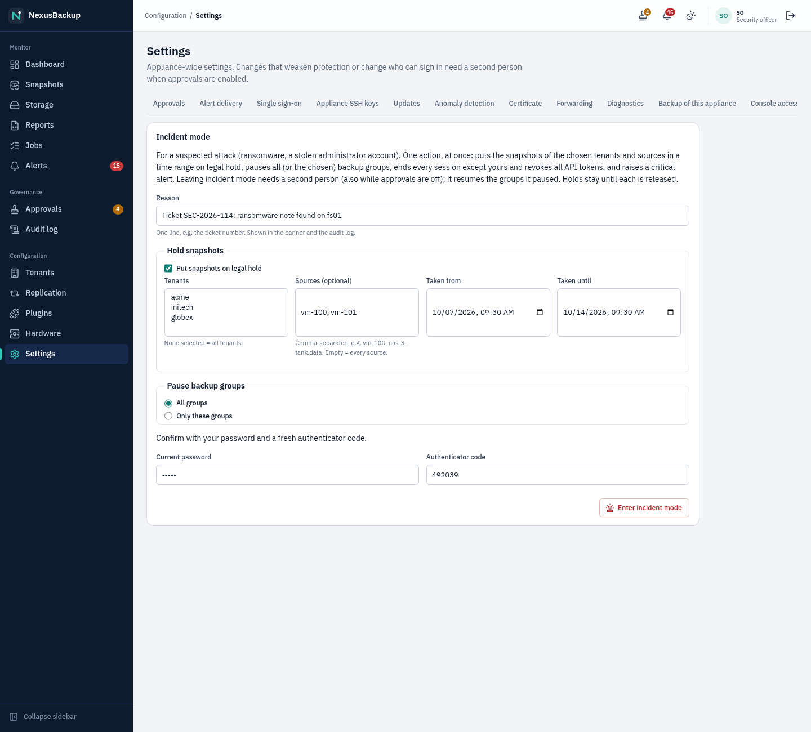

1. Enter a **Reason** (the ticket number; it appears in the banner and the audit log).
2. **Hold snapshots:** the tenants (none selected = all tenants), optionally sources (comma-separated; empty = all)
   and the time range whose snapshots are put on legal hold, as with **Hold a time range…** above.
3. **Pause backup groups:** all groups, or only the chosen ones. They are paused indefinitely, so a source that is
   being encrypted does not push more changed data into the store (and retention does not start counting the new,
   bad snapshots as "the last seven").
4. Confirm with your password and a fresh authenticator code, then **Enter incident mode**.

At once, in one step: the holds are set, the groups are paused, **every session except yours ends and every API token
is revoked** (whoever used a stolen session or token is locked out; colleagues sign in again), and the critical
alert `incident` is raised. Every appliance-wide account sees a red banner, and the dashboard shows the incident.
While incident mode is active no group can be resumed. Everything is audited (`incident.enter` lists what was held
and paused).

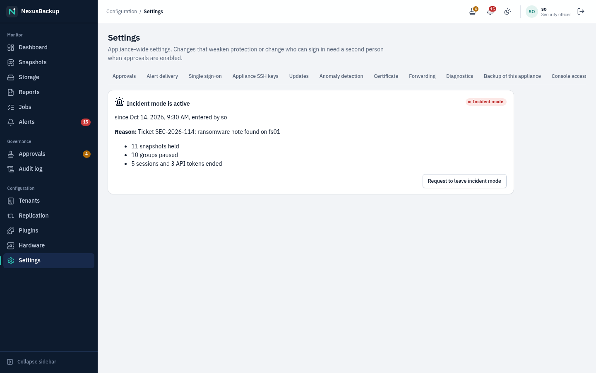

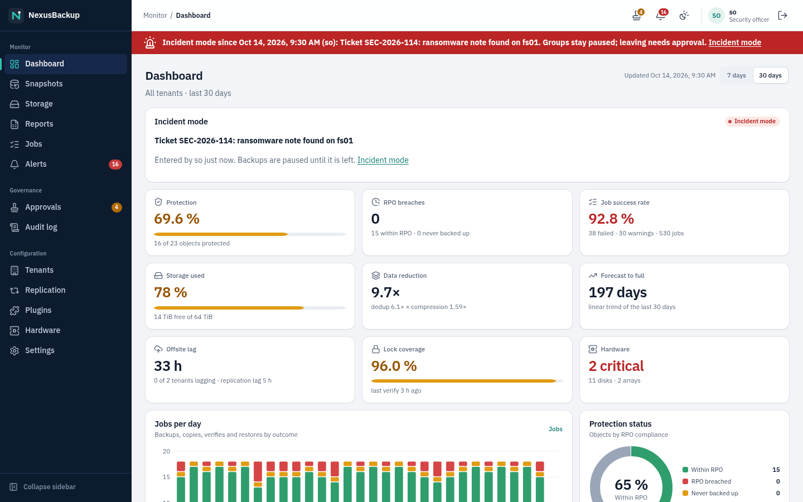

**Leaving** needs a second person, also when approvals are switched off: a security officer or an administrator
clicks **Request to leave incident mode**, and *another* administrator or security officer approves it on
**Approvals** (`incident.leave`). Approving resumes the groups the incident paused (a group that was paused until a
date before the incident gets that pause back), resolves the alert and removes the banner. The **holds stay**: release
each one when the case is closed (step 4 above). Revoked API tokens do not come back; create new ones.

Before you leave incident mode: restore and check the affected systems from held snapshots, change the passwords of
accounts that may be compromised, and review the audit log of the incident period.

> **Status:** Implemented in Phase 21b and tested in the API (`crates/web-api/tests/incident.rs`) and the demo
> backend; a run on the appliance image (lab) is pending.

## Attach an offsite copy in the web UI

Use this on a new appliance that went through first boot normally (it has its own recovery key). You need:

- the **original tenant name** (exactly as on the lost appliance);
- the **offsite target** settings: for a Storage Box host, port, user, base directory and the **pinned host key**
  (from your records, not from the network), plus an SSH key file on the new appliance that the box accepts (add
  its public key to the box, see [07 Offsite copies](07-offsite.md#hetzner-storage-box-sftp)); for S3 endpoint,
  region, bucket, prefix, access key and secret key;
- the **recovery key of the lost appliance** (not the new one's);
- a second administrator or security officer to approve.

Steps:

1. **Configuration → Tenants → Attach offsite copy** (administrator or security officer). Enter the original name and
   the target as for a new tenant, then **Attach offsite copy**. The request goes to **Approvals**; it does not contain
   the recovery key.

   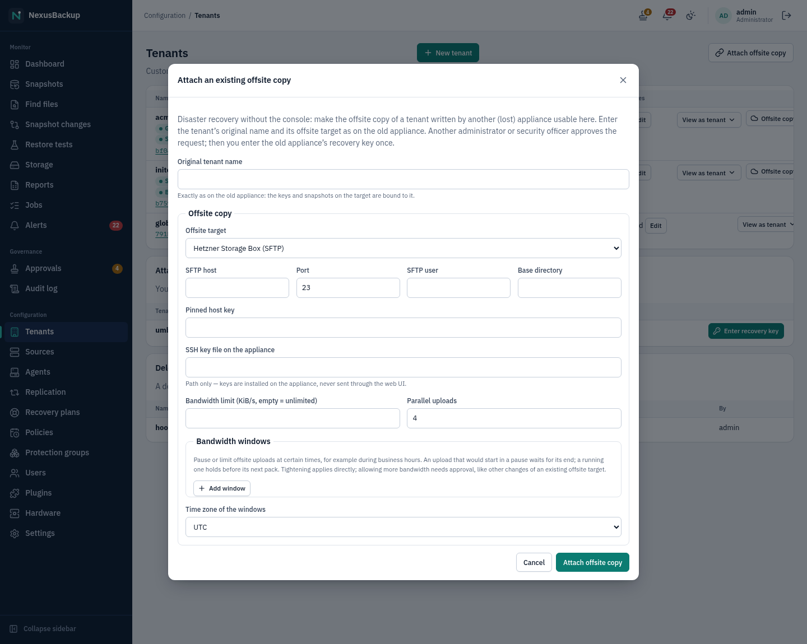

2. A **different** administrator or security officer approves it. From now on the appliance may reach the target
   (outbound firewall), for 72 hours.
3. Back on **Tenants**, under **Attach requests**, the requester clicks **Enter recovery key**, types the lost
   appliance's recovery key and clicks **Attach now**. Only the requester sees this button, and only within 72 hours
   of the approval.

   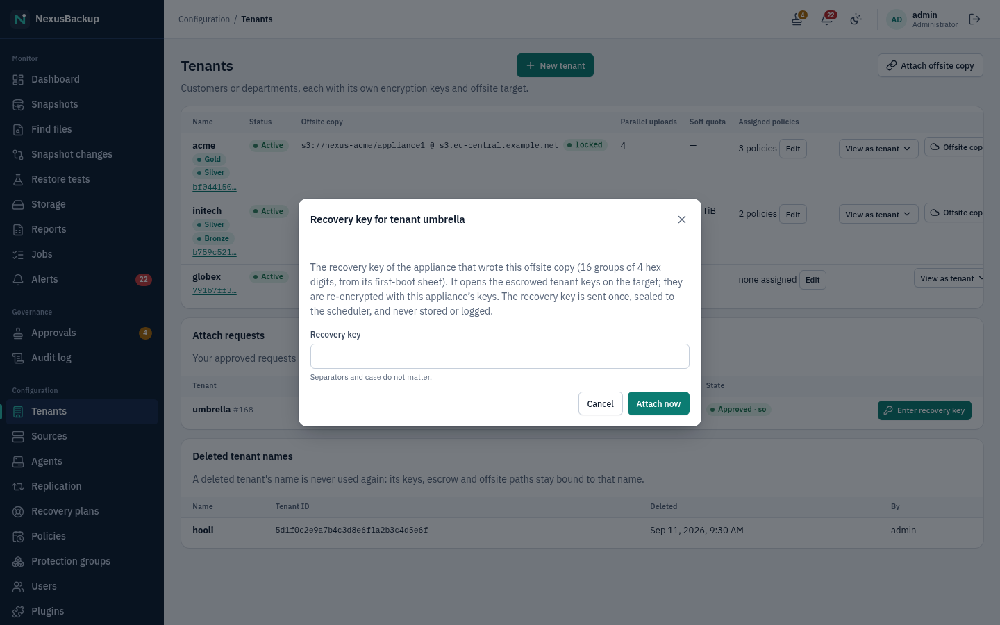

4. An **Attach offsite copy** job runs. It fetches the escrowed tenant keys from the target, opens them with the
   recovery key and stores them encrypted with this appliance's own keys, then indexes every pack and snapshot on the
   target. When it has finished, the tenant exists with this offsite target and its snapshots appear on
   **Snapshots** as **offsite only**.
5. **Fetch from offsite** the snapshots you need and restore them as usual
   ([06 Restores](06-restores.md#restore-from-the-offsite-copy)). Restore the newest snapshot of each guest first.
6. Configure the sources, policies and protection groups again ([04 Sources](04-sources.md),
   [05 Policies and protection groups](05-policies-and-groups.md)). New backups go into the same store and the same
   offsite target.

The recovery key is sent once, sealed so that only the scheduler can open it, and handed to the key service; it is
never stored, logged or shown in the audit log. A wrong key fails the job: enter it again (the approval stays valid
for 72 hours). Every step is audited (`tenant.attach_offsite` …).

**Keep the old recovery key.** The offsite target keeps the lost appliance's key escrow, so the old recovery key stays
the key for this tenant's offsite copy (also for a later disaster). Do not rotate the attached tenant's keys.

> **Status:** Tested in integration tests (two key services, a local target; the scheduler and API flow with a fake
> offsite tool) and as a lab procedure on a second appliance VM; not yet against a real Storage Box or S3 provider.

## Recover a tenant from the offsite copy (console)

The fallback when the web UI cannot be used. Run these steps on the local console of the new machine, as root, with
the appliance image installed. One run recovers **one tenant** (each tenant has its own offsite target).

1. **Prepare an empty key directory and store.** The DR command imports the escrow into a key directory that does
   not have a different `kek.recovery` yet. It refuses to overwrite the keys of an appliance that already ran its own
   key initialization.
2. **Write a job configuration** for `nexus-offsite` (the same format the scheduler generates). Example for a
   Storage Box:

   ```json
   {
     "store": "/var/lib/nexus/chunkstore/initech",
     "tenant": "initech",
     "keyd_socket": "/run/nexus-keyd/keyd.sock",
     "escrow_dir": "/var/lib/nexus/escrow/initech",
     "state": "/var/lib/nexus/offsite/initech",
     "remote": {
       "type": "sftp",
       "host": "u123456.storagebox.example.net",
       "port": 23,
       "user": "u123456",
       "key_file": "/root/dr/initech.key",
       "host_key": "ssh-ed25519 AAAA…",
       "base_dir": "nexus"
     }
   }
   ```

   For S3 use `"type": "s3"` with `endpoint`, `region`, `bucket`, `prefix`, `access_key`, `secret_key_file` (a file
   containing the secret key), and `"lock": true` if the bucket uses Object Lock. You need the **pinned SSH host key**
   of the Storage Box; take it from your records, not from the network.
3. **Recover the keys and rebuild the offsite inventory.** The recovery key is read from standard input:

   ```sh
   /usr/libexec/nexus/nexus-offsite /root/dr/initech.json dr /var/lib/nexus/keyd
   ```

   This copies the escrow files from the target, re-seals the KEK on this machine with the recovery key, opens the
   tenant store and indexes every pack and snapshot on the target. On S3 the retention locks are read back from the
   objects, so lock extensions survive. Output: `DR: keys recovered, <n> packs and <m> snapshots indexed`. A wrong
   recovery key or a wrong tenant key is refused.
4. **Start the key service** on the recovered key directory, so the other commands can get the tenant keys:

   ```sh
   /usr/libexec/nexus/keyd serve /var/lib/nexus/keyd /run/nexus-keyd/keyd.sock nexus-chunkstore
   ```
5. **List and restore snapshots** from the target into the local store:

   ```sh
   /usr/libexec/nexus/nexus-offsite /root/dr/initech.json list
   /usr/libexec/nexus/nexus-offsite /root/dr/initech.json restore vm-100 1791939600
   ```

   `restore <source> <time>` copies one snapshot (its manifest, indexes and all chunks it needs) into the local store.
   Every chunk is verified (authenticated decryption and keyed hash) before it is written. Restore the newest snapshot
   of each guest first.
6. **Bring the data back to the sources.** Once the snapshots are in the local store of a configured tenant, use the
   normal restores ([06 Restores](06-restores.md)): full VM restore to a Proxmox VE node, file downloads, restore to
   path.

> **Status:** Steps 1–5 are the tested drill (`nexus-offsite … dr`, then `restore`, then a VM disk compared with the
> original). Step 6 requires the tenant, sources and the scheduler to be configured on the new appliance with the
> recovered key directory. How the first-boot wizard and the recovered keys fit together is **not implemented as a
> guided procedure** and has not been tested end to end. The lab drills ran the commands as a developer, not from a
> root console of an installed appliance under SELinux enforcing; the policy restricts access to key files to the
> key service and the setup wizard, so these commands may need adjustments there. If you face a real disaster, contact the project before you
> run first boot on the replacement hardware.

## Recover one tenant with its tenant recovery key

For a tenant that has a [tenant recovery key](#the-tenant-recovery-key-optional). It runs on **another appliance
that has been set up** (first boot done, so its key service has its own master key), for example the customer's own
appliance. The appliance recovery key of the original appliance is not needed, and nothing of other tenants is
unlocked.

1. Do **not** create the tenant on the new appliance yet: the scheduler would give it a new data key, and the import
   below refuses a tenant that already has different keys.
2. Write the job configuration as in [Recover a tenant from the offsite copy](#recover-a-tenant-from-the-offsite-copy-console),
   step 2.
3. Recover the tenant's keys with the tenant recovery key (read from standard input, never typed on the command line):

   ```sh
   /usr/libexec/nexus/nexus-offsite /root/dr/initech.json dr --tenant-key /var/lib/nexus/keyd
   ```

   This reads only `keys/tenants/<tenant>/tenant-escrow.*` from the target, opens the files of this key, checks
   that they belong to this tenant, stores the data keys under this appliance's own master key and indexes every
   pack and snapshot. Output: `DR: keys recovered with the tenant recovery key, <n> packs and <m> snapshots
   indexed`. A wrong key, another tenant's name, or a tenant that already has different keys here is refused.
   The command runs as root: hand the new key files to the key service afterwards with
   `chown -R nexus-keyd:nexus-keyd /var/lib/nexus/keyd/tenants/initech && restorecon -R /var/lib/nexus/keyd`.
4. Create the tenant with the **same name** (**Tenants → New tenant**); it uses the imported keys. Continue with
   steps 5 and 6 above (list, restore, bring the data back).
5. Give the tenant a **new** offsite target (or another prefix) on the new appliance. The old target's key escrow
   belongs to the old appliance; do not upload into it from the new one.

> **Status:** The tenant-level DR is tested against a local directory target (key import, other tenants refused,
> the appliance escrow untouched, a restored disk compared with the original) and the key rotation and replacement
> in unit tests. It has not been run on an installed appliance, from the web UI, or against a real Storage Box or
> S3 provider. There is no **Tenants → Attach** flow for it in the web UI yet.

## Recover from a replicated secondary

If the lost appliance replicated a tenant to a second appliance, the data is already there:

1. Sign in to the **secondary** appliance. Its snapshots of the tenant are marked **Replicated from <primary>** on the
   **Snapshots** page.
2. Restore as usual: file browsing and downloads work with the secondary's keys only. For full VM restores, add the
   DR site's Proxmox VE cluster as a source of the replicated tenant (a replicated tenant accepts sources as restore
   targets, but no protection groups or agents).

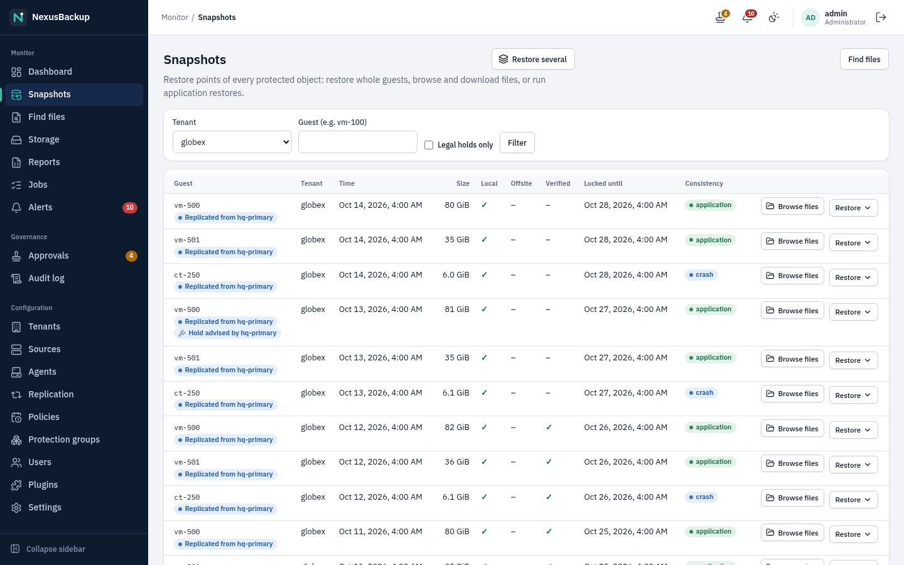

If the secondary runs in **vault mode** ([08 Replication](08-replication.md#vault-mode-secondary-only)), every
restore and download is a request that a second person approves first: plan for two people (an administrator or
operator who requests, an administrator or security officer who approves). Vault mode stays on during the recovery;
switching it off needs the recovery key at the console (`nexus-setup vault-disable`) and is not needed for restores.

The secondary keeps its own retention and never deletes because the primary deleted. It cannot be "promoted" to a
primary: replicated tenants take no new backups on the secondary. To protect the sources again, set up a primary
(the repaired or a new appliance) and configure the tenant there.

> **Status:** Restore on a secondary with the primary powered off was tested in the two-appliance lab (file download
> from a replicated VM snapshot). A full VM restore on the secondary was not part of that test.

## Emergency root shell on the console

The appliance has no root password and no SSH server. Tasks that need root (the network change, update rollback, SSH
key files, the offsite recovery above, the break-glass reset below) are done on the **local console**: the physical
screen and keyboard, or the hypervisor's console of a virtual appliance. **tty2** (press **Alt+F2**; in a graphical
VM console **Ctrl+Alt+F2**) shows the console gate instead of a login prompt:

```
NexusBackup appliance: emergency console
...
Unlock code or recovery key:
```

It accepts one of two things.

**A one-time code (normal case).**

1. An administrator opens **Configuration → Settings → Console access**, chooses the **Shell duration** (1 to
   8 hours), enters a **Reason** and clicks **Request**.
2. With approvals enabled, another administrator or a security officer approves the request `console unlock` on the
   **Approvals** page ([10 Approvals and audit](10-approvals-and-audit.md)). With approvals disabled the request is
   approved at once (still audited and alerted).
3. The requester clicks **Show code** and confirms. The code (4 groups of 5 characters, for example
   `7K3QD-1M9ZX-ABCDE-FGHJK`) is shown **once**; the appliance keeps only its hash. Showing it raises the critical
   alert `console_unlock`. The code must be used within **24 hours of the approval**.
4. At the console, on tty2, type the code (case, spaces and dashes do not matter) and press Enter. A root shell
   opens for the approved duration. The code works once.

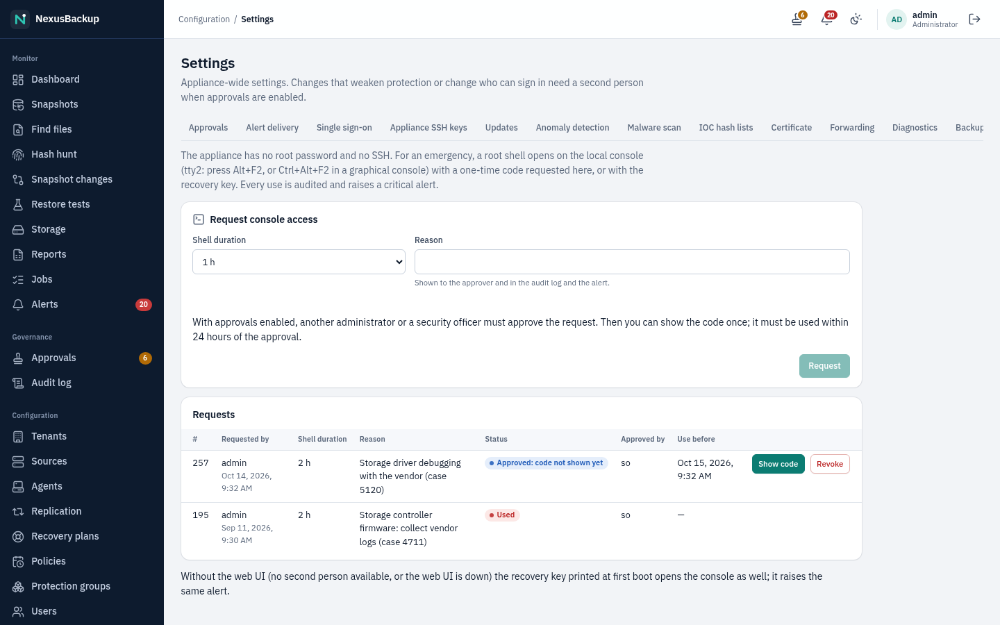

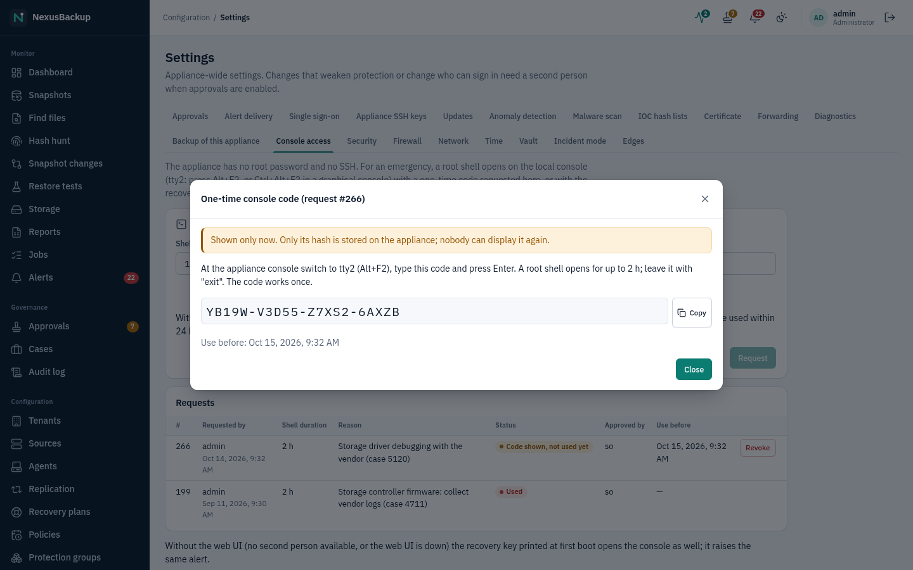

An administrator or a security officer can **Revoke** an approved or shown code that is no longer needed; it stops
working at once.

**The recovery key (when nobody can approve or the web interface is down).** Type the recovery key (16 groups of 4
hex digits) at the same prompt, then the shell duration in hours (1 to 8, default 1). It is checked against the key
service exactly like at first boot. Use this only when the code path is impossible: the recovery key also decrypts
every backup ([The recovery key](#the-recovery-key)).

While the shell runs:

- it is a full root shell (SELinux `unconfined_t`), limited to the chosen duration: when the time is up the
  appliance ends the shell and everything started from it. Leave it earlier with `exit`;
- the critical alert `console_root_shell` is raised and delivered through the alert channels
  ([11 Alerts and monitoring](11-alerts-and-monitoring.md));
- every administrator, security officer and operator sees a red banner in the web interface ("Root shell running on
  the console: since …, ends at the latest …"), until the shell ends;
- the audit log records `console.root_shell` (who requested and approved the code, or `recovery_key`) and, at the
  end, `console.root_shell_end` with the duration. Rejected input is recorded as `console.unlock_failed`.

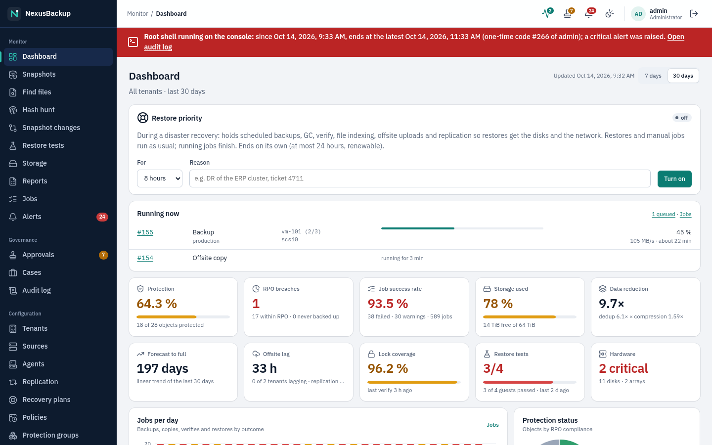

After **5** rejected attempts within **15 minutes** the gate refuses further attempts until the oldest of them is
15 minutes old (and waits a few seconds after each rejected attempt). Before first boot setup is complete the gate
only points to the setup wizard on tty1.

Everything done in the shell is the operator's responsibility and is not recorded command by command. Agree with
the approver what will be done, and close the shell as soon as the task is finished. Afterwards check the audit log
and acknowledge the alerts (administrators and security officers).

> **Status:** Implemented in Phase 14 (console gate `nexus-console-gate` on tty2, the web interface, unit and API
> tests). The appliance VM test (`lab/appliance/console-gate.sh`) drives a second instance of the gate over the
> serial console, because the lab VM has no screen for tty2. It has not been used on real hardware yet.

## Rotating a tenant's encryption key

Every tenant's data is encrypted with its own data encryption key (DEK), wrapped by the appliance's key-encryption
key. Rotating it creates a new key version: new snapshots are encrypted with it, older snapshots stay readable with
the older versions (they are kept). **Settings → Security → Encryption key rotation reminder** (default 365 days,
0 = off) makes the appliance raise the info alert `dek_rotation` for each tenant whose current key is older than that;
replicated tenants (on a secondary) are skipped, their keys are rotated on the primary.

Rotation is done in an emergency root shell on the console (see the next section):

```
runuser -u nexus-keyd -- /usr/libexec/nexus/keyd tenant-rotate /var/lib/nexus/keyd <tenant>
```

It prints the new version (`acme: DEK v2`). The alert resolves within minutes. Afterwards:

- The next offsite copy uploads the new wrapped key with the escrow files (no action needed).
- On a replication **primary**, export the keys to each secondary again (**Replication → Export keys**, needs
  approval); until then the secondary raises `replication_keys` for snapshots with the new version.
- If the tenant has a tenant recovery key, keyd seals the new version to it automatically.

The age is the time the key file was written: on an appliance rebuilt from a configuration backup or recovered from
offsite, the reminder counts from the recovery.

> **Status:** The reminder is implemented in Phase 21b (scheduler and key daemon tests). Rotation itself is the key
> daemon's command-line tool; a web action for it is not planned.

## Break-glass: the only administrator lost their authenticator

Normally another administrator issues a new activation code ([09 Users and access](09-users-and-access.md#lost-password-or-authenticator)).
If there is no other administrator who can sign in, reset the account on the appliance's console with the
**recovery key**. Nobody can do this over the network.

You need:

- a root shell on the appliance's local console (physical console or the hypervisor's console): with nobody else to
  approve a code, open it with the recovery key ([Emergency root shell on the console](#emergency-root-shell-on-the-console));
- the written recovery key (the same key as at setup, see [The recovery key](#the-recovery-key)).

Procedure:

1. On the console, as root, run:

   ```sh
   nexus-setup recover-admin --user admin
   ```

   `--user` names the administrator account to reset (here `admin`).
2. Enter the recovery key when asked. A wrong key is refused.
3. The command resets the account to **Pending activation**: its old password, authenticator and passkeys stop working. It prints a new **one-time activation code**.
4. If approvals are enabled and at least two people could approve, the command refuses, because the reset bypasses
   the four-eyes rule. If those people really cannot help (for example a security officer exists but no other
   administrator), repeat it with `--force-solo`. The recovery is then flagged as a solo action in the audit log and
   the alert; tell the security officer.
5. In a browser, open the sign-in page, click **Activate account** and activate the account with the user name and the
   code: choose a new password and set up a new authenticator
   ([09 Users and access](09-users-and-access.md#activating-your-account)).

What the appliance records:

- the audit entry `user.break_glass`;
- a critical alert of kind `break_glass`, sent through the configured alert delivery
  ([11 Alerts and monitoring](11-alerts-and-monitoring.md));
- a red banner for every administrator in the web interface: "Break-glass recovery was used: … Check the audit log,
  then acknowledge." with **Open audit log** and **Acknowledge**. It stays until an administrator acknowledges it.

After the recovery, check the audit log for anything unexpected, acknowledge the banner, and create a second
administrator so this is not needed again.

Single sign-on accounts cannot be recovered this way: their sign-in is handled by the identity provider. If the
identity provider is unavailable, sign in with a local administrator account (see
[09 Users and access](09-users-and-access.md#single-sign-on-oidc)); if none can sign in, use the procedure above on a
local administrator account.

> **Status:** `nexus-setup recover-admin` is part of the image (unit-tested). The root shell it needs comes from the
> console gate ([above](#emergency-root-shell-on-the-console)); the two together have not been run on real hardware.
> A second administrator remains the better protection.

## The configuration backup

Every day (02:30) the appliance makes a **configuration backup**: one sealed file (bundle) with everything a
replacement appliance needs besides the backup data:

- the catalog: tenants, sources, policies, protection groups, users and their roles and authenticators, API
  tokens, settings (approvals, alert delivery, single sign-on, firewall), installed plugins and their trusted
  publisher keys, alerts, job history and the **audit log**;
- `totp.key` (the key of the users' TOTP seeds) and `secrets.key` (the key of the source and offsite secrets);
- the agent CA (enrolled Linux/Windows agents keep working) and the replication identities (CA, client keys);
- the appliance's SSH keys and known hosts (`/etc/nexus/ssh`: Proxmox VE nodes, Storage Boxes);
- the TLS identity (self-signed certificate and key, which replication secondaries pin) and an imported web
  certificate, and the metrics token.

It does **not** contain backup data, the tenants' data keys (they are escrowed on each offsite target, see
[The recovery key](#the-recovery-key)) or the master key itself (only `kek.recovery`, which needs the recovery key).
Plugin programs are not included either: upload them again after a restore.

The bundle is encrypted so that only the **recovery key** opens it: the key service publishes a public key derived
from the master key, a helper without network access seals the bundle to it, and opening it needs the master key,
which only the recovery key unwraps. Nobody can read the bundle without the recovery key, not even on the appliance.

Where it goes:

- to the offsite target of **every tenant** (except deactivated tenants), below `config/<appliance ID>/` (one file
  per run, named by its time). Each target keeps the newest bundle of each of the last **14 days** and of each of the
  last **12 months**; with S3 Object Lock every bundle is locked for 14 days, the monthly ones for six months;
- the newest one stays on the appliance for **Download latest**.

**Configuration → Settings → Backup of this appliance** (administrators and security officers) shows the last
successful run, the newest bundle, the appliance ID, every offsite target with its last upload, and the recent runs.
Administrators can **Run now** (for example after larger changes) and **Download latest** (needs the download
permission; audited as `download.get`; no approval, because the bundle is useless without the recovery key). Keep a
downloaded copy with your disaster recovery records, especially when no tenant has an offsite target.

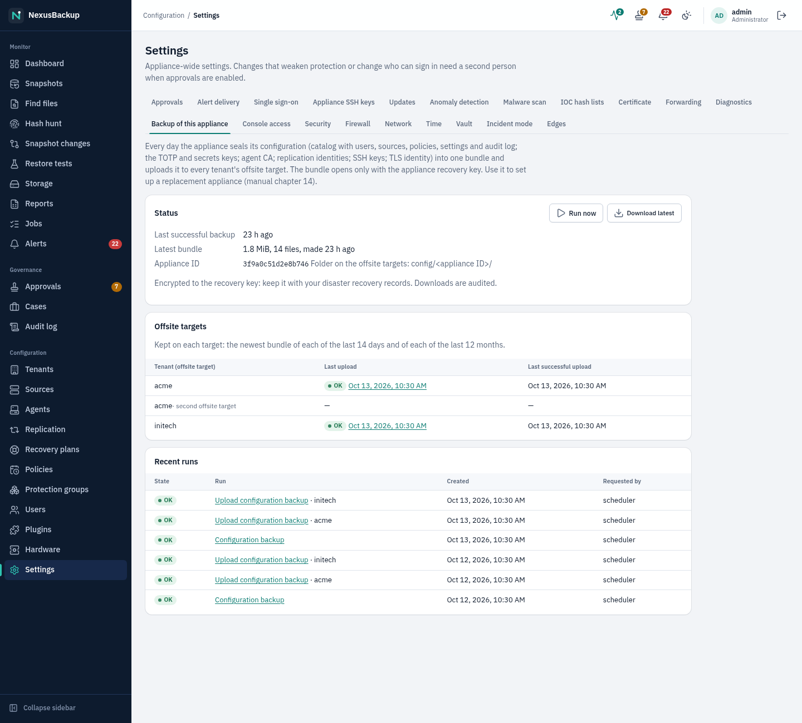

If a run fails, the warning alert `config_backup` is raised (key `config_backup`; `config_backup:<tenant>` when the
upload to that tenant's target failed). It resolves after the next successful run.

> **Status:** Implemented (unit and integration tests: a bundle made without the recovery key and opened with it, a
> wrong key refused, every listed file present, retention on a target, restore end to end in a temporary root, API
> roles and audit). The appliance VM drill (`lab/appliance/config-restore.sh`) is written but has not been run yet;
> it has not been used on real hardware.

## New appliance from a configuration backup

Use this when the appliance is lost and a new one should take its place with the same configuration, users,
agents and replication peers. You need:

- the new hardware (or VM) with the appliance image installed, and a network address for it. Give it the **same
  address and host name** as the lost appliance if you can: agents, replication peers and browsers know the old one;
- the **recovery key of the lost appliance**;
- either a downloaded bundle, or the access data of one of the tenants' **offsite targets** from your records: for a
  Storage Box host, port, user, base directory and the **pinned host key**; for S3 endpoint, region, bucket, prefix,
  access key and secret key.

Steps at the console of the new appliance (first boot wizard on tty1):

1. Do step **1. Management network** as usual.
2. On the overview press **b** (*Restore a configuration backup*). Choose the target type with Left/Right.
   - **Storage Box (SFTP):** the screen shows a new public key (`ssh-ed25519 … nexus-restore`). Add it to the
     Storage Box's `authorized_keys` (Hetzner Robot or another machine), then type host, port, user, base directory
     and the pinned host key.
   - **S3:** type endpoint, region, bucket, prefix, access key, secret key and whether the provider needs path-style
     URLs.
   - **Appliance ID:** leave it empty unless the target holds configuration backups of several appliances (the
     error message lists them; the ID is on the lost appliance's settings page and in your records).
   - **Recovery key:** the lost appliance's key, 16 groups of 4 hex digits.

   Press Enter on the last field. The wizard opens the outbound firewall for that target only, fetches the newest
   bundle, checks the recovery key against it (a wrong key changes nothing) and restores every file with its owner,
   permissions and SELinux label. The key service gets the lost appliance's master key back, so **the recovery key
   stays the same**. The wizard then sets the boot menu password, writes `setup-done` and starts the services.
3. Open the web interface and sign in with your **usual account** (password and authenticator of the lost
   appliance). The audit log continues the lost appliance's log; the restore is recorded as `setup.restore_config`.
4. The appliance now restores the **data keys of every tenant with an offsite target** from that target by itself
   (job *Restore tenant keys from offsite*, no recovery key needed: the keys were wrapped with the restored master
   key) and indexes the offsite copy. Until then no job runs for that tenant. When it has finished, the snapshots
   appear on **Snapshots** as *offsite only*: **Fetch from offsite** what you need and restore it as usual
   ([06 Restores](06-restores.md#restore-from-the-offsite-copy)). If it fails, the warning alert
   `config_restore:<tenant>` names the reason; it is retried every hour.
5. **Plugins:** upload the plugin bundles again (**Plugins**); they are marked *failed* with the note "restored from
   a configuration backup" until then. Approve them as usual.
6. **Different address?** If the new appliance has another address than the lost one, run
   `nexus-setup --force-reconfigure-network` from a root shell on the console (new certificate) and tell the
   replication peers and agents the new address.
7. Backups, offsite copies, configuration backups and replication continue on their schedules, into the same stores
   and offsite targets.

From a downloaded bundle instead of an offsite target (root shell on the console, before first boot is finished,
for example in a lab): `nexus-setup restore-config /path/config.bundle` (the recovery key is read from standard
input). `nexus-setup restore-config --offsite target.json` takes a target file in the format of
[Recover a tenant from the offsite copy](#recover-a-tenant-from-the-offsite-copy-console), step 2.

What is **not** recovered this way:

- the data of tenants **without** an offsite target (it was only on the lost appliance) and of replicated tenants
  on a secondary (pair the secondary with its primary again, [08 Replication](08-replication.md));
- configuration changes made after the newest configuration backup;
- plugin programs (step 5) and the operating system's network configuration (step 1).

> **Status:** The restore is tested in integration tests (temporary root: restore with the recovery key, wrong key
> refused, owners and modes; tenant keys from the escrow with the restored master key; the scheduler waits for them).
> The wizard screen and the restore on an installed appliance under SELinux have not been run yet
> (`lab/appliance/config-restore.sh` covers the console command, the wizard screen is a manual check).

## Recovery plans

A recovery plan writes down how a site comes back: which guests, in which order, on which node and storage,
on which networks. The appliance checks the plan every day, can test it isolated at any time and executes it
for real after approval. Open **Configuration → Recovery plans**.

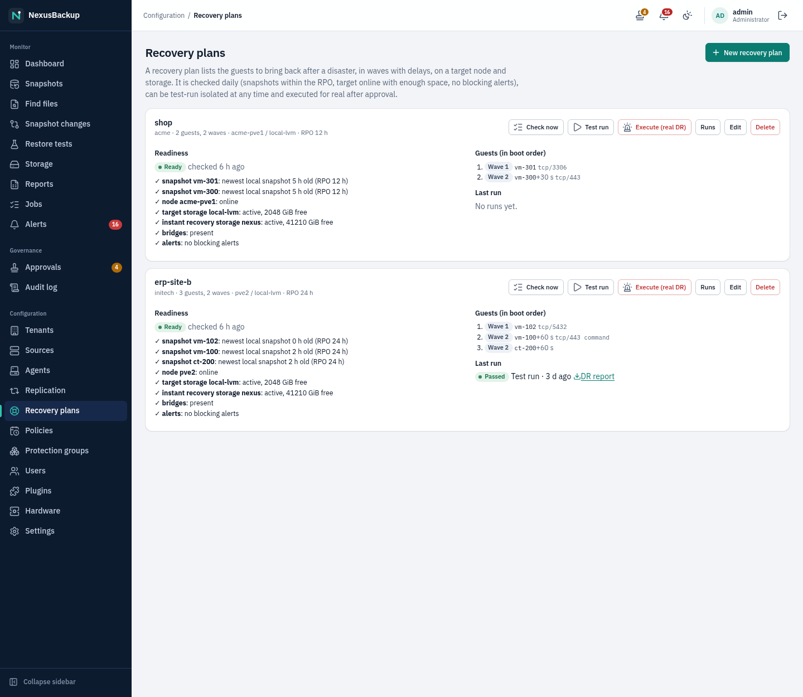

**Create a plan** (admins and tenant admins): **New recovery plan**.

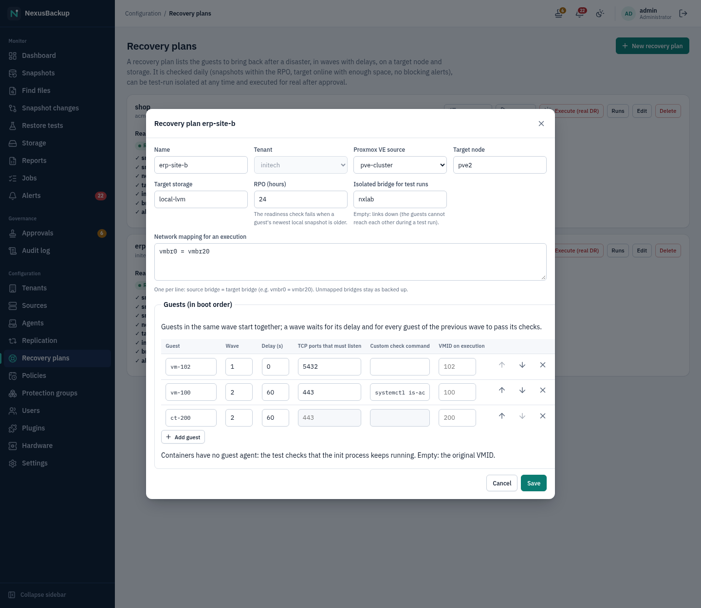

- **Proxmox VE source, target node, target storage:** where the guests come back. For a second site, add its
  cluster as a source of the tenant.
- **RPO (hours):** the readiness check fails when a guest's newest local snapshot is older.
- **Isolated bridge for test runs:** a bridge or SDN VNet without an uplink. Empty: all links down (the guests
  then cannot reach each other during a test run).
- **Network mapping for an execution:** one line per bridge, `vmbr0 = vmbr20`. Unmapped bridges stay as backed
  up.
- **Guests (in boot order):** each guest with its **wave**, a **delay** in seconds and the checks of a restore
  test (ports, custom command; see [06 Restores](06-restores.md#restore-tests)). Guests in the same wave start
  together. A wave waits for its delay and starts when every guest of the previous wave passed its checks
  (database first, then the application servers). **VMID on execution:** empty = the original VMID.

**Readiness** (daily at 05:30 UTC, after every change and with **Check now**): a local snapshot within the RPO for
every guest, the target node online, the target storage and the instant recovery storage active with room for the
guests, the bridges present on the node, and no open restore test, verification or inventory alert of the
tenant's guests. A plan that is not ready raises the warning **recovery_plan**; the next passed check resolves it.

**Test run** (admins, operators, tenant admins): every guest boots isolated as in a restore test, wave by wave.
All guests stay up until the last wave was checked, then all are destroyed. The results go into the restore test
list and the run. A failed test run raises **recovery_plan**.

**Execute (real DR):** restores every guest of the plan for real with a full restore of its newest local snapshot,
under its original VMID and name (or the plan's VMID), with the network mapping applied, and starts it, wave by
wave. A wave in which a guest fails stops the run; the remaining guests are reported as skipped (restore them one
by one). Type the plan's name to request it. The execution always needs approval: another admin or security
officer approves it on **Approvals** (the request shows the plan as it will run); with approvals disabled it runs
at once (audited). A failed execution raises a critical **recovery_plan** alert.

**Runs and the DR report:** **Runs** lists the test runs and executions with every guest's result. **DR report**
downloads an HTML page with the plan as it ran, who requested and approved it, start and end, and per guest the
snapshot used, the target, the boot time and every check. Print it to PDF from the browser for your records.

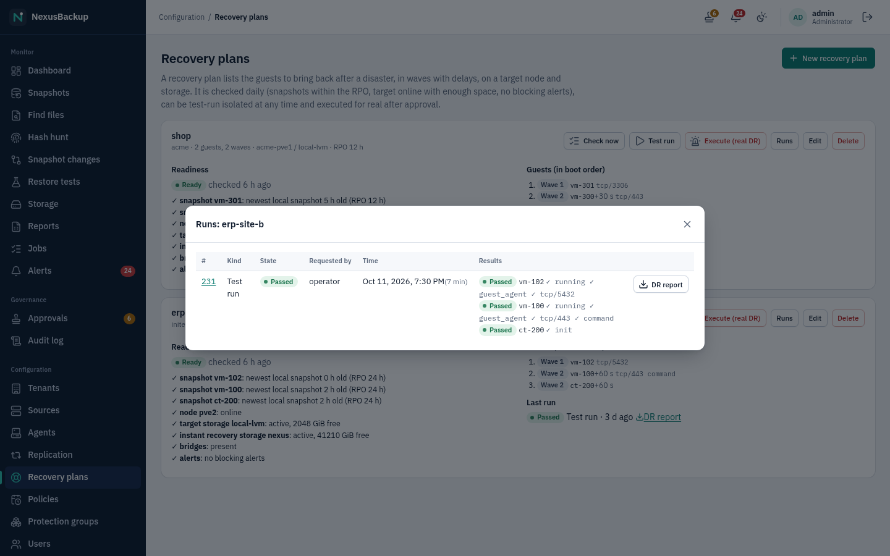

> **Status:** Plans, readiness, test runs, approval and the DR report are covered by unit and integration tests
> against a simulated Proxmox VE. A test run on the PVE lab is a lab step (`lab/e2e/m5-api.sh recovery-plan`); a
> real execution on a second cluster has not been run yet.

## Practise

Run a drill at least once a year and after major changes:

1. **Check the written recovery key** on the running appliance (root, local console). The key is read from standard
   input and compared with the key service; nothing is changed:

   ```sh
   /usr/libexec/nexus/keyd check-recovery /var/lib/nexus/keyd
   ```
2. **Watch the offsite checks:** every offsite job ends with an inventory check (packs or manifests missing on the
   target), and the daily verify job also reads 3 sampled packs from the target. Problems raise alerts
   ([11 Alerts and monitoring](11-alerts-and-monitoring.md)).
3. **Do a full DR drill** on spare hardware or a VM: install the image, run the procedure above for one tenant with
   the real recovery key and offsite credentials, restore one VM to a test node and boot it. Record the time it took.
4. **For replication:** restore a file from the secondary while the primary is unreachable.
   Run a **test run** of every recovery plan (above) and keep its DR report with the drill record.
5. Record the drill in your own change log (date, tenant, snapshot, result, duration).
