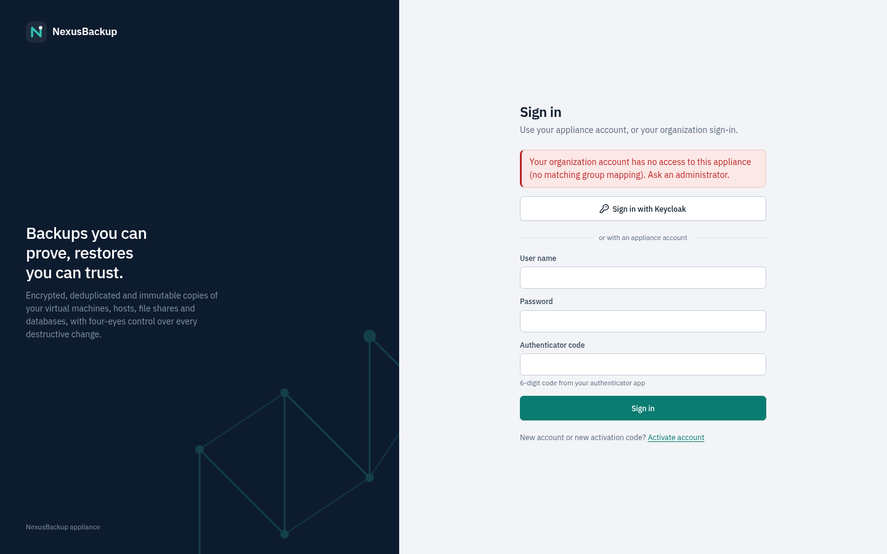
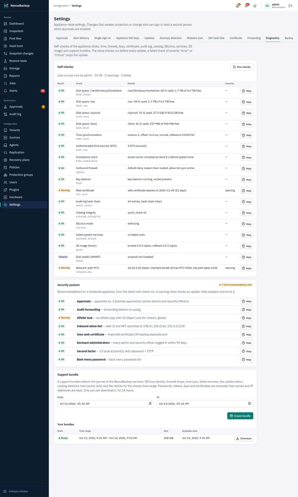
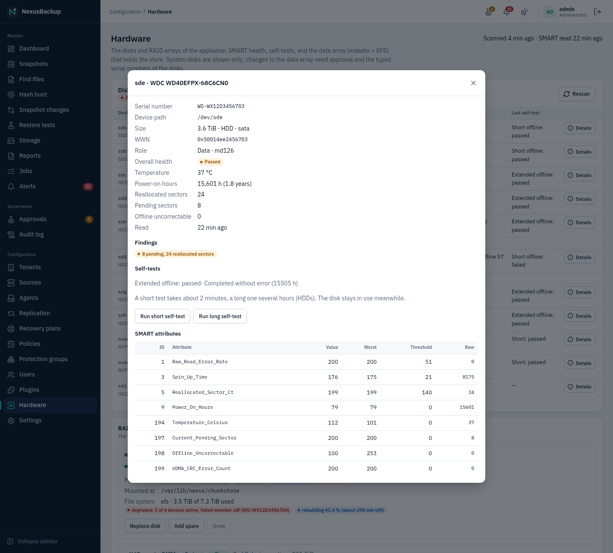
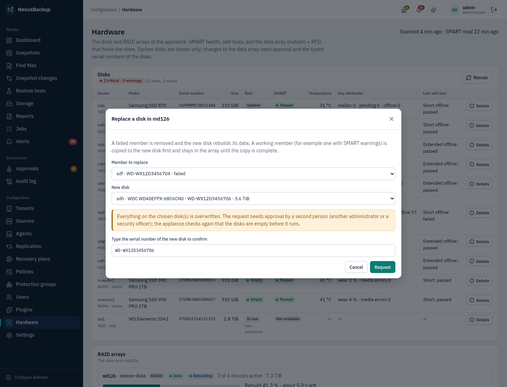

# 15 Troubleshooting and FAQ

Start with the job log: open **Jobs**, click the failed job and read the last lines of its **Log**. The alert of a
failed job (`job_failed`) repeats them. Each entry below lists the symptom, the cause and the fix.

## Signing in

**Sign-in fails although password and code are right.**
Each authenticator code works only once, and a code is valid for 30 seconds (one step before or after is
tolerated). Wait for the next code. Check that the clock of your phone is correct.

**"Too many attempts".**
After 5 failures for a user or from an address within 15 minutes, sign-in is locked for 15 minutes. Wait. The failures
are in the audit log (`auth.login_failed`).

**Lost authenticator or password.**
Another administrator issues a new activation code (see [09 Users and access](09-users-and-access.md#lost-password-or-authenticator)).
If you are the only administrator, use the console break-glass procedure with the recovery key
([14 Disaster recovery](14-disaster-recovery.md#break-glass-the-only-administrator-lost-their-authenticator)).

**Activation code rejected.**
The code is valid for 72 hours and only once. For administrators and security officers with approvals enabled, the
code has two parts and works only after the approval; enter both parts. Ask for a new code if it expired.

**Approvals show "Disabled" right after installation.**
First boot was finished with "second person later". Add an administrator or security officer under **Users**, let
them activate the account, then click **Enable approvals** under **Settings → Approvals**.

**The page is dark (or light) although I want the other theme.**
By default the interface follows the light/dark setting of your operating system. Click the theme button in the top
bar (sun, moon, or half sun) until its tooltip shows the theme you want: it cycles through **Theme: follow the
system**, **Theme: light** and **Theme: dark**. The choice is stored in this browser only; a private window or another
browser starts again with the system setting.

**The web UI does not load any more after a firewall change (connection times out).**
The approved source list of the web service in **Settings → Firewall** no longer contains your address (for example
you changed networks, or connect through a VPN or proxy with another address). From an address that is still in
the list, correct the list. If nobody can connect, open a root shell on the appliance console (tty2, with the recovery
key when nobody can request a console code, see
[14 Disaster recovery](14-disaster-recovery.md#emergency-root-shell-on-the-console)) and run
`nexus-setup reset-firewall`: every source list is cleared (any address again) at once, audited (`firewall.reset`)
with the warning alert `firewall_reset`. Then set a correct list
([02 Installation](02-installation.md#inbound-firewall)). **Settings → Firewall → Recent blocked attempts** shows
which address was dropped.

**A red "Break-glass recovery was used" banner appears.**
Someone reset an administrator account on the console with the recovery key. Open the audit log (`user.break_glass`),
make sure the recovery was planned, then click **Acknowledge**
([14 Disaster recovery](14-disaster-recovery.md#break-glass-the-only-administrator-lost-their-authenticator)).

## Single sign-on

If a sign-in through the identity provider (IdP) fails, the appliance returns to its sign-in page and shows the reason
in a red box:

| Message | Meaning | Fix |
|---|---|---|
| "Your organization account has no access to this appliance (no matching group mapping). Ask an administrator." | none of the user's groups matches a group mapping (code `denied`); an existing single sign-on account is disabled | add the user to a mapped group at the IdP, or add a mapping under **Settings → Single sign-on**. Check that the IdP sends the groups claim, and in the form the mapping expects (Entra ID sends group object IDs, Keycloak group names without path) |
| "Single sign-on is turned off on this appliance." | **Allow single sign-on** is off (code `disabled`) | an administrator turns it on, or users sign in with an appliance account |
| "Your account on this appliance is disabled. Ask an administrator." | an administrator disabled this single sign-on account (code `account_disabled`); signing in again does not enable it | an administrator clears **Disabled** on the **Users** page |
| "The sign-in took too long. Please try again." | more than 10 minutes passed between leaving for the IdP and coming back (code `expired`) | try again |
| "The sign-in could not be verified (state mismatch). Please try again." | the answer did not belong to the sign-in this browser started (code `state`): e.g. two sign-ins in parallel tabs, a bookmarked IdP page, blocked cookies, or the appliance opened under a different address than the registered redirect URI | close other sign-in tabs, allow cookies for the appliance, and always open the appliance under the address registered at the IdP |
| "The identity provider reported an error. Please try again or contact your administrator." | the IdP refused or cancelled the sign-in (code `idp`), e.g. the user cancelled, is not assigned to the application, or failed MFA | check the IdP's sign-in log |
| "The answer of the identity provider could not be verified. Contact your administrator." | the ID token failed a check (code `token`): issuer, audience (client ID), expiry, nonce or signature; or the client secret is wrong | compare **Issuer URL** and **Client ID** with the IdP, enter the client secret again (expired Entra ID secrets are a common cause), check the appliance clock, and run **Test connection** |
| "Single sign-on failed (…). Please try again or contact your administrator." | another error | the appliance's audit log and the IdP's log name the cause |

**The "Sign in with …" button is missing.**
Single sign-on is not set up or not allowed (**Settings → Single sign-on**, **Allow single sign-on**), or a change of
these settings is still waiting for approval.

**Test connection fails.**
The appliance cannot fetch `<issuer>/.well-known/openid-configuration` or the signing keys: wrong **Issuer URL** (for
Entra ID it ends in `/v2.0`, for Keycloak in `/realms/<realm>`), or the IdP is not reachable from the appliance. The
test uses the saved settings: save first.

**A single sign-on user cannot sign in with the user name and password form.**
Expected: single sign-on accounts have no appliance password or authenticator. Use **Sign in with …**.

**A single sign-on user has the wrong role or tenant.**
Role and tenants are set from the mappings at every sign-in; the highest-privileged matching mapping wins. Check the
user's groups at the IdP and the mappings, then let the user sign out and in again.

## Backups

**VM backup fails with a fleecing error (e.g. "fleecing storage … is full").**
VM backups need a fleecing storage on the node with free space. Set **Fleecing storage** in the source to fast local
thin storage (e.g. `local-lvm`) and free up space there.

**The first backup after a VM or host restart takes much longer.**
Expected: the dirty bitmap is lost when QEMU restarts, so the disk is read once completely. Only changed chunks are
stored.

**A guest shows "RPO breached" on the Dashboard, or an object appears under "Objects needing attention".**
"RPO breached" in the **Protection status** table, or **Breached** under **Objects needing attention**: the last good backup is older than 1.5 × the policy period
(36 hours for daily, 90 minutes for hourly). **Never**: the object is in a group but was never backed up successfully.
Look for failed backup jobs of its group, or a job of the same source that blocks the queue.

**The Dashboard says "Key figures are not available right now".**
The appliance could not compute the key figures. The **Protection status** table below still works. If it persists,
the appliance-side dashboard service may not be available on your version yet.

**A job stays "Queued" for a long time.**
Only one job per source runs at a time. A long backup or restore of the same source delays the next job. Queued jobs
can be cancelled by administrators and operators.

**Agent shows "Token expired", or Enroll is greyed out.**
Enrollment tokens are valid for 24 hours. Click **New token**, run
`sudo /usr/local/sbin/nexus-agent init --token -` on the host, paste the token, then click **Enroll**. After 5
failed proofs the agent locks enrollment; `init --token` clears the lock.

**Agent backup "not point-in-time consistent" and a `backup_inconsistent` alert.**
The volume has no LVM, ZFS or btrfs snapshot support, so it was read live. Move the data to LVM/ZFS/btrfs, or accept
the flagged backup.

**Share backup always marked inconsistent.**
No **NAS snapshot directory** is set, or no snapshot matches the **Snapshot name prefix**. Set `.zfs/snapshot`,
`.snapshot` or `~snapshot` and check the prefix. The alert for a missing snapshot is raised once per source.

**NFS backup misses files or reports unreadable entries.**
The export is not `ro,all_squash,anonuid=0,anongid=0` for the appliance's address, so only world-readable files can
be read. Fix the export. For SMB, use an account in Backup Operators (Windows) or Samba `admin users`.

**TrueNAS backups fail with a TLS error after months.**
TrueNAS renewed its certificate and the pinned one no longer matches. Paste the new certificate (or its CA) into the
source.

**TrueNAS SSH refused after you changed the datasets.**
The forced-command line in `authorized_keys` contains the datasets. Paste the new line shown in the source dialog into
the TrueNAS user's "SSH public key" field.

**PostgreSQL server disk fills with WAL.**
The replication slot of cluster backups keeps WAL while backups are not running. Run backups again, or drop the slot
(`SELECT pg_drop_replication_slot('nexusbackup')`) when you remove the source, or set `max_slot_wal_keep_size`.

**Plugin upload rejected with "signature verification failed".**
The signing key is not trusted, or the key's publisher differs from the `publisher` in the manifest. Add the
publisher key (with approval) after comparing its fingerprint with the publisher.

**A new destination cannot be reached ("No route to host", timeouts).**
The outbound allow-list is applied a few seconds after a configuration change and every 30 minutes. A reload of the
firewall empties it until the next sync. Wait, or save the configuration again to trigger a sync. Dropped connections
are logged with the prefix `nexus-out-drop:`.

## Restores

**Container restore fails with "no space" or a tar error.**
The node stages the container under `/var/tmp/nexusbackup`. Free space on the node's root file system, or restore on
another node.

**VM/CT restore fails with a permission error on the network.**
The PVE API token lacks `SDN.Use` on the bridge's zone. Grant `PVESDNUser` on `/sdn/zones/<zone>`.

**Restore fails because of the target storage.**
**Target storage** must be a PVE storage for VM disks or container volumes (e.g. `local-lvm`), not the NexusBackup
storage.

**Instant recovery refused.**
The VM has a TPM state (`tpmstate0`) or is a template. Use **Restore → Full restore to a new VM / container**.

**A plugin restore is missing from the Restore menu.**
The menu offers only the restores that apply to this kind of snapshot. PostgreSQL, for example, offers the dump
restore only on database snapshots (`plugin-postgresql-<source>-<db>`) and the point-in-time restore only on cluster
snapshots (`plugin-postgresql-<source>`). Security officers see no **Restore** menu at all.

**Instant-recovered VM hangs or gets I/O errors.**
The connection between the node and the appliance was interrupted before the disk move finished. Restore
connectivity; resuming the export is a command-line step (`nexus-pve … ir-serve`). Keep enough space on the node's
root file system for the guest's writes.

**Browse files shows no files or a mount error for a VM.**
The volume is not supported by the restore micro-VM (LUKS, BitLocker, ZFS native encryption, dynamic disks, zvols,
duplicate pool or volume-group names). Restore the whole VM instead.

**Download link gone or answers 403/404.**
Prepared downloads expire after 24 hours and can be fetched only by the user who requested them. Prepare it again.

## Alerts

**Send test under Settings → Alert delivery shows "error: …".**
The text after "error:" comes from the mail server or webhook. Common causes: wrong port or STARTTLS setting, a relay
that requires **SMTP user (optional)** and **SMTP password**, a sender address the relay does not accept, or a
webhook URL that is not HTTPS. The test uses the saved settings: save first.

## Offsite and replication

**`offsite_lag` alert.**
Snapshots have not reached the target for more than 48 hours. Check the tenant's **Offsite copy** jobs: credentials,
pinned host key, free space on the Storage Box, bucket permissions.

**S3 uploads fail intermittently with "connection refused" (e.g. AWS).**
The endpoint's DNS rotates and the allow-list does not contain the new address yet. The job is retried; prefer a
provider with stable addresses.

**Replication sync fails with "approve the key export on the primary", or a `replication_keys` alert.**
There is no key export yet, or the primary rotated the tenant key. On the primary, click **Export keys** on the peer,
compare the key service fingerprint with the secondary, and have the request approved.

**The secondary refuses the primary's certificate after a network change.**
`nexus-setup --force-reconfigure-network` on the primary created a new certificate. Compare the new fingerprint and
create the replication source again with it.

## Verification failed

A `verify` alert means missing or corrupt chunks in the local store or in the sampled offsite packs.

1. Do not confirm or approve garbage collections until the cause is known.
2. Read the verify job's log (counts of corrupt and missing chunks). **Snapshots** marks the
   affected snapshots **Damaged**, and the `snapshot_damaged` alert names them.
3. Check the appliance's disks (hardware errors, file system).
4. Run **Repair** on **Snapshots** (administrators). It fetches the bad chunks from the offsite
   target or, on a replication secondary, from the primary. See
   [11 Alerts and monitoring](11-alerts-and-monitoring.md#verification-and-repair).
5. Chunks that no copy has come back when the source delivers the same data again in its next
   (full) backup. Otherwise restore the affected guests from an older snapshot.

An `inventory` alert (packs missing on the offsite target, or a locked snapshot missing locally) can mean an attack.
Check the target's own snapshots (Storage Box) or object versions (S3) and the audit log.

## Updates

**An update does not install.**
Updates are applied only in the maintenance window or on request, are postponed while jobs run, and a version that was
rolled back is not applied again. Check **Settings → Updates** or `nexus-update status` on the console (see
[13 Updates](13-updates.md)).

**An update shows "Blocked by checks".**
Before it downloads or installs an update the appliance runs its self-checks. A failed check of severity **error** or
**critical** stops the update (see [Diagnostics and support bundles](#diagnostics-and-support-bundles) below). The
**Updates** tab lists the failed checks with a link to their entry here. Fix the cause, then click **Check now**.

**The appliance runs the old version after an update.**
The health check failed after the reboot and the appliance rolled back automatically. The reason is in the journal of
the greenboot health check.

## Diagnostics and support bundles

The appliance has no shell access. To find out what is wrong, use **Configuration → Settings → Diagnostics**
(administrators and security officers; only administrators create support bundles).

> **Status:** New in this release. The checks, the redaction and the web interface are covered by unit and API tests
> and were tested against the demo backend; the run on a real appliance (SELinux confinement, journal and audit
> access) is not lab-tested yet.

**Self-checks.** **Run checks** checks disks, time, firewall, key daemon, web certificate, audit log, catalog, SELinux,
services and the OS image, and lists the result of each with a **Help** link to its entry below. Each failed check has a
severity: **warning**, **error** or **critical**. The same checks run before every update: a failed check of severity
**error** or **critical** stops the update ([13 Updates](13-updates.md#pre-update-checks)). Running the checks is
recorded in the audit log (`diag.checks`).

**Support bundle.** Choose a time range (at most 31 days, default the last 24 hours) and click **Create bundle**. After
a minute the bundle appears under **Your bundles** with a **Download** button. It is a `.tar.gz` file with:

- the journal of the NexusBackup services, the time sync and the firewall for the range, and all warnings and errors;
- SELinux denials, firewall drops, chrony status, failed services, the NexusBackup units and the firewall ruleset;
- the update status (booted, staged and rollback image, last result);
- catalog statistics: row counts per table and the number of audit entries per action, never their contents;
- the result of the self-checks, and a `manifest.json`.

Before the bundle is written, passwords, tokens, keys, certificates, cookies, authenticator secrets and passwords in
URLs are replaced by `[REDACTED]`. **Host names and IP addresses are kept**: support needs them to follow connections
and firewall drops. Check the bundle before you send it if your addresses must not leave the company. Only the
administrator who created a bundle can download it, for 24 hours; then it is deleted. Creating and downloading are
recorded in the audit log (`diag.bundle`, `download.get`).

**Only one request at a time.** "A diagnostics request is waiting to run" means another request has not started yet;
try again a minute later.

### Security posture

The checks named `posture.*` are recommendations for a hardened appliance: approvals with at least three approvers,
audit forwarding that delivers, offsite copies with Object Lock, an inbound allow-list for the web UI, your own web
certificate, no dormant administrators, a second factor for every account and the boot menu password. They run with
the other checks and appear in their own **Security posture** card on **Settings → Diagnostics**; each is either OK or
a warning and never blocks an update. Each row's **Help** leads to its line in the table below.

> **Status:** Added in Phase 21b (nexus-diag unit tests and the demo backend); a run on the appliance image is
> pending.

### The checks

| Check | What it checks | What to do |
|---|---|---|
| `disk.store` Disk space: chunk store | Used space of the file system that holds the backups (`/var/lib/nexus/chunkstore`). Warning from 85 %, error from 95 %. | Let retention free space (**Storage** shows growth per tenant), shorten the retention of large groups, delete expired snapshots or add disk space. A full store makes backups fail. |
| `disk.var` Disk space: /var | Used space of `/var` (journal, catalog, downloads, update staging). Warning from 85 %, error from 95 %. | An update needs free space in `/var` to download the new image. If `/var` and the store share one file system, free space in the store. |
| `disk.root` Disk space: /sysroot | Used space of the OS file system (`/sysroot`, which holds the OS images). | Usually caused by old deployments; it is freed when the next update replaces the rollback image. Contact support if it stays above 95 %. |
| `disk.boot` Disk space: /boot | Used space of `/boot` (kernels of the booted and the rollback image). | As for `/sysroot`; an update cannot be staged without room for its kernel. |
| `time.sync` Time synchronisation | Whether chrony has a synchronised clock (stratum, offset). Not synchronised = error; an offset above 1 s = warning. | Check that the NTS servers are reachable (DNS works, outbound UDP 123 and TCP 4460 to the servers are allowed by your firewall) and wait a few minutes after boot. Certificate checks, sign-in codes and retention locks rely on the clock. |
| `time.nts` Authenticated time sources (NTS) | Whether the time sources are authenticated with NTS. | The appliance accepts only NTS sources. A warning means none could be authenticated yet: usually blocked TCP 4460 to the NTS servers. |
| `time.compliance` Compliance clock | How far the compliance clock (the clock retention locks use, chapter 1) is from system time, as the scheduler last measured it. Behind after a restart = pass (it catches up slowly; locks last longer meanwhile). System time jumped ahead while running, or moved back: more than 1 minute = warning, more than 10 minutes = error (never blocks an update). Not measured for 15 minutes = warning. | Find out who or what changed the time: check `time.sync` and `time.nts` and the audit log. Nothing needs repairing: the compliance clock never jumps, it moves towards system time by at most 0.1 % of the elapsed time. If system time is wrong, fix the time sources; see also the alert `clock_skew` (chapter 11). |
| `egress` Outbound firewall | Whether the default-deny output chain and its allow-list sets are loaded, and whether the allow-list sync runs. | An error means the firewall table is missing: reboot the appliance. A warning about the sync means destinations you add (sources, offsite targets, alert webhooks) are not opened; reboot and check the journal of `nexus-nft-sync`. |
| `keyd` Key daemon | Whether the key daemon runs and its socket exists. Without it no backup and no restore works (critical). | Reboot the appliance. If it stays down, create a support bundle and contact support; do not reinstall (the key store is on this appliance and in the recovery escrow). |
| `tls.cert` Web certificate | Expiry of the web interface's certificate. Expires within 30 days = warning, expired = error. | The self-signed certificate of the first-boot wizard is valid for 10 years, so this normally concerns an imported certificate: replace it before it expires. Browsers and the replication secondary refuse an expired certificate. |
| `audit.chain` Audit log hash chain | Recomputes the hash chain of the audit log. A broken chain means the catalog was modified outside the appliance (critical). | Do not change anything. Open **Audit log**, note the reported entry number, create a support bundle and treat it as a security incident. |
| `catalog.integrity` Catalog integrity | SQLite `quick_check` of the catalog database (critical when it fails). | Usually a disk problem. Create a support bundle and contact support; the catalog can be rebuilt from the stores and the offsite copies ([14 Disaster recovery](14-disaster-recovery.md)). |
| `selinux` SELinux mode | Whether SELinux enforces the service confinement. Permissive or disabled is critical. | The appliance always boots enforcing. If this fails, the kernel command line was changed; contact support. |
| `systemd.failed` Failed system services | Services that have failed. A failed key daemon, web-api, scheduler or replication daemon is an error, any other failed unit a warning. | The bundle's journal names the reason. A reboot restarts all services. |
| `bootc` OS image (bootc) | Booted, staged and rollback image as the update agent last saw them; a queued rollback or an unsigned origin is a warning. | An unsigned origin is fixed by the next update check. A queued rollback takes effect at the next reboot. |
| `posture.approvals` Security posture: approvals | Approvals are on and at least three active administrators or security officers can approve. | Switch approvals on and add approvers ([10 Approvals and audit](10-approvals-and-audit.md#fewer-than-three-approvers)). |
| `posture.forwarding` Security posture: audit forwarding | A syslog or HTTPS sink is configured and enabled, and each one delivered its last batch (not failing). | Configure **Settings → Forwarding** ([10 Approvals and audit](10-approvals-and-audit.md#forwarding-to-a-siem)); if it fails, see the `forwarding` alert. |
| `posture.offsite_lock` Security posture: offsite lock | Every tenant copies offsite to S3 with Object Lock (an SFTP or local target, or no offsite copy, counts as not locked). | Use an S3 target with Object Lock ([07 Offsite](07-offsite.md)). A Storage Box with snapshots protects too, but the appliance cannot verify it: the warning stays. |
| `posture.inbound` Security posture: inbound allow-list | The web UI and API (port 8443) accept connections only from listed networks. | Set the source list of **Web UI and API** in **Settings → Firewall** ([02 Installation](02-installation.md#inbound-firewall)). |
| `posture.certificate` Security posture: own web certificate | An imported certificate (signed by your CA) is served instead of the self-signed one. | [02 Installation](02-installation.md#use-your-own-certificate). |
| `posture.dormant_admins` Security posture: dormant administrators | Every active administrator and security officer signed in within the dormant-account period (**Settings → Security**; 90 days when that is off). | Disable or delete accounts that are no longer needed; the people behind the others should sign in. |
| `posture.totp` Security posture: second factor | Every active local account has an authenticator (TOTP). Single sign-on accounts are counted; their second factor is the identity provider's. | Reset the account (it then activates with a new authenticator); for single sign-on, require MFA at the identity provider. |
| `posture.grub` Security posture: boot menu password | The boot menu password hash exists and is installed in `/boot/grub2/user.cfg`. | Set it at the console with `nexus-setup` ([14 Disaster recovery](14-disaster-recovery.md#boot-menu-password)). |
| `network.mtu` Network: path MTU | The last path-MTU check of `nexus-net` (hourly, **Settings → Network → Path MTU**): a source, offsite or replication destination that does not take the full MTU of its interface, or one routed through another interface than its role's, is a warning (never blocks an update). Skipped before the first check; results older than 3 hours are a warning. | Align the MTU on the appliance, the switches and the destination (or lower it in **Settings → Network**); fix the route of a wrongly routed destination with a static route on the role's interface ([02 Installation](02-installation.md#network-interfaces)). |
| `smart` Disk health (SMART) | The last scan of `nexus-disks` (**Configuration → Hardware**): a disk SMART reports as failing or a failed array is an error, a degraded array or bad sectors a warning, a status older than an hour a warning. Skipped before the first scan. In a virtual machine most disks have no SMART; the hypervisor watches them. | See [Replacing a disk](#replacing-a-disk). If the status is old, check `systemctl status nexus-disks.timer` on the console. |

## Disks and RAID

**Configuration → Hardware** shows the disks, their SMART health and the RAID arrays; problems raise `disk` alerts
([11 Alerts](11-alerts-and-monitoring.md#alert-kinds)).

**A disk shows pending or reallocated sectors (warning).** The disk has found unreadable spots and replaced some of
them. Run a **long self-test** in its **Details**. If the counts keep growing (the alert becomes critical, "growing")
or the self-test fails, replace the disk soon, while the array is still complete.

**SMART health "failed" (critical).** The disk predicts its own failure: replace it now.

**No SMART data.** Virtual disks and some RAID controllers do not pass SMART through; the hypervisor or the
controller's management interface watches them instead.

### Replacing a disk

When a member of the data array fails, the array keeps working **degraded** (RAID6 survives two failed disks,
RAID5 and RAID1 one). Replace the disk soon:

1. Install the new disk (same size or larger) next to the old one if there is a free slot; otherwise pull the
   failed disk first (compare the serial number on its label with the one shown as **faulty**). The new disk must be
   **empty**: no partitions, no file system. Click **Rescan** so it appears with the role **Empty**.
2. On the array, click **Replace disk**. Choose the new disk and, under **Member to replace**, the failed member (it is
   preselected). Type the new disk's serial number and submit.
3. A second person approves the request on **Approvals**.
4. The appliance removes the failed member and adds the new disk; the array shows **recovering** with a progress
   bar (several hours for large disks). Backups continue meanwhile, a little slower. The `disk` alerts resolve
   themselves when the rebuild has finished.

If a spare was configured, the rebuild starts on its own when a member fails; replace the failed disk afterwards and
**Add spare** with the new one.

**The request was refused.** **Recent operations** shows why, for example "is not empty: in_use, has partitions"
(the disk still holds an old partition table: wipe it on another machine, or use a different disk) or "is smaller
than the array members".

## FAQ

**Does NexusBackup replace an archive?**
No. Backups keep restore points for weeks, months and a few years. Legal archiving (e.g. 10 years under GoBD/HGB)
belongs in an archive or DMS.

**Can I delete a single snapshot?**
Not in the web interface. Snapshots are removed by retention once their lock has expired.

**Why does a tenant's data not deduplicate against another tenant's?**
By design: each tenant has its own key and store, so tenants stay cryptographically separated.

**Can a compromised Proxmox VE node delete my backups?**
No. Nodes hold no credentials for the appliance, deleting a NexusBackup volume in PVE is refused, and retention locks
protect snapshots on the appliance.

**Can I turn approvals off?**
Yes, if another administrator or security officer approves that request. Single-administrator appliances start with
approvals disabled. Locks and secrets still protect existing backups.

**Which times are used?**
Schedules and retention periods use UTC. The web interface shows times in the browser's time zone.

**Is the appliance production-ready?**
Not yet. All functions run end to end in the lab, but real-hardware tests, a real Storage Box run, the external
penetration test, TPM/LUKS disk encryption, a VM drill of the configuration restore and the release key ceremony are still
open. The **Status** notes in each chapter say what is lab-only.
