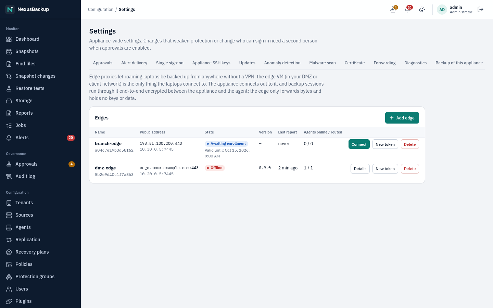
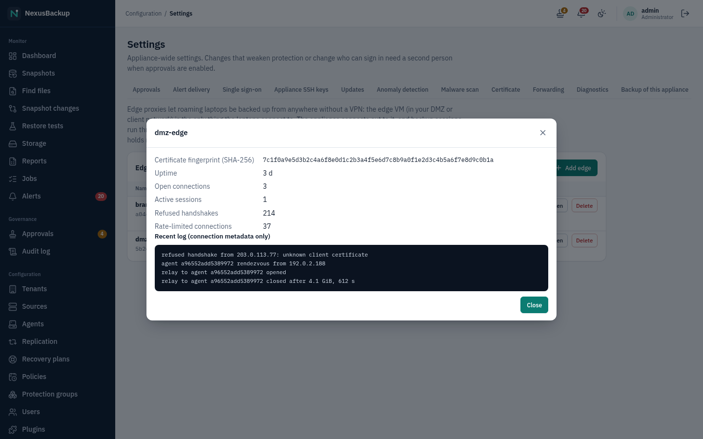

# 18. Edge proxy for roaming laptops

This chapter is for administrators who want laptops backed up while they are away from the office, without a VPN and
without opening any connection into the appliance. The agents themselves are installed as described in
[16 Linux agent](16-linux-agent.md) and [17 Windows agent](17-windows-agent.md); laptop policies (battery, metered
networks, missed runs) are in [04 Sources](04-sources.md).

> **Status:** the edge proxy is implemented and tested in-process (a real agent and the real appliance side through a
> real edge: pairing, backups, "back up now", rate limits, refused certificates, and a check that the edge only ever
> sees encrypted TLS records). The edge VM image has **not yet been run in the VM lab**, and it is not built by the
> release pipeline yet: build it with `os/edge/build.sh` (see "Install the edge VM"). Updates of the edge's operating
> system are a reinstall or `bootc switch` for now.

## How it works

- The **edge proxy** (`nexus-edge`) is a small, separate virtual machine that you run in a DMZ or another network that
  laptops can reach from the internet. It is the only internet-facing part.
- Laptops connect **out** to the edge with their agent certificate and keep that connection open. The appliance
  connects **out** to the edge as well. When the appliance wants to back up a laptop, the edge pairs the two
  connections and passes the bytes through.
- The backup session inside is the same encrypted session as on the office network: the appliance and the agent
  check each other's certificates end to end. **The edge cannot read or change backup data**; it holds no keys of the
  appliance or the agents.
- The appliance always tries a laptop **directly first** and uses the edge only when the laptop is not reachable
  directly. The agent list shows which route the last session took (**via edge**).
- **Back up now** on the laptop (tray icon, control panel, `nexus-agent tui`) reaches the appliance through the edge
  at once: the backup starts within seconds, wherever the laptop is.

## Requirements

| | |
|---|---|
| Edge VM | 1 vCPU, 1 GiB RAM, 8 GiB disk, x86-64, UEFI or BIOS; any hypervisor |
| Network | a public (or laptop-reachable) address with **443/tcp** forwarded to the edge; the appliance must reach the edge on **7445/tcp** |
| Agents | version with protocol 1.7 (capability `edge`); older agents can be configured by hand in `agent.conf` |
| Laptops | enrolled once on the office network or VPN (enrollment never runs through the edge) |

Only 443 and 7445 are open on the edge. It has no web interface, no SSH and no login prompt.

## 1. Add the edge on the appliance

**Settings** → **Edges** → **Add edge** (administrators):

- **Name**: for the list, e.g. `dmz-edge`.
- **Control address** and **port** (7445): how the *appliance* reaches the edge, e.g. its DMZ address `192.0.2.40`.
- **Public address** and **port** (443): how *laptops* reach the edge from the internet, e.g. `edge.example.com`.

The appliance shows a **one-time token** (valid 24 hours) and the command for the edge console. Copy it now; it is
not shown again (**New token** creates another one). The appliance's firewall opens the way to the control address
automatically.



## 2. Install the edge VM

Build the image and a disk or installer ISO on a build host with podman (from a checkout of the release):

```sh
os/edge/build.sh --qcow2      # target/edge/qcow2/disk.qcow2
os/edge/build.sh --iso        # target/edge/bootiso/install.iso
```

Boot the VM. Its console shows a menu:

1. **Network** opens `nmtui`: set the address, gateway and DNS (DHCP works too).
2. **Enrollment token**: paste the token from step 1. The edge prints its **certificate fingerprint**.
3. **Restrict the control port** (optional, recommended): the appliance's address as the edge sees it; then only that
   address can reach port 7445.

Forward 443/tcp from your public address to the edge, and allow 7445/tcp from the appliance to the edge.

## 3. Connect

Back on the appliance, click **Connect** next to the edge. The appliance and the edge prove to each other that they
know the token, bound to this very connection, and from then on recognise each other by certificate. Compare the
**fingerprint** in the edge's details with the one on the edge console. The edge turns **online** within a minute and
shows its version, uptime and the laptops connected to it.



## 4. Assign laptops

**Agents** → the laptop's **Endpoint settings** → **Reach via edge** → choose the edge → **Save**. At the laptop's next
contact on the office network (or VPN) the appliance tells the agent which edge to use and its fingerprint; from then
on the laptop keeps a connection to the edge wherever it is. The edge's details list it under **agents online**.

Without that office contact, or for older agents, set it by hand in `agent.conf` and restart the agent:

```ini
edge = edge.example.com:443
edge_sha256 = <fingerprint from Settings → Edges>
```

## Daily operation

- Scheduled backups and restores of an assigned laptop run directly when possible, otherwise through the edge. A
  laptop that is offline altogether is handled by the laptop policy (missed runs are caught up when it is back).
- **Back up now** on the laptop starts a backup within seconds through the edge.
- The **Edges** page shows per edge: online/offline, last contact, version, laptops connected, connections, refused
  handshakes and rate-limited connections, and the latest log lines (connection metadata only — which laptop
  connected from which address and how much was transferred; never file names or data).

## Updates

The appliance updates the edge program itself: when the appliance carries a newer signed `nexus-edge`, the control
link sends it, the edge checks the signature against the release keys built into its image and restarts into the new
version. Nothing is installed that is not signed with the release key. The edge's operating system is updated by
installing a newer edge image (or `bootc switch` in a maintenance window), then entering a new token.

## Security

- The edge is exposed to the internet, but **every connection must present a valid certificate first**: laptops their
  agent certificate (only agents assigned to this edge are accepted), the appliance its own certificate. Anything else
  fails before a single message is read. Connections are rate-limited per address and per laptop.
- **If the edge is compromised**, an attacker can stop laptops from being backed up through it and see connection
  metadata (which laptop was online from which address, when, and how much was transferred). They cannot read or
  change backup data, cannot pose as the appliance to a laptop or as a laptop to the appliance, and have no way into
  the appliance: the appliance only connects out to the edge. Details: `docs/edge.md`, threat model T53–T55.
- A stolen laptop: remove the agent (or its edge assignment) on the appliance; the edge refuses its certificate from
  the next configuration push on.

## Removing an edge

**Settings** → **Edges** → **Delete**. Laptops assigned to it fall back to direct connections (and are told at their
next direct contact). Shut the VM down and delete it; it holds no backup data.

## Troubleshooting

| Symptom | Check |
|---|---|
| Edge stays **offline** after **Connect** | appliance → edge 7445 reachable? the control-port restriction on the edge console includes the appliance's address as the edge sees it (NAT)? the job log of **Connect** |
| **Connect** fails with a proof error | the token on the edge console is not the latest one: **New token**, enter it again on the console |
| Laptop never appears under **agents online** | it had no direct contact since the assignment (set `edge` in `agent.conf`), 443 not forwarded, or the laptop's network blocks outgoing 443; `nexus-agent status` on the laptop shows the edge state |
| Backups via the edge are slow | the edge's upload/download bandwidth and the laptop's connection limit throughput; bandwidth limits per agent apply as usual |
