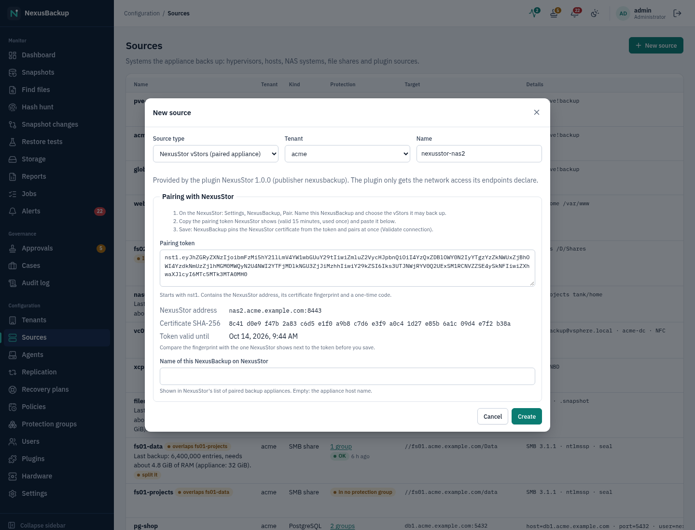

# 19 NexusStor

NexusStor is the NAS appliance of the NexusBackup family. It serves **vStors**: isolated storage servers, each with
its own encrypted ZFS datasets, NFS exports, SMB shares, S3 buckets and iSCSI LUNs. NexusBackup backs up the vStors
of a NexusStor through the plugin **NexusStor** (source kind **NexusStor vStors (paired appliance)**,
`plugin:nexusstor`). The two appliances are **paired**: there is no SSH and no API key to copy. NexusBackup only gets
the backup protocol; it cannot use the NexusStor web interface or its REST API.

> **Status:** Backups (full and incremental) pass their integration tests against a simulated NexusStor, also as
> the plugin binary in the real sandbox, and ran in the lab against a NexusStor appliance (2026-11-01). NexusStor's
> change-rate finding reaches NexusBackup (see below). Restores into a NexusStor (files into an export, a LUN, a whole
> vStor), the backup status on the NexusStor side and NexusBackup's findings sent to NexusStor come in a later
> version; until then, restore by download (see below).

## How it works

- NexusBackup connects to the NexusStor's **management address on TCP 8443** (TLS 1.3). It accepts only the
  NexusStor certificate whose SHA-256 fingerprint the pairing token named, and it presents a client certificate
  that the appliance generated for this pairing. NexusStor accepts only paired certificates.
- Each **vStor is a guest** of the source. A protection group selects vStors like a group selects VMs.
- One backup run of a vStor creates one NexusBackup snapshot (`plugin-nexusstor-<source id>-<vStor>`). NexusStor
  takes a recursive ZFS snapshot `nexusbackup-<time>` of the vStor and puts a hold on it, so its own retention
  cannot remove it while NexusBackup reads it or needs it as the next run's base. All data is read from that
  snapshot, never from the live file systems.

## Pairing

1. On the NexusStor (as an admin): **Settings → NexusBackup → Pair**. Enter a name for this NexusBackup and choose
   the vStors it may back up (some or all). With approvals turned on there, a second person approves the pairing.
   NexusStor shows a **pairing token** (`nst1.…`), valid for 15 minutes and usable once, and the fingerprint of its
   certificate.
2. On NexusBackup: **Sources → New source**, **Source type** **NexusStor vStors (paired appliance)** (under
   **Plugins**; the plugin must be installed and enabled, see [12 Plugins](12-plugins.md)). Choose the tenant and a
   name, and paste the token into **Pairing token**. The form shows the NexusStor address, the certificate
   fingerprint and how long the token is valid: compare the fingerprint with the one NexusStor shows.
3. Optional: **Name of this NexusBackup on NexusStor** (default: the appliance's host name).
4. **Create**. The appliance stores the address, port and fingerprint from the token, generates the pairing's client
   certificate (the key is sealed like every source secret) and opens the outgoing firewall for the address. It
   then runs **Validate connection**, which pairs: it sends the token's one-time code and the client certificate
   to NexusStor, which pins the certificate. The job log shows `paired with NexusStor "<name>"` and the number of
   vStors in the pairing's scope.

If the validation reports **token**, the token has expired, was already used or was typed wrong: create a new one
on NexusStor, open the source with **Edit**, paste it into **New pairing token** and save. Pairing again after the
pairing was revoked on NexusStor, or after NexusStor's certificate was replaced, works the same way. If the
validation reports **fingerprint**, the system at that address presented another certificate than the token named:
do not continue, check that the address really is the NexusStor.

**Unpairing.** Revoking the pairing on NexusStor stops all backups at once (they fail with "not paired"). Deleting
the source on NexusBackup forgets the pairing on this side; revoke it on NexusStor as well. The existing snapshots
stay restorable until retention removes them.

## What is backed up

| In the snapshot | Content |
|---|---|
| file tree | one folder per file system dataset of the vStor, named as on NexusStor (`data`, `data/projects`, `s3`, …): every NFS export, SMB share and the S3 buckets are folders in it. Owner, mode, modification time, symbolic links, extended attributes (for SMB, for example `user.DOSATTRIB` and `security.NTACL`) and the NFSv4 ACL (stored as the extended attribute `system.nfs4_acl`) |
| stream `luns/<name>` | each iSCSI LUN as a raw disk image, read in full |
| stream `vstor.json` | the vStor's definition as NexusStor keeps it (network, exports, shares, buckets, LUNs), without secrets |

The appliance also keeps the vStor's protocols, quota and datasets with each snapshot in its catalog. Data is decrypted from the vStor's key on
NexusStor and sealed again under the NexusBackup tenant's keys; it travels only inside the pinned TLS connection over
the management network.

Not included: S3 access keys, SMB passwords and iSCSI CHAP secrets (they are not part of the definition NexusStor
sends). Hard links are stored as separate files (deduplication keeps the data once). File names that are not valid
UTF-8 cannot be transferred by the protocol: such files are skipped and listed as warnings of the job.

## Incremental backups

- The **first** backup of a vStor reads everything.
- Every later run asks NexusStor for the changes since the previous run's ZFS snapshot (`zfs diff`). Files that did
  not change are taken over from the previous NexusBackup snapshot without being transferred. Changed, new and
  renamed files are read again; a renamed folder is read again as a whole. A dataset created since the previous
  run is read in full.
- If the previous ZFS snapshot is gone on NexusStor, or a dataset was removed, the run reads everything again.
- **LUNs are read in full on every run.** The chunk store keeps only blocks it does not have yet, so the storage
  grows by the changed data only, but the transfer is the whole LUN.
- NexusStor keeps at most two `nexusbackup-*` snapshots of a vStor for this source: the one the last committed backup
  was read from (the next run's base) and, until the next run, the one before it. The next run releases the older
  one. A run that fails releases the snapshot it created. Other `nexusbackup-*` snapshots of the vStor (for example
  of another paired NexusBackup, or left by a run the appliance could not commit) are never deleted; the job log
  lists them, delete them on NexusStor if nothing uses them.

## Backup state on NexusStor

After each backup of a vStor, NexusBackup reports the result to NexusStor (plugin 1.1.0 or newer, NexusStor with
the report endpoint): ok, warning (committed, but not consistent or with skipped files) or failed, with the snapshot
and a short summary. NexusStor shows the newest report on the vStor page (**Last backup by NexusBackup**) and raises
`backup_overdue` when a vStor gets no successful report for 26 hours. A report that does not arrive (an older
NexusStor, the appliance unreachable) is a warning line in the job log; the backup itself is not affected.

## Ransomware signal from NexusStor

NexusStor watches how much each scheduled snapshot of a vStor wrote; a run far above the usual (a typical sign of
ransomware encrypting files) is a **change-rate finding**, and NexusStor locks its last good snapshot. A backup that
sees an open finding for the vStor:

- flags its snapshot (**Snapshots**: anomaly badge; it holds the data after the jump),
- raises the critical alert **anomaly** with the newest clean NexusBackup snapshot from no later than NexusStor's last
  good snapshot: hold that one (**Alerts → Hold last good snapshot**) and restore from it,
- notes it in the job log.

Later backups are flagged too while NexusStor's finding is open; clear it on NexusStor once the cause is resolved.

## Limits

| Limit | Value |
|---|---|
| paths per request / LUN bytes per request | 1000 / 64 MiB (the protocol's limits) |
| entries per vStor snapshot | 20 million |
| extended attributes and ACL of one entry | 64 KiB together; larger ones are left out with a warning |
| answer sizes | JSON answers 16 MiB, one file record 1 MiB, `zfs diff` output 1 GiB |

NexusBackup treats everything NexusStor sends as untrusted: names, paths and sizes are checked, a path outside the
vStor or an oversized record fails the run, and the plugin runs in the plugin sandbox with network access to the
NexusStor's address only.

## Restores

Until the NexusStor restores are available, restore by **download** (tar or zip) from the snapshot, like other
file backups: the folders `data/…` and `s3/…`, the LUN images under `.nexus-streams/luns/` and `vstor.json` under
`.nexus-streams/` ([06 Restores](06-restores.md)).
